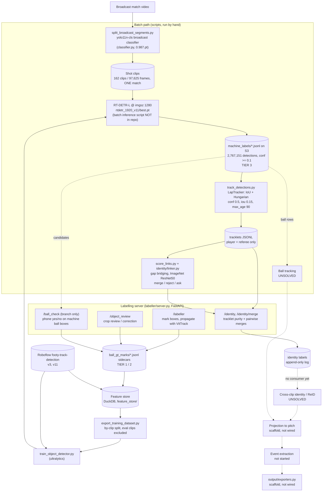

# Current architecture: what is wired, what works, what is unsolved

**Snapshot:** `origin/main` @ `658d63d` (2026-09-01), plus unmerged branches
`feat/ball-check-mobile` (`5d4fc90`) and `fix/train-workers-cache` (`a9baacb`).
**Written:** 2026-10-25, from reading the code. Where a doc and the code disagree,
this page follows the code.

**Rules for this page.** Every performance number has a source next to it: a file
path, a results file, a commit, or a knowledge-base page (written `KB:<page>`, from
George's `~/knowledge/wiki/`, which is not in this repo). A number with no artifact
behind it is marked **unverified**. A number from a superseded setup is marked
**superseded**. Stages with no working method are marked **UNSOLVED**.

A lot of code here is scaffolding that nothing calls. "Wired" means a script or
server path actually reaches it.

---

## 1. Pipeline

Solid arrows are paths that run today. Dotted arrows are designed but not wired, or
not working.

Two facts shape everything below:

* **The corpus is one match.** All 162 clips in `machine_labels/` are
  `arsenal_mancity_20250925` (`docs/design/player_reid.md` §0, M7). No number on
  this page has been shown to generalise across matches.
* **The live pipeline is a set of scripts run by hand.** There is no orchestrator.
  `metaflow/docker/Dockerfile` and the `metaflow` dependency group exist, but no flow
  is defined.

---

## 2. Per-stage status

| Stage | Wired / best component | Numbers (source) | Alternatives that lost or are untested |
|---|---|---|---|
| **Broadcast-frame filtering / shot segmentation** | `scripts/split_broadcast_segments.py` → `classifier.get_current_best_guess_classifier()` → yolo11n-cls `model_saves/classifier/20251226-yolo11n-cls/0.987.pt` | The "0.987" accuracy exists only in the filename (**unverified**; `notes.txt` says it was trained on dataset v6). Output quality: **0 interior camera cuts** in 3,175 frames over 5 clips (`player_reid.md` M1). | W&B run `aakevy06` (top1 0.981, v10 binary, `docs/training/notable_runs.md`). Its checkpoint dir `20260125-yolo11n-cls/` holds only a `.gitignore`, so it is not the one in use. The April Roboflow v10 reproductions reached 0.413 to 0.433 because of a train/val class mismatch (`notable_runs.md`, `docs/training.md`). `split_video.py` makes fixed-length chunks and is superseded. |
| **Object detection** (player / referee / `in_play_ball`) | RT-DETR-L at `imgsz=1280`, `CURRENT_BEST_DETECTOR_CHECKPOINT = model_saves/detector/rtdetr_1920_v11/best.pt` (`detectors/ultralytics.py:36`; the weights are not in git) | **Ball:** mAP50 **.221** / recall **.209** on v11-val, 211 ball instances (code comment `detectors/ultralytics.py:37`; KB:footy-ball-detection-findings). **Disputed:** a handoff doc outside the repo gives .665 / .591 for the same weights. Neither figure has been re-measured (KB:footy-ball-detection-findings, "UNRESOLVED"). **Players:** median conf 0.919, 74.3% ≥ 0.5 on seg002 (`player_reid.md` M8). No player mAP for RT-DETR is recorded (**unverified**). **Throughput:** ~19.8 fps on an RTX 3060, `half=True, batch=8`; 97,625 frames → 2,767,151 detections in 82 min (KB:footy-labeller-gotchas). | yolo11s v3 @ 640 (`optuna_trial_1_…/best.pt`, still in git): ball recall **0.000** at 640 (code comment, bead ft-90o). yolo11n @ 1280, 3 epochs: ball mAP50 0.202, player 0.974 (KB:footy-ball-detection-findings, 2026-08-31). The v3-trained model scores 0.250 / 0.209 on v11-val against v11-trained 0.221 / 0.209, so 5.7× more ball labels bought nothing (same KB page). RT-DETR-L after 9 epochs: 0.314 / 0.283 (same KB page; which checkpoint that was is **unverified**). The SAM3 text-prompt detector (`UltralyticsSam3Detector`, used by `scripts/detect_objects.py`) has no metric (**unverified**). yolo11s/m/l at 1280, which would separate model size from architecture, are **untested**. |
| **Ball tracking** (temporal) | **UNSOLVED.** Nothing is wired into the batch path. The only temporal ball component in use is VitTrack propagation inside the labeller (`labeller/video_utils.py`, `BackgroundLabeller` → `VitTrackVideoLabeller`). | VitTrack seeded from GT on `arsenal_example` stays on the ball for **9/176 frames (5%)**. Its confidence is a **constant 0.119**, the same on-ball and drifted (KB:footy-labeller-gotchas, measured 2026-08-29; also `pipeline_overview.md`). | Bake-off (`docs/bakeoff_results.json`, 2026-06-21): ROI-YOLO recall 1.4%, VitTrack 0%. **Invalid / superseded**: both ran on the 640px yolo11s checkpoint, which is blind to the ball, and VitTrack's `mean_fps` of 1,829,132 shows it never really ran. `MotionGuidedTracker` (`labeller/motion_tracker.py`): Kalman plus crop runner, not wired, no metric. SAM3 propagation (`Sam3VideoLabeller`): dead code. LapTracker on the ball made 82 track IDs over 90 tracked frames (`docs/ball_tracker_failure_analysis.md`, old detector, **superseded**). ByteTrack's low-confidence second pass and temporal heatmap models (TrackNet, YOLOFT) are **untested**, research only (KB:footy-ball-detection-findings; `docs/design/bidirectional_tracking_research.md`). |
| **Player tracking within a clip** | `scripts/track_detections.py` → `trackers/lap.py::LapTracker` (IoU + `lap.lapjv`), defaults conf 0.5, iou 0.15, max_age 90, on precomputed RT-DETR detections, CPU only | seg000 (38k detections, 2,534 frames): **157 tracklets, median length 31, 9% singletons**, against 397 / 5 / 22% with the library defaults (`track_detections.py` docstring). Association failure: **4.5% of 1,604,326** consecutive-frame pairs across 162 clips (`identity/linker.py` docstring). Speed ~650 fps on a laptop CPU (`track_detections.py`; `pipeline_overview.md` says ~540). **Purity: unmeasured.** No ID-switch rate, HOTA or IDF1 exists. | `UltralyticsTracker` (ByteTrack / BoT-SORT, `trackers/ultralytics.py`, `scripts/track_objects.py`) has never been run against GT (**unverified**; `player_reid.md` §1). It also re-runs detection rather than reusing `machine_labels`. |
| **Tracklet gap bridging** | `identity/linker.py` (temporal, spatial and team gates) + `scripts/score_links.py` (ImageNet ResNet50 cosine on crops next to the gap). Thresholds: merge ≥ 0.80, reject < 0.55, ask in between. max gap 12 frames. | Embedding AUC against guaranteed negatives, by gap: **0.912 @ 4 frames, 0.867 @ 12, 0.761 @ 25, 0.634 @ 200** (`identity/linker.py` docstring; the measurement script and data are not in the repo). The 0.55 / 0.80 thresholds have not been calibrated against human verdicts (**unverified**). | ReID-trained backbone: **untested** ("one-line swap", `score_links.py`). **Caveat:** the team gate is inert. `tracklets_from_rows()` never sets `Tracklet.team`, so `respect_team=True` filters nothing. |
| **Team assignment** | **Not implemented in code.** | k=2 on torso HSV: **1.0% ambiguous**, n=1,253 crops, *one clip* (seg002) (`player_reid.md` M6). This was a one-off measurement; no module computes `team_id`. | None. |
| **Cross-clip identity / ReID** | **UNSOLVED.** Only the human side exists: `/identity` review and merge pages (`labeller/identity_routes.py`), union-find with contradiction reporting (`identity/clusters.py`), and an append-only label store (`identity/store.py`). | ImageNet backbones give AUC 0.43 to 0.49 (chance) on cross-clip pairs (`pipeline_overview.md` only; no script or results, **unverified**). Jersey OCR is ruled out: median player box 52×111 px, so digits are about 10 to 18 px (`player_reid.md` M3). `pipeline_overview.md` says ~40% of tracklets have a frame ≥ 110 px and a human read a number at 102 px (**unverified**, no artifact). | ReID-trained embeddings (OSNet, SoccerNet-ReID): **untested**. A Gemini Flash purity pre-filter showed 70% agreement with collapsed confidence (`pipeline_overview.md` only; no code in the repo, **unverified**). |
| **Pitch projection / calibration** | **UNSOLVED.** `projection/projector.py::PitchProjector` applies a given homography, but no calibration stage produces one, and nothing calls it. | None. | None. |
| **Event extraction** | **Not started.** No code. | None. | None. |
| **Output** | `output/exporters.py::MatchExporter` (parquet to FiftyOne / JSON / CSV) is a scaffold; nothing calls it. | None. | None. |

---

## 3. Labellers, feature store, training, GPU

### Labellers

One FastAPI app, `src/footy_track/labeller/server.py`, started with
`uv run uvicorn footy_track.labeller.server:app` or
`python -m footy_track.labeller [--debug]`. Its canonical spec is
`src/footy_track/labeller/README.md` (requirements LAB-nnn, linked to tests).

| Page | What it does | State |
|---|---|---|
| `/labeller` | Hand-mark boxes, then propagate them with **VitTrack** (one SOT per object) over a WebSocket run | Works mechanically. For the ball, Run halts at frame 1 because the ball's confidence sits at 0.119 against a 0.30 threshold. This is the *safe* behaviour, because lowering the threshold would write off-ball boxes into GT (KB:footy-labeller-gotchas). |
| `/object_review` | Grid and modal crop review, edit, re-run the detector | Works. Uses `get_current_best_detector`. |
| `/ingest` | Clip ingestion | Broken (OPEN-1 in the labeller README). |
| `/identity`, `/identity/merge` | Tracklet purity review, jersey grounding, pairwise merges | Works (commits `ceafa7a`..`8c78711`). No labels have been reported back as a metric yet. |
| `/ball_check` | **Branch `feat/ball-check-mobile` only.** Phone-sized yes/no and drag-to-correct on RT-DETR ball candidates (356,812 candidates over 162 clips), confidence-stratified and self-steering (75% near the boundary, 25% uniform), with event dedupe (77,560 → 28,221 events on 40 clips) | Ten commits, about 3.6k lines with tests, not merged. Verdicts append to `<gt>/ball_checks/<clip>.jsonl`. It also fixes a real ingest bug: the `human_checked` tag was being read as the object class, which would have dropped 831 ball boxes (`ingest_gt.py` diff on the branch, commit messages). |

**Provenance** (labeller README §1; `identity/labels.py`): `labeller` is TIER 1
(human), `vittrack` + `human_checked` is TIER 2, and anything machine-only is TIER 3.
**Gotcha:** `review._parse_jsonl_box` reports `vittrack` boxes as provenance
`labeller` (OPEN-3, pinned by tests), so filter on tags, not on that field
(KB:footy-labeller-gotchas).

**Dead labeller code:** `labeller/app.py` (the old Streamlit "SAM3 Video Labeller",
reached only from `scripts/run_labeller.py`), `Sam3VideoLabeller` in `video_utils.py`,
and `_default_model_uri()`, which looks for SAM3 weights in iCloud paths.
`BackgroundLabeller.submit()` ignores its `model_uri` and `imgsz` arguments.

### Feature store (`src/footy_track/feature_store/`)

DuckDB over Parquet. Tables `game`, `frame`, `detection`, `track_meta` and `run`;
views `frame_features`, `detections_enriched` and `tracks_enriched`. The detection key
is `(game_id, source, run_id, frame_index, detection_id)`. The `canonical` flag
arbitrates per run-batch, not per row (`schema.py` docstring, fix `d5d27e2`).
Importers cover Roboflow YOLO datasets (`hand_label`), labeller/SAM3 JSON, and GT
sidecars (`ingest_gt.py`). `export_training_dataset.py` writes a by-clip
train/val[/test] split that excludes every eval clip; the split is tested in
`tests/feature_store/test_roundtrip_fidelity.py` and
`test_export_training_dataset.py`.

Gaps:

* **The 2.77M RT-DETR detections are not ingested.** They live as JSONL on S3, and as
  of 2026-09-24 no `feature_store.duckdb` existed on the Mac mini
  (KB:footy-labeller-gotchas).
* **`detection_id` is positional.** `importers.py` uses the row ordinal. The
  content-hash fix in `identity/stable_id.py` exists, but nothing calls it.
* **`difficulty.py`** (flagging rows for review) is not called by any script.

### Training

* `scripts/train_object_detector.py` uses the ultralytics `YOLO(...)` class and pulls
  Roboflow `footy-track-detection` or a `--local-dataset`. **Defaults are traps:**
  `--imgsz 640` (blind to the ball) and `--device mps`. Always pass `--imgsz 1280`.
  It includes an MPS assigner workaround (`209f1bb`).
* **The RT-DETR-L training command and the batch-inference script that produced
  `machine_labels/` are not in any branch.** The production checkpoint cannot be
  reproduced from the repo.
* Branch `fix/train-workers-cache` (`a9baacb`, one file): adds `--workers` (default 8)
  and `--cache {ram,disk,none}`, both behaviour-preserving. Measured on an RTX 2070:
  workers 8 → 58.5 s, workers 12 → 57.6 s for 3 epochs at 640px, so the loader is not
  the bottleneck (commit message). It is based on `8c78711` but conflicts with nothing
  on main. Safe to merge.
* `scripts/optuna_sweep_object_detector.py` and `scripts/train_classifier.py` are
  older but still functional (**unverified**: not run for this page).
* The DVC remote (`.dvc/config`) points at `/Users/georgebarnett/code/dvc-remote`, a
  macOS path that does not exist on Linux (KB:footy-data-plane-reconciliation).

### Vast.ai GPU scripts

KB:vast-ai-gpu-rental describes `scripts/vast/{up,sync,down,provision,fix_dataset_paths}.sh`
"in the footy-track repo". **They are not in `main` or in any remote branch** (checked
every `origin/*` tree on 2026-10-25). They exist, if anywhere, only in a local clone.
The recorded baseline from that page is: yolo11n, `imgsz=1280`, 1× RTX A4000 at about
12 s/epoch with 2.0 of 16 GB used, which is about $0.02 for 50 epochs (not reproducible
from this repo). Key design rules from the same page: install into the image's
`/venv/main`, never a fresh venv; rsync the exact Roboflow v11 split rather than
re-downloading it; and rewrite the absolute `path:` in `data.yaml` after every push.

---

## 4. Stale docs and unused code to ignore

**Docs that describe a pipeline that does not exist, or is superseded.** Trust this
page, `docs/design/pipeline_overview.md`, `docs/design/player_reid.md` and
`src/footy_track/labeller/README.md` over them.

| Doc | Why it is stale |
|---|---|
| `README.md` "Pipeline" section, `docs/pipeline_architecture.md`, `docs/index.md`, `docs/agent_guidelines.md` | 2025 InputConsumer → Processor → OutputProducer model. None of those classes exist. |
| `docs/system_overview.md`, `docs/approach.md`, `docs/interfaces.md`, `docs/problem.md`, `docs/doc_review.md` | April 2026, before RT-DETR, 1280px, the labeller and identity work. `doc_review.md` audits only those April docs. |
| `docs/system_design.md`, `docs/pipelines.md` | June 2026 "living" design, with OCR, calibration and event stages that have no code. Useful as intent, not as status. |
| `docs/training.md` | 5-epoch and 50-epoch baselines at 640px, and classifier regressions. Superseded by the resolution findings. |
| `docs/ball_tracker_failure_analysis.md`, `docs/bakeoff_results.json` | Run with the 640px yolo11s checkpoint, which is blind to the ball. The bake-off VitTrack row is empty (fps 1.8M). |
| `docs/design/sam3_ball_labelling_gpu.md`, `docs/labeller_web_app_design.md`, `docs/labeller_timeline_design.md`, `docs/design/labeller_review_2026-06.md`, `docs/design/autolabelling_architecture_review.md` | SAM3-era labeller design. SAM3 was replaced by VitTrack (`f38ca2b`) and the motion-guided loop was never wired. `labeller_requirements.md` already redirects to the labeller README. |
| `docs/design/tracking.md`, `docs/design/player_tracking_format.md` | April drafts. Partly implemented in `trackers/`, but `player_reid.md` replaces their reasoning. |
| `docs/design/projection.md`, `docs/design/output.md`, `docs/design/input_live_stream.md` | Specs for scaffolds that nothing calls. |
| `docs/development.md`, `src/footy_track/scripts/README.md` | Cover only `split_video` and `extract_frames`, with `uvx`/macOS instructions. |
| `mkdocs.yml` nav | Publishes only the stale April docs listed above. |

**Code that nothing in the live path reaches:**

* `labeller/app.py`, `scripts/run_labeller.py`, and `Sam3VideoLabeller` /
  `_default_model_uri` in `labeller/video_utils.py` (old Streamlit / SAM3 path)
* `labeller/motion_tracker.py::MotionGuidedTracker` (only its `Box`/`Detection` types are imported)
* `ball_trackers/roi_yolo.py` and `scripts/run_bakeoff.py` (hardcoded macOS paths, 640px checkpoint)
* `projection/`, `output/`, `input/streams.py` (live stream backend unimplemented), and `metaflow/`
* `labelling.py` (Roboflow / SAM3 upload handler, used by notebooks and tests only), `scripts/upload_*_frames.py`, `scripts/create_roboflow_v11.py` (one-off)
* `feature_store/difficulty.py`, `identity/stable_id.py` (correct, but unused)
* `classifier.RandomClassifier`: `get_current_best_guess_classifier()` **silently falls back to random labels** if the checkpoint fails to load (for example a git-lfs pointer file). It is also evaluated at import time (`CURRENT_BEST_GUESS_CLASSIFIER_CLASS`), and `_model_infer` hardcodes `device="mps"`, so the segmenter is likely to fail or misbehave off a Mac (**unverified** at runtime).
* `.playwright-mcp/` logs, and about 70 stale `origin/polecat/*` and `origin/georgeb/*` branches
* Hardcoded macOS / iCloud paths remain in `scripts/run_bakeoff.py` and `video_utils._default_model_uri`. `eval_data/clips/*.mp4` are absolute symlinks to `/mnt/storage/footy_data`.

---

## 5. Open questions, ranked

1. **Is per-player identity actually needed downstream, or is team + role enough?**
   This is cheap to answer and can delete the most expensive unsolved workstream
   (`pipeline_overview.md` makes the same point).
2. **What is the true ball detector number?** Re-measure `rtdetr_1920_v11/best.pt` at
   `imgsz=1280` on a named, leak-free split with the `in_play_ball` instance count:
   .221 or .665? Every ball decision depends on it. Also check `astonvilla_seg080` and
   `bournemouth_1st_seg070`, which are in the training set (KB:footy-ball-detection-findings).
3. **What replaces VitTrack for the ball?** The candidates are a ByteTrack-style
   low-confidence second pass over the existing conf ≥ 0.1 detections (inference only,
   no retrain), or a temporal multi-frame detector. Ball Check verdicts give the
   per-confidence-band precision needed to choose the threshold. Merge
   `feat/ball-check-mobile` first.
4. **Is it model capacity or architecture?** Train yolo11s/m/l at 1280 against
   RT-DETR-L on the same split. On Vast this is cheap (KB:vast-ai-gpu-rental).
5. **What is LapTracker's real tracklet purity and ID-switch rate?** Only fragmentation
   has been measured. The `/identity` review pages exist to measure purity, but no
   result is recorded. Purity gates whether tracklets can be trusted as identity
   training data.
6. **Does a ReID-trained embedding separate same-team players across gaps longer than
   0.5 s?** ImageNet AUC falls to 0.76 at 1 s and 0.63 at 8 s (`identity/linker.py`).
   Also wire in team assignment, so the linker's team gate does something.
7. **Can any of this be reproduced from the repo?** The RT-DETR training command, the
   batch-inference script, the Vast scripts and the production checkpoint are all
   outside git, and the DVC remote is a macOS path. Every result above currently
   rests on one person's machines.
8. **Generalisation:** every corpus-level number comes from one match
   (Arsenal v Man City).
