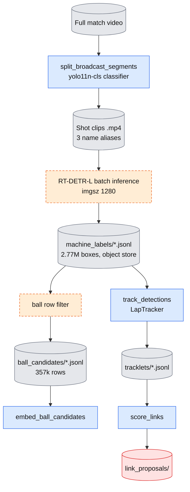
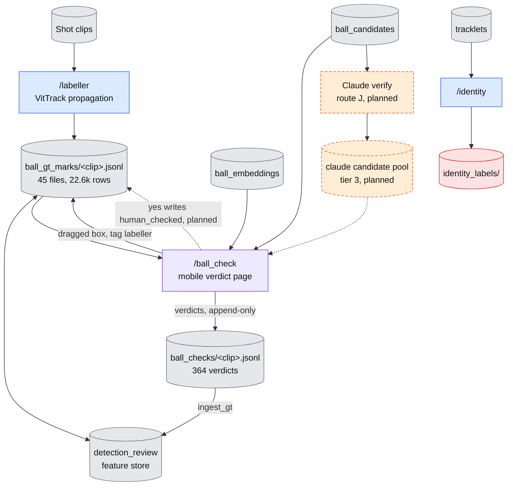
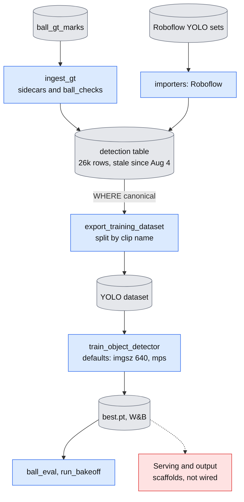
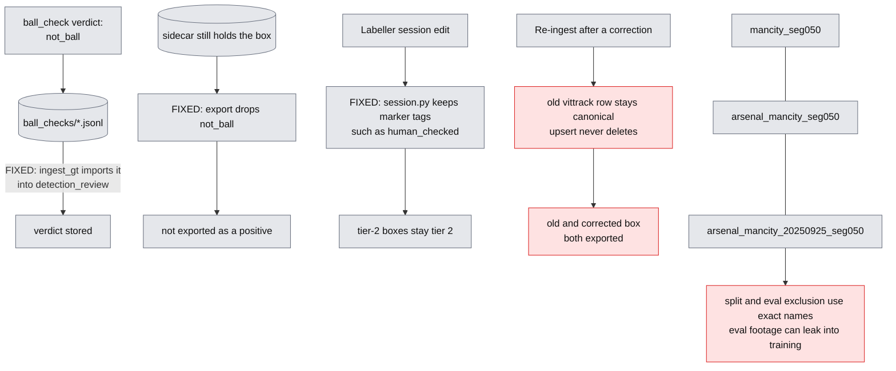
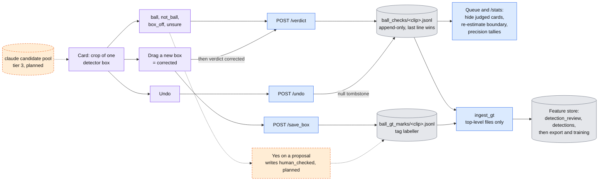

# Architecture

_Reviewed against `main` @ 26d2506, 2026-11-08. Where a doc and the code disagree, this page follows the code. Open work is in the [TODO list](todo.md); measured numbers are in [Best pipeline and label needs](pipeline-and-labels.md); datasets are in [Datasets and labels](data.md)._

Every number has a source next to it (a file, a results file, a commit, or a knowledge-base page written `KB:<page>`; the knowledge base is the author's private notes and is not in this repo). A number with no artifact behind it is **unverified**; one from a superseded setup is **superseded**. Stages with no working method are **UNSOLVED**. "Wired" means a script or server path actually reaches the code.

## 1. Overview

footy-track turns broadcast football video into ball and player data. Today it is a set of scripts run by hand plus one FastAPI labelling server. There is no orchestrator (`metaflow/docker/Dockerfile` exists, no flow is defined).

1. A classifier cuts the match into broadcast-only shot clips.
2. RT-DETR-L runs on every frame and writes **machine labels** (tier 3).
3. Humans label and review in the labeller, writing GT sidecars (tier 1 and 2).
4. GT sidecars and Roboflow sets go into a DuckDB **feature store**, which exports a by-clip YOLO dataset for training.
5. Serving, projection to the pitch, event extraction and output are scaffolds that nothing calls.

**Planned, not built:** route J, a Claude-assisted ball labelling loop. Claude checks zoomed detector and tracker candidates, a person confirms only the doubtful ones in `/ball_check`, and the answers feed the same store and eval. The proposal is in [Claude-assisted ball labelling loop](design/claude_autolabel_loop.md); route J in [Best pipeline](pipeline-and-labels.md#4-how-labels-are-created-today).

Two facts shape everything below:

- **The machine-labelled corpus is one match.** All 162 clips in `machine_labels/` are `arsenal_mancity_20250925` (`docs/design/player_reid.md` section 0, M7). No corpus-level number has been shown to generalise across matches.
- **The production inputs are not in git.** The RT-DETR training command, the batch inference script, the machine-labels to ball-candidates filter and the clip-alias symlinks live outside the repo ([T-09](todo.md)).

Provenance tiers: `labeller` is tier 1 (human), `vittrack` plus the `human_checked` tag is tier 2, anything machine-only is tier 3. What each tier means for training, and how a label reaches the trainer, is in [Datasets and labels](data.md#label-tiers-and-provenance-tags).

## 2. End-to-end data flow

The flow is drawn in three parts so each fits on one screen. Legend for all three: grey is data on disk or in the object store, blue is code in git, orange dashed is a step that is not in git, red is an output nothing reads, purple is the `/ball_check` path.

### 2.1 From video to machine labels

The diagram shows a match video cut into clips, run through the detector, and split into ball candidates and player tracklets. The detector run and the ball filter are not in git.

### 2.2 Labelling

The diagram shows the labeller server pages reading clips and candidates and writing GT sidecars. Ball verdicts are read by `ingest_gt` into the store's `detection_review` table (`feature_store/ingest_gt.py:383`); identity labels go to files that nothing reads. The orange dashed boxes are route J (planned): Claude checks candidates, its proposals form a separate tier 3 pool that `/ball_check` shows uncertain-first, and a person's yes writes a `human_checked` box. Proposals never go straight into a sidecar.

### 2.3 From labels to a trained model

The diagram shows GT sidecars and Roboflow sets going into the feature store, then an export, training and evaluation. Serving is not wired.

## 3. Where the pipeline silently goes wrong

The first two chains (S1, S2) are fixed on this branch; the code lines are in section 7. The last two (S3, S4) are marked done in the [TODO list](todo.md) (T-03, T-04) and were not re-checked here. Details are in section 7.

## 4. Per-stage reference

### 4.1 Status by stage

| Stage | Wired component | Numbers (source) | Alternatives that lost or are untested |
|---|---|---|---|
| **Shot segmentation** | `scripts/split_broadcast_segments.py` with `classifier.get_current_best_guess_classifier()` (yolo11n-cls `model_saves/classifier/20251226-yolo11n-cls/0.987.pt`). Also run by the labeller `/ingest/run`. | The "0.987" exists only in the filename (**unverified**). Output quality: 0 interior cuts in 3,175 frames over 5 clips (`player_reid.md` M1). | W&B run `aakevy06` (top1 0.981, `docs/training/notable_runs.md`); its checkpoint dir holds only a `.gitignore`. `split_video.py` makes fixed-length chunks and is superseded. |
| **Object detection** (player, referee, `in_play_ball`) | RT-DETR-L, `CURRENT_BEST_DETECTOR_CHECKPOINT = model_saves/detector/rtdetr_1920_v11/best.pt`, `DEFAULT_IMGSZ = 1280` (`detectors/ultralytics.py:36-43`). Weights are not in git. | **Ball: mAP50 .665, recall .591** on v11-val (211 balls), trained and validated at imgsz 1920 rect (`exp5090_results.json` in the 5090 run backup, not in the repo). Not measured at the served 1280 or on the v11 test split. 74% of v11-val balls are one clip. Players: median conf 0.919 on seg002 (`player_reid.md` M8); no RT-DETR player mAP recorded. Throughput about 19.8 fps on an RTX 3060, 97,625 frames to 2,767,151 detections in 82 min (KB:footy-labeller-gotchas). | yolo11n/m/l at 1280 scored .221/.451/.364 and lost to RT-DETR-L (.668) on the same split; the old ".221" attributed to this checkpoint was yolo11n. yolo11s v3 at 640 has ball recall 0.000 (still in git). The SAM3 text-prompt detector (`UltralyticsSam3Detector`) has no metric. Full table: [Best pipeline](pipeline-and-labels.md). |
| **Ball tracking** | **UNSOLVED.** Nothing is wired into the batch path. Only temporal component: VitTrack propagation in the labeller (`labeller/video_utils.py`). | VitTrack seeded from GT stays on the ball for 9/176 frames (5%) with a constant confidence of 0.119 (KB:footy-labeller-gotchas). | Bake-off (`docs/bakeoff_results.json`) is **invalid**: it ran the 640px checkpoint, blind to the ball, and VitTrack's `mean_fps` of 1,829,132 shows it never ran. `MotionGuidedTracker` is not wired. ByteTrack second pass, Kalman and temporal heatmap models are **untested**. |
| **Claude-assisted ball labels** (route J) | **Planned, nothing built.** Design: [Claude-assisted ball labelling loop](design/claude_autolabel_loop.md). | None. Calibration on the 26 human-marked clips (646 ball frames, 37 no-ball frames, [Ball tracking evaluation](ball-tracking-eval.md)) comes first; no cost, agreement or error rate exists yet (**unverified**). | A person doing every card at about 3.3 s per card (route D, [Best pipeline](pipeline-and-labels.md)). |
| **Player tracking** (within a clip) | `scripts/track_detections.py` with `trackers/lap.py::LapTracker` (IoU and Hungarian, conf 0.5, iou 0.15, max_age 90) over machine labels, CPU. | seg000: 157 tracklets, median 31 frames, 9% singletons (against 397, 5, 22% with defaults). 4.5% of 1,604,326 consecutive-frame associations fail. About 650 fps (`track_detections.py:5`). **Purity, IDF1, HOTA: unmeasured.** | `trackers/ultralytics.py` (ByteTrack, BoT-SORT) re-runs detection and has never been run against GT. |
| **Gap bridging** | `identity/linker.py` plus `scripts/score_links.py` (ImageNet ResNet50 cosine). Merge at 0.80 or more, reject below 0.55, max gap 12 frames. | AUC by gap: 0.912 at 4 frames, 0.867 at 12, 0.761 at 25, 0.634 at 200 (`linker.py` docstring; script and data not in repo). Thresholds uncalibrated. | ReID-trained backbone **untested**. Team gate is inert: `linker.py:125` needs `team`, which no code sets. |
| **Team assignment** | Not implemented. | k=2 on torso HSV, 1.0% ambiguous, n=1,253 crops, one clip (`player_reid.md` M6). One-off measurement; no module sets `team_id`. | None. |
| **Cross-clip identity / ReID** | **UNSOLVED.** Human side only: `/identity` and `/identity/merge` (`labeller/identity_routes.py`), union-find (`identity/clusters.py`), append-only store (`identity/store.py`). | ImageNet backbones give AUC 0.43-0.49, chance, cross-clip (`pipeline_overview.md`, **unverified**). Jersey OCR ruled out: median box 52x111 px (`player_reid.md` M3). | OSNet, SoccerNet-ReID: untested. |
| **Projection, events, output** | `projection/projector.py`, `output/exporters.py`, `input/streams.py` are scaffolds nothing calls. Event extraction is not started. | None. | None. See [T-17](todo.md). |

### 4.2 Entry points and formats

| Stage | Entry points | Inputs | Outputs |
|---|---|---|---|
| Segmentation | `python -m footy_track.scripts.split_broadcast_segments`; labeller `/ingest/upload`, `/ingest/run` (`labeller/ingest.py`) | match video | broadcast-only MP4 runs plus manifest JSON |
| Frame extraction | `python -m footy_track.scripts.extract_frames`, `split_video` | video | JPEG frames `<stem>_%06d` |
| Batch detection | **not in repo** | clips | `machine_labels/<raw_stem>.jsonl` in the object store |
| In-repo detection | `scripts/detect_objects.py` (SAM3 prompts, optional `--store_path`); labeller `/autodetect`, `/review/yolo` | frames | `FrameDetections` (pydantic, `schema.py`). Only the SAM3 script writes to the store. |
| Player tracking | `scripts/track_detections.py`; `scripts/track_objects.py` (superseded) | machine labels JSONL | `tracklets/<clip>.jsonl`; neither writes to the store (`track_meta` has no writer) |
| Gap bridging | `scripts/score_links.py` | tracklets, clips | `link_proposals/` (read by nothing) |
| Box labeller | `uv run uvicorn footy_track.labeller.server:app`, or `python -m footy_track.labeller [--debug]` | clip MP4 (`FOOTY_CLIPS_DIR`), sidecar | `ball_gt_marks/<stem>.jsonl` |
| Review | `/object_review` (`review.py`) | all sidecars | same sidecars, rewritten in place |
| Ball check | `/ball_check` (`ball_check.py`, `candidates.py`, `web/ball_check.html`, `scripts/embed_ball_candidates.py`) | sidecars or `FOOTY_BALL_CANDIDATES_DIR`, `ball_embeddings/*.npz` | verdict log `ball_checks/<stem>.jsonl`; corrected boxes to the sidecar as `[label, "labeller"]` |
| Identity | `/identity`, `/identity/merge` | `tracklets/` | `identity_labels/` (append-only) |
| Feature store | `python -m footy_track.feature_store.ingest_gt --gt-dir --video-dir --db [--roboflow-dir]` | sidecars, Roboflow dir | DuckDB |
| Export | `python -m footy_track.scripts.export_training_dataset` | store | YOLO dataset plus `data.yaml`; writes `dataset_tag` back to the store |
| Training | `scripts/train_object_detector.py`, `train_classifier.py`, `optuna_sweep_object_detector.py` | Roboflow or local YOLO dir | weights, W&B |
| Evaluation | `scripts/run_bakeoff.py`, `analyse_ball_tracker.py`, `build_eval_sidecars.py` (`ball_eval/`) | `eval_data/clips/*.jsonl` plus MP4 | `docs/bakeoff_results.json` |

## 5. Subsystems

### 5.1 Labeller

One FastAPI app, `src/footy_track/labeller/server.py`. Its canonical spec is `src/footy_track/labeller/README.md` (requirements LAB-nnn, linked to tests); it is outside `docs_dir`, so it is not published here.

| Page | What it does | State |
|---|---|---|
| `/labeller` | Hand-mark boxes, propagate with VitTrack over a WebSocket run | Works mechanically. For the ball, Run halts at frame 1 (confidence 0.119 against the 0.30 handback in `video_utils.py:51,55`). This is the safe behaviour: lowering the threshold would write off-ball boxes into GT. |
| `/object_review` | Grid and modal crop review, edit, re-run the detector | Works. |
| `/ball_check` | Phone-sized yes/no and drag-to-correct on RT-DETR ball candidates (356,812 over 162 clips), confidence-stratified (one card in four is uniform; the rest are weighted towards the borderline window), event dedupe | Works. Its verdicts are imported into the store's `detection_review` table by `ingest_gt`, and `not_ball` boxes are dropped from the export (T-02, merged); a `ball` verdict does not yet create a tier 2 box. See [Ball Check](#ball-check-verdicts-corrections-and-undo). |
| `/identity`, `/identity/merge` | Tracklet purity, jersey grounding, pairwise merges | Human side only. |
| `/ingest` | Clip ingestion | Returns 500: `labeller/web/ingest.html` is missing (`server.py:160-162`, [T-18](todo.md)). |

Gotcha: `review._parse_jsonl_box` reports `vittrack` boxes as provenance `labeller` (OPEN-3, pinned by tests), so filter on tags, not on that field (KB:footy-labeller-gotchas).

#### Ball Check: verdicts, corrections and undo

Who this is for: anyone changing `/ball_check` or wondering why its work does not show up in a training set. Code: `labeller/ball_check.py`, `labeller/web/ball_check.html`.

Legend: purple is the Ball Check path, blue is code in git, grey is data, orange dashed is planned (route J). The diagram shows that a verdict goes to the log and `ingest_gt` carries it into the store, a dragged box reaches the sidecar and so can reach training, and undo touches only the log. The planned part adds a pool of Claude proposals as a source of cards, and a "yes" on one of them that writes the box with `human_checked`; see [Claude-assisted ball labelling loop](design/claude_autolabel_loop.md#6-provenance-and-tiers).

- **Verdicts.** One JSON line per decision: `clip`, `frame_index`, `box_index`, `source` (`cand` for a detector candidate, `sidecar` for a box already in a sidecar), `confidence`, `bbox`, `label`, `provenance`, `corrected_bbox`, `ts`. There are five verdicts: `ball`, `not_ball`, `box_off` (the ball is there but the box is wrong), `corrected` and `unsure`. The last line for a `(source, clip, frame, box)` wins.
- **Corrections.** Dragging a box calls `save_box` first, then logs a `corrected` verdict. For a candidate (the usual case, because candidate clips mostly have no sidecar) `save_box` appends a new tier 1 line `[label, labeller]` to `<clip>.jsonl`, creating the file under the clip name the card shows. For a sidecar box it rewrites that box in place through the review endpoint, and falls back to appending if that fails.
- **Undo.** Appends a line with `verdict: null` (a tombstone) and puts the card back in the queue. It does **not** revert a box that `save_box` wrote, and correcting the card again appends a second box ([T-05](todo.md)).
- **What reads verdicts today.** The queue and `/ball_check/stats`, and `ingest_gt`, which imports the logs into the store's `detection_review` table (`feature_store/ingest_gt.py:383`, `feature_store/ball_checks.py`, table at `feature_store/schema.py:330`). The queue hides judged cards and re-estimates its sampling boundary, starting at 0.25, as the confidence where measured precision crosses 0.5. The stats endpoint reports precision as (`ball` + `box_off` + `corrected`) over those plus `not_ball`, and `clean_precision` without `box_off`. The [precision bands](pipeline-and-labels.md#ball-check-precision-by-confidence-band) counted only `ball` and `corrected`; there are no `box_off` verdicts in the 364, so the two agree.
- **What the export does with them.** It drops boxes a person marked `not_ball` (`scripts/export_training_dataset.py:85-97`, applied at `:125` and `:151`); T-02 is merged. This was the old seam S2.
- **What is still missing.** A `ball` verdict only marks the matching detection reviewed; it does not write a tier 2 box, and no code in the repo **creates** `human_checked` (searched on this branch; the session now only **preserves** it, `labeller/session.py:173-180`, `:326-332`). The import matches a verdict to a detection by box overlap, but stores the positional `detection_id` and the export joins on it (`export_training_dataset.py:89-95`), so a re-ingest that shifts ids can mis-match ([T-25](todo.md)). Planned: a "yes" on a Claude proposal writes the box with `human_checked` (tier 2), and a drag or tap-to-place writes `labeller` (tier 1), through a separate candidate pool, never straight into the sidecar (LAB-002); see [T-47](todo.md).

### 5.2 Feature store

DuckDB. Tables `game`, `frame`, `detection`, `track_meta`, `run`; views `frame_features`, `detections_enriched`, `tracks_enriched`. Detection key is `(game_id, source, run_id, frame_index, detection_id)` (`schema.py:301`). The `canonical` flag arbitrates per run group, not per row (`schema.py:19-71` docstring); all `gt_import_*` runs of a clip form one group (`schema.py:40-48`). Importers cover Roboflow YOLO sets (`hand_label`), labeller/SAM3 JSON and GT sidecars (`ingest_gt.py`). `export_training_dataset.py` writes a by-clip train/val[/test] split excluding eval clips, tested in `tests/feature_store/`. Parquet export exists (`store.py:270-326`) but no workflow uses it; DuckDB is primary. `game_id` is a clip stem for GT imports (`ingest_gt.py:202,227`), not a match.

What is and is not in the store, and a diagram of its keys, is in [Feature store design, section 7.1](design/feature_store.md#71-keys-as-implemented-and-what-is-not-in-the-store). `detection_id` is positional (`importers.py:228`, `ingest_gt.py:199`); the content-hash fix in `identity/stable_id.py` is never called. `difficulty.py` is never called.

### 5.3 Training

- `scripts/train_object_detector.py` pulls Roboflow `footy-track-detection` or a `--local-dataset`. **Several defaults are traps** (`--imgsz 640`, `--device mps`, `--dataset-version 3`, `--workers 8`, `--cache ram`); the table is in [Training, defaults that are traps](training.md#defaults-that-are-traps) ([T-06](todo.md)). It includes an MPS assigner workaround (`209f1bb`).
- The RT-DETR-L training command that made the production checkpoint is not in any branch.
- `scripts/optuna_sweep_object_detector.py` and `train_classifier.py` are older and unverified.
- `.dvc/config:4` points at a macOS path (a home-directory path).
- The Vast.ai scripts KB:vast-ai-gpu-rental describes (`scripts/vast/*.sh`) are not in `main` or any remote branch (checked 2026-10-25).

## 6. Data formats that cross stage boundaries

There are six ball and box label formats and no module owns them:

1. **Labeller sidecar** `ball_gt_marks/<stem>.jsonl`: `bbox` and `center` as dicts, `tags = [label, provenance, *markers]`. Written by `session._box_line` (`session.py:309-317`), `review_correct` (`review.py:335-344`) and `ball_check._append_gt` (`ball_check.py:713-720`). Read by session, review, ball_check, `ingest_gt` and `build_eval_sidecars.py`, each with its own parser. Skip markers: `{bbox: null, tags: ["no_ball" | "not_broadcast"]}`.
2. **Sparse centre GT** (`scripts/label_ball_centers.py`): `center` as a `[x, y]` list.
3. **Eval sidecar** `eval_data/clips/<stem>.jsonl` (`ball_eval/dataset.py`): one row per frame, list `bbox` and `center`.
4. **Machine labels and candidates**: dict `bbox`, plus `confidence`, `model_id`, `run_id`, `reviewed`, `tags = [label, "rtdetr"]`.
5. **Verdict log** `ball_checks/<stem>.jsonl`: `{clip, frame_index, box_index, source, confidence, verdict, bbox, label, provenance, corrected_bbox, ts}`. Verdicts are `ball`, `not_ball`, `box_off`, `corrected`, `unsure`; undo appends a `verdict: null` tombstone.
6. **Tracklets JSONL** and **identity label** logs.

### Which reader accepts which format

The parsers disagree. A **list bbox** is `[x, y, w, h]`; a **dict bbox** is `{x, y, w, h}`. A **centre-only row** has `bbox: null` and a `center`. The table is read from the code on `main`, 2026-11-08; "TypeError" means the line indexes a list as a dict and raises.

| Reader | Code | Dict bbox | List bbox | Centre-only row | Unknown class tag becomes |
|---|---|---|---|---|---|
| Labeller session (load) | `session._restore_box_line` | yes | yes | ignored on load, so the next flush rewrites the file without it | `in_play_ball` |
| Object review | `review._parse_jsonl_box` | yes | yes | ignored | `player` |
| Ball Check sidecar boxes | `ball_check._sidecar_ball_boxes` | yes | yes | ignored | skipped (not a ball) |
| Ball Check candidates | `candidates.read_candidates` | yes | TypeError (`:239`) | ignored | skipped (ball tags only) |
| Candidate embedder | `scripts/embed_ball_candidates.py` | yes | TypeError in `describe` | ignored | skipped (ball tags only) |
| Feature store ingest | `ingest_gt.ingest_gt_jsonl` | yes | **TypeError at `:210`, which aborts the whole ingest** | dropped; the frame is still recorded | the raw tag becomes the label |
| Player tracker | `scripts/track_detections.py` | yes | silently skipped | n/a | n/a |
| Eval sidecar builder | `scripts/build_eval_sidecars.py` | yes | yes | writes `bbox: null`; the centre is not copied | skipped (ball tags only) |
| Eval harness | `ball_eval/dataset.py` | yes | yes | **the only reader that uses the centre** | n/a |

The hazard is latent today: none of the 45 files in `ball_gt_marks` has a list bbox (checked 2026-11-08). The only list values are the centres in `mancity_seg104.jsonl`, which is not a box sidecar. The first list-bbox file that reaches `ingest_gt` will stop the run ([T-14](todo.md)).

Environment variables: `FOOTY_CLIPS_DIR`, `FOOTY_GT_MARKS_DIR`, `FOOTY_BALL_CANDIDATES_DIR`, `FOOTY_MAX_CLIPS`, `FOOTY_DEBUG`. The data plane is the footy data directory: `~/footy/footy_data` by default, wherever the variables point otherwise (see [Datasets and labels](data.md#where-things-live)).

## 7. Known seams and risks

Severity: **H** silently corrupts training data or GT; **M** wrong results or lost work in a foreseeable workflow; **L** friction. Item ids link to the [TODO list](todo.md).

| # | Sev | Seam | Where | TODO |
|---|---|---|---|---|
| S1 | H | **Fixed (T-01, PR #25).** The labeller session used to drop `human_checked` on load and flush. It now keeps marker tags beside the timeline and writes them back. | `session.py:173-180, 293, 326-332`; `ingest_gt.py:81` | T-01 |
| S2 | H | **Fixed for `not_ball` (T-02, PR #26).** Ball Check verdicts are now imported into `detection_review` and the export drops `not_ball` boxes. Remaining: the export joins on the stored positional `detection_id` (T-25), and `box_off` is stored but not excluded. | `ingest_gt.py:383`; `export_training_dataset.py:85-97, 125, 151`; `ball_checks.py:170-177` | T-02, T-25 |
| S3 | H | Clip identity is not canonical. The same footage has up to three stems (`mancity_seg050`, `arsenal_mancity_seg050`, `arsenal_mancity_20250925_seg050`); the eval exclusion and by-clip split use exact names, so eval footage can reach training and one clip can sit in both train and val. | `ball_check.py:709-728`; `export_training_dataset.py:78-80, 362-368, 385-387` | T-03 |
| S4 | H | Re-ingest leaves ghost rows: `_upsert` never deletes, and all `gt_import_*` runs of a clip are one canonical group, so the old row stays canonical next to the corrected box. | `store.py:197-220`; `schema.py:40-48`; `review.py:312-370` | T-04 |
| S5 | M | Undoing a `corrected` card appends a tombstone but leaves the box written by `save_box`; re-correcting appends a second box. | `ball_check.html:351-365`; `ball_check.py:771-793` | T-05 |
| S6 | M | Concurrent writers clobber each other: the session flush rewrites the whole sidecar from memory; review and ball_check rewrite or append to it; review's rewrites are not atomic. | `session.py:252-301`; `review.py:344, 367` | T-05 |
| S7 | M | Box identity is positional (`(source, clip, frame, box_index)`), so deletes or reordering repoint old verdicts. | `ball_check.py:135-149`; `candidates.py:17-20` | T-04 |
| S8 | M | The `reviewed` column has no consumer; tier-3 machine rows export by default, and `--sources` is the only tier control. | `export_training_dataset.py:32-34, 91-128` | T-02 |
| S9 | M | `run_id` cannot separate machines: `ingest_gt` hardcodes `gt_import_<prov>`, so two machines' sidecars overwrite each other. | `ingest_gt.py:197, 253` | T-04 |
| S10 | M | OPEN-3: provenance of vittrack reported as `labeller` in review. | `review.py:54-57, 104-108` | T-14 |
| S11 | M | Producers not in git: RT-DETR batch inference, ball row filter, RT-DETR training command, clip-alias symlinks (`ballcheck_clips/`). | section 2 diagram | T-09 |
| S12 | M | No committed eval for the production detector. The only eval GT clip, `eval_data/clips/mancity_seg104.jsonl`, has no MP4 next to it, and the bake-off used the 640 checkpoint. | `eval_data/clips/` | T-10 |
| S13 | L | Unknown-tag fallbacks disagree: session `in_play_ball` (`session.py:156`), review `player` (`review.py:102`), `ingest_gt` the raw tag (`ingest_gt.py:141`). Session drops boxes on a `no_ball` frame; `ingest_gt` imports them. | as cited | T-14 |
| S14 | L | Ball Check `remaining` subtracts rows from events (`ball_check.py:289`). | | |
| S15 | L | A verdict POST failure (`{ok: false}`) is silently dropped by the page. | `ball_check.html:289-308` | T-05 |
| S16 | L | `--legacy-all-reviewed` stamps everything reviewed; harmless only while `reviewed` is unused. | `ingest_gt.py:314-322` | |

Outputs nothing consumes: `identity_labels/` (except the clusters view), `link_proposals/`, `tracklets/` (identity pages only), the `reviewed` column, `difficulty.flag_for_review`, and the 2.77M machine labels (except as the Ball Check pool).

Test gaps at stage boundaries: no CI runs tests ([T-08](todo.md)); no sidecar-to-store test; no session round-trip test for `human_checked`; no test that a verdict affects the store or export; no test for clip-alias leakage, for re-ingest after a correction, for undo of `corrected`, for concurrent flushes, or for list-`bbox` sidecars. 22 labeller requirements are marked UNTESTED-FRONTEND.

## 8. Dead code, duplication, hardcoded paths

### Dead and unwired code

"Unwired" means no script, server route or pipeline stage on a live path imports it. Checked by searching imports on `main`, 2026-11-08; "tests only" means the only importers are in `tests/`. Removal is tracked as [T-16](todo.md) (dead code) and [T-17](todo.md) (scaffolds); `/ingest` is [T-18](todo.md).

| Item | What it was for | Status |
|---|---|---|
| `labeller/app.py`, `labeller/_canvas_compat.py`, `scripts/run_labeller.py`, streamlit dependencies | The first, Streamlit labeller | Replaced by the FastAPI labeller. Only its own run script and tests reach it. |
| `Sam3VideoLabeller`, `_default_model_uri` (an iCloud path, `labeller/video_utils.py:111-121`) | SAM3 video backend | Re-exported by `labeller/__init__.py`, but the server uses VitTrack. Docstring says "kept for reference". |
| `labeller/motion_tracker.py::MotionGuidedTracker` | Motion-guided ball tracker | Not wired. Only its `Box` and `Detection` types are imported; tests otherwise. |
| `ball_trackers/roi_yolo.py`, `scripts/run_bakeoff.py` | Ball-tracker bake-off | Only the bake-off reaches them, and its results are invalid (640 px checkpoint). |
| `projection/`, `output/`, `input/streams.py`, `metaflow/` | Serving, pitch projection, output, orchestration | Scaffolds. Tests only; `metaflow/` holds a Dockerfile and no flow. |
| `footy_track/logging.py`, `footy_track:main` | Logging helper, console entry point | No importer; `main` prints "Hello from footy-track!". |
| `labelling.py`, `scripts/upload_classifier_frames.py`, `scripts/upload_object_detector_frames.py`, `scripts/create_roboflow_v11.py` | One-off Roboflow upload helpers | Tests only for `labelling.py`; the scripts are run by hand and nothing calls them. |
| `trackers/ultralytics.py`, `trackers/writer.py`, `scripts/track_objects.py` | ByteTrack and BoT-SORT path | Superseded by `LapTracker`; re-runs detection and has never been scored against GT. |
| `feature_store/difficulty.py`, `identity/stable_id.py` | Review-flag scorer; content-hash detection ids | Exported and tested, but no stage calls them (`detection_id` is still positional). |
| `.playwright-mcp/` | Browser logs | Committed by accident; nothing reads them. |
| `/ingest` page | Clip ingestion UI | The route exists but `labeller/web/ingest.html` does not, so it returns 500. |

`classifier.get_current_best_guess_classifier()` silently falls back to random labels if the checkpoint fails to load (`classifier.py:30-33`), loads at import time (`:148`), and hardcodes `device="mps"` (`:128`).

**Duplicated helpers** ([T-14](todo.md)): box numbering in `review._read_all_boxes`, `review._iter_frame_box_lines` and `ball_check._sidecar_ball_boxes`; ball label sets in four places; provenance tag sets in three (`human_checked` is known only to `ingest_gt`); video lookup by stem in three places; the crop window in review and ball_check.

**Hardcoded paths** ([T-19](todo.md)): `.dvc/config:4`; `scripts/run_bakeoff.py:26,28`; `labeller/video_utils.py:121`; `labeller/server.py:97-106` (iCloud GT fallback); `feature_store/ingest_gt.py:6-7` docstring (a machine-specific example path); `scripts/export_training_dataset.py:179-212,509`; `scripts/embed_ball_candidates.py:18-20`; `scripts/score_links.py:167-171`; `eval_data/clips/*.mp4` (40 absolute symlinks); `classifier.py:128`.

## 9. Docs that still disagree with the code

These were checked on 2026-11-08 and are not fixed by this page ([T-11](todo.md)). Trust this page, [Best pipeline](pipeline-and-labels.md), `docs/design/pipeline_overview.md`, `docs/design/player_reid.md` and `labeller/README.md` over them.

| Doc | Problem |
|---|---|
| `README.md` pipeline section, `docs/pipeline_architecture.md`, `docs/system_overview.md`, `docs/interfaces.md`, `docs/approach.md`, `docs/development.md:83-86` | Describe an InputConsumer, Processor, OutputProducer model; none of those classes exist. `development.md:67` names `main_entrypoint.py`, which does not exist. |
| `README.md`, `docs/index.md:31` | `footy-track` is said to run the pipeline; it prints "Hello from footy-track!". |
| `docs/data_formats.md:35`, `src/footy_track/scripts/README.md:21-60` | Name `footy-track-extract-frames` and `footy-track-split-video`; the only console script is `footy-track` (`pyproject.toml:44`). |
| `docs/data_formats.md:11-20, 83-86` | Describe `data/<match>/...` and dataset version 3; the live layout is in [Datasets and labels](data.md) and v11 is in use. |
| `docs/training.md:60-67` | Lists four trainer arguments; `--imgsz`, `--device`, `--batch`, `--no-amp`, `--local-dataset`, `--workers`, `--cache` are undocumented. |
| `labeller/README.md` sections 11-12 | Say Ball Check writes nothing to the sidecars (it does, via `save_box`, `ball_check.py:651-729`); wrong verdict set, precision formula and crop window; focus 0.7 (code `candidates.py:63`: 0.98); handback 0.5 (code: 0.30); 138 tests (177 test functions); `step`, `save_box`, `crop_meta` endpoints undocumented. It also never mentions `human_checked`. |
| `docs/design/feature_store.md:85-93, 117` | Say Parquet is the source of truth and `game` is a match. |
| `docs/design/pipeline_overview.md:41, 45, 53` | LapTracker about 540 fps (code: 650); kit colour to `team_id` and per-player ids in the store are not implemented. |
| `eval_data/README.md` | Says clips are MP4 plus JSONL pairs; `mancity_seg104.jsonl` has no MP4. |
| `ingest_gt.py` docstring, `ball_check.py:11-15` docstring | Outdated tag form and "writes only to its own log". |
| April docs: `approach.md`, `problem.md`, `doc_review.md`, `ball_tracker_failure_analysis.md`, `system_design.md`, `pipelines.md` and the SAM3-era labeller designs | Historical; `bakeoff_results.json` and the failure analysis rest on the 640px checkpoint. |

## 10. Open questions

1. Is per-player identity needed downstream, or are team and role enough? Cheap to answer, and could delete the most expensive unsolved workstream (`pipeline_overview.md`).
2. What is the ball detector's number at the served resolution, on a split that spans matches? See [T-10](todo.md).
3. What replaces VitTrack for the ball? A ByteTrack-style second pass over the stored conf 0.1+ detections is inference-only; see [Best pipeline](pipeline-and-labels.md).
4. What are LapTracker's purity and ID-switch rates? Only fragmentation has been measured.
5. Does a ReID-trained embedding separate same-team players across gaps longer than 0.5 s?
6. Can any of this be reproduced from the repo? Not today ([T-09](todo.md)).
7. Generalisation: every corpus-level number comes from one match.
