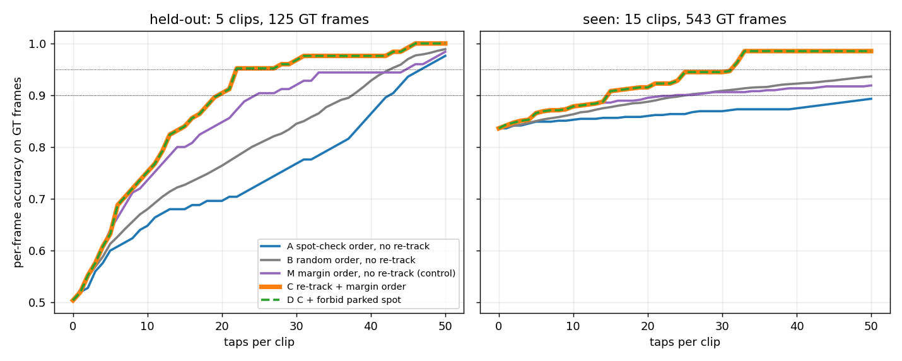

# Ball tracking evaluation

How well does the ball tracker follow the real ball? This page describes the
measurement (`footy_track.ball_eval.detection_replay` and
`scripts/ball_tracking_eval.py`), the ground truth it uses, and the first
results for the three detection-based trackers. It is the first scored ball
measurement of the tracker; it does **not** replace the detector evaluation in
T-10 (see [TODO](todo.md)), which scores the detector itself on the v11 test
split.

## What is measured

The tracker never sees pixels, only the ball candidates the detector produced
(confidence 0.1 or more, nothing filtered). So the measurement splits in two:

1. **`cache`** runs the detector once per clip, on a GPU, and writes every ball
   candidate per frame to `<clip>.jsonl` (one header line with the clip, frame
   size, weights, image size and confidence floor, then `{"f": frame, "c": [[x, y,
   w, h, conf], ...]}` per frame). Same weights and settings as the inference
   pipeline (the `rtdetr_1920_v11` checkpoint at image size 1280, confidence 0.1).
2. **`score`** replays any tracker over the cache on a CPU (about 7 seconds for
   26 clips and three trackers) and compares its output with the human ball
   marks. Change a tracker, rerun `score`; the detector is never rerun.

`review` is a third, proxy-only command for runs without ground truth: it counts
how many frames each tracker changes relative to the first one and how many of
its ball positions are in the stands (normalised y under 0.12).

```bash
python -m footy_track.scripts.ball_tracking_eval cache  --videos <clips> --gt <gt> --out <cache> --weights <best.pt>
python -m footy_track.scripts.ball_tracking_eval score  --cache <cache> --gt <gt> --split split.json \
    --trackers online,bidirectional,viterbi --radii 10,25 [--per-clip] [--param viterbi.enter_cost=6]
python -m footy_track.scripts.ball_tracking_eval review --runs <dir of run folders>
```

`split.json` maps each canonical clip id to `"seen"` or `"held_out"`.

## Ground truth rules

Marks come from the labeller sidecars (`ball_gt_marks/<clip>.jsonl`).

- A **ball mark** is a row whose first tag is `in_play_ball` or `out_of_play_ball`.
- Only marks tagged `labeller` (placed or confirmed by a person in the labeller)
  count as ground truth. This is the headline tier, `human`.
- Marks a machine propagated and a person later checked (`vittrack` plus
  `human_checked`) are scored in a separate `human+propagated` tier. They are not
  independent of the tracking family, so do not headline them.
- `yolo` and `sam3` marks, and rows without a provenance tag, are never ground
  truth.
- A `no_ball` row means the ball is not visible in that frame. `not_broadcast`
  frames and frames with no row at all are not scored.
- Sidecars are merged by canonical clip id (`footy_track.clip_id`), because one
  clip has several names (for example `mancity_seg010` and
  `arsenal_mancity_seg010`). If a frame has several marks, the nearest counts.

The ground truth is small: 646 human ball frames and 37 human no-ball frames over
26 clips. Most clips have between 1 and 60 marks; the huge sidecars (thousands of
rows) are almost entirely player boxes and propagated ball boxes, so only a few
dozen of their rows are human ball marks. Marks are sparse (isolated frames), so
a clip scores only on its marked frames; the tracker still runs over the whole
clip. The marks were mostly made while reviewing detector output, so frames where
the detector found nothing at all are probably under-represented. Treat the
recall figures as optimistic.

## Metrics

On every frame with a ball mark, at pixel radius R (native resolution; R = 10
and 25):

- **HIT**: the prediction centre is within R of a mark.
- **WRONG**: there is a prediction but it is farther than R. This is the
  "following the wrong object" failure and the number to watch.
- **MISS**: no prediction.

On every `no_ball` frame, **FALSE** means a prediction exists.

- precision = HIT / (HIT + WRONG + FALSE)
- recall = HIT / ball-marked frames
- wrong / pred = WRONG / (HIT + WRONG): how often a made prediction is the wrong object
- HIT and WRONG are split into detected (`d`) and interpolated (`i`) predictions.
- **detector any-cand** is the detector upper bound: the ball-marked frames where
  any candidate of confidence 0.1 or more is within R. The gap between this and
  recall is tracker loss (and interpolation can push recall above it).

## Leakage: seen and held-out clips

A clip is **seen** if any frame of it, or of its source footage, is in the
detector training data (Roboflow dataset v11, any split), **held-out** otherwise.
Checked from the dataset image names, plus a check that the whole-match frames in
v11 (named by match frame number, sampled every 5th frame) fall in the clip's
time span; `arsenal_mancity_part093` is seen for that reason.

- **Held-out** (6 clips, 119 human ball frames, 7 no-ball frames):
  `arsenal_mancity_seg031` (53), `arsenal_bournemouth_1st_seg035` (40),
  `arsenal_bournemouth_1st_seg031` (11), `_seg015` (9), `_seg021` (5), `_seg060` (1).
- **Seen** (20 clips, 527 human ball frames, 30 no-ball frames): the rest, among
  them `arsenal_example`, which has 157 images in the v11 validation split, and
  the two large single-clip sources of v11, `astonvilla_seg080` and
  `bournemouth_1st_seg070`.

Seen numbers measure how well the tracker uses detections the model has
effectively memorised, so they overstate real performance. The tracker
parameters below were tuned on the seen clips only. The held-out set is small
(119 ball frames, 78% of them from two clips), so differences of a few
frames are noise.

## Results

Detector: `rtdetr_1920_v11`, image size 1280, confidence floor 0.1. Human tier.
Counts are frames; `d`/`i` are detected/interpolated.

Held-out (headline):

| tracker | R px | HIT | WRONG | MISS | FALSE (of 7 no-ball) | precision | recall | detector any-cand |
|---|---|---|---|---|---|---|---|---|
| online | 10 | 70 (61d/9i) | 33 (18d/15i) | 16 | 5 | 0.648 | 0.588 | 74 of 119 |
| bidirectional | 10 | 70 (63d/7i) | 20 (18d/2i) | 29 | 3 | 0.753 | 0.588 | |
| viterbi | 10 | 59 (56d/3i) | 18 (12d/6i) | 42 | 3 | 0.738 | 0.496 | |
| online | 25 | 73 (61d/12i) | 30 (18d/12i) | 16 | 5 | 0.676 | 0.613 | 74 of 119 |
| bidirectional | 25 | 70 (63d/7i) | 20 (18d/2i) | 29 | 3 | 0.753 | 0.588 | |
| viterbi | 25 | 59 (56d/3i) | 18 (12d/6i) | 42 | 3 | 0.738 | 0.496 | |

Seen (tuned on; 527 ball frames, 30 no-ball frames, detector any-cand 458 at R=10, 460 at R=25):

| tracker | R px | HIT | WRONG | MISS | FALSE | precision | recall |
|---|---|---|---|---|---|---|---|
| online | 10 | 431 (424d/7i) | 48 (30d/18i) | 48 | 16 | 0.871 | 0.818 |
| bidirectional | 10 | 455 (447d/8i) | 28 (23d/5i) | 44 | 10 | 0.923 | 0.863 |
| viterbi | 10 | 438 (419d/19i) | 13 (6d/7i) | 76 | 7 | 0.956 | 0.831 |
| online | 25 | 435 (426d/9i) | 44 (28d/16i) | 48 | 16 | 0.879 | 0.825 |
| bidirectional | 25 | 462 (451d/11i) | 21 (19d/2i) | 44 | 10 | 0.937 | 0.877 |
| viterbi | 25 | 444 (420d/24i) | 7 (5d/2i) | 76 | 7 | 0.969 | 0.843 |

What the numbers say:

- Most of the held-out loss is the detector, not the tracker: only 74 of 119
  ball frames have any candidate within 25 px (62%). No tracker can fix that.
- Held-out WRONG falls from 30 to 20 (bidirectional) or 18 (viterbi) and
  precision rises from 0.68 to 0.74-0.75. Bidirectional keeps online's recall
  within 3 frames; viterbi gives up recall (0.50) for precision.
- On the seen clips both new trackers cut WRONG by half or more (44 to 21 and 7).
- The held-out gain comes mostly from two clips (arsenal_mancity_seg031 and
  arsenal_bournemouth_1st_seg031) and is within what 119 frames can
  distinguish; treat it as encouraging, not proven. The default stays `online`.
- `arsenal_bournemouth_1st_seg035` is bad for every tracker (about 17 of 40
  frames wrong): its ball is often high in the air near the stands, where no
  tracker trusts it and where the detector often finds nothing. This is also why
  a "no ball in the stands" penalty is not safe: real balls go there.

Per-clip and pooled results (including the `human+propagated` tier, where
bidirectional reaches precision 0.97 and recall 0.93 on seen clips) come from
`score --per-clip`.

## The two new trackers

Both are offline (they need the whole clip's candidates), write the same
`ball_track.jsonl` rows, and are selected with `--ball-tracker`
(`InferenceConfig.ball_tracker`, default `online`). The `--ball-*` threshold
flags configure only the online tracker; the offline ones use the defaults
below. The web app is unchanged and keeps `online`.

### Bidirectional (`ball_trackers/bidirectional.py`)

Runs `DetectionBallTracker` forward and on the time-reversed candidates, then
merges per frame:

- neither pass has a ball: no ball;
- only one pass has a detected ball: take it; a bridge (interpolated frames) that
  only one pass makes is dropped (`fill="agree"`; `fill="any"` keeps it);
- both have a ball within 60 px: agree; keep the detected one (forward if both are);
- they disagree: keep the pass whose track (the run of frames with one track id
  in that pass) has more support. Support is the sum of its detected
  confidences (`support="conf_sum"`; `"strong_count"`, the number of detections at
  or above the start confidence, scored identically here).

Parameters: online defaults except `max_missed` 6 and `growth_px` 15
(`agree_px` 60, `fill` agree, `support` conf_sum).

### Viterbi (`ball_trackers/viterbi.py`)

Picks the single best path through the whole clip. Each frame offers its top 8
candidates (confidence 0.1 or more) or no ball. A path scores:

- per chosen candidate: the log-odds that a candidate of that confidence is the
  ball, interpolated from the Ball Check precision bands (0.04 at 0.1-0.2, 0.42
  at 0.5-0.6, 0.79 at 0.6-0.7, 0.96 at 0.7-0.8, near 1 above), plus a bias of 1.0;
- minus a move cost between consecutive chosen candidates g frames and d px apart:
  3 * (d / (30 + 40 g))^2, capped at 8 (so a camera cut is allowed, never free),
  plus 0.3 per skipped frame;
- minus 4 to start a track and 0.5 to end one.

Candidates more than 12 frames apart are never linked, and gaps inside a track
are filled by linear interpolation only up to that limit. There is an optional
`top_penalty` for candidates in the stands (normalised y under `top_y`, 0.12);
it is off because the grid search gave no consistent gain and the seg035 clip
shows real balls up there. No pitch mask is used. It runs in a fraction of a
second per clip.

### Tuning

Light grid searches on the seen clips only, objective HIT minus twice
(WRONG + FALSE) at 25 px: viterbi `emission_bias` 0.5-3.5, `enter_cost` 2-6,
`jump_cost` 4-8, `gap_cost` 0.1-0.3, `move_weight` 1-3, `max_gap` 8-20,
`speed_px` 25-70, `base_px` 20-50 (the surface is flat; the chosen values are
inside a plateau, not at its best corner); bidirectional `fill`, `agree_px`,
`support`, `start_conf`, `jump_conf`, `max_missed` 3-25, `base_radius_px`,
`growth_px`. Interpolating gaps both passes did not make was the main source of
bidirectional's early WRONG predictions.

## Limits

- Small, hand-selected ground truth; the held-out set is 119 ball frames.
- GT frames are mostly ones a person looked at because the detector proposed
  something; recall is optimistic.
- Pixel distance only; no check of the ball size or the pitch position.
- Clips are scored at native resolution (one 1280x720 source, the rest 1920x1080).
- Whole-match frames in v11 were attributed to clips from the segment time table;
  a clip could still share footage with training in ways this does not detect.

Related: [Inference](inference.md), the research note on
[bidirectional tracking for autolabelling](design/bidirectional_tracking_research.md)
(a different problem: pixel trackers seeded from human marks), [TODO](todo.md) T-10, T-20, T-34.

## Re-tracking after each review verdict (simulation)

Question: if the whole-clip tracker is re-run after every human verdict, does it
take fewer review taps to get correct ball tracks? Simulated offline on the cached
candidates (`ball_trackers/constrained.py`, `scripts/retrack_sim.py`), with the
human GT marks as a perfect reviewer. One tap answers one card: a frame plus the
tracker answer there. The reviewer says "ball" (the path is anchored there),
"not a ball" (that candidate is forbidden in that frame) or, when the answer is
wrong or missing, drags to the true position (anchor). A frame that was tapped
counts as right. Accuracy is per GT frame (HIT within 25 px, or no answer on a
no-ball frame). Cards can only be asked on frames that have GT.

Constraints are anchors, forbidden spots and forbidden-everywhere spots in the
Viterbi tracker (same model as `viterbi`, identical output with no constraints).
The next card is the frame with the smallest *margin*: the score gap between the
best whole-clip path and the best path that uses a different object at that frame
(forward and backward pass, no per-frame re-runs), with frames changed by the last
re-track asked first. Strategies: A spot-check order (first, last, biggest jump,
middle frame of each track, interleaved), B random order (8 seeds), M margin order
computed once and never re-tracked (control), C re-track + margin order, D = C plus
"not a ball" also forbids that image position (5 px) in every frame.



Taps per clip needed to reach a pooled accuracy (taps as a fraction of the GT
frames in brackets). Held-out: 5 clips, 125 GT frames (corrected truth); seen: 15
clips, 543 GT frames. Clips with fewer than 5 GT frames (1 held-out, 2 seen) are
left out.

| set | strategy | acc at 0 taps | acc at 10 taps/clip | to 90% | to 95% |
|---|---|---|---|---|---|
| held-out | A spot-check | 0.50 | 0.65 | 22.4 (90%) | 23.8 (95%) |
| held-out | B random | 0.50 | 0.68 | 20.4 (82%) | 22.4 (90%) |
| held-out | M margin, no re-track | 0.50 | 0.74 | 15.2 (61%) | 23.2 (93%) |
| held-out | C re-track | 0.50 | 0.75 | 13.2 (53%) | 14.0 (56%) |
| held-out | D C + parked | 0.50 | 0.75 | 13.2 (53%) | 14.0 (56%) |
| seen | A spot-check | 0.84 | 0.85 | 26.9 (74%) | 32.1 (89%) |
| seen | B random | 0.84 | 0.86 | 19.9 (55%) | 28.1 (78%) |
| seen | M margin, no re-track | 0.84 | 0.88 | 18.9 (52%) | 30.7 (85%) |
| seen | C re-track | 0.84 | 0.88 | 13.2 (36%) | 22.0 (61%) |
| seen | D C + parked | 0.84 | 0.88 | 13.2 (36%) | 22.0 (61%) |

- Re-tracking helps once a clip has had some taps. C reaches 90% in about 35-40%
  fewer taps than random order and 40-50% fewer than the spot-check order, and
  needs about 40% (held-out) and 28% (seen) fewer taps than margin order alone to
  reach 95%. The first 5 taps are the same for every strategy. Spot-check order
  without re-tracking is worse than random on these GT frames.
- Most of the remaining loss is the detector: on held-out clips about half the GT
  frames have no candidate near the ball, so only a tap (drag) fixes them, whatever
  the tracker does.
- D equals C to the last frame: parked-spot forbids were issued 11 times (held-out)
  and 5 times (seen) and never changed the answer on a GT frame. The confidently
  wrong held-out frames (6 of 56 at margin 3 or more, all in one clip) sit on a
  ball that moves with the camera pan, so an image-position rule does not catch
  them. Not worth building as specified.
- Auto-marking frames "done" without a tap is the risk. Margin 3 or more marks 56
  held-out frames done, 6 of them wrong (11%); confidence 0.7 or more gives the same
  56 and 6, so the margin adds nothing over confidence. Confidence 0.8 or more is
  clean on held-out (41 done, 0 wrong). On seen clips, margin 3 or more: 332 done,
  0 wrong. The error did not grow after 10 re-tracked taps (47 done, 6 wrong held-out).
- Chaining consecutive segments (E): in the one adjacent eval pair (`seg030`,
  `seg031`), solving the two together with the real 96-frame gap is identical to
  solving them apart; treating the join as contiguous (not true) moved the count of
  correct frames by at most 3 of 86 either way, no net gain. Across all 161 joins of
  the 162-segment match the gap between consecutive segments is at least 26 source
  frames (median 156, about 6 s): segments are cut around non-broadcast footage,
  never back to back. Zero joins were judged continuous (rule: gap of at most 2
  frames, histogram correlation 0.85 or more, mean abs difference at most 25); 36 of
  161 look alike (same wide shot, correlation 0.9 or more) but the match clock shows
  seconds elapsed, so the ball cannot be followed across. Chaining is not worth
  building.

Caveats: perfect reviewer; GT is sparse and only GT frames can be asked or scored,
so effects on other frames are not measured; held-out is 5 clips and 79% of its
frames come from two of them; the margin is a proxy (dropping the ball is
approximated by the candidate's own emission); seen clips were used to tune the
tracker. Reproduce with `python -m footy_track.scripts.retrack_sim sim --cache C
--gt G --split S --truth T --out O`, then `plot`; `joins` runs the join test.
