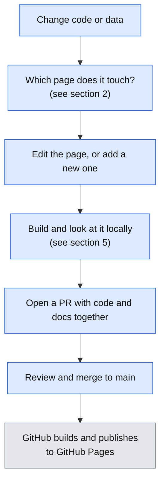
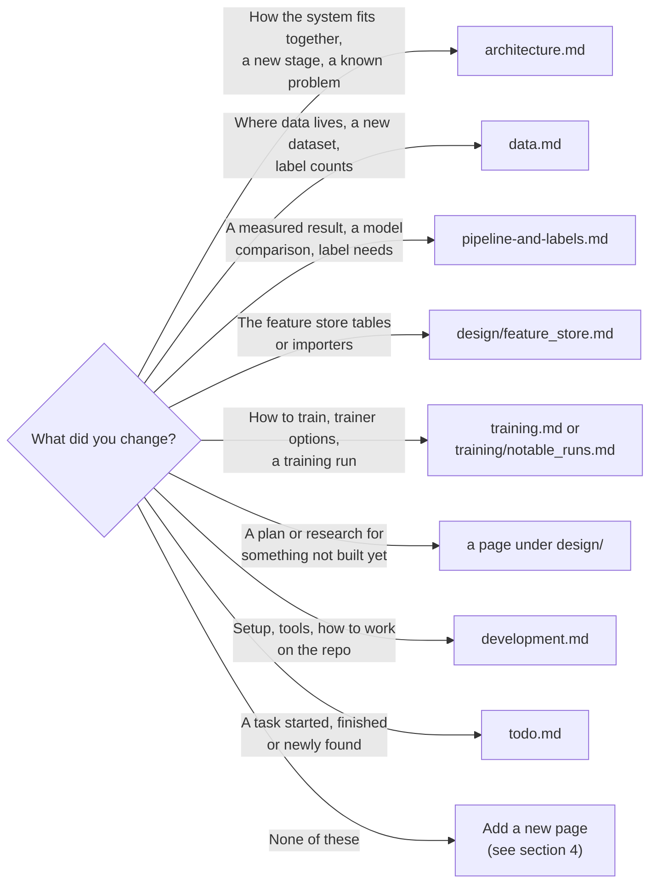
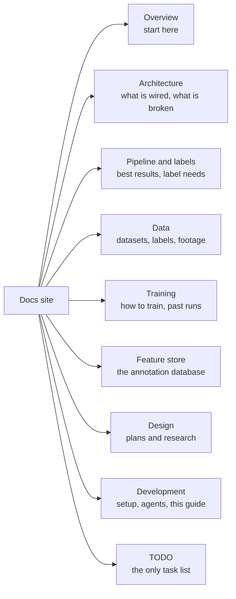
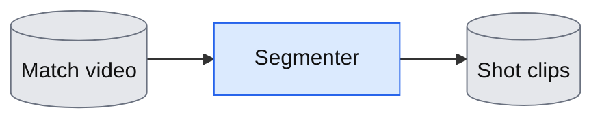
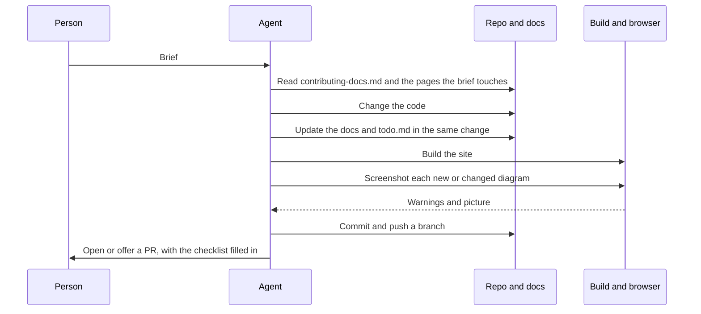

# How to contribute to the docs

This page is for anyone who changes footy-track: people and coding agents. It says where docs live, how to change them, and how to check your work. Read it before you open a pull request (PR). A PR is a request to merge your branch into `main`.

The rule in one line: **if your change would make a page wrong, fix the page in the same PR.**

## 1. The workflow

The docs are plain Markdown files in `docs/`. A tool called MkDocs turns them into a website. When a change reaches `main`, GitHub builds the site and publishes it to GitHub Pages.



Legend: blue boxes are things you do; the grey box happens by itself. The diagram shows the steps from changing code to a published page.

## 2. Where does my change go?

Ask what changed, then follow the arrow.



The diagram sends each kind of change to one page. If a change fits two pages, put the detail in one and link to it from the other. Do not copy the same table twice.

## 3. The site map



The map shows the top-level sections of the site and what each one is for. The order matches `nav:` in `mkdocs.yml`.

## 4. Add a page

1. Create `docs/<name>.md`. Use lower-case words, with `-` or `_` between them. Match the pages near it.
2. Start with one `#` heading. Add one sentence under it saying who the page is for and why they would read it.
3. Add **one line** to `nav:` in `mkdocs.yml`, under the right section: `- Title: file-name.md`.
4. Link to it from at least one other page. A page nothing links to is hard to find.
5. Build the site (section 5). The build prints a list of pages that are not in the nav. Yours must not be on it.

Do not edit `pyproject.toml` or `uv.lock` to add docs tools.

## 5. Build and preview

From the repo root:

```bash
uvx --with mkdocs-material mkdocs build -d /tmp/footy-site
```

This builds the site into `/tmp/footy-site` without changing the repo. Read the warnings. Do not add new ones. (`--strict` currently fails on two old links in `system_design.md`; that is known.)

For a live preview, run `uvx --with mkdocs-material mkdocs serve`. It serves the site on `http://127.0.0.1:8000` and reloads when you save.

## 6. Writing style

Write for a smart person who is new to the project.

- **Short, plain sentences.** Say "use" and not "utilise". If you need a technical word, explain it the first time.
- **Say who the page is for** in the first lines.
- **Lead with what and why.** Put the answer first. Put the detail after it.
- **One idea per paragraph.**
- **Give an example** when a rule is abstract. A command, a table row or a path is better than a description.
- **Use tables for reference material** (options, paths, counts). Use sentences for reasoning.
- **Link to code by file path**, for example `src/footy_track/labeller/session.py`. Add a line number only when it really matters. Line numbers go stale quickly.
- **Say what is measured and what is assumed.** Write "measured" with its source, or "unverified". Do not mix them.
- **Date numbers that go stale**, for example "18,147 objects (2026-11-08)".
- **No marketing words** and no filler.

## 7. Diagrams

Draw diagrams in Mermaid. Mermaid is text that the site turns into a picture, so a diagram is reviewed like code. Put it in a fenced block that starts with ` ```mermaid `.

Pick the type by the job:

| Job | Use |
|---|---|
| Data flow or steps | `flowchart` |
| Who calls whom, in order | `sequenceDiagram` |
| Something with states, such as a label going from draft to checked | `stateDiagram-v2` |
| A choice with branches | `flowchart` with a `{}` decision box |

Rules:

- **Keep it small.** About 15 nodes at most. If it is bigger, split it into two diagrams.
- **Use the shared colours** from the [architecture page](architecture.md). Define them with `classDef`: grey is data on disk or S3, blue is code in git, orange with a dashed border is a step that is not in git, red is dead code or an output nothing reads, purple is new.
- **Quote every label**: `A["Some label"]`.
- **Break lines with `<br/>`**, not with a newline.
- **Escape special characters.** Write `&amp;` for `&`, `&lt;` for `<` and `&gt;` for `>`. Avoid `#`, `;` and unbalanced quotes in labels.
- **Add a one-line legend** under the diagram for the colours you used.
- **Add one sentence under the diagram** saying what it shows. This is the text for people who cannot see the picture.

A tiny example that follows the rules:



Legend: grey is data, blue is code in git. The diagram shows a video going through the segmenter into shot clips.

## 8. Check that a diagram renders

A diagram with a syntax error shows an error box or nothing. Always look at it.

1. Build the site: `uvx --with mkdocs-material mkdocs build -d /tmp/footy-site`.
2. Serve it: `cd /tmp/footy-site && python3 -m http.server 8911`.
3. Open the page in a headless browser and take a screenshot. With Playwright (a browser-driving tool) for Node.js:

```js
const { chromium } = require('playwright');
(async () => {
  const b = await chromium.launch({
    executablePath: process.env.HOME + '/.cache/ms-playwright/chromium-1140/chrome-linux/chrome',
    args: ['--no-sandbox'] });
  const p = await b.newPage({ viewport: { width: 1300, height: 900 } });
  await p.goto('http://localhost:8911/contributing-docs/', { waitUntil: 'networkidle' });
  await p.waitForTimeout(8000);
  await p.locator('.mermaid').nth(0).screenshot({ path: 'diagram0.png' });
  await b.close();
})();
```

4. Open the PNG and look at it. Do this for every diagram you added or changed.

Two things to know:

- Material draws Mermaid inside a closed shadow DOM, so `document.querySelectorAll('.mermaid svg')` finds nothing even when the picture is fine. Check the **screenshot**, not the page structure.
- The Mermaid script loads from a CDN (a public file host). The browser needs internet access.

Optional: `make docs-check` runs `scripts/check_docs_diagrams.py` (a quick text check for empty diagrams, unbalanced quotes, loose `&` or `<`, and diagrams over 25 nodes) and then the build. It is not run in CI yet.

## 9. What must never go in the docs

The repo and the site (https://egroeg121.github.io/footy-track/) are **public**. Anyone can read every page and every old version in git history.

Never write:

- Keys, tokens or passwords of any kind.
- Private hostnames, IP addresses or Tailscale names.
- Cloud bucket names, account ids, or full private paths beyond what the page needs.
- Personal data: emails, phone numbers, names of people in footage who are not public figures.
- Screenshots of private tools (cloud consoles, dashboards, chats).

Write this instead:

| Instead of | Write |
|---|---|
| A full home or disk path | "the data directory" and name the setting that points to it, for example `FOOTY_GT_MARKS_DIR` |
| A bucket name | "the private S3 bucket" |
| A machine name | "the workstation" or "the GPU box" |
| A key | "set `WANDB_API_KEY` in your environment" (the name, never the value) |

If you find one already in the docs, remove it and tell the owner. A leaked secret must also be revoked: deleting it from the page does not delete it from git history.

## 10. Agents

An agent is an AI coding tool working from a brief. Agents follow the same rules. The steps are:



The diagram shows an agent reading the docs first, changing code and docs together, checking the build and the pictures, and only then pushing.

## 11. Before you open the PR

- [ ] The docs are in the same PR as the code.
- [ ] `docs/todo.md` is updated if a TODO item started, moved or finished.
- [ ] New pages have one `nav:` line in `mkdocs.yml` and a link from another page.
- [ ] The build runs with no new warnings.
- [ ] Every new or changed diagram was looked at in a screenshot.
- [ ] Each diagram has a legend and a one-sentence description.
- [ ] Numbers say whether they are measured or assumed, and have a date if they go stale.
- [ ] No keys, private hostnames, IPs, bucket names, emails or private paths (section 9).
- [ ] No change to `pyproject.toml` or `uv.lock` for docs.
