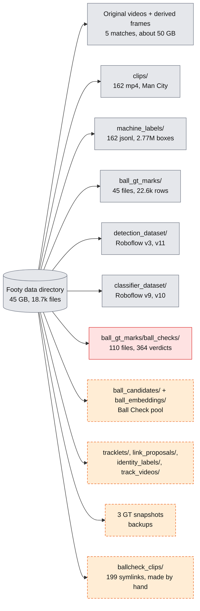
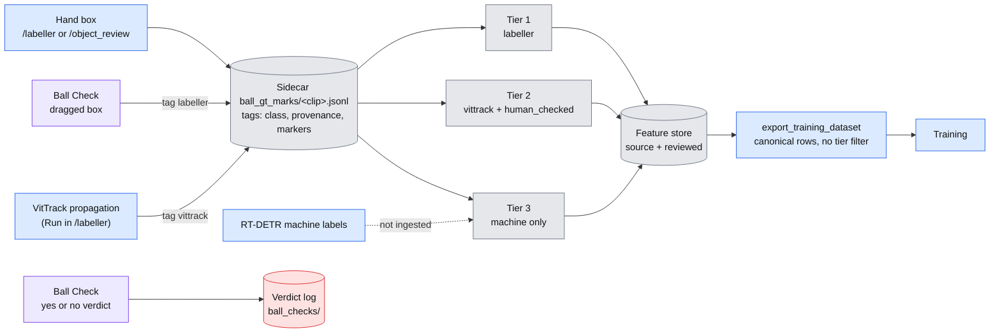

# Datasets and labels

**Who this is for:** anyone who needs to find, count or trust the footy data and its labels. It says where each dataset lives, what a label is worth (tiers), how the evaluation sets are built, and what exists on one machine but not the other.

_Counts measured on 2026-11-08 on the build machine against `main` @ 26d2506. They will drift; re-run the checks before relying on them. Figures marked "inventory" come from the review's dataset inventory and were not recounted._ For how the data moves through the system see [Architecture](architecture.md); for what is missing see the [TODO list](todo.md).

## Where things live

All paths below are relative to the **footy data directory**. It is not in git. Its location differs per machine, so code reads it from environment variables or a per-user default.

| Place | Contents |
|---|---|
| Footy data directory on the build machine (45 GB, 18,716 files) | The working copy of everything below. |
| `~/code/footy_data` | On the build machine, a dangling symlink into iCloud left over from the macOS setup. Do not use. |
| The object store, under a `footy_data/` prefix | 18,147 objects, 47.88 GB. Sibling prefixes `gpu_runs/` (18 objects, 795 MB), `models/` (3 objects, 67 MB) and `backups/`. |
| The desktop GPU machine | A third copy, about 44 GB per the maintainer's notes. Not checked in this review. The notes record the two machines diverging on `ball_gt_marks` in August; not verified. |
| `~/footy/footy_data` | Where the labeller looks by default. Override with `FOOTY_CLIPS_DIR`, `FOOTY_GT_MARKS_DIR` and `FOOTY_BALL_CANDIDATES_DIR` (`labeller/server.py:92-114`). |
| A separate data folder next to the repo | Only `arsenal_mancity_example_video.mp4` (1920x1080, 25 fps, 250 frames, 10 s). |

Model weights are not in git. `rtdetr_1920_v11/best.pt` (66.8 MB) is in the object store under `models/` and `gpu_runs/`, and on the build machine. The SAM3 weights go in `model_saves/sam3/`; the object store has the complete `sam3.1_multiplex.pt`, the local copy is a partial download.

### Layout and what is local only

Legend: grey is in the object store and on the build machine, orange dashed is local only (not in the object store, and not made by code in git), red is data that nothing reads. The diagram shows the top-level folders only; the table below has formats and sizes.

## Datasets

| Name | Folder under `footy_data` | Format | Size and counts | Use |
|---|---|---|---|---|
| Raw match videos | `arsenal_{astonvilla,bournmouth_1st_half,bournmouth_2nd_half,mancity,norwich}/original_video` (the `bournmouth` spelling is the real folder name) | mp4, ts, webm, mkv | 14.7 GB, 5 files | Source of everything |
| Derived frames and segments | same game folders | jpg, png, mp4 | about 35 GB | Frame sampling, broadcast filtering |
| `clips/` | `clips/` | mp4, 1920x1080, 25 fps, about 101 s | 162 files, 2.3 GB | Canonical dated Man City clips `arsenal_mancity_20250925_segNNN` |
| `machine_labels/` | `machine_labels/` | jsonl plus `_manifest.json` | 162 files, 889 MB, 2,767,151 boxes, 97,625 frames | RT-DETR-L (`rtdetr-l_1920_v11`, imgsz 1280, conf 0.1 or more), tier 3, unreviewed. In the object store. |
| `ball_candidates/` | | jsonl | 162 files, 119 MB, 356,812 ball rows | Ball Check pool. **Local only.** |
| `ball_embeddings/` | | npz | 162 files, 42 MB | Crop descriptors for diversity sampling. **Local only.** |
| `tracklets/` | | jsonl (LapTracker) | 162 files, 334 MB, 1,606,131 rows | Player re-ID work. **Local only.** |
| `link_proposals/`, `identity_labels/`, `track_videos/` | | jsonl, mp4 | under 1 MB: 68 proposals, 9 review rows | Re-ID review. **Local only.** |
| `ball_gt_marks/` | | jsonl, one per clip | 45 files, 22,648 rows, 5.4 MB | Human and human-checked GT, normalised bbox and centre |
| `ball_gt_marks/ball_checks/` | | jsonl, append-only | 110 files, 364 verdicts, 2026-09-24 to 09-25 | `/ball_check` verdicts |
| GT snapshots | `ball_gt_marks.bak-ballcheck-20260924-151008`, `ball_gt_marks_MERGED` (identical, 39 files), `ball_gt_marks.pre-merge-20260826-234555` (33 files) | jsonl | about 5 MB each | Backups. **Local only**; the object store has `_backups/ball_gt_marks_2026-07-04`. |
| `detection_dataset/` | `roboflow_dataset_3` (162/49/46 train/val/test images), `roboflow_dataset_11` (1035/215/268) | YOLO images and txt | 47 MB, 237 MB | Detector training (Roboflow `footy-track-detection`) |
| `classifier_dataset/` | `roboflow_dataset_9` (594/183/166), `roboflow_dataset_10` (387/104/100) | class folders | 109 MB, 70 MB | Broadcast-frame classifier (inventory counts) |

## Label tiers and provenance tags

A label is worth what the person or program behind it is worth. Every box in a sidecar file carries tags in the order `[class, provenance, *markers]`, and the tiers are read from those tags (`labeller/README.md` section 1; `feature_store/ingest_gt.py:73-77, 93-115`).

| Tier | Tags on the box | What it means | In the feature store | For training |
|---|---|---|---|---|
| **1** | `labeller` | A human drew or dragged this box. | `source = hand_label`, `reviewed = true` | Ground truth. Safe to train and evaluate on. |
| **2** | `vittrack` plus `human_checked` | A tracker drew the box and a human confirmed it. About 97% right on the 81 Ball Check verdicts over such boxes (measured, 2026-11-08). | `source = vittrack`, `reviewed = true` once the ingest fix is in the store | Good enough to train on. Not good enough as strict eval ground truth. |
| **3** | `yolo`, `sam3`, or `vittrack` without `human_checked`; also every machine label from RT-DETR | A machine drew it and nobody looked. | `reviewed = false` | Noisy. Below 0.6 detector confidence at most 42% of Ball Check cards were real balls ([precision bands](pipeline-and-labels.md#ball-check-precision-by-confidence-band)). |

Three details that trip people up:

- `human_checked` is a marker, not a provenance and not a class. It sits after the provenance tag. Before `ingest_gt` knew this, it read the marker as the object class and lost the real one.
- **No code in the repo writes `human_checked`** (searched 2026-11-08). The 15,386 `vittrack` rows that carry it got it from a one-off backfill on 2026-08-23. New VitTrack output cannot become tier 2 through any tool.
- The labeller session currently drops `human_checked` on load and flush, which silently turns tier 2 into tier 3 for a whole clip ([T-01](todo.md); the fix is on an unmerged branch).

Legend: blue is code in git, grey is data, purple is the Ball Check path, red is data nothing reads. The diagram shows how a box becomes tier 1, 2 or 3 and what reaches training: a Ball Check dragged box becomes tier 1 through the sidecar, a Ball Check yes or no goes only to the verdict log, and the export does not filter on tier, so tier 3 rows in the store are exported too ([T-22](todo.md)). The routes that produce these labels are in [Best pipeline and label needs, section 4](pipeline-and-labels.md#4-how-labels-are-created-today).

## Label formats and counts

Sidecar rows are `{frame_index, bbox{x,y,w,h} normalised, center, tags: [class, provenance, *markers]}`; skip markers are rows with `bbox: null` and tag `no_ball` or `not_broadcast`. See [Architecture, section 6](architecture.md#6-data-formats-that-cross-stage-boundaries) for the six formats.

Current `ball_gt_marks` (45 files, 22,648 rows, 0 unparsable; measured 2026-11-08): player 18,688, referee 2,099, `in_play_ball` 1,523, `not_broadcast` 138 (marker), coach 81, `no_ball` 68 (marker), person 32, player_sub 13, `out_of_play_ball` 2, untagged 4.

Ball provenance tiers: tier 1 `labeller` 692 (plus 2 `out_of_play_ball`); tier 2 `vittrack` plus `human_checked` 825; tier 3 `yolo` 6. `vittrack` rows total 15,386, all carrying `human_checked`; `labeller` rows 6,446; `yolo` 606. An older note's 612/857/6 matches the August feature store, not these files.

Verdicts (364 rows): `ball` 179, `not_ball` 149, `unsure` 20, `corrected` 12, tombstones 4. By source: 283 candidates, 81 sidecar boxes. Machine labels: player 2,028,121; `in_play_ball` 352,039; referee 285,162; coach 53,607; person 26,463; player_sub 16,986; `ball` 4,773 (class `ball` is dead in Roboflow v11 but present in machine output).

Roboflow v11 `in_play_ball` instances, counted per file: train 1,010, valid 211, test 243. (`cat labels/*.txt` undercounts because the files lack a trailing newline; an older figure of 826 for train was that miscount.) v11-val is 74% one clip, `arsenal_example`.

## Evaluation sets

There are two, and neither is a multi-match benchmark. Both are defined by files, so check the files before quoting a score.

| Set | Defined by | Size | Limits |
|---|---|---|---|
| **Roboflow v11-val** (single-frame ball detection) | `detection_dataset/roboflow_dataset_11/valid` | 215 images, 211 `in_play_ball` | 157 images and 156 balls (74%) are one 10-second clip, `arsenal_example`. Counted from file names, 2026-11-08. The production checkpoint's headline figure (mAP50 0.665, recall 0.591) is measured here. |
| **Roboflow v11-test** | `detection_dataset/roboflow_dataset_11/test` | 268 images, 243 `in_play_ball` | Never evaluated in any log found. 265 of the 268 images (241 of 243 balls) are frames cut from the full Man City match video, not from clips, so it is one match. Counted from file names, 2026-11-08. |
| **Ball-tracker harness set** (`ball_eval`) | Every clip with a `<stem>.jsonl` sidecar in `eval_data/clips/` | One file, `mancity_seg104.jsonl`: 4 rows, all with the same centre, and no matching MP4 | Effectively empty. The bake-off that used it ran the ball-blind 640 px checkpoint, so its results are not valid ([Architecture, section 4.1](architecture.md#41-status-by-stage)). |

The harness set doubles as the **leakage guard**: `export_training_dataset` excludes every clip that has a sidecar in `eval_data/clips/` from train and val (`scripts/export_training_dataset.py:78-80, 362-363`). It matches clip names exactly, and one clip has up to three names, so the guard can miss ([T-03](todo.md)). The split in v11 itself is by clip, but v11 train, val and test are all mostly Man City (v11 train has 1,010 balls, 517 of them from `astonvilla_seg080`).

What a better set needs (diverse matches, dense contiguous frames, explicit `no_ball` frames) is in [Best pipeline and label needs, section 3](pipeline-and-labels.md#3-label-needs-and-gaps).

## Feature store

DuckDB (open with `read_only=True`; see [Environment notes](development.md#environment-notes) for the version pin). The keys, the diagram and the list of what is not in the store are in [Feature store design, section 7.1](design/feature_store.md#71-keys-as-implemented-and-what-is-not-in-the-store). The state of the newest copy:

- **Newest copy:** 2026-08-04, 4.2 MB, in a local job mirror (older: 2026-07-05, 3.4 MB). **Local only, not in the object store, stale.**
- **Contents (measured 2026-11-08, read-only):** `detection` 26,364 rows; 34 of 41 games have detections; `frame` 1,869; 4 runs (`roboflow_v3`, `gt_import_labeller`, `gt_import_vittrack`, `gt_import_yolo`); `track_meta` 0 rows.
- **Ball rows:** `vittrack` 857 (`reviewed=False`), `hand_label` reviewed 612, `roboflow_v3` 235, `yolo` 6, `ball` 1.
- **Why it is stale:** `vittrack` boxes are stored `reviewed=False` because the `human_checked` ingest fix post-dates both copies. It also lacks the September corrections, six GT files and Roboflow v11 (only v3).

## Footage

| Game | Original | Codec, res, fps | Duration | Derived | Labels |
|---|---|---|---|---|---|
| Man City 2025-09-25 | `arsenal_mancity_20250925.webm` 4.53 GB | h264 1920x1080 25 | 7153 s | 7,143 png frames, 876 mp4, 162 clips | GT on part; machine labels on all 162 clips |
| Norwich | `arsenal_norwich.mkv` 3.85 GB | hevc 3840x2160 50 | 6948 s | 606 jpg, no clips | none |
| Bournemouth 1st half | `Bournemouth vs Arsenal 1.ts` 1.67 GB | h264 1920x1080 50 | 3109 s | 121 mp4, 777 jpg | GT (`bournemouth_1st_seg070` has 3,863 rows) |
| Bournemouth 2nd half | `Bournemouth vs Arsenal 2.ts` 1.78 GB | h264 1920x1080 50 | 3210 s | 803 jpg, no mp4 | none |
| Aston Villa | `Arsenal - Aston Villa.mp4` 2.90 GB | not probed | | 320 mp4, 1,864 jpg | GT (`astonvilla_seg080` has 9,988 rows) |

Clip names come in three aliases: dated (`arsenal_mancity_20250925_segNNN`, in `clips/`), and short GT stems (`arsenal_mancity_segNNN`, `mancity_segNNN`, `astonvilla_segNNN`, `bournemouth_1st_segNNN`). The map between them is `ballcheck_clips/` (199 symlinks), which is not generated by anything in git ([T-03](todo.md), [T-09](todo.md)). GT covers 45 clips (7 with dated names) of about 1,700 broadcast segments.

## Local versus the object store

Counts from a listing on 2026-11-08 (measured). The top-level folders marked in the [layout diagram](#layout-and-what-is-local-only) are the ones that differ.

| | In both | Object store only | Local only |
|---|---|---|---|
| Keys | 18,112 | 3 | 604 |
| What | Clips, machine labels, GT sidecars including `ball_checks/` (same file sizes on both sides as of 2026-09-25), Roboflow datasets | `_backups/ball_gt_marks_2026-07-04`, the complete `sam3.1_multiplex.pt`, `roboflow_dataset_11/test/labels.cache` | `ball_candidates`, `ball_embeddings`, `tracklets`, the GT snapshots, `identity_labels`, `link_proposals`, `track_videos`, the partial SAM3 file, both feature stores |

Practical rules:

- Ball Check needs `ball_candidates/` and `ball_embeddings/`, which are local only. A new machine has to rebuild them from `machine_labels/` with a filter script that is not in git ([T-09](todo.md)).
- The labeller and `ball_check` read sidecars from `FOOTY_GT_MARKS_DIR`. Two machines writing to different copies is how the August divergence happened.
- The object store credentials work; an older note saying they were dead (2026-08-26) is stale.

## Gaps

- **Footage without labels:** Norwich and Bournemouth 2nd half have no GT. Machine labels cover only the 162 Man City clips. See [Best pipeline and label needs](pipeline-and-labels.md) for which gaps matter ([T-13](todo.md)).
- **Labels without footage:** `arsenal_example` (3,348 rows, 176 ball marks) has only the 10 s example video, tied by name. `eval_data/clips/mancity_seg104.jsonl` has no MP4.
- **Not in the feature store:** see [Feature store design, section 7.1](design/feature_store.md#71-keys-as-implemented-and-what-is-not-in-the-store) ([T-07](todo.md)).
- **Format hazards:** two centre formats (dict and list) can still appear; `ball_gt_marks` has 4 untagged rows; `astonvilla_seg080.jsonl` differs from its backup because six vittrack boxes were rewritten as `labeller` by the `corrected` path, so Ball Check does rewrite sidecars.
- **Cross-machine:** rows that exist only on the desktop GPU machine cannot be checked from the build machine.
