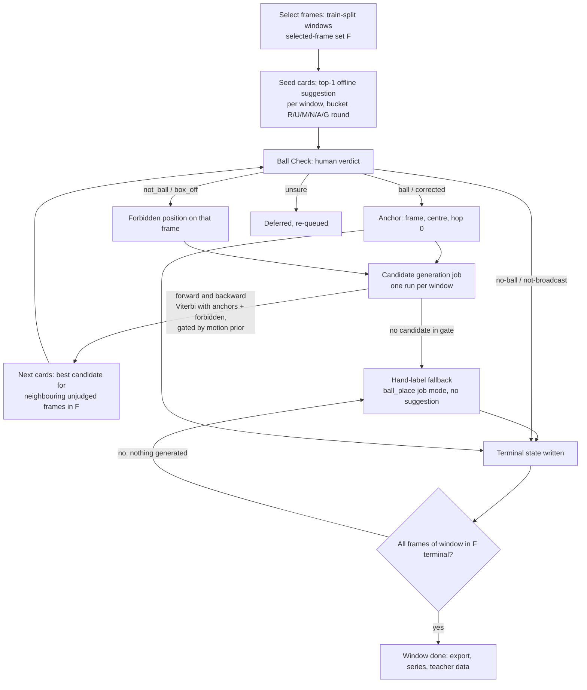

# Ball anchor iteration: confirmed balls seed the next candidate cards

Status: design proposal, 2026-11-21. Nothing in section 8 is built. KB relied on: `footy-claude-autolabel-loop` (Viterbi re-track simulation: ball verdict = anchor, `not_ball` = forbidden, next card = smallest margin; about 13 taps/clip to 90% vs about 20 random; Claude "ball" on the tracker's own candidate 61/62, on other candidates only 10/33; 37% of held-out ball frames have no detector candidate within 25 px), `footy-two-detector-labelling-design` (two detectors, `frame_label_state` per group, teacher vs student, method precedence), `footy-datasets-and-progress` (`split_of`, eval only grows, nightly Prefect chain, GPU `stage-inputs` chain). Builds on `ball_sampling.md` (§2.2.1, §3.2, §6 Loop 2), `full_frame_labelling.md` (two-detector decision, §1, §4), labeller README §19c (hooks) and §19e (eval panel).

Marking: **BUILT** = exists in `src/` and was read for this doc; **NEW** = to build; **JOBS-REPO** = lives in `~/code/jobs` (Prefect deployments), described here but not edited from this repo.

## 1. Goal and the loop

Request (George, 2026-11-21): the offline model already suggests the most likely ball per frame; a human-confirmed one should **anchor** a search forward and backward in time for the most likely ball on the neighbouring frames, those candidates are checked again in Ball Check, and the confirmed ones become new anchors, until the selected frames are done.

**Design change 2026-11-21 (George):** the same suggestion / anchor-iteration Ball Check flow serves BOTH families, train (training and teacher data) and eval (measuring the detector). Phone Ball Check cards (confirm / not-ball) do the bulk for both; the laptop does the full-frame hand checks. Anchoring bias from showing suggestions is accepted ("don't worry about anchoring bias"); the safeguards that remain are about completeness, split separation and versioning (section 4).

### 1.1 What already exists (extend, do not duplicate)

| Piece | Where | State |
|---|---|---|
| Top-1 + up to 5 candidates per frame, offline `tid` tracklet ids per window | `ball_eval/job_suggest.py::suggest_job`, `ball_eval/panel_suggest.py`, `ball_eval/tracklets.py::add_tracklets` | BUILT, but `require_heldout_job` makes it heldout-only |
| Roll-forward ranking from human anchors: `score = log(conf) - d^2/(2 sigma^2) (+ tid bonus)`, constant-velocity prediction from the last two human boxes, `sigma = SIGMA0 + K*abs(frame - last)` | `ball_eval/suggest_rank.py::rank_candidates` (mirrored in `labeller/web/index.html`), served by `labeller/suggestions.py::candidates_for_job` (also returns existing human boxes as anchors) | BUILT, runs in the browser for `ball_place` jobs |
| Whole-clip best-path tracker with emission from Ball Check precision bands, transition cost by distance and gap, `max_gap` | `ball_trackers/viterbi.py::ViterbiBallTracker` | BUILT, **no anchor / forbidden constraints in the code**: the "verdict = anchor, wrong = forbidden" re-track exists only as the KB simulation. Constrained version is NEW |
| Detector + bidirectional tracker candidates, gap plausibility | `ball_mining/track.py::run_tracker`, `gap_plausibility`; pool schema `ball_mining/schema.py` | BUILT |
| Round: plan, tick rule, idempotent create, hooks | `ball_mining/round.py` (`plan_round`, `create_round`, `tick_decision`, `next_key`, `ROUND_HOOKS`) | BUILT |
| Refit every 50 verdicts, `reorder_unanswered` with `if_rev`, Platt on R/A cards only, LTT on A cards | `ball_mining/refit.py::refit_round`, `ball_mining/threshold.py` | BUILT |
| Append cards to a live job, dedupe on unit, `if_rev` | `labeller/job_edit.py::append_items`, `jobs_client.append`, `hooks.HookContext.append` | BUILT |
| Re-track seeds from a rejected series window | `labeller/series_review.py` (`reproposals.json`, `_anchors`) | BUILT (anchors recorded, nothing consumes them yet) |
| Per-group frame state with method precedence | `feature_store/schema.py::FrameLabelStateRow`, `store.py::upsert_frame_label_states` | BUILT |
| Ball Check verdicts `ball / not_ball / box_off / corrected / unsure` | `labeller/ball_check.py::VERDICTS` | BUILT |

So the missing part is small: a **server-side, verdict-driven candidate generator** (anchors in, next cards out) that reuses `rank_candidates` scoring and the Viterbi tracker, plus the bookkeeping in sections 3 and 7.

### 1.2 The loop

One iteration (the unit of work, per window `w`):

1. `verdict(card)` is written by the labeller (`ball_check._append_verdict`) and `hooks.emit` counts it.
2. State after the verdict: `ball`/`corrected` gives an anchor (centre of the human or confirmed box, `hop = 0`); `not_ball`/`box_off` adds a forbidden disc on that frame; `unsure` is neither.
3. The generator (NEW, section 2) loads the window's anchors and forbidden set, runs the constrained Viterbi both ways, and writes per-frame best candidates with a score and the track margin.
4. It picks the next cards (section 2.2), appends them to the live job (`append_items`, deduped), and reorders the unanswered ones (`reorder_unanswered` with `if_rev`).
5. The labeller answers them; return to 1. A human-confirmed frame is always an anchor (weight of a human label); `hop` on a **card** is the search distance in sampled steps from its nearest anchor, kept so ranking, decay and audits can see how far the search has walked (section 5).

## 2. Card generation and ranking

### 2.1 Generator (NEW: `ball_mining/anchor_search.py`)

Inputs per window (a window = a run of sampled frames inside one `_segNNN` clip, as `full_frame_labelling.md` §4 stage 1; segments are not chainable, so a search never crosses a clip):
- candidates per frame: the pool / `run_tracker` output or the `job_suggest` `boxes[...]["cands"]` (top-1 + up to 5, conf >= 0.1, `tid`);
- anchors: human-confirmed centres from the dataset's marks (same reader as `suggestions.candidates_for_job`'s `human` map, `job_suggest.job_human`);
- forbidden: `not_ball` / `box_off` boxes of the window (radius = box size, grown by a margin);
- the version of the candidate generator (detector sha8 + tracker params + scorer version).

Algorithm: `ViterbiBallTracker` extended with two hard constraints (NEW, small): at an anchor frame the only allowed candidate is the one nearest the anchor (or a synthetic node at the human centre when the detector had none, which is what makes missed balls reachable), and any candidate inside a forbidden disc is removed. Run on the whole window, which yields forward and backward propagation in one pass, instead of two causal passes. Per frame output: best node, its posterior margin vs the second-best path (the existing simulation's "smallest Viterbi margin" signal), and `hop` = frames to the nearest anchor.

Motion gate (so a far-away FP cannot be proposed): a node is eligible only if it is within `allowed = base_px + speed_px * gap` of the predicted position from the nearest anchor on each side (the same gate `ViterbiBallTracker` already applies as transition cost, and `tracklets.SPEED_PX` = 65 px per video frame at 1080p). Frames with no eligible node get **no card**; they are handled by the fallback in section 3.4.

### 2.2 Which cards are emitted, and in what order

Per refresh, over the unjudged frames of the window in F:
1. **Frontier first.** Frames adjacent (in the sampled grid) to an anchor: the smallest `hop` wins, because the prediction is sharpest there.
2. Within equal hop: lowest Viterbi margin first (most informative; the simulation's order), then highest `conf`.
3. **Track agreement.** A candidate on the same `tid` as the anchor's candidate gets a bonus (already in `rank_candidates`, `TID_BONUS`); candidates where forward and backward passes disagree are demoted to the audit pool rather than dropped.
4. **Step distance.** Do not emit every frame: emit every `k`-th (default 2) sampled frame in a run and let `k = 1` only for low-margin frames. The human confirming frame t and t+2 pins t+1 by interpolation inside the gate, which is then offered as one bulk "accept the run" card (Series-review style, `series_review.py`) rather than N single cards. NEW, optional.
5. **De-dup against judged frames.** Skip any `(clip, frame)` with a live verdict (`ball_mining/clips.py::read_verdict_frames`, tombstones honoured), any frame in a live round job (`round.pending_frames`), and any frame whose ball `frame_label_state` is already `complete`/`absent`. `append_items` dedupes by unit again as the last line.

Card content: the existing `ball_check` card (crop, box, context clip) plus hidden `sampling`/`search` metadata (section 6).

### 2.3 Integration with the round (`ball_mining/round.py`)

A round today is one `ball_check` job `ball-round/<date>/<n>` with quota buckets and the two `ROUND_HOOKS`. Anchor iteration does not make a second job type; it **adds a third hook and a new bucket**:
- New bucket `S` (search): cards generated from anchors. It is appended to the *same round job* (`append_items`), not a new job per iteration, so the board shows one job with growing "done N / M" and the phone page stays in the same session.
- Seed cards (R/U/M/N/A/G as in `ball_sampling.md` §3.2) are unchanged. A, G and R cards stay interleaved and never move (`refit.priority_order` only re-deals U and M); S cards are re-dealt by frontier order in the slots they occupy.
- **Adaptive trigger (primary).** New hook `anchor-search` in `ROUND_HOOKS`: `{"trigger": {"every_n": 10, "min_interval_s": 60}}` (prefect action floor is `hooks.MIN_PREFECT_INTERVAL_S`; check the value, the refit hook already uses 60), deployment `ball-anchor-search/ball-anchor-search` (JOBS-REPO). Every 10 verdicts, not 50, because search is cheap CPU and latency is what the labeller feels; refit stays at 50.
- **Nightly sweep (secondary).** The same flow, run with `{job_id: null, mode: "sweep"}`, regenerates every open window, which catches windows whose hook never fired (labeller down, dropped events: `hooks.EVENT_QUEUE_MAX` drops are counted but not replayed) and picks up a new generator version.
- Generation is CPU-only at stride-5 sampled frames when candidates are already cached; only a candidate-cache miss (new window, new detector) needs the GPU (section 7.3).

## 3. Terminal states, "done", progress

### 3.1 Per-frame states (selected frames F)

F = the frames chosen into a job or window (job items, `job_suggest.job_frames`). Every frame in F is in exactly one state; none may sit in `pending` forever.

| State | Meaning | Terminal | Written as |
|---|---|---|---|
| `ball` | human confirmed or drew the ball box (verdict `ball`/`corrected`, or `ball_place` box) | yes | `frame_label_state(ball, complete, method=verdict/hand_frame)` BUILT writers |
| `no_ball` | human full-frame check: no ball visible (never inferred from "no candidate") | yes | `(ball, absent, ...)` BUILT |
| `unusable` | not broadcast / too few points / frame type mark | yes | NEW mapping: `frame_type` mark -> ball `absent` with reason `not_broadcast`? Needs a `reason` column (section 6) |
| `deferred` | explicit, with a reason (`unsure` twice, video unreadable, window rejected) | yes, but **counted separately and never exported** | NEW: `partial` state + `deferred_reason` |
| `queued` | a card exists, unanswered | no | job item |
| `unreachable` | search produced no eligible candidate | no, routed to fallback | NEW |
| `unreviewed` | in F, no card yet | no | absence of row |

`unsure` stays non-terminal on its first answer (as in `full_frame_labelling.md` §1): the card is re-queued once at the end of the job; a second `unsure` becomes `deferred(reason=unsure_x2)`.

### 3.2 Window and job completion rule

A window is **done** when every frame in F(window) is terminal (`ball`, `no_ball`, `unusable`, `deferred`). A job is done when all its windows are. Not done by silence: a job cannot be marked done while `unreviewed`, `queued` or `unreachable` frames remain; the reconciler (section 7.7) lists them. `deferred` frames count toward "terminal" but the progress bar shows them as their own segment so they cannot pass as labelled.

### 3.3 Progress

- Job bar: the existing `done N / M` (`round._cards` reads `progress.done/total`). With appended cards M grows; to avoid a moving target, the job also reports `frames_total = |F|` and `frames_terminal`, and the page bar uses frames, not cards (NEW fields on the job `progress`).
- `/progress/labelling` (`labeller/progress.py`): the ball-complete target gets a breakdown of `ball / no_ball / unusable / deferred / outstanding` per dataset and per window (NEW; the two-target rewrite in the two-detector decision is already a TODO there).

### 3.4 Unreachable frames fall back to hand labelling

After a refresh, frames in F that are `unreviewed` and have no eligible candidate, or that stayed `queued` unanswered past a stale age, are moved by the generator into a companion `ball_place` job in labeller **job mode** (`ball-place/<window>`; the generator writes it with `jobs_client.submit`, idempotent key). A frame the search cannot reach is **never defaulted to `no_ball`**: it goes to this explicit full-frame human check (laptop job mode, or a full-frame card on the phone). When the human places a box it becomes an anchor and the search re-runs for the window; a human `no_ball` is the only way a no-candidate frame ends as `no_ball`. This guarantees the loop terminates: every frame is reached by a card or by a full-frame check, and recall is not inflated by silently dropping frames the model missed (section 4.1).

## 4. Eval and train sharing the flow: what stays separate (revised 2026-11-21)

Eval frames exist to **measure the detector and find its false negatives**. Both families now use the same card mechanics (offline suggestion on a Ball Check card, anchor search, full-frame fallback), so one phone flow covers both. Because every selected frame must be completed anyway, showing a suggestion does not change *which* frames are measured; anchoring bias is accepted and not mitigated here (no machine-box hiding, no blind audit slice). The measure stays valid only if the following hold.

1. **Selected set fixed first, with logged inclusion probabilities.** Each job's F is chosen up front (eval: panel windows with `pi_window`/`pi_frame`, BUILT in `ball_eval/panel.py`; train: the round's bucket sampler and its `sampling` block) and written to `selected_frame` **before any candidate is generated**. Candidates never decide which frames are measured; they only order and pre-fill cards.
2. **Every selected frame reaches an explicit terminal state** (section 3.1). No candidate is not `no_ball`.
3. **False-negative rule.** A frame where the search finds no confirmed candidate (zero candidates, all rejected, `unsure`, not found) goes to an explicit human full-frame check: laptop labeller job mode, or a full-frame card on the phone ("tap the ball, or no ball"). Only that check can write `no_ball`. This is the false-negative hunt (4.1).
4. **Split separation.** `split_of(match, clip)` (`footy_track/splits.py`) puts every frame in exactly one set. The generator runs **per split and per job**: anchors and candidates come only from that job's own selected set, so anchors propagate only inside the same F (guard + test, NEW). Eval and train F are disjoint; eval labels never enter a training export (the exporter's `split_of` gate stays: heldout and `eval_in_match` frames are excluded); an appended item whose split differs from the job's is rejected (extend the job API's mixed-split check to `append_items`).
5. **Versions on everything.** Every card and label records `generator_version` (candidate model sha8 + tracker params), `teacher_version`, `run_id`. Eval scores (`panel_score.score`) are reported **per version**, and an eval label is read together with the version of the model whose box the labeller saw.
6. **Two job families stay separate** (7.0): own keys, caps and `done` counters, though the card mechanics are shared.

Existing code that fits: `ball_sampling.md` §2.2.1 already shows suggestions on 75% of panel windows with a 25% blind control; accepted suggestions are ordinary tier-1 labels tagged `accepted_suggestion` + `suggest_det:<sha8>`; `panel_score.suggestion_report` compares blind vs shown. The blind control is no longer required by this design; it may stay as an optional diagnostic and nothing here depends on it. `job_suggest.require_heldout_job` limits job-keyed suggestion files to heldout jobs; the train family needs the same builder with a per-job split guard instead (task 1).

### 4.1 The false-negative hunt

False negatives = ball present, no correct prediction (`miss`; `off` for a wrong top-1). They are visible only if frames with no confirmed candidate are looked at in full, which is rule 3.
- **Stratum `model_no_ball`** (eval and train): windows where the frozen reference model gave zero candidates or top-1 conf below a floor, with logged `pi` and HT weighting (`ball_sampling.md` §2.3 difficulty bands) so it never inflates the headline unweighted.
- **Measurement** (`ball_eval/panel_score.py::score`, BUILT): `hit/off/miss/false_ball/true_empty` per frame, HT totals, bootstrap CIs. NEW columns: `miss` per bucket (`easy/gappy/contested/low_evidence`, `ball_mining/buckets.py`); whether a candidate within r px existed (detector recall ceiling vs ranking error); and the share of terminal frames found by a card vs by a full-frame check (the latter are the candidate source's false negatives).
- **Feedback:** eval results feed back only as measurement and as new targeted TRAIN strata (train windows resembling the failing buckets). Eval labels are never copied into training.

## 5. Risk

Anchoring bias (a shown box pulling the label) is **accepted** by decision (2026-11-21); no mitigation is built for it.

| Risk | Mitigation |
|---|---|
| **Wrong anchor propagates** | A human-confirmed anchor is treated as ground truth but cards carry `hop`; cap `hop` at 3 steps beyond the last confirmation (a card further than that is not auto-extended, it needs a fresh seed); confidence on the card = `p_cal * decay^hop`; a later `not_ball`/`box_off` on a card adjacent to an anchor flags the anchor `suspect` and re-runs the window with that anchor **released**; a `not_ball` is always a forbidden zone (`ball_ck` rejects stay forbidden for all later refreshes, kept per window) |
| **Auto-propagation** (bulk "accept the run" for interpolated frames) | Never auto-accepted: it is a card a human answers |
| **Wilson/LTT thresholds** (`ball_mining/threshold.py`) | LTT requires exchangeable A-bucket audits: verdicts on S cards are *chosen* by the anchor and are **not exchangeable**, so `threshold.audit_rows` must keep excluding them (`ExchangeabilityError` on a non-"A" tag). The auto-accept set is still computed from A cards; S-card verdicts feed training labels and the report only. S frames' `p_real` for Platt uses only R/A cards, as `refit.fit_calibration` already does |
| **Teacher drift** | Every card and label records `generator_version`, `teacher_version` (`offline_vN`) and `run_id`; eval scores are reported per version; a card whose generator version is older than the current one is **stale** (section 7.5), still answerable, and its verdict still counts |
| **Selection of "easy" frames** | Search favours frames near confirmed balls, which are easy. Training export composition check per bucket and `hop`; hard strata still come from U/M/N, and `hop >= 2` labels are loss-weighted 0.5 until an audit shows their precision |
| **Eval leakage** | Section 4 rules 4 and 5 |

## 6. Data model / API changes (all NEW)

Card (hidden `sampling`/`search` block, persisted with each verdict like the existing `sampling`): `anchor_id` (job id + clip + frame of the nearest anchor), `hop`, `direction` (`fwd|bwd|both`), `source` (`seed|search|fallback`), `generator_version`, `teacher_version`, `run_id`, `search_round` (monotonic per window), `margin`, `p_cal`, `stale` (derived).

Job kinds: no new kind for cards (`ball_check` round job + appended S cards); the fallback is a `ball_place` job `ball-place/<window>`. Job `progress` gains `frames_total`, `frames_terminal`, `by_state`.

Per-frame state: `frame_label_state` (BUILT) covers `ball complete/absent/partial/unreviewed`. Add nullable `reason` (`not_broadcast`, `unsure_x2`, `window_rejected`, `video_unreadable`) and `generator_version`; method precedence unchanged (`hand_series/hand_frame` > `verdict` > `offline_audited`). A new small table (or store file) `selected_frame(job_key, game_id, frame_index, window_id, split, selected_at)` is the **expected set F** that the reconciler diffs against (section 7.7).

API: reuse `POST /api/jobs/<id>/append` and `/reorder` (`if_rev`) BUILT; add `GET /api/jobs/<id>/frames` (state per frame of F) and accept `search` meta on appended items.

## 7. Orchestration and sync between jobs, schedules and the store

Three systems own parts of the state, so each fact gets exactly one owner.

### 7.0 Two job families that both stay (assumption: "both jobs" = these two)

Neither replaces the other; they advance side by side, share card mechanics, and never exchange labels. (Revised 2026-11-21: both now use suggestion + anchor cards on the phone.)

| | **Eval job family** | **Train job family** |
|---|---|---|
| Phone | `ball_check` cards from the offline suggestion + anchor search, key namespace `ball-eval/<panel>/<match>` (NEW card job; the panel's frozen windows and `pi` are BUILT in `ball_eval/panel.py`) | `ball_check` round `ball-round/<date>/<n>` (BUILT) |
| Laptop | full-frame hand-label checks for frames with no confirmed candidate: `ball_place` job mode `ball-eval-place/<panel>/<match>` (NEW, idempotent) | the same for train: `ball-place/<window>` (NEW) |
| Selected set F | panel windows of heldout matches (`split_of` = `eval_heldout_match`; in-match eval clips `eval_in_match` as a secondary panel), fixed at creation with `pi` | train-split windows (`split_of` = `train`), fixed per round |
| Purpose | score the detector, find false negatives | training and teacher data |
| Done | every frame of F terminal (`ball`, `no_ball` only via full-frame check, `unusable`, `deferred(reason)`); QA repeat/gold cards excluded from estimates | section 3.2 |
| Progress counter | `/progress/labelling` ball-eval block: `frames_terminal / frames_total` per panel and match, found-by-card vs found-by-check, panel-score CIs per version | ball-train block, per window |

Rules that keep them from starving or contaminating each other:
1. **Disjoint by construction.** F_eval and F_train are disjoint because `split_of` is a function of `(match, clip)` and assignments are sticky; the creator records each frame's `split` in `selected_frame`; the reconciler fails hard if a `(game, frame)` is in both sets or in a job of the wrong family.
2. **Separate caps and namespaces.** `tick_decision` counts only `ball-round/*` jobs (`refit.is_round_job` filters on the key prefix), so eval cards never consume the train cap (open < 100, today < 600) and S cards never count against eval. Eval has its own cap and no daily tick: its F is fixed at creation (the panel version), and the anchor flow appends to it only within F, bounded by its own open-card cap so the phone is not flooded.
3. **Both advance on the phone and laptop.** The board shows both families as separate lines with their own counters. A nightly report lists per family `frames_outstanding` and days idle, and an eval family with outstanding frames raises a board task so training rounds cannot absorb all human time. Time split is a policy (open question 9).
4. **Nothing generated crosses over.** The generator runs per job and reads only that job's F (section 4 rule 4). Search files are per job (`<marks>/ball_mining/search/<job>/<window>/`), so train anchors can never seed an eval frame and the reverse.
5. **Eval feeds back only as measurement and targeting.** Allowed: the per-version panel score (per-bucket miss, `model_no_ball`, section 4.1) and new targeted TRAIN strata derived from it. Not allowed: copying an eval label or box into training, or using an eval frame as a train anchor.
6. **The reconciler checks each set independently** (7.7 loops over families): own F, own job, own store rows, separate reports and alerts.

### 7.1 Single source of truth, and who may write

| Fact | Owner (only writer) | Others |
|---|---|---|
| A verdict / human box | the **labeller** (`ball_check._append_verdict` JSONL under the dataset marks dir; `ball_place` sidecars) | read-only: generator, refit, store ingest |
| Which cards exist, their order, `rev` | the **labeller job file** (`job_edit.append_items` / `reorder_unanswered`; the only mutators) | flows go through the API, never the files |
| Terminal frame state | the **feature store** `frame_label_state`, written by ingest from verdicts / sidecars (`ingest_gt`, `feature_store/ball_checks` replacement) | the labeller never writes the store directly; progress reads it |
| Anchors / forbidden / generated candidates | the **generator output** `<marks>/ball_mining/search/<window>/vNNN.json` (immutable, versioned like `refit.write_state`) | derived: always recomputable from verdicts + candidates |
| Expected set F | the **creator** of the job (round planner / window selector), recorded once in `selected_frame` | reconciler reads |

Nothing is derived in two places: anchors are not stored as a separate truth; they are `verdict in (ball, corrected)` rows read at generation time. The search file is a cache with a version, rebuilt on demand.

### 7.2 Event chain

`verdict` (labeller, durable JSONL) -> `hooks.emit` (in-memory, may drop) -> hook `anchor-search` `every_n=10` -> `prefect_client.create_flow_run("ball-anchor-search/...", {job_id, window?, hook, trigger, dataset})` -> flow reads results (`jobs_client.results`) + marks -> writes `search/<window>/vNNN.json` -> `jobs_client.append(items, if_rev=rev)` then `jobs_client.reorder(order, if_rev=rev)` -> labeller serves new cards. In parallel the nightly flow ingests verdicts to the store (`frame_label_state`) and bumps dataset versions.

Because `emit` can drop events and a labeller restart loses the in-memory counters, **the hook is a latency optimisation, not a correctness path**: correctness comes from the sweep and the reconciler, both of which derive everything from durable verdicts.

### 7.3 Idempotency and dedupe

- Round and fallback jobs: idempotent `key` (`round.next_key` -> `ball-round/<date>/<n>`; the jobs layer returns the existing job with `created=False` on the same key, `jobs.py` `_sha_id(key)`). Fallback jobs use `ball-place/<window_id>`; a window has at most one live fallback job.
- Appended cards: a deterministic `search_round` and a per-card `unit` key `(clip, frame_index)`; `append_items` already skips units present in the job (`_dedupe_key`), so a retried append adds 0 and reports `skipped_duplicates`.
- Generation runs: skip key = `sha1(window_id + sorted anchors + sorted forbidden + generator_version)`. If the latest `search/<window>/vNNN.json` carries the same digest, the run is a no-op (the way `refit` reuses the latest state for the same data). Overlapping nightly and hook runs therefore converge on one result.
- No verdict is ever lost by regeneration: verdicts are keyed by `(clip, frame, box)` in the labeller marks and never rewritten by flows. A card answered after it was reordered or went stale still writes its verdict (the API never moves answered cards; staleness is metadata).

### 7.4 Concurrency and locking

- **One generation run per window**: Prefect concurrency tag `anchor-search:<window_id>` with limit 1 (JOBS-REPO). A second trigger for the same window queues or is dropped by the skip key. Hook bounds already give one in-flight run per `(job, hook)` and `MAX_PREFECT_INFLIGHT` across jobs.
- **`if_rev` conflicts**: the flow reads `rev` with the unanswered positions, appends with `if_rev`, then reads the new `rev` and reorders with it. On 409 it re-reads and retries up to `REORDER_TRIES` (BUILT in `refit._apply_order`); the generator reuses that helper. Append before reorder, never in parallel with a refit run: the refit and search hooks share a **per-job mutex** (Prefect concurrency tag `ball-job:<job_id>`, limit 1) so two flows never fight over `rev`. NEW.
- **GPU**: the gpu pool has concurrency 1. Only a candidate-cache **miss** (new window or new detector) needs the GPU; it goes through the existing `stage-inputs` -> GPU -> `push-outputs` chain as a **separate** low-priority flow (`ball-candidates`), never inside the hook flow. The hook flow is CPU-only and returns "no candidates yet, retry" when the cache is missing; it never blocks the GPU slot or waits on it. Candidate generation is demand-driven by the window's selection, once per `(window, detector_sha)`.

### 7.5 Ordering and staleness

- A search file records `generator_version` and `rev_seen` (the job `rev` and the verdict count it was built from). Cards appended from an older generator version than `latest` are `stale`: they stay in the job, still count when answered, but are re-ranked behind fresh frontier cards at the next refresh, and a stale **unanswered** card is replaced by a new one only if its frame's best candidate changed by more than a gate (otherwise leave it, to avoid churn under the labeller's hands).
- Version bumps (new detector, new tracker params, new scorer) never rewrite history: new `vNNN.json`, old cards keep their recorded versions. Training export reports composition by version.
- Out-of-order events (verdict 53 processed before 51): irrelevant, because each run reads the whole verdict set, not the event.

### 7.6 Failure and recovery

| Failure | Behaviour |
|---|---|
| Flow crashes mid-iteration (after write of search file, before append) | next run has the same digest: sees the file, skips regeneration, repeats the append (idempotent) |
| Crash between append and reorder | cards are present, order is the old one: harmless; next refresh reorders |
| Labeller restarts / redeploys | verdicts are durable; hook counters reset, so the nightly sweep and the reconciler cover the gap; flows retry API calls with backoff and fail closed (as `refit`: "any other API error propagates") |
| Labeller / laptop offline | flows cannot append: they write the search file and mark `pending_push`; next tick pushes. The laptop labelling site runs the same API; the board shows the latest `rev` |
| Partial batch (some cards appended, API error) | `append_items` is one transaction under the job file lock; a retry sees 0 or N, never half (verify in the task below) |
| Deploy of the labeller mid-round | follow the existing rule: deploy only from `/home/george/footy-track-main` when idle ~5 min; Prefect deployments are never redeployed mid-run (`SignatureMismatchError` gotcha in `prefect-job-system`) |

### 7.7 Schedules, backpressure, reconciliation

- **Existing tick** (BUILT: `round.tick_decision`): create a round only when open training cards < 100 and cards created today < 600; 15-minute `autolabel-queue-tick`; weekly flow. The anchor search obeys the **same** caps: S cards count as open training cards, so the search never appends beyond `open_cards_max` (it appends the best frontier cards up to the headroom) and counts toward `daily_cards_max`. Backpressure therefore shapes iteration speed automatically, and a human working fast gets more cards because the open count drops.
- **Adaptive vs nightly**: adaptive (`every_n=10` hook) for latency while someone is labelling; nightly sweep (new `ball-anchor-sweep`, runs after `footy-nightly-datasets` ingest at 03:30 Europe/London so it sees fresh store state) for windows with no recent activity, generator-version rollovers and missed events. Different run keys (`hook` vs `sweep`) but the same skip digest.
- **Reconciler** (NEW: `ball_mining/reconcile.py`, nightly flow `ball-reconcile`, report-only; read-only by default, `--apply` only re-queues): diffs three sets per window: expected `selected_frame` F, job items/cards (labeller API + marks), and `frame_label_state` (store). Reports: **orphans** (card with no F entry, verdict with no job), **missing** (F frame with no card, no terminal state and no fallback job), **stuck** (queued longer than N days, unreachable with no fallback), **split violations** (any F or anchor on a non-train clip, a hard fail), **store lag** (verdict present, no `frame_label_state` row), and **version skew**. Output is a JSON report on `/progress/labelling` plus a nonzero exit that raises a Prefect notification. This is what enforces "every selected frame reaches a terminal state".

### 7.8 What must change in the jobs repo (not edited here)

1. New deployment `ball-anchor-search/ball-anchor-search` (cpu pool, mini): runs `python -m footy_track.ball_mining.anchor_search --job <ref> [--window W]`, params `{job_id, window?, hook, trigger, dataset, labeller_url?}` (same signature as `ball-refit`; **redeploy only when no parent flow is running**).
2. New deployment `ball-candidates` (gpu pool, desktop, concurrency 1, via `stage-inputs`/`push-outputs`), key `(window, detector_sha)`.
3. Concurrency tags `anchor-search:<window>` and `ball-job:<job_id>` (limit 1); make `ball-refit` and `ball-round-close` take `ball-job:<job_id>` too.
4. `ball-anchor-sweep` after the nightly ingest in `footy-nightly-datasets`, and `ball-reconcile` nightly.
5. `autolabel-queue-tick` (15 min): after the round tick, also top up open S cards through the sweep flow when below `open_cards_max`, inside the same daily cap. Keep `auto_conf` at 0.95 (`ball_sampling.md` §3.3).
6. Extend `ROUND_HOOKS` in this repo (`round.py`) with the third hook; set `FOOTY_HOOKS_PREFECT_ALLOW` to include the new deployments.

**Status (task 5, BUILT in this repo):** `ROUND_HOOKS` has the third hook `anchor-search` (`every_n` 10, `min_interval_s` 60, prefect `ball-anchor-search/ball-anchor-search`, params `{}`; the labeller adds `{job_id, hook, trigger, dataset, labeller_url?}`). The CLI is `python -m footy_track.scripts.ball_anchor_search run --job <ref> | sweep` (docstring there = the exact contract of the JOBS-REPO flow: `mode == "sweep"` or `job_id is None` runs `sweep`, else `run --job <job_id>`; both take `--labeller-url`). Both take the per-job mutex `refit.job_lock` (flock on `<marks>/ball_mining/locks/<job>.lock`) that refit and close also take, so the Prefect tag `ball-job:<job_id>` has a local twin; a busy job is skipped (exit 0). Bucket `S` verdicts are removed before the Platt fit and Learn-then-Test (`refit.exclude_search`) and only reported as their own `hit_rates` bucket. Items 1-5 of the list above remain JOBS-REPO work.

**Status (task 10, BUILT in this repo; decisions of George 2026-11-22):** the eval family runs on the shared flow as `ball_check` job `ball-eval/<panel>/<match>` (`ball_eval/eval_flow.py`: F and splits to `selected_frame` first, `build_job_body` refuses without them; one seed card per panel window, bucket `E`, `pi` on the card; appended search cards stay bucket `S`; no-candidate windows, rejected-out frames, unreachable / beyond-cap frames go to `ball-eval-place/<panel>/<match>`, never `no_ball`). `scripts/ball_anchor_search` runs the eval iteration (seeds + search + fallback, the eval family's own open cap) for `ball-eval/*` jobs, also in the sweep. (1) **Candidate source** (`ball_eval/eval_source.py`): the offline teacher while its recall within 20 px of human gold (any candidate) is >= the best student's (ties -> teacher), else the best student; the scored model is never used silently (ties prefer another source; if it is chosen anyway the record says `selected_is_scored_model`); `candidate_source` (kind, id, version, `teacher_version` / `model_version`, gold recall, rule) is on every card (`sampling` and `search`), search document and suggest file, and all scores per version are in the selection record. (2) **Fixed eval share** (`ball_mining/share.py`): `EVAL_SHARE = 0.30`, `merge()` interleaves the families' cards so every prefix of k cards holds floor(0.3 k) eval cards until the eval list is empty; each side is cut to its own room first (caps untouched) and a card of the wrong split raises. It is the ordering rule plus a CLI; nothing in the labeller page calls it yet (the page serves one job at a time). (3) **False-negative report** (`ball_eval/fn_report.py`, `ball-eval-fn-report/v1`): from the terminal states of F, per scored version the ball frames with no detection within 20 px (`no_detection` vs `off`), plus `ball / no_ball / unusable / deferred / outstanding` counts, `complete` only when nothing is outstanding. Also fixed: `resolve_selected` now finds `selected_frame` rows by job KEY (progress and reconciler write them by key), and `run_search` loads candidates / anchors for all of F, not just the cards already in the job (`job_with_selected`).

## 8. Task list (dependency order)

Legend as in `full_frame_labelling.md` §5. All NEW.

1. **Per-job split guard + candidate cache reader.** Files: `ball_mining/anchor_search.py` (guard, loaders), `ball_eval/job_suggest.py` (drop heldout-only restriction for a per-job split check), `labeller/job_edit.py` (reject appended items of another split), tests. Accept: a job only ever reads/writes frames of its own selected set and one split; anchors never cross jobs; reads `job_suggest` `cands` or pool candidates uniformly; anchors read from marks. Deps: none.
2. **Constrained Viterbi.** Files: `ball_trackers/viterbi.py` (anchor/forbidden args, synthetic anchor node), tests with a fixture clip. Accept: anchor frame returns the anchor; forbidden disc never chosen; unconstrained output unchanged (regression); both directions in one pass. Deps: 1.
3. **Generator + ranking + versioned search file.** Files: `anchor_search.py`, `search/<window>/vNNN.json`. Accept: frontier order = hop, margin, conf; skips judged frames (verdicts, pending round cards, terminal `frame_label_state`); same input digest -> no new file; no candidate in gate -> frame listed `unreachable`. Deps: 2.
4. **Append/reorder client with caps.** Files: `anchor_search.py` using `refit._apply_order`'s retry. Accept: respects open-card and daily caps from `round.tick_decision`; retried append adds 0; 409 retries; append is atomic (kill test). Deps: 3.
5. **Hook + CLI + round integration.** Files: `ball_mining/round.py` (`ROUND_HOOKS` third hook, bucket `S` tag), `scripts/ball_anchor_search.py`, `refit.py` (S cards excluded from Platt/LTT). Accept: S verdicts never reach `learn_then_test`; hook fires every 10; refit unaffected. Deps: 4.
6. **Per-frame state and reasons.** Files: `feature_store/schema.py` (`reason`, `generator_version`, `selected_frame`), `store.py`, `ingest_gt.py`, tests. Accept: `no_ball`, `unusable`, `deferred` map as in section 3.1; re-ingest idempotent. Deps: none (parallel to 1-5).
7. **Fallback hand-label job.** Files: `anchor_search.py`, `jobs_client` use. Accept: unreachable frames produce one idempotent `ball_place` job with no suggestion; a placed box re-runs the search. Deps: 3, 6.
8. **Progress.** Files: `labeller/progress.py`, `jobs.py` progress fields, page bars. Accept: `frames_total/terminal/by_state` equal a fixture store; `deferred` shown separately. Deps: 6.
9. **Reconciler.** Files: `ball_mining/reconcile.py`, `scripts/`. Accept: fixtures detect orphan, missing, stuck, store lag, split violation; read-only by default. Deps: 6.
10. **Eval on the shared flow + false-negative report.** Files: `ball_eval/panel.py` (eval `ball_check` job from the frozen panel, `selected_frame` written before candidates, `model_no_ball` band), `panel_score.py` (miss by bucket, found-by-card vs by-check, per-version scores). Accept: F and `pi` logged before candidate generation; a no-candidate frame becomes a full-frame check, never `no_ball`; scores carry the generator version; report has miss by bucket with CIs. Deps: 1, 6, 7.
11. **Wrong-anchor controls.** Files: `anchor_search.py`, `refit.py`. Accept: S-gold cards injected at 5%; `hop` cap enforced; `suspect` anchor flow. Deps: 5.
12. **Jobs-repo changes (section 7.8).** In `~/code/jobs`. Accept: concurrency limits verified with two overlapping triggers; a dry run produces the same state twice. Deps: 5, 9.
13. **Replay evaluation on already-labelled train clips** (before any rollout). Accept: with a perfect oracle on 5 held-out-by-us train clips, taps-to-90% beats the 13 of the KB simulation or the design is revised. Deps: 3.

## 9. Open questions for George

1. Eval candidate source: should it be a different model or version from the one being scored (so the suggestions are not the scored model's own output), or the same one? Recorded either way (`generator_version`), but the per-version eval number reads differently.
2. `hop` cap and decay: stop at 3 steps beyond the last confirmation? Or let long runs bulk-accept after two confirmations either side?
3. Card cadence: one card per every second sampled frame plus bulk "accept the run" for interpolated frames, or every sampled frame?
4. `deferred` frames: allowed to remain forever (reported, never exported), or must a human resolve them before a window counts as done?
5. Trigger cadence: hook every 10 verdicts vs 50 (matching refit)? A 60 s Prefect floor sets the lower bound.
6. Does Claude verify run on search cards (as pre-filter) or are they human-only until their precision is measured?
7. Window size for search (250 frames = 5 s as in `full_frame_labelling.md`, or longer)? Segments are not contiguous, so windows cannot span `_segNNN`.
8. Should the reconciler be allowed to auto re-queue (`--apply`), or report only?
9. "Keep both jobs": I read it as the eval family and the train family run side by side with shared card mechanics (section 7.0). If you meant something else (for example keeping the old per-frame `ball_place` flow beside Ball Check cards), say so. Also: a fixed share of labelling time for the eval job until its panel is done?

## 10. Replay results (task 13, 2026-11-21)

Harness: `ball_mining/anchor_replay.py` + `scripts/ball_anchor_replay.py` (CPU, read-only, train clips only via `splits.split_of_name`). It runs the real `generate_window` after every verdict. Oracle: human ball GT (`labeller`-tagged sidecars of `ball_gt_marks` + `ball_gt_marks_ball_train_v1`, aliases merged by canonical clip id). Candidates: RT-DETR jsonl (`ball_candidates`, sha `b4ea4b22`, conf >= 0.1, top 6/frame). A card is `ball` when its centre is within 20 px of GT, else `not_ball` (anchor / forbidden disc). A GT frame counts as covered when it has a correct anchor or the current card for it is within 20 px (nothing beyond the hop cap is credited). Re-seed = top-1 detection on an uncovered frame, oracle-judged; no detection left = hand placement (one tap, counted as `hand_in_90`). The tracker also gets a stride-5 grid of non-GT "bridge" frames (never asked or scored), because `max_gap = 12` otherwise cannot link GT frames that are about 25 frames apart. Windows are 250 frames, clip taps = sum over windows.

**Real data available.** 7 train clips have both dense human GT (>= 20 ball frames) and per-frame detector candidates, all `arsenal_mancity_seg{010,030,031,050,060,100,110}` (GT 124/26/53/80/20/24/29 frames). 7 more train clips with >= 11 GT frames have NO candidates on disk (`arsenal_example`, `arsenal_mancity_part050`, `arsenal_astonvilla_seg080`, `arsenal_bournemouth_1st_seg009/031/035/040`): their only candidate source is a sparse `ball_pool` parquet (a few clips per match, a handful of frames each) and `machine_labels` / `ball_candidates` exist only for `arsenal_mancity_20250925_*` plus a few eval clips. Most `ball_gt_marks_ball_train_v1` clips have a single human frame (Ball Check outcomes), useless for a replay. GT frames are sparse (about one per 25 frames), unlike the dense per-frame GT of the KB simulation. Detector recall ceiling: of the 356 GT frames, 34 have no candidate within 20 px (per clip in the table below).

**Result: the acceptance criterion is NOT met.** Perfect oracle, design as specified (hop cap 3, order hop / margin / conf, judged frames skipped, window 250), real candidates:

| clip | GT | unreachable | taps to 90% | of which hand | taps to 100% of reachable | wrong anchors |
|---|---|---|---|---|---|---|
| seg010 | 124 | 11 | 129 | 11 | 129 | 0 |
| seg030 | 26 | 0 | 24 | 0 | 26 | 0 |
| seg031 | 53 | 18 | 64 | 15 | 55 | 0 |
| seg050 | 80 | 2 | 75 | 0 | 80 | 0 |
| seg060 | 20 | 2 | 14 | 0 | 15 | 0 |
| seg100 | 24 | 0 | 23 | 0 | 25 | 0 |
| seg110 | 29 | 1 | 27 | 0 | 30 | 0 |

Mean 50.9, median 27 taps to 90% against the baseline 13 (no clip but seg060 is near it). Confirming every frame once to reach 90% would cost 323 taps over the 7 clips (90% of 356 frames); the design needs 356 (`design` policy), so it is no better than confirming every frame once. Variants (same data, `--help` for flags):

| variant | mean / median taps to 90% |
|---|---|
| spec (design order, hop cap 3) | 50.9 / 27 |
| smallest margin first (KB simulation order) | 50.3 / 24 |
| `requeue` (rejected frame stays open for its next candidate) | 57.6 / 26 |
| margin order, hop cap 12 | 35.0 / 24 |
| margin order, hop cap 100 | 22.6 / 8 |
| margin order, hop cap 100, whole clip as one window | 32.3 / 5 |
| spec with a 5% noisy oracle | 54.7 / 29 (1 wrong anchor) |

Why: (1) the hop cap counts sampled steps, so on a 25-frame GT spacing almost every frame is beyond the cap and needs its own seed card; lifting the cap gives 1-8 taps on four clips (seg050, 060, 100, 110, one continuous ball track) but seg010, seg031 stay at 80+ (hop cap is a wrong-anchor safeguard, so a safe value is the open question); (2) cards are asked in frontier / margin order, including frames whose pick is already right, so correct frames cost a tap without raising coverage, while confident wrong picks (large margin) come last; (3) the detector ceiling (seg031: 18 of 53 GT frames without a candidate) forces hand placements before 90% is reachable; (4) `max_gap = 12` means the unmodified tracker cannot link frames more than 12 apart: the stride-5 grid is required.

**Verdict:** revise the design before rollout. Suggested changes to test next in this harness: spend the first taps on the most-informative frames only and let high-margin runs be bulk-accepted (section 2.2 item 4, never auto-accepted) instead of one card per frame; make the hop cap depend on the margin / track continuity (the replay shows wrong anchors are rare, 0 with a perfect oracle); keep the stride-5 bridge frames as part of the generator input (task 3 follow-up). The 13-tap KB figure came from dense per-frame GT, so this replay is a harder test than that simulation; a like-for-like rerun needs dense GT, which does not exist for these clips. A synthetic run (`--synthetic 5`, labelled as such, not a measurement) only proves the harness: mean 72 taps (design) / 95 (requeue).
