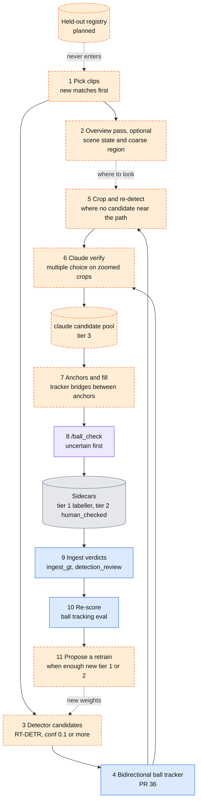
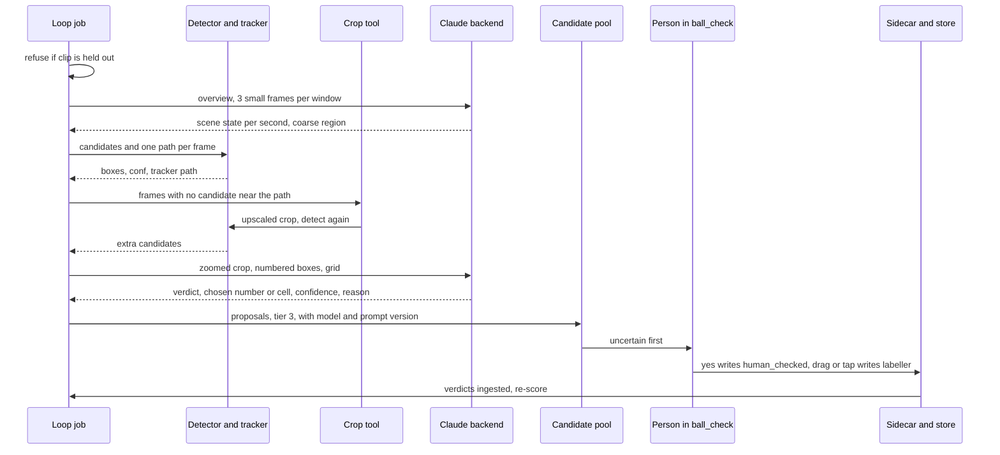

# Claude-assisted ball labelling loop

Status: **PROPOSAL. Nothing in this page is built.** · Date: 2026-11-10 · Code reviewed: the ball-tracker branch (PR #36), which stacks on `main` @ `26d2506` plus the merged T-01 to T-04 fixes

This page is for anyone deciding how to get many more ball labels, from many more matches, without a person drawing every box. It proposes **route J, "Claude-assisted ball labels"**: a loop in which the detector and tracker propose, a Claude model checks, and a person confirms only what is uncertain. It builds on two June notes, the [autolabelling architecture review](autolabelling_architecture_review.md) and the [bidirectional tracking research](bidirectional_tracking_research.md), and on the scored measurement in [Ball tracking evaluation](../ball-tracking-eval.md).

Every number has a source next to it. Anything with no measurement behind it is marked **unverified** or **proposed**. Items that do not exist yet are marked **planned**.

## 1. Why

The ball is the whole problem ([Best pipeline](../pipeline-and-labels.md), summary). Three facts from the existing docs point at the same gap:

- **Diversity beats volume.** Going from Roboflow v3 to v11 took RT-DETR-L ball mAP50 from 0.328 to 0.665 and recall from 0.244 to 0.59, while more frames from the same long clips will not help ([Best pipeline](../pipeline-and-labels.md), section 3). New matches are the lever.
- **Humans are the bottleneck.** A Ball Check card takes about 3.3 s (18 per minute), measured from 360 decided verdicts on two days, one person ([Best pipeline](../pipeline-and-labels.md), route D). That is fast, but every card still costs a person's attention, and a new match has thousands of candidate frames.
- **Much of the loss is the detector, not the tracker.** On the held-out clips only 74 of 119 human ball frames have any detector candidate within 25 px (62%), and no tracker can recover the rest ([Ball tracking evaluation](../ball-tracking-eval.md), results). Frames the detector misses are exactly the frames a person would otherwise have to place by hand.

A Claude model can look at a zoomed crop and answer a narrow question ("which of these boxes is the ball?"). The proposal is to use that to turn a person's job from "draw or judge every box" into "confirm the doubtful ones".

What this is **not**: it is not a way to produce evaluation data, and it is not a replacement for the human tiers. Claude output is tier 3 until a person says yes ([section 6](#6-provenance-and-tiers)).

## 2. The loop



Legend, as in [Architecture](../architecture.md#2-end-to-end-data-flow): blue is code in git, orange dashed is planned or not in git, purple is the `/ball_check` path, grey is data. The diagram shows one pass of the loop: pick clips, find candidates, fill the gaps, have Claude check, show a person the doubtful ones, ingest the answers, re-score, and only then consider a retrain. The detector step is orange because the batch inference script is not in git ([T-09](../todo.md)).

The steps, in plain words:

1. **Pick clips.** Unlabelled clips, new matches first. A clip whose canonical id (`footy_track.clip_id`) is in the held-out registry is refused ([section 7](#7-the-held-out-rule)).
2. **Overview pass (optional).** For each window, send Claude three downscaled frames one second apart. It returns, per second, the scene state: ball in play, ball in the air, out of play or off-screen, replay or close-up; plus a coarse region of the frame where play is. This pass is **only** for scene state and where to look. It never gives positions. Evidence: in an informal visual review of 10 clips, the model could not reliably spot a ball of about 11 px at full-frame scale. That review is not recorded in the repo (**unverified**); the 11 px size is the 1280 px figure in [Tracking pipeline design](tracking-pipeline.md), top risk 3.
3. **Candidates.** The existing RT-DETR detections (conf 0.1 or more, route F machine labels) and the bidirectional tracker from PR #36 give one candidate path per frame.
4. **Crop and re-detect.** Where no candidate lies near the expected path, crop around the tracker's predicted or interpolated position (or the overview region), upscale the crop, and run the detector again on it, so a ball of about 11 px becomes about 30 to 40 px. The 3x to 4x scale is a target, not a measurement (**planned**); `/ball_check` already upscales crops to 640 px wide for people (LAB-1008 in the labeller spec, `src/footy_track/labeller/README.md`).
5. **Claude verifies.** Multiple choice only ([section 4](#4-prompt-and-answer-format)).
6. **Anchors and fill.** Claude-confirmed detections become anchors and the bidirectional tracker fills between them. This is the anchor-plus-fusion design of the [June research note](bidirectional_tracking_research.md), with Claude supplying first-pass anchors where that note assumed human marks.
7. **Human review in `/ball_check`.** Proposals go to a new candidate pool with provenance `claude` (tier 3). They are never written straight into the GT sidecars (LAB-002, README section 1). `/ball_check` shows them, uncertain first: Claude and the detector disagree, low confidence, cell corrections. A "yes" writes the box with a `human_checked` marker (tier 2). A drag or a tap-to-place writes `labeller` (tier 1). This closes the documented gap that a ball verdict is thrown away; see [section 9](#9-what-the-code-does-with-verdicts-today).
8. **Ingest, re-score, propose.** Verdicts go through the existing ingest, the tracker is re-scored with the ball tracking eval, and a retrain is **proposed** (never started automatically) when enough new tier 1 or tier 2 labels exist. "Enough" is not decided; see [open questions](#11-open-questions).

## 3. One clip, in order



The sequence shows that the person only ever sees what Claude and the detector have already narrowed down, and that nothing reaches the sidecars without a person's action.

## 4. Prompt and answer format

Claude is given **multiple choice**, never a request for pixel coordinates. A language model is unreliable at locating an 11 px object by number of pixels, so the question is shaped so that a position is always chosen from a list the code drew.

**Verify prompt (one per frame, planned):**

- Input: a padded, zoomed crop around the expected ball position (at least 6 box sides of padding, the same default that `/ball_check` uses, LAB-1008), with candidate boxes drawn and numbered `1..n`, plus, on a separate copy, a fine numbered grid over the crop (for example 6 by 6, cells `1..36`; the grid size is **proposed** and to be tuned).
- Question: "Which numbered box is the match ball, or none? If none, but you can see the ball, which grid cell is it in?"
- Context given in words: ball in play versus replay, football size and colour, that boot and head blobs and ad-board marks are common false positives.

**Answer (strict JSON, planned):**

```json
{
  "verdict": "box | cell | none_visible | not_sure",
  "box": 2,
  "cell": null,
  "confidence": 0.0,
  "reason": "one short sentence"
}
```

Rules:

- `verdict` is `box` (the ball is one of the numbered boxes), `cell` (the ball is visible but no box is on it), `none_visible`, or `not_sure`.
- `confidence` is a number from 0 to 1. It is Claude's own and is **not** calibrated; the calibration run ([section 8](#8-calibration-plan-and-acceptance-thresholds)) measures how far to trust it.
- `cell` is a correction hint. A cell alone is never a box: a person places the ball, or the crop-and-re-detect step runs again inside that cell.
- A malformed or off-list answer is recorded as `not_sure`. It is never repaired by guessing.

**Logged with every answer:** clip, frame, crop geometry, the candidate list as drawn, the raw answer, the model name, the prompt version, the backend and its settings, the time taken, and the cost where the backend reports one. This log is the data the calibration run and any later audit depend on.

## 5. Backends

The Claude call sits behind one small interface (**planned**): a request (images, candidate list, prompt version) goes in, a structured answer comes out. Two backends, selectable by configuration:

| | (a) Anthropic API | (b) Claude Code headless (`claude -p`) |
|---|---|---|
| Sign-in | API key | Subscription login |
| Cost model | Pay per token; cost is reported per call | Counts against the plan's usage limits, **shared with interactive use**, so a loop can starve the person's own sessions |
| Speed and control | Parallel calls, fixed model and settings, structured output, retries are yours to control | Slower, one process per call, less control over settings and output shape |
| Fit | An unattended, continuous loop | Personal use, small batches, the calibration run if no key is available |

Recommendation: use the API for an unattended continuous loop, and keep `claude -p` as a fallback for small or interactive runs. Check the current terms of the subscription before relying on headless use for anything beyond personal work. The pluggable interface means the choice can change without touching the loop.

Handling the key: it lives in the job runner's secret store or the environment of the job. It never goes in the repo, a config file in git, a log line, or this site.

### Running it: jobs, not a service

The loop is a sequence of jobs under an external job runner (Prefect: a server on a small always-on machine, with a work pool on the GPU machine). That setup is **not in this repo**, and the design does not depend on it: **every step must also run as a plain script** that takes a clip list and an output folder, writes only under that folder, and can be re-run safely. Planned jobs, in order:

1. pick unlabelled clips, new matches first (reads the held-out registry);
2. detector and tracker (GPU);
3. crop and re-detect (GPU);
4. Claude verify (network, no GPU);
5. queue for review (write the candidate pool);
6. ingest verdicts (`ingest_gt`, which already reads Ball Check verdicts);
7. re-score with the ball tracking eval (CPU, about 7 s for 26 clips and three trackers per [Ball tracking evaluation](../ball-tracking-eval.md));
8. propose a retrain when enough new tier 1 or 2 labels exist (a notification, not a training run).

## 6. Provenance and tiers

Tiers as in [Datasets and labels](../data.md#label-tiers-and-provenance-tags); the new rows are **planned**.

| What | Sidecar tags | Tier | Written by | Counts as ground truth in the ball eval? | Reaches training? |
|---|---|---|---|---|---|
| Hand-drawn or dragged box | `[label, labeller]` | 1 | A person | Yes, the headline `human` tier | Yes |
| Propagated box a person checked | `[label, vittrack, human_checked]` | 2 | Machine, then a person | Separate `human+propagated` tier only | Yes |
| **Claude proposal a person said yes to** (planned) | `[label, claude, human_checked]` | 2 | Claude, then a person | **No**; unknown provenance is ignored (`detection_replay.py:214-219`), and should stay so | Yes |
| **Claude proposal after a drag or a tap to place** (planned) | `[label, labeller]` | 1 | A person, using Claude's hint | Yes | Yes |
| **Claude proposal, not yet reviewed** (planned) | none: it lives only in the candidate pool | 3 | Claude | No | **No** |
| Detector box (route F) | `[label, rtdetr]` in `machine_labels/` | 3 | Machine | No | Only via Ball Check |

Rules:

- A Claude proposal is never written straight into a sidecar. This is LAB-002 ("machine output never replaces anything at or above its own level", README section 1). Nothing at tier 1 or 2 is ever overwritten by it.
- A "yes" in `/ball_check` writes the box with `human_checked`. A drag, or a tap on the spot where the ball is, writes `labeller`. Both are the person's act, not Claude's.
- Tier 2 for a Claude box keeps the `claude` tag, so a later audit can tell which labels came through the loop. The ingest map from provenance tag to source (`ingest_gt.py:82-87`) and the session's provenance set would need a `claude` entry; until then an unknown tag is handled by the fallbacks listed in [Architecture, section 6](../architecture.md#6-data-formats-that-cross-stage-boundaries) and must not be relied on.

## 7. The held-out rule

**Held-out clips never enter the loop. They stay human-only.**

- The held-out set is the 6 clips (119 human ball frames, 7 no-ball frames) in [Ball tracking evaluation](../ball-tracking-eval.md#leakage-seen-and-held-out-clips), plus whatever is added later. A clip is held out if it, or its source footage, is outside the detector's training data.
- The loop reads a checked-in **held-out registry** (planned; it relates to [T-33](../todo.md), the explicit eval-clip list) and refuses any clip in it, matched by canonical clip id (`footy_track.clip_id`) and by footage time span, since names alone cannot catch overlap (T-33).
- Claude output never enters a held-out clip's sidecar, the candidate pool for it, or the training export for it.
- New held-out clips are added from **new matches** over time, human-marked, before the loop first touches that match. One full match is held out per match batch, as [Best pipeline](../pipeline-and-labels.md#5-recommendation-in-order) step 4 already says.
- Why it matters: a detector retrained on Claude-assisted labels of a clip, then scored on that clip, measures nothing. The rule keeps the score honest.

## 8. Calibration plan and acceptance thresholds

**Calibrate before scaling.** The thresholds below are **proposed**, not agreed.

**Data.** The 26 clips with human marks: 646 human ball frames and 37 human no-ball frames ([Ball tracking evaluation](../ball-tracking-eval.md#ground-truth-rules)). Steps 3 to 6 of the loop (candidates, crop and re-detect, Claude verify) run over them **read-only**. Output goes to a scratch folder, never to the candidate pool or a sidecar, because 6 of the 26 clips are held out and the loop must not write into them. For the same reason, **tune the prompt on the 20 seen clips only and score the 6 held-out clips once**, at the end. The eval's own caveats carry over: the marks are mostly on frames a person looked at because the detector proposed something, so recall will look better than it is.

Extra negatives: the 37 no-ball frames are few. Add the `not_ball` Ball Check verdicts (144 in [Best pipeline](../pipeline-and-labels.md), section 3, stored in `detection_review`) as false-positive examples.

**What to measure, and a proposed threshold for each:**

| Measure | Definition | Proposed threshold | Why |
|---|---|---|---|
| Agreement with human marks | Of human-marked ball frames where a correct candidate exists, the share where Claude picks it | at least 0.95 | Below that, the review queue fills with disagreements and saves little |
| False "not ball" | Claude says `none_visible` or picks another box when the human mark is among the candidates | at most 0.03 | These are real balls the loop would discard |
| False "ball" | Claude confirms a box on a no-ball frame, or one more than 25 px from a human mark, or a box a person marked `not_ball` | at most 0.02 | A confirmed wrong box becomes an anchor and misleads the fill. Held-out `WRONG` is the failure the tracker eval already watches |
| Beats the confidence bands | Claude's precision on candidates of conf 0.1 to 0.6, where measured precision is at most 0.42 ([Best pipeline](../pipeline-and-labels.md), Ball Check precision) | clearly above 0.42 in every band | Otherwise Claude adds nothing the confidence score did not give |
| Extra balls from crop and re-detect | Human-marked frames with no original candidate within 25 px where the re-detect finds one within 25 px | report the count; proceed if it recovers a useful share of the 112 frames the detector missed (646 frames, minus 534 with a candidate within 25 px: 74 held-out plus 460 seen, from [Ball tracking evaluation](../ball-tracking-eval.md)) | This is the step meant to raise recall; if it finds nothing, the loop is only a faster reviewer |
| Calibration of Claude's confidence | Precision per Claude-confidence band | monotone and usable to order the review queue | Needed for "uncertain first" |
| Cost and time per clip | Backend cost and wall time per clip, split by step | set after the first run, against a budget stated before it; compare per resolved frame with the human 3.3 s per card ([Best pipeline](../pipeline-and-labels.md), route D) | No cost number exists yet (**unverified**) |

**Gate.** The loop is not run on new matches until agreement, false "not ball" and false "ball" meet their thresholds on the seen clips **and** the single held-out scoring does not contradict them. If the thresholds are missed, the fallback is a smaller role (for example the overview pass and crop-and-re-detect only, with a person doing every verify), not lower thresholds.

## 9. What the code does with verdicts today

This corrects a claim older pages still make. T-02 is merged: Ball Check verdicts reach the feature store.

- `ingest_gt` imports the verdict logs: `import_ball_checks(store, bc_dir, ...)` (`feature_store/ingest_gt.py:383`) into the `detection_review` table (`feature_store/schema.py:330`).
- The training export drops boxes a person marked `not_ball` unless asked to keep them (`scripts/export_training_dataset.py:85-97`, applied at `:125` and `:151`).
- Still open: the import matches by box overlap but stores the positional `detection_id`, and the export joins on it ([T-25](../todo.md)); `ball` verdicts mark a detection reviewed, but nothing yet creates a tier 2 box from a yes.
- No code **creates** `human_checked`. Since T-01 the labeller session **keeps** the marker across load and flush (`labeller/session.py:173-180`, `:326-332`), and `ingest_gt` reads it (`ingest_gt.py:81`). A "yes writes `human_checked`" step is therefore new work ([T-47](../todo.md)).

## 10. Risks

| Risk | What it looks like | Mitigation (proposed) |
|---|---|---|
| **Claude agrees with a detector false positive** | A player's head near the ad boards at conf about 0.75 is already followed by a tracker ([T-34](../todo.md)); numbered boxes invite the model to pick one | Always offer "none"; include hard cases in calibration; ask a person whenever Claude and the detector or tracker path disagree; never treat a Claude yes as tier 2 without a person |
| **Leakage** | Claude-assisted labels of an eval clip reach training, or the prompt is tuned on held-out clips | The held-out rule ([section 7](#7-the-held-out-rule)); tune on seen clips only; registry checked in code, not by convention |
| **Cost** | Per-frame calls over thousands of frames per match | Verify only frames the tracker cannot settle; crop sizes small; measure cost in calibration; a budget cap per run; API cost is reported per call |
| **Wrong anchors poison the fill** | One confirmed wrong box drags the bidirectional fill | Anchors need agreement between Claude and a candidate from detector or re-detect; the tracker's own agreement test applies |
| **Optimistic calibration** | The 26 clips are frames people already looked at | Say so in the result; treat thresholds as necessary, not sufficient; re-measure on the first reviewed batch from a new match |
| **Model or prompt drift** | The same prompt gives different answers after a model change | Log model and prompt version on every answer; re-run a fixed calibration subset when either changes |
| **Subscription limits** (backend b) | The loop uses up the plan for interactive work | Use the API for the loop |
| **Overview pass misleads** | Scene state is wrong, a real play is skipped | It only suggests where to look and what to skip; it never gives positions or labels |
| **Human fatigue and rubber-stamping** | A person taps yes on every Claude proposal | Mix in known-answer cards; keep the uncertain-first order; sample-check reviewed batches |
| **Public repo** | Keys, hosts or paths leak into docs or logs | Secrets only in the runner; logs hold no keys |

## 11. Open questions

1. How many new tier 1 and 2 labels justify proposing a retrain? One match's worth, or a fixed count?
2. Should a `claude` plus `human_checked` box count as tier 2 in the training export, or be exported only after a second look? It is not independent evidence, so the ball eval ignores it.
3. Grid size for cell answers: coarse (fewer, larger cells) or fine (more cells, harder to read)? Tune in calibration.
4. Is the overview pass worth its cost? Measure how many frames it lets the loop skip before building it.
5. Does the 3x to 4x crop upscale actually help RT-DETR, which was trained at 1920? Unmeasured.
6. Do replays and close-ups need their own handling, since the ball there is large and the tracker has no pitch context?
7. Where does the candidate pool live, and does it share the `ball_candidates` format so `/ball_check` can read it unchanged?
8. Who owns the held-out registry, and how is time-span overlap between new matches checked?

Related: [Architecture](../architecture.md), [Best pipeline and label needs](../pipeline-and-labels.md), [Tracking pipeline design](tracking-pipeline.md), [Ball tracking evaluation](../ball-tracking-eval.md), [TODO](../todo.md) T-44 to T-49.
