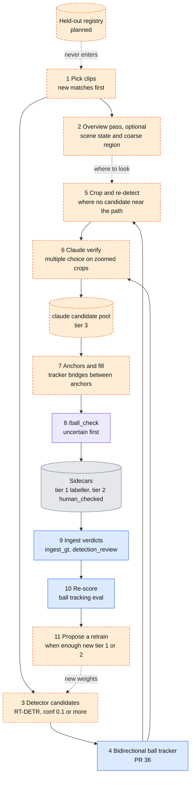
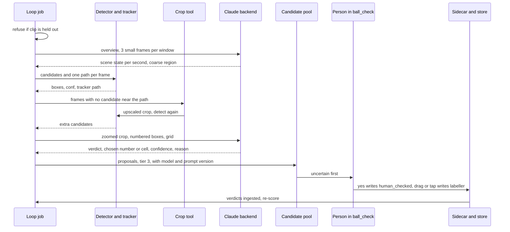

# Claude-assisted ball labelling loop

Status: **PROPOSAL, with the labelling mode of [section 12](#12-labelling-mode-built-2026-11) built.** The calibration pilot and method v2 ([section 8](#calibration-results-pilot-2026-11)) and the labelling loop of section 12 exist; the overview pass, the API backend and the retrain proposal do not · Date: 2026-11-10 · Code reviewed: the ball-tracker branch (PR #36), which stacks on `main` @ `26d2506` plus the merged T-01 to T-04 fixes

This page is for anyone deciding how to get many more ball labels, from many more matches, without a person drawing every box. It proposes **route J, "Claude-assisted ball labels"**: a loop in which the detector and tracker propose, a Claude model checks, and a person confirms only what is uncertain. It builds on two June notes, the [autolabelling architecture review](autolabelling_architecture_review.md) and the [bidirectional tracking research](bidirectional_tracking_research.md), and on the scored measurement in [Ball tracking evaluation](../ball-tracking-eval.md).

Every number has a source next to it. Anything with no measurement behind it is marked **unverified** or **proposed**. Items that do not exist yet are marked **planned**.

## 1. Why

The ball is the whole problem ([Best pipeline](../pipeline-and-labels.md), summary). Three facts from the existing docs point at the same gap:

- **Diversity beats volume.** Going from Roboflow v3 to v11 took RT-DETR-L ball mAP50 from 0.328 to 0.665 and recall from 0.244 to 0.59, while more frames from the same long clips will not help ([Best pipeline](../pipeline-and-labels.md), section 3). New matches are the lever.
- **Humans are the bottleneck.** A Ball Check card takes about 3.3 s (18 per minute), measured from 360 decided verdicts on two days, one person ([Best pipeline](../pipeline-and-labels.md), route D). That is fast, but every card still costs a person's attention, and a new match has thousands of candidate frames.
- **Much of the loss is the detector, not the tracker.** On the held-out clips only 74 of 119 human ball frames have any detector candidate within 25 px (62%), and no tracker can recover the rest ([Ball tracking evaluation](../ball-tracking-eval.md), results). Frames the detector misses are exactly the frames a person would otherwise have to place by hand.

A Claude model can look at a zoomed crop and answer a narrow question ("which of these boxes is the ball?"). The proposal is to use that to turn a person's job from "draw or judge every box" into "confirm the doubtful ones".

What this is **not**: it is not a way to produce evaluation data, and it is not a replacement for the human tiers. Claude output is tier 3 until a person says yes ([section 6](#6-provenance-and-tiers)).

## 2. The loop



Legend, as in [Architecture](../architecture.md#2-end-to-end-data-flow): blue is code in git, orange dashed is planned or not in git, purple is the `/ball_check` path, grey is data. The diagram shows one pass of the loop: pick clips, find candidates, fill the gaps, have Claude check, show a person the doubtful ones, ingest the answers, re-score, and only then consider a retrain. The detector step is orange because the batch inference script is not in git ([T-09](../todo.md)).

The steps, in plain words:

1. **Pick clips.** Unlabelled clips, new matches first. A clip whose canonical id (`footy_track.clip_id`) is in the held-out registry is refused ([section 7](#7-the-held-out-rule)).
2. **Overview pass (optional).** For each window, send Claude three downscaled frames one second apart. It returns, per second, the scene state: ball in play, ball in the air, out of play or off-screen, replay or close-up; plus a coarse region of the frame where play is. This pass is **only** for scene state and where to look. It never gives positions. Evidence: in an informal visual review of 10 clips, the model could not reliably spot a ball of about 11 px at full-frame scale. That review is not recorded in the repo (**unverified**); the 11 px size is the 1280 px figure in [Tracking pipeline design](tracking-pipeline.md), top risk 3.
3. **Candidates.** The existing RT-DETR detections (conf 0.1 or more, route F machine labels) and the bidirectional tracker from PR #36 give one candidate path per frame.
4. **Crop and re-detect.** Where no candidate lies near the expected path, crop around the tracker's predicted or interpolated position (or the overview region), upscale the crop, and run the detector again on it, so a ball of about 11 px becomes about 30 to 40 px. The 3x to 4x scale is a target, not a measurement (**planned**); `/ball_check` already upscales crops to 640 px wide for people (LAB-1008 in the labeller spec, `src/footy_track/labeller/README.md`).
5. **Claude verifies.** Multiple choice only ([section 4](#4-prompt-and-answer-format)).
6. **Anchors and fill.** Claude-confirmed detections become anchors and the bidirectional tracker fills between them. This is the anchor-plus-fusion design of the [June research note](bidirectional_tracking_research.md), with Claude supplying first-pass anchors where that note assumed human marks.
7. **Human review in `/ball_check`.** Proposals go to a new candidate pool with provenance `claude` (tier 3). They are never written straight into the GT sidecars (LAB-002, README section 1). `/ball_check` shows them, uncertain first: Claude and the detector disagree, low confidence, cell corrections. A "yes" writes the box with a `human_checked` marker (tier 2). A drag or a tap-to-place writes `labeller` (tier 1). This closes the documented gap that a ball verdict is thrown away; see [section 9](#9-what-the-code-does-with-verdicts-today).
8. **Ingest, re-score, propose.** Verdicts go through the existing ingest, the tracker is re-scored with the ball tracking eval, and a retrain is **proposed** (never started automatically) when enough new tier 1 or tier 2 labels exist. "Enough" is not decided; see [open questions](#11-open-questions).

## 3. One clip, in order



The sequence shows that the person only ever sees what Claude and the detector have already narrowed down, and that nothing reaches the sidecars without a person's action.

## 4. Prompt and answer format

Claude is given **multiple choice**, never a request for pixel coordinates. A language model is unreliable at locating an 11 px object by number of pixels, so the question is shaped so that a position is always chosen from a list the code drew.

**Verify prompt (one per frame, planned):**

- Input: a padded, zoomed crop around the expected ball position (at least 6 box sides of padding, the same default that `/ball_check` uses, LAB-1008), with candidate boxes drawn and numbered `1..n`, plus, on a separate copy, a fine numbered grid over the crop (for example 6 by 6, cells `1..36`; the grid size is **proposed** and to be tuned).
- Question: "Which numbered box is the match ball, or none? If none, but you can see the ball, which grid cell is it in?"
- Context given in words: ball in play versus replay, football size and colour, that boot and head blobs and ad-board marks are common false positives.

**Answer (strict JSON, planned):**

```json
{
  "verdict": "box | cell | none_visible | not_sure",
  "box": 2,
  "cell": null,
  "confidence": 0.0,
  "reason": "one short sentence"
}
```

Rules:

- `verdict` is `box` (the ball is one of the numbered boxes), `cell` (the ball is visible but no box is on it), `none_visible`, or `not_sure`.
- `confidence` is a number from 0 to 1. It is Claude's own and is **not** calibrated; the calibration run ([section 8](#8-calibration-plan-and-acceptance-thresholds)) measures how far to trust it.
- `cell` is a correction hint. A cell alone is never a box: a person places the ball, or the crop-and-re-detect step runs again inside that cell.
- A malformed or off-list answer is recorded as `not_sure`. It is never repaired by guessing.

**Logged with every answer:** clip, frame, crop geometry, the candidate list as drawn, the raw answer, the model name, the prompt version, the backend and its settings, the time taken, and the cost where the backend reports one. This log is the data the calibration run and any later audit depend on.

## 5. Backends

The Claude call sits behind one small interface (**planned**): a request (images, candidate list, prompt version) goes in, a structured answer comes out. Two backends, selectable by configuration:

| | (a) Anthropic API | (b) Claude Code headless (`claude -p`) |
|---|---|---|
| Sign-in | API key | Subscription login |
| Cost model | Pay per token; cost is reported per call | Counts against the plan's usage limits, **shared with interactive use**, so a loop can starve the person's own sessions |
| Speed and control | Parallel calls, fixed model and settings, structured output, retries are yours to control | Slower, one process per call, less control over settings and output shape |
| Fit | An unattended, continuous loop | Personal use, small batches, the calibration run if no key is available |

Recommendation: use the API for an unattended continuous loop, and keep `claude -p` as a fallback for small or interactive runs. Check the current terms of the subscription before relying on headless use for anything beyond personal work. The pluggable interface means the choice can change without touching the loop.

Handling the key: it lives in the job runner's secret store or the environment of the job. It never goes in the repo, a config file in git, a log line, or this site.

### Running it: jobs, not a service

The loop is a sequence of jobs under an external job runner (Prefect: a server on a small always-on machine, with a work pool on the GPU machine). That setup is **not in this repo**, and the design does not depend on it: **every step must also run as a plain script** that takes a clip list and an output folder, writes only under that folder, and can be re-run safely. Planned jobs, in order:

1. pick unlabelled clips, new matches first (reads the held-out registry);
2. detector and tracker (GPU);
3. crop and re-detect (GPU);
4. Claude verify (network, no GPU);
5. queue for review (write the candidate pool);
6. ingest verdicts (`ingest_gt`, which already reads Ball Check verdicts);
7. re-score with the ball tracking eval (CPU, about 7 s for 26 clips and three trackers per [Ball tracking evaluation](../ball-tracking-eval.md));
8. propose a retrain when enough new tier 1 or 2 labels exist (a notification, not a training run).

## 6. Provenance and tiers

Tiers as in [Datasets and labels](../data.md#label-tiers-and-provenance-tags); the new rows are **planned**.

| What | Sidecar tags | Tier | Written by | Counts as ground truth in the ball eval? | Reaches training? |
|---|---|---|---|---|---|
| Hand-drawn or dragged box | `[label, labeller]` | 1 | A person | Yes, the headline `human` tier | Yes |
| Propagated box a person checked | `[label, vittrack, human_checked]` | 2 | Machine, then a person | Separate `human+propagated` tier only | Yes |
| **Claude proposal a person said yes to** (planned) | `[label, claude, human_checked]` | 2 | Claude, then a person | **No**; unknown provenance is ignored (`detection_replay.py:214-219`), and should stay so | Yes |
| **Claude proposal after a drag or a tap to place** (planned) | `[label, labeller]` | 1 | A person, using Claude's hint | Yes | Yes |
| **Claude proposal, not yet reviewed** (planned) | none: it lives only in the candidate pool | 3 | Claude | No | **No** |
| Detector box (route F) | `[label, rtdetr]` in `machine_labels/` | 3 | Machine | No | Only via Ball Check |

Rules:

- A Claude proposal is never written straight into a sidecar. This is LAB-002 ("machine output never replaces anything at or above its own level", README section 1). Nothing at tier 1 or 2 is ever overwritten by it.
- A "yes" in `/ball_check` writes the box with `human_checked`. A drag, or a tap on the spot where the ball is, writes `labeller`. Both are the person's act, not Claude's.
- Tier 2 for a Claude box keeps the `claude` tag, so a later audit can tell which labels came through the loop. The ingest map from provenance tag to source (`ingest_gt.py:82-87`) and the session's provenance set would need a `claude` entry; until then an unknown tag is handled by the fallbacks listed in [Architecture, section 6](../architecture.md#6-data-formats-that-cross-stage-boundaries) and must not be relied on.

## 7. The held-out rule

**Held-out clips never enter the loop. They stay human-only.**

- The held-out set is the 6 clips (119 human ball frames, 7 no-ball frames) in [Ball tracking evaluation](../ball-tracking-eval.md#leakage-seen-and-held-out-clips), plus whatever is added later. A clip is held out if it, or its source footage, is outside the detector's training data.
- The loop reads a checked-in **held-out registry** (planned; it relates to [T-33](../todo.md), the explicit eval-clip list) and refuses any clip in it, matched by canonical clip id (`footy_track.clip_id`) and by footage time span, since names alone cannot catch overlap (T-33).
- Claude output never enters a held-out clip's sidecar, the candidate pool for it, or the training export for it.
- New held-out clips are added from **new matches** over time, human-marked, before the loop first touches that match. One full match is held out per match batch, as [Best pipeline](../pipeline-and-labels.md#5-recommendation-in-order) step 4 already says.
- Why it matters: a detector retrained on Claude-assisted labels of a clip, then scored on that clip, measures nothing. The rule keeps the score honest.

## 8. Calibration plan and acceptance thresholds

**Calibrate before scaling.** The thresholds below are **proposed**, not agreed.

**Data.** The 26 clips with human marks: 646 human ball frames and 37 human no-ball frames ([Ball tracking evaluation](../ball-tracking-eval.md#ground-truth-rules)). Steps 3 to 6 of the loop (candidates, crop and re-detect, Claude verify) run over them **read-only**. Output goes to a scratch folder, never to the candidate pool or a sidecar, because 6 of the 26 clips are held out and the loop must not write into them. For the same reason, **tune the prompt on the 20 seen clips only and score the 6 held-out clips once**, at the end. The eval's own caveats carry over: the marks are mostly on frames a person looked at because the detector proposed something, so recall will look better than it is.

Extra negatives: the 37 no-ball frames are few. Add the `not_ball` Ball Check verdicts (144 in [Best pipeline](../pipeline-and-labels.md), section 3, stored in `detection_review`) as false-positive examples.

**What to measure, and a proposed threshold for each:**

| Measure | Definition | Proposed threshold | Why |
|---|---|---|---|
| Agreement with human marks | Of human-marked ball frames where a correct candidate exists, the share where Claude picks it | at least 0.95 | Below that, the review queue fills with disagreements and saves little |
| False "not ball" | Claude says `none_visible` or picks another box when the human mark is among the candidates | at most 0.03 | These are real balls the loop would discard |
| False "ball" | Claude confirms a box on a no-ball frame, or one more than 25 px from a human mark, or a box a person marked `not_ball` | at most 0.02 | A confirmed wrong box becomes an anchor and misleads the fill. Held-out `WRONG` is the failure the tracker eval already watches |
| Beats the confidence bands | Claude's precision on candidates of conf 0.1 to 0.6, where measured precision is at most 0.42 ([Best pipeline](../pipeline-and-labels.md), Ball Check precision) | clearly above 0.42 in every band | Otherwise Claude adds nothing the confidence score did not give |
| Extra balls from crop and re-detect | Human-marked frames with no original candidate within 25 px where the re-detect finds one within 25 px | report the count; proceed if it recovers a useful share of the 112 frames the detector missed (646 frames, minus 534 with a candidate within 25 px: 74 held-out plus 460 seen, from [Ball tracking evaluation](../ball-tracking-eval.md)) | This is the step meant to raise recall; if it finds nothing, the loop is only a faster reviewer |
| Calibration of Claude's confidence | Precision per Claude-confidence band | monotone and usable to order the review queue | Needed for "uncertain first" |
| Cost and time per clip | Backend cost and wall time per clip, split by step | set after the first run, against a budget stated before it; compare per resolved frame with the human 3.3 s per card ([Best pipeline](../pipeline-and-labels.md), route D) | No cost number exists yet (**unverified**) |

**Gate.** The loop is not run on new matches until agreement, false "not ball" and false "ball" meet their thresholds on the seen clips **and** the single held-out scoring does not contradict them. If the thresholds are missed, the fallback is a smaller role (for example the overview pass and crop-and-re-detect only, with a person doing every verify), not lower thresholds.

### Calibration results (pilot, 2026-11)

A first calibration pilot has been run. It is **small, uses the subscription backend, and does not clear the gate**: on every proposed threshold the first prompt version misses. Treat the numbers as a baseline for iterating the prompt and the crop step, not as a verdict on the idea.

**Method.** Code: `src/footy_track/autolabel/` and `scripts/claude_verify_pilot.py` (`prepare`, `ask`, `score`; tests in `tests/test_autolabel_verify_pilot.py`, synthetic data only). Steps, in order:

1. *Frames.* All human-marked frames of the 6 held-out clips (119 ball, 7 no-ball) plus a seeded sample of the seen clips: 50 ball frames where a cached detector candidate lies within 25 px of the human mark, 50 where none does, and 20 no-ball frames. 246 questions in a fixed shuffled order. Only `labeller` (human-placed) marks count as GT. The GT is used only to stratify the sample and to score; it never places a crop or a candidate.
2. *Crop centre.* The bidirectional tracker's output replayed over the cached detections (172 frames), else the nearest tracker position within 12 frames (59), else the frame centre (15). The crop is 320 x 320 native pixels, clamped to the frame.
3. *Crop and re-detect.* The crop is upscaled 3x (960 x 960) and the same RT-DETR weights run on it at conf 0.05 and `imgsz` 960 (the 3x scale with no further resampling; other scales are unmeasured). Candidates are the cached boxes inside the crop plus the re-detect boxes, de-duplicated within 6 px (the original wins), top 6 by confidence; each remembers where it came from.
4. *Question image.* The crop shown at 960 x 960 with thin coloured boxes, a large number beside each box, a faint 8 x 8 grid labelled A1 to H8 at the edges (**one cell is 40 px at native resolution**), and a 480 x 270 whole-frame thumbnail with the crop outlined. The list of numbers with detector confidences is drawn beside it.
5. *Ask.* `claude -p` (Claude Code headless, subscription login), one call per 6 images, each image read with the Read tool, reply a JSON array. Answer schema: `{"verdict": "candidate" | "cell" | "none" | "unsure", "candidate": int | null, "cell": "C5" | null, "confidence": 0 to 1, "reason": short}`. This differs from the sketch in [section 4](#4-prompt-and-answer-format) (8 x 8 grid instead of 6 x 6, `candidate`/`none`/`unsure` as verdict names). The exact prompt text is versioned in `claude_cli.py` as `verify-v1`. A malformed batch is retried once. Sonnet on all 246 questions; Opus on the first 60 (a random subset, by the shuffle).
6. *Score.* Per question against the human marks within R = 25 px (and 10 px) at native resolution. Ball present: correct if the chosen candidate's centre, or the chosen cell's centre, is within R of the mark; `none` is a false "not ball"; `unsure` is counted separately. No-ball: correct only for `none`; any candidate or cell is a false "ball". A wrong pick on a ball frame also counts as a false "ball".

**Prompt tuning.** None. `verify-v1` was run once, unchanged, on seen and held-out frames together, so the held-out numbers are not contaminated by tuning, and there is no tuned-on-seen result either.

**Results, Sonnet, R = 25 px** (at 10 px every rate moves by at most 0.03 and the headline conclusions do not change):

| set | questions | agreement | agreement where a candidate is within R | false "not ball" (all ball frames) | false "not ball" (candidate within R) | false "ball" (all questions) | unsure |
|---|---|---|---|---|---|---|---|
| all | 246 | 0.512 | 0.771 (101 of 131) | 0.397 | 0.153 | 0.102 | 0.033 |
| held-out | 126 | 0.516 | 0.833 (60 of 72) | 0.395 | 0.125 | 0.095 | 0.016 |
| seen | 120 | 0.508 | 0.695 (41 of 59) | 0.400 | 0.186 | 0.108 | 0.050 |

Other rows: false "ball" on the 27 no-ball frames alone is 0.185 (5 of 27; held-out 2 of 7, seen 3 of 20). Wrong picks on ball frames are 0.091 of ball frames. No malformed answers, no retries for Sonnet.

**The crop often misses the ball.** In 57 of the 219 ball questions (26%; 28 of 119 held-out) the human mark is **outside** the 320 px crop, because the tracker's expected position was wrong or absent. There the only right answer for the crop is `none`, which the strict scoring above counts as a false "not ball". Two extra views: counting `none` as correct when the mark is outside the crop, agreement is **0.699** (held-out 0.698); and on the 162 ball questions whose mark is inside the crop, agreement is 0.642 and the false "not ball" rate is 0.253. The crop step, not only Claude, limits the pilot.

**Cell answers.** 12 questions got a cell answer from Sonnet; 3 were within 25 px (a 40 px cell centre is up to about 28 px from a ball in the same cell, so 25 px is a lenient test for a cell). On the 88 ball frames with no candidate within R in the crop, agreement was 0.034, so the cell hint is not a usable way to recover a ball the detector misses.

**Crop-and-re-detect gain.** Of the 219 ball questions, 14 (6.4%; 5 of 119 held-out, 9 of 100 seen) had a candidate within 25 px **only** because of the re-detect pass (the cached run had none inside the crop). Of the 102 ball frames with no cached candidate within 25 px in the crop, that is 14%. Sonnet picked the right box on 4 of those 14 (2 of 5 held-out); Opus picked it on 1 of the 3 that fall in its 60-question subset. So the step does add balls, but few, and Claude does not yet pick most of them.

**Sonnet versus Opus**, on the same 60 questions (53 ball frames, 7 no-ball; 30 held-out, 30 seen), R = 25 px:

| model | agreement | agreement where a candidate is within R | false "not ball" (candidate within R) | false "not ball" (mark in crop) | false "ball" | unsure |
|---|---|---|---|---|---|---|
| Sonnet | 0.567 | 0.778 (28 of 36) | 0.139 | 0.233 | 0.100 | 0.033 |
| Opus | 0.600 | 0.861 (31 of 36) | 0.028 (1 of 36) | 0.093 | 0.117 | 0.117 |

Opus is far less likely to throw away a real ball, and says `unsure` more often (0.117 against 0.033); it is no better on false "ball". With 60 questions, one or two answers move any of these by 0.02 to 0.03, so the difference is indicative only.

**Confidence calibration** (R = 25 px, share of answers in each band that were correct): Sonnet 0.23 (7 of 31) below 0.5, 0.32 (26 of 81) from 0.5 to 0.8, 0.69 (93 of 134) from 0.8; Opus 0 of 11, 8 of 18, 28 of 31 (0.90). Both are monotone, so the confidence can order a review queue, but even the top band is below the 0.95 target for Sonnet. The comparison with the detector's confidence bands (precision at most 0.42) was **not** run.

**Against the proposed thresholds** (all on Sonnet and all frames unless stated; none met):

| measure | proposed | pilot | met |
|---|---|---|---|
| agreement | at least 0.95 | 0.512 strict, 0.699 mark-in-crop adjusted, 0.771 where a candidate exists (held-out 0.833) | no |
| false "not ball" | at most 0.03 | 0.153 where a candidate exists (Opus 0.028 on 36 frames); 0.397 on all ball frames | Sonnet no; Opus only in that narrow slice |
| false "ball" | at most 0.02 | 0.102 (Sonnet), 0.117 (Opus, 60 questions) | no |

**Time and cost.** Sonnet: 41 calls (6 images each), mean 23.6 s, reported cost USD 0.091 per call (3.73 in total). Opus: 11 calls (one malformed batch was retried once and then parsed), mean 32.0 s, USD 0.171 per call (1.88 in total). The reported cost is the list-price equivalent printed by the CLI; on the subscription it is a usage figure, not a charge. Each call also carries about 7,000 tokens of the CLI's own context. Projection for a 30 s clip at 2 frames per second (60 questions, 10 calls): Sonnet about 4 minutes of calls run one after another (about 80 s at 3 in parallel) and about USD 0.91; Opus about 5.3 minutes (about 110 s at 3 in parallel) and about USD 1.71. That is roughly 4 s (Sonnet) or 5 s (Opus) per question, against 3.3 s per card for a person, before any human review of what Claude flags. The GPU steps (reading frames, re-detect on 246 crops, drawing) took under a minute on a single consumer GPU and are not split out.

**Caveats.**

- 6 held-out clips and 126 held-out questions: every rate has a wide interval (for example 28 of 36 has a 95% interval of roughly 0.60 to 0.90). The Opus comparison is 60 questions.
- The subscription backend shares usage limits with interactive work and was not tuned (no temperature or settings control); results may differ on the API.
- The seen sample is stratified by whether a detector candidate exists, so the overall rates are not the rates on a typical clip. The human marks are mostly frames a person looked at because the detector proposed something ([section 8](#8-calibration-plan-and-acceptance-thresholds)); the eval's caveats carry over.
- Some of the human marks are themselves hard to confirm at this scale (a ball in a crowd, a ball behind an advert board). Claude's "none" on those frames is not clearly an error. The pilot has no second human pass to check the marks.
- A contact sheet of wrong answers and re-detect wins was inspected only to sanity check the rendering; the prompt was not changed in response.
- Crop scale (3x), `imgsz` 960 for re-detect, 8 x 8 grid and 6 boxes per question are untuned choices.

**What it suggests, not proves.** Fixing the crop first (the mark is outside it in a quarter of the frames) and re-running before touching the prompt; trying Opus or a second look on `none` answers where a candidate exists; and not relying on cell answers. The gate in this section stays: no new matches until the thresholds are met.

### Method v2 results (2026-11)

The reviewer's fixes to the pilot were built and scored. **The gate is still not met.** v2 is much better than v1 on the held-out clips, but agreement, false "not ball" and false "ball" all miss their thresholds, and 35% of the human-marked ball frames cannot be answered at all because the detector and the re-detect pass produce no candidate near the mark.

**What changed from v1.** Code: `autolabel/verify_v2.py`, `render_v2.py`, `prompts_v2.py`, `scripts/claude_verify_v2.py` (`prepare`, `ask`, `score`; tests in `tests/test_autolabel_verify_v2.py`, synthetic data only).

1. *Crops are centred on each candidate*, not on the tracker's expected position, so the mark can no longer fall outside the crop for lack of a tracker guess.
2. *One question per candidate*: "is the box on the match ball?", strict JSON `{"verdict": "ball" | "not_ball" | "unsure", "confidence": 0 to 1, "reason": short}`. The image is a 128 px native patch enlarged 4x to 512 px with a single thin yellow box, plus a 384 px context panel at 1x with the patch outlined. No grid cells. This is the question `/ball_check` asks a person.
3. *Candidates per frame*: the detection the bidirectional tracker chose (if any; source `tracker`), the top 2 other cached candidates by confidence (`top`), and up to 2 crop-and-re-detect candidates (`redetect`: a 320 px crop around the tracker path, 3x upscale, same weights, conf 0.05) that have no cached candidate within 25 px. Every question records its source.
4. *Models*: Opus by default; optional "Sonnet first, Opus second look on `not_ball` and `unsure`" (`ask --only-from`). The `claude -p` backend strips API-key variables from the environment and stops with a distinct exit code on an auth or usage-limit error; there is no fallback backend (the API backend is not wired).
5. *Scoring*: per candidate, a candidate within R = 25 px of a human mark is "near", any other is "far". A ball frame is correct when exactly the near candidates are answered `ball` and no far one is; a no-ball frame when none is. Reported: precision and recall of `ball` verdicts, frame agreement, false "not ball" (near candidates answered `not_ball`), false "ball" (far candidates, including those on no-ball frames, answered `ball`), `unsure` rate, the split by source and by Claude confidence, and held-out against seen. **Ball frames with no candidate within R are reported apart and are not counted against Claude**; their far candidates still count toward false "ball".
6. *Protocol*: the prompt was iterated on seen clips only, three versions, then the held-out clips were scored once with the last one. Sample as v1 (same seed): all 126 held-out frames, and for tuning the first 80 frames of the seeded seen sample (279 questions; 39 ball frames answerable, 27 with no candidate within R, 13 no-ball frames).

**Prompt versions** (exact text in `prompts_v2.py`; a logged `prompt_version` always maps to its text):

| version | change |
|---|---|
| `verify-v2` | plain question, list of look-alikes, `unsure` allowed |
| `verify-v2.1` | after reading v2's errors: the ball may be yellow, yellow-green or lilac (hi-vis balls were called boots and socks); say `ball` when the ball is in, touching, or within about one box height of the box (many "false not ball" were a box 10 to 25 px off a clearly visible ball) |
| `verify-v2.2` | v2.1 plus a strict look-alike rule (a ball is a separate round object, not part of a boot, sock, board or crowd; a faint smear is `unsure`) after v2.1 raised false "ball" |

**Seen clips (tuning set), Opus, R = 25 px** (46 near and 233 far candidates):

| prompt | frame agreement (39 frames) | no-ball frames (13) | ball precision | ball recall | false "not ball" | false "ball" (far) | unsure |
|---|---|---|---|---|---|---|---|
| v2 | 0.590 | 0.846 | 0.689 | 0.674 | 0.239 | 0.060 | 0.097 |
| v2.1 | 0.564 | 0.692 | 0.578 | 0.804 | 0.174 | 0.116 | 0.047 |
| v2.2 | 0.538 | 0.769 | 0.642 | 0.739 | 0.174 | 0.082 | 0.104 |
| v2.2, Sonnet | 0.538 | 0.769 | 0.732 | 0.652 | 0.196 | 0.047 | 0.140 |

The three prompts are within noise of each other on 39 frames (one frame is 0.026). v2.2 was chosen as final before the held-out run because it had the lowest sum of false "not ball" and false "ball". Sonnet with the final prompt is close to Opus, says `unsure` more, and costs half as much per question; a Sonnet-first design saves little here because 85% of its answers (not_ball or unsure) would need an Opus second look.

**Held-out clips, scored once, `verify-v2.2`, Opus, R = 25 px** (126 frames: 119 ball, 7 no-ball; 355 questions: 83 `tracker`, 167 `top`, 105 `redetect`; 76 near and 279 far candidates):

| measure | result | threshold | met |
|---|---|---|---|
| frame agreement, ball frames with a candidate within R | **0.813** (61 of 75) | at least 0.95 | no |
| false "not ball" (near candidates not answered `ball`) | **0.079** (6 of 76; 1 of them `unsure`) | at most 0.03 | no |
| false "ball" (far candidates answered `ball`) | **0.108** (30 of 279; no-ball frames alone 0.087, 2 of 23; 17 are on ball frames with no near candidate) | at most 0.02 | no |
| ball precision / recall | 0.697 (69 of 99) / 0.908 (69 of 76) | | |
| no-ball frame agreement | 0.714 (5 of 7) | | |
| `unsure` rate | 0.070 | | |
| ball frames with no candidate within R (not answerable) | 44 of 119 (0.370); only 2 of them had a cached candidate within R that was not selected | | |

At R = 10 px the rates move by 0.01 to 0.02. Where the answers are good: the candidate the tracker chose is confirmed with precision 0.952 (59 of 62), the other top candidates only 0.242 (8 of 33), re-detect 0.5 (2 of 4). Claude's confidence orders the answers well: `ball` verdicts with confidence at least 0.95 were all near a mark (33 of 33), 0.8 to 0.95 gave 28 of 43, 0.5 to 0.8 gave 8 of 23. The detector's own confidence bands on the same candidates were 16 of 223 near below 0.3, 7 of 65 from 0.3 to 0.6 and 53 of 67 from 0.6 to 0.9, so Claude is clearly above the detector's low-confidence precision (at most 0.42), mainly by rejecting the many far candidates.

**Crop-and-re-detect.** Three held-out ball frames had a near candidate only from the re-detect pass (the cached run had none within 25 px); Claude confirmed 2 of them. Against 44 unanswerable frames this is a small gain; the frames that remain unanswerable are real misses of both the detector and the re-detect pass, so the method cannot raise recall on them.

**Cost and time.** Opus, held-out run: 46 calls (45 batches of 8 images and one retry), mean 44 s per call, 5.6 s per question one after another (about 11 minutes with 3 in parallel), list-price-equivalent USD 0.0127 per question (4.61 in total). Sonnet on the seen set: USD 0.0058 per question, 2.8 s per question. A frame has about 2.8 questions, so about 16 s and USD 0.036 per frame with Opus, against 3.3 s per card for a person. On a subscription the cost is a usage figure, not a charge.

**Reading the result.**

- Most remaining errors are of three kinds. (a) False "ball" on far candidates: a second ball-like blob in the same frame (a spare ball, a bright patch near an advert board) that Claude cannot distinguish from the match ball in isolation; a per-candidate question has no way to know that only one is the match ball. (b) False "not ball" on near candidates where the human mark is a blurred or partly hidden ball, or a ball inside the crowd, where Claude's `not_ball` is arguably right; the marks have no second human pass. (c) The 10 to 25 px offsets, which v2.1 and v2.2 only partly fixed.
- The 0.95 agreement target looks out of reach for per-candidate verdicts alone. A frame-level step (accept a `ball` only when it agrees with the tracker's chosen detection, take the highest-confidence `ball` when several are returned, and send everything else to a person) would use the observed structure: `ball` verdicts at confidence at least 0.95 were all correct. That combination was not scored here and is not tuned on seen clips; treat it as the next experiment, not as a result.
- Caveats: held-out is 6 clips and 126 frames, so every rate has a wide interval (61 of 75 has a 95% interval of roughly 0.71 to 0.89); the seen tuning set is a stratified sample with half of its ball frames unanswerable, so its rates are not comparable with held-out rates; prompt versions differ by one or two frames; the marks are mostly frames a person looked at because the detector proposed something.

### Re-checking the disagreements

The held-out marks have no second human pass, and the 36 disagreements (7 false "not ball" including one `unsure`, 30 false "ball") include many that look like mark problems: a clear ball at a player's feet while the mark sits elsewhere, a spare ball near the hoardings, a mark on a ball in the crowd, a mark on a blurred smudge. A person re-checks each one, and the metrics are then re-computed against the marks as corrected. No new schema:

1. `claude_verify_v2 disagreements --run R --answers A --videos V` lists every disagreement (`disagreements.csv` and `.json`: clip, frame, mark position, Claude's box, confidence, type) and writes `review_list.json`, one Ball Check card per human mark ("is the mark the in-play match ball?") and one per disagreeing Claude box (same question), grouped by frame, mark first. A card shows its own box; the other box of the pair is drawn in magenta, so one card shows both.
2. Start the labeller with `FOOTY_BALL_CHECK_LIST=R/review_list.json` (and `FOOTY_CLIPS_DIR` set to the folder the videos are in) and open `/ball_check?source=list`. This is the smallest piece of T-47's pool: explicit cards served in file order, no sampling. It is not the `claude` candidate pool (tier 3, `human_checked` write) that T-47 plans.
3. Verdicts go to the normal log (`<gt dir>/ball_checks/<clip>.jsonl`, `source: "list"`), so the feature store import sees them like any others. They are left out of the `/ball_check/stats` precision and of the confidence bands (the cards are hand-picked, not a sample).
4. `score ... --decisions <gt dir>/ball_checks` re-scores with the marks changed by those verdicts and writes `summary_<label>_rechecked.json` and `truth_<label>_rechecked.json`.

Mapping of answers (nothing new is added): on a mark card, `not_ball` removes the mark, `corrected` (drag the box) moves it, `ball`, `box_off`, `unsure` or no answer keep it. On a Claude card, `ball` adds that box as a mark, `corrected` adds the dragged box, `not_ball`, `unsure` or no answer add nothing. So "GT right" is mark `ball` plus Claude `not_ball`; "Claude right" is mark `not_ball` plus Claude `ball`; "both wrong" is both `not_ball` (the frame becomes a no-ball frame); and a spare or crowd ball is `not_ball` for the question asked (the in-play ball). That last case cannot be told apart from "not a ball at all" in the log; if the split matters later, a distinct verdict (for example `not_in_play`) would be a schema change and is proposed here, not made.

Limits: the list holds only disagreements, so it cannot find a wrong mark on a frame where Claude and the mark agree, or on the 44 frames with no candidate near the mark. A dragged `corrected` box is appended to the sidecar as new `labeller` GT (the existing `save_box` behaviour) and does not delete the old mark, so a corrected mark leaves two lines for the frame until the old one is removed. The mark cards use a 12 px square because the run stores mark centres only.

## 9. What the code does with verdicts today

This corrects a claim older pages still make. T-02 is merged: Ball Check verdicts reach the feature store.

- `ingest_gt` imports the verdict logs: `import_ball_checks(store, bc_dir, ...)` (`feature_store/ingest_gt.py:383`) into the `detection_review` table (`feature_store/schema.py:330`).
- The training export drops boxes a person marked `not_ball` unless asked to keep them (`scripts/export_training_dataset.py:85-97`, applied at `:125` and `:151`).
- Still open: the import matches by box overlap but stores the positional `detection_id`, and the export joins on it ([T-25](../todo.md)); `ball` verdicts mark a detection reviewed, but nothing yet creates a tier 2 box from a yes.
- No code **creates** `human_checked`. Since T-01 the labeller session **keeps** the marker across load and flush (`labeller/session.py:173-180`, `:326-332`), and `ingest_gt` reads it (`ingest_gt.py:81`). A "yes writes `human_checked`" step is therefore new work ([T-47](../todo.md)).

## 10. Risks

| Risk | What it looks like | Mitigation (proposed) |
|---|---|---|
| **Claude agrees with a detector false positive** | A player's head near the ad boards at conf about 0.75 is already followed by a tracker ([T-34](../todo.md)); numbered boxes invite the model to pick one | Always offer "none"; include hard cases in calibration; ask a person whenever Claude and the detector or tracker path disagree; never treat a Claude yes as tier 2 without a person |
| **Leakage** | Claude-assisted labels of an eval clip reach training, or the prompt is tuned on held-out clips | The held-out rule ([section 7](#7-the-held-out-rule)); tune on seen clips only; registry checked in code, not by convention |
| **Cost** | Per-frame calls over thousands of frames per match | Verify only frames the tracker cannot settle; crop sizes small; measure cost in calibration; a budget cap per run; API cost is reported per call |
| **Wrong anchors poison the fill** | One confirmed wrong box drags the bidirectional fill | Anchors need agreement between Claude and a candidate from detector or re-detect; the tracker's own agreement test applies |
| **Optimistic calibration** | The 26 clips are frames people already looked at | Say so in the result; treat thresholds as necessary, not sufficient; re-measure on the first reviewed batch from a new match |
| **Model or prompt drift** | The same prompt gives different answers after a model change | Log model and prompt version on every answer; re-run a fixed calibration subset when either changes |
| **Subscription limits** (backend b) | The loop uses up the plan for interactive work | Use the API for the loop |
| **Overview pass misleads** | Scene state is wrong, a real play is skipped | It only suggests where to look and what to skip; it never gives positions or labels |
| **Human fatigue and rubber-stamping** | A person taps yes on every Claude proposal | Mix in known-answer cards; keep the uncertain-first order; sample-check reviewed batches |
| **Public repo** | Keys, hosts or paths leak into docs or logs | Secrets only in the runner; logs hold no keys |

## 11. Open questions

1. How many new tier 1 and 2 labels justify proposing a retrain? One match's worth, or a fixed count?
2. Should a `claude` plus `human_checked` box count as tier 2 in the training export, or be exported only after a second look? It is not independent evidence, so the ball eval ignores it.
3. Grid size for cell answers: coarse (fewer, larger cells) or fine (more cells, harder to read)? Tune in calibration.
4. Is the overview pass worth its cost? Measure how many frames it lets the loop skip before building it.
5. Does the 3x to 4x crop upscale actually help RT-DETR, which was trained at 1920? Unmeasured.
6. Do replays and close-ups need their own handling, since the ball there is large and the tracker has no pitch context?
7. Where does the candidate pool live, and does it share the `ball_candidates` format so `/ball_check` can read it unchanged?
8. Who owns the held-out registry, and how is time-span overlap between new matches checked?

## 12. Labelling mode (built, 2026-11)

This is the loop of section 2 as built for new clips, from the evidence of section 8 and
the re-check of the 65 disagreement cards. Code: `autolabel/loop.py` (pure logic),
`autolabel/camera.py`, `scripts/autolabel_loop.py` (steps), `scripts/claude_verify_v2.py ask`
(the Claude step, reused), jobs `footy_autolabel.py` (`autolabel-pool`, `-detect`,
`-candidates`, `-verify`, `-decide`, `-ingest`, and `autolabel-pipeline mode=labelling`).
Where this section and section 2 to 7 differ, this section is what runs. Tests:
`tests/test_autolabel_loop.py`.

**What the re-check showed, and the rules it sets.** After a person re-checked all 65
disagreement cards of the held-out run, Claude's `ball` on **the tracker's own candidate**
was right 61 of 62 times (0.98; confidence at least 0.95: 33 of 33), but on the other top
detector candidates only 10 of 33 (0.30). Nearly all of those errors are static spare
balls by the advertising hoardings, mostly in the Bournemouth clips. 37% of the human ball
frames had no candidate within 25 px, which Claude cannot repair. Hence: only a tracker
candidate can be accepted without a person; everything else that might be the ball goes to
the queue, and the reviewer sees one card per object, blind.

### 12.1 One round

| step | job (pool) | what | idempotent by |
|---|---|---|---|
| pool | `autolabel-pool` (cpu, desktop) | clips by name, glob or N random unlabelled ones, as canonical ids, into `clips.json`; **hard-fails on any evaluation clip** | an existing `clips.json` is kept |
| detect | `autolabel-detect` (gpu) | `rtdetr_1920_v11` candidate cache (conf 0.1, imgsz 1280) in the loop's own cache folder | cached clips skipped, temp dir then rename |
| candidates | `autolabel-candidates` (cpu, desktop) | bidirectional tracker, camera motion, static filter, every 5th frame, per frame the tracker's detection plus the top 2 other candidates, a question image per candidate, a per-run question budget, and the missed-ball (gap) frames | a finished run dir with the same parameters is skipped |
| verify | `autolabel-verify` (cpu, desktop) | `claude -p`, prompt `verify-v2.2`, `opus`, answers saved per batch; `--budget` caps new questions; exit 3 and a failed run on an auth or usage-limit error, progress kept | answered questions skipped |
| decide | `autolabel-decide` (cpu, desktop) | decision rule, objects, blind review list, circuit breaker, round report | pure recomputation, stable ids |
| (review) | person, Ball Check `source=list` | one card per object, blind | verdicts keyed by card id |
| ingest | `autolabel-ingest` (cpu, desktop) | apply verdicts, write labels, audit precision, breaker for the next round | recomputes from the verdict log |

Re-crop-and-re-detect (section 2, step 4) is **not** part of the labelling mode: it recovered
2 of 44 unanswerable held-out frames at a GPU cost, so `max_redetect` is 0 here.

### 12.2 Eval clips never enter

`eval_clip_ids` is the union of every clip in the eval split file (held-out and seen), every
clip with a GT sidecar or a Ball Check verdict log in the GT-marks folder, every video in the
eval folders and every cached eval clip, as canonical ids (`footy_track.clip_id`, so every
alias is caught). A missing or empty split file is an error. Clips registered as new
eval clips (12.11, `--eval-registry` / `$FOOTY_EVAL_REGISTRY`) are in the set too, from
the moment they are registered. `pool`, `check`, `prepare` and
`ingest` all call `assert_not_eval` and exit 4 (the jobs fail the step) on a match; random
picks skip eval clips and the clips of earlier rounds. Not caught: footage overlap between
a new clip and an eval clip under a different name (T-33, T-49 are still open), and clips the
detector was trained on. The loop's labels go to their own folder, never into the GT-marks
folder, so a labelled clip cannot become an eval clip by having a sidecar.

### 12.3 Static-object filter

A candidate is dropped before Claude is asked when, within 75 frames, at least 8 frames
(itself included) have a candidate within 6 px of its image position **while the global
camera shift between those frames reaches 30 px**. The shift is a cumulative phase
correlation of consecutive frames (480 px wide, windowed; a weak peak counts as no motion).
With no camera estimate, or a still camera, the candidate is kept (a ball at rest under a
still camera is real). All of it uses the cached candidates of every frame, not only the
sampled ones; the parameters are `StaticParams`.

*Measured* on the held-out run (355 candidates, Claude `verify-v2.2` Opus answers, scored
against the marks as corrected by the 65 re-check verdicts; 26 candidates called `ball` far
from any mark, of which 23 `top`, 2 `redetect`, 1 `tracker`; 73 called `ball` near a mark):

| radius px | frames | window | camera px | false `ball` removed | of which `top` | true balls removed | all candidates removed |
|---|---|---|---|---|---|---|---|
| 6 (default) | 8 | 75 | 30 | 4 of 26 | 4 | **0 of 73** | 8 of 355 |
| 6 | 12 | 75 | 30 | 4 | 4 | 0 | 8 |
| 4 | 8 | 75 | 30 | 4 | 4 | 0 | 8 |
| 8 | 8 | 75 | 30 | 5 | 5 | 1 | 13 |
| 6 | 5 | 50 | 20 | 5 | 5 | 2 | 22 |
| 10 | 6 | 75 | 30 | 5 | 5 | 4 | 22 |
| 6 | 8 | 75 | 60 | 0 | 0 | 0 | 1 |

So the filter is **safe but weak**: at the default it removes 4 of the 23 false `top` calls
(17%) and no true ball; looser settings add one more false call at the price of true balls.
The reason is visible in the numbers: in the Bournemouth clip the camera pans only 27 to 40
px over the 3 s window in which the spare ball is seen at one image position, while genuine
balls at rest (a ball held for a set piece) sit at one position for up to 43 frames with 24
px of camera travel. Image position alone cannot separate them at that pan speed, and the
default was not tuned on the held-out clips beyond this table. What protects the labels is
therefore the decision rule and the review, not this filter; it saves a few questions and
queue cards. (Camera-compensated "world" position was also tried in a one-off analysis
and did not separate them better.)

### 12.4 Decision rule (defaults in `Thresholds`, all configurable)

| candidate | Claude | outcome |
|---|---|---|
| tracker's | `ball`, conf at least 0.95 | **auto-accepted** (`claude_auto`, tier 3) |
| tracker's | `ball`, conf below 0.95 | queue (second tier) |
| tracker's | `not_ball`, `unsure`, invalid | queue: tracker and Claude disagree, one is wrong |
| other (`top`) | `ball`, any conf | queue |
| other | `not_ball`, conf at least 0.8 | dropped, but a share is queued as a control |
| other | `not_ball` below 0.8, `unsure` | queue |
| any | removed by the static filter | dropped, never asked, same control sampling |

The second tier (tracker `ball`, 0.8 to 0.95) is queued, not accepted: over all candidates the
0.8 to 0.95 band was right 28 of 43 times, and the sample for the tracker alone is too small to
say it is better. Whether to accept it later is for the audit numbers to decide.

### 12.5 Objects and the review list

Candidates of one clip are grouped into **objects** within each outcome class: two tracker
candidates with the same tracker id are one object; otherwise a candidate joins the object
whose last member is at most 12 frames earlier and within 12 px plus 12 px per frame (20 px
plus 40 px per frame between two tracker picks), never two members on one frame. The card
shows the member Claude was most sure of (else the highest detector confidence); the verdict
applies to the object's frames. An object of 5 or more members also gets 2 **spot-check**
cards on other members: if a spot verdict contradicts the object card the object is reported
as inconsistent and nothing is written for it.

**Queue order: reviewer time goes where the model fails.** Priority, highest first:

1. **Missed balls.** Detector recall is the ceiling of the loop (37% of held-out ball
   frames have no candidate within 25 px). A sampled frame where the tracker's path has a
   position (interpolated) but no cached candidate lies within 25 px of it is a *gap*
   frame; runs of gap frames are one object (at most 40 cards per round, the rest are
   reported as capped). The card shows the predicted position; the person drags the
   ball onto it (`corrected`: a tier 1 hard positive the detector missed), says it is
   right (`ball`) or that no ball is visible (`not_ball`). Not asked to Claude.
2. **Spare balls and false starts**: queued objects with any non-tracker candidate
   (confident detector candidates, objects Claude was unsure about), after the static filter.
3. **Claude-uncertain tracker candidates**: queued objects made only of tracker candidates
   (conf below 0.95, or `not_ball` / `unsure` on the tracker's own candidate).
4. The blind **gate audit** samples and the random no-candidate frames (12.10). They
   are not kept in this slot: they are spread through the whole list.
5. Spot-check cards.

The audit-type cards (4) are mixed in at hash-random places through the whole list
after this ordering, so a reviewer who stops early has still seen a share of every
audit.

Inside a priority the cards interleave the clips (hash order inside each clip, then
round-robin). Each object is one card showing its most informative frame, never a run of
consecutive frames: the frame of fastest motion for an object of 3 or more members, its
first member for a shorter one, the middle frame for a gap. A card is `{id, clip,
frame_index, frame_size, bbox, label, provenance: "list"}`: no source, role or Claude answer
is on it. The roles and priorities live in `cards_meta.json`, which the reviewer never
sees. A card `id` is a hash of the round, role and object, so the list can be regenerated;
the Ball Check list format gains this id (labeller README, LAB-1013b), with the verdict
keyed by a hash of it instead of the list position, and old position-keyed lists still
work. Since the file order is the priority order, the blind property is the card content,
not a shuffle. The 3 s context clip of Ball Check is the aid for in-play versus spare ball;
spare and crowd balls are `not_ball`.

### 12.6 Provenance and write-back

| what | tags in the loop's label file | tier | how |
|---|---|---|---|
| auto-accepted, not audited (or audit unsure) | `[in_play_ball, claude_auto]` | 3 | machine; feature store source `claude_auto`, unreviewed |
| auto-accepted object a person confirmed (audit) | `[in_play_ball, claude, human_checked]` | 2 | the whole object |
| queued object a person confirmed | `[in_play_ball, claude, human_checked]` | 2 | its queued members |
| `corrected` (a drag) | `[in_play_ball, labeller]` | 1 | the card's frame only; on a missed-ball card this is the hard positive |
| missed-ball card, `ball` | `[in_play_ball, claude, human_checked]` | 2 | the tracker's predicted box, that frame only |
| missed-ball card, `not_ball` (no ball visible) | none: a no-ball frame | - | `hard_negatives.jsonl` reason `gap_no_ball` |
| `not_ball` | none: hard negative | - | `hard_negatives.jsonl` and a `not_ball` record in `ball_checks/` |
| `box_off`, `unsure`, no verdict | nothing | - | |

Labels go to `autolabel_labels/<clip>.jsonl` (the sidecar format) and hard negatives and the
confirmed boxes to `autolabel_labels/ball_checks/<clip>.jsonl` (the Ball Check log format), both
**rebuilt from every round's own files** (`<run>/labels`, `<run>/ball_checks_propagated`),
merged so that on one frame overlapping boxes keep only the strongest tier. A file that
would change is copied to `autolabel_labels/.backups` first; nothing in the GT-marks folder
is written. Run `ingest_gt --gt-dir autolabel_labels` to bring them into the feature store.

**Training export.** `export_training_dataset` leaves `claude_auto` rows out unless
`--include-auto` is given (`include_auto=True`); asking for the source in `--sources`
without it is an error. Tier 2 `claude` boxes (reviewed) are exported like any reviewed
box; hard negatives are dropped from positives through `detection_review` as before.
Eval clips are excluded by canonical id as before.

**The 65 earlier verdicts.** `autolabel_loop legacy-import` applies them to the held-out
truth (`truth_<label>_rechecked.json` logic, duplicates within 4 px merged) and lists the
`not_ball` boxes as hard negatives, in `eval_corrections.json`, marked `eval_only`. It has no
path to a label folder: the clips are evaluation clips, so those verdicts correct the eval
truth and never reach training data.

### 12.7 Round report and circuit breaker

`round_report.json` and `.md` per round: clips, frames sampled, candidates, dropped by the
static filter, questions asked and answered, auto-accepted candidates, objects by class,
cards by role. After `ingest`: audit of the auto-accepted objects (ball, not ball, unsure;
precision by objects and by frames) and the controls (dropped objects a person found to be
the ball), the labels written, inconsistent objects.

From the gate audits on (12.10) the report also has, per gate, the audited objects,
precision with a Wilson 95% interval, ball rate for the drop gates, the gate's pass
level and whether it passed, and the miss rate measured on the random no-candidate
frames, in `round_report.json` (`gates`, `random`) and `.md`.

**Circuit breaker.** It looks at the auto-accept gate only, as before; the other gates
and the random frames are reported, never acted on. The latest round with at least 5 audited objects decides: audit
precision (by frames) below 0.97 opens it, and the next round sends every would-be
auto-accept to the queue (`would_auto` is still measured on those cards, so a later round
can close it again). No audited round: closed. Thresholds are in `Thresholds`.

### 12.8 First round (round-001)

Three random unlabelled clips (none in the eval split, none with GT marks), Opus,
`verify-v2.2`, budget 300 questions, every 5th frame, run through the Prefect pipeline
(`mode=labelling`; pool, detect, candidates, verify, decide). Nothing has been reviewed yet,
so the audit precision, the controls and the breaker have no numbers: they come from the
review and `autolabel-ingest`.

| count | value |
|---|---|
| clips / frames sampled | 3 / 196 |
| candidates (tracker pick plus top 2 others, per sampled frame) | 406 |
| dropped by the static filter | 9 |
| over the question budget (not asked) | 97 |
| Claude questions answered | 300 (171 `ball`, 101 `not_ball`, 28 `unsure`; 38 calls, about 11 minutes of calls, 3 in parallel, no stop) |
| Claude on tracker candidates (155) | `ball` 146 (54 at conf 0.95 or more), `not_ball` 4, `unsure` 5 |
| Claude on other candidates (145) | `ball` 25, `not_ball` 97 (47 at conf 0.95 or more), `unsure` 23 |
| auto-accepted candidates / objects | 54 / 7 |
| queued candidates | 163, in 58 objects |
| dropped candidates | 92 (83 confident `not_ball`, 9 static) |
| missed-ball (gap) frames / cards | 8 / 6 |
| review cards | 88: 6 missed ball, 49 spare ball or false start, 9 tracker-uncertain, 1 audit, 4 control, 19 spot |

Observations, all before any human check. Only 54 of the 146 tracker `ball` answers reach
0.95, so most tracker candidates go to the queue as second tier; the audit sample is one
object this round, below the 5 needed for the breaker to judge. The round was first
decided with an earlier commit and then re-decided with the priority order (same answers).
Prefect runs: pipeline 856f5990-e1bf-478f-a534-18e20329caac (pool 06a255c2, detect
72f3e6d9, candidates de2dc475, verify 7b6c0950, decide 91f2b800); re-decide with the
queue priority b86da0a9-c073-4f60-ba3d-1fe24be7edba. The missed-ball items of this round
were added to the prepared run with `autolabel_loop add-gaps` (the candidates step of a
fresh run does it itself). The review queue is served at the desktop's tailnet address,
port 8093 (`/ball_check?source=list`), from a GT folder of its own so no verdict lands in
the real GT marks.

### 12.9 Choices the design left open, and what is not verified

- Sampling: every 5th frame (5 fps), the tracker's detection plus the top 2 others; budget
  60% tracker candidates. Not tuned.
- The gate audit rates and floors (12.10) and the 0.97 breaker threshold are defaults, not
  measured. Round-001 was decided with the first scheme (10% audit with a floor of 1, 5%
  controls): 1 audit and 4 control cards, too few to measure anything. Its report and cards
  stay as they were (the report has no `scheme`, so `ingest` rebuilds it with that scheme).
- Object linking is a heuristic; a wrong merge propagates one verdict to a different
  object, which the spot-check cards only partly catch.
- The review UI was not changed beyond the list format; spot cards look like any other card.
- Sparse eval labelling is built (12.11), minus the split file entry: a registered clip is
  an eval clip for the loop and the export, and its marks go to the GT-marks folder, which
  the evaluation harness reads as it does for any other labelled clip.
- Re-tracking after each verdict is built (12.12); the parked-object forbid and segment chaining
  of the simulation are not.
- Not built: the API backend (`--backend api` still stops), crop-and-re-detect in the labelling
  mode, a checked-in held-out registry with footage-overlap checks (T-49; the registry of
  12.11 only names clips), the retrain proposal.

### 12.10 Gate audits and random frames (built, 2026-11)

Every automatic decision of the loop is a **gate**, and each is checked on its own by a blind
random sample (`Thresholds`, CLI `--audit-rate --audit-min --settled-rate --settled-min
--settled-rounds --drop-precision --random-frames`, same parameters on the Prefect flows):

| gate | what it decides | an audit card is | "correct" when the person says |
|---|---|---|---|
| `auto` | tracker candidate, `ball`, conf at least 0.95: accepted unseen | an auto-accepted object | ball (breaker input, pass level 0.97) |
| `claude_drop` | non-tracker candidate, `not_ball`, conf at least 0.8: dropped | a dropped object | not a ball (pass level 0.95) |
| `static_drop` | removed by the static filter, never asked | a filtered object | not a ball (pass level 0.95) |
| `over_budget` | left unasked by the question budget (nothing decided it; the audit measures what the budget loses) | an unasked candidate | not a ball (report only, no pass level) |

The gates a person already sees in full (second-tier tracker candidates, spare balls, Claude
`unsure`, missed-ball cards) need no audit. Not audited: the missed-ball cards beyond the
per-round cap (a hash-random subset already), and spot cards, which check object linking.

**Sample size.** Per gate `max(ceil(rate x objects), min)`, never more than the gate has,
drawn by a hash of round, gate and object. A "new" gate uses rate 0.20 and a floor of 6;
a gate that has **passed 3 rounds in a row** (judged at least `settled_min` = 3 objects with
precision at its pass level; a round that judged fewer is ignored, one that judged enough
and missed the level ends the streak) is "settled": rate 0.05 and floor 3. `over_budget`
has no pass level and stays new. Objects are grouped inside one gate (a static drop and a
confident drop never share an object).

**History.** `<rounds dir>/gate_state.json` (next to the round directories, because it spans
rounds): per gate a list of `{round, decided, correct, precision, at}`. `ingest` writes a
round's entry (keyed by round id, so a re-ingest replaces it); `decide` reads the others
and stores the rates it used in the report (`gates_plan`). `ingest` rebuilds the cards from
the round's own stored thresholds and plan, ignoring the command line, so the card ids
cannot drift from the list the reviewer has. A report without `scheme` (round-001) is
rebuilt with the first scheme.

**Random no-candidate frames.** `prepare` (or `add-random` on a prepared run) draws
`--random-frames` (default 8) sampled frames at random, spread over the clips, into
`random_frames.json` with every cached detector candidate of the frame. Each becomes a card
with **no box** (`"bbox": null, "place": true`) that asks "Tap the ball, or No ball"
(LAB-1015). The tapped box is a tier 1 `labeller` label; "No ball" writes nothing. The
report classes each tapped ball by the nearest candidate (25 px): `found_selected` (the loop
asked about it), `found_not_selected` (cached, but the top-2 selection dropped it) or
`missed` (no candidate), and gives the miss rate `missed / balls visible` and the
never-examined rate `(missed + not selected) / balls visible`, each with a Wilson 95%
interval, plus the share of random frames with a ball in view.

**Blind and mixed.** Audit cards have the same fields and prompt as any review card; the
role and gate live in `cards_meta.json`. The only visible difference is on the random
frames, where there is no box to ask about. All audit-type cards are spread through the
whole list (12.5), not left for the end.

**Rehearsal on round-001's data** (copy in a temp dir, same answers, new sampling; round-001
itself was not touched): the queue grows from 88 to 140 cards. The 6 missed-ball, 58 review
and 25 spot cards are the same kind as before; the audit-type cards go from 5 to 51:

| gate | objects (candidates) | cards |
|---|---|---|
| auto | 7 (54) | 6 (the floor; 20% would be 2) |
| claude_drop | 68 (83) | 14 (20%) |
| static_drop | 6 (9) | 6 (all) |
| over_budget | 85 (97) | 17 (20%) |
| random no-candidate frames | 8 | 8 |

So a round like this costs about 50 more cards, which is 37% of the queue. The floors
dominate for the small gates (auto, static) and the rate for the big ones; the cost falls
to roughly 3 + 4 + 3 + 5 + 8 = 23 once the gates settle.

Not verified: that 6 objects is enough to see a precision change (a Wilson interval of 6 of
6 is 61-100%; the report says so instead of pretending), and that three passing rounds is
the right bar for settling.

### 12.11 Sparse eval labelling (built, 2026-11)

To grow the evaluation set from new clips: about one frame per second, one tap-to-place card
per frame (tap the ball, or "No ball"), the same card as the random frames.

1. `autolabel_loop eval-register --registry R --clips-dir V --clips ...` registers clips
   as new eval clips (`footy_track/eval_registry.py`, canonical ids, a small JSON file;
   `$FOOTY_EVAL_REGISTRY` is the default location). **From that moment** the loop's `pool`,
   `check`, `prepare` and `ingest` refuse them (exit 4) and `export_training_dataset`
   (`--eval-registry` or the environment variable) leaves them out of both splits. A clip
   an earlier round used (its `clips.json` under `--rounds-dir`) is refused at
   registration: the loop may have labelled it.
2. `eval-list --registry R --clips-dir V --out list.json [--stride-s 1.0]` writes one card per
   `stride_s` seconds of every registered clip (frame 0, then every `round(fps x stride_s)`
   frames), each a tap-to-place card, in clip and frame order.
3. Serve it with `FOOTY_BALL_CHECK_LIST=list.json` and the **real** GT-marks folder (the reverse
   of the loop's rule: these marks are the evaluation truth). A tapped ball is appended to the
   clip's sidecar as `[in_play_ball, labeller]` by Ball Check as for any dragged box.
4. `eval-finalise --list list.json --gt-dir G` writes a `no_ball` marker line to the sidecar
   for every "No ball" verdict (idempotent), and prints the counts.

Not done: the split file (`ball_eval_cache_split.json`) is not edited (the held-out versus seen
assignment is a decision about the measurement, not about leakage); frames are not checked
against footage overlap with other clips (T-33, T-49); 1 frame per second is a default, not a
measured sample size.

### 12.12 Re-tracking during the review (built, 2026-11)

Evidence: an offline simulation (`scripts/retrack_sim.py`, `docs/ball-tracking-eval.md`,
re-tracking after each verdict) with the human marks as a perfect reviewer. Re-running a
whole-clip constrained Viterbi tracker after each verdict (a "ball" anchors the path through
that box, a "not a ball" forbids that candidate in that frame) and asking the most uncertain
frame (smallest Viterbi margin) next reached 90% frame accuracy in about 13 taps per clip,
against about 20 for random order and 22 to 27 for the spot-check order. Two things from
that work are **not** built: forbidding a parked object at every frame (it never changed an
answer) and chaining consecutive segments (the segments are not contiguous).

**What the server does** (`labeller/retrack_service.py`, logic in `autolabel/retrack.py`,
`ball_trackers/constrained.py`). It is on when `FOOTY_RETRACK_CACHE` (the round's detector
candidate cache) is set together with `FOOTY_BALL_CHECK_LIST`; `FOOTY_RETRACK_META` (the
round's `cards_meta.json`, read by the server only, never sent to the page) says which
cards are blind samples.

1. A verdict POST appends to the verdict log and returns at once. The card after it is the
   next one of the queue as it stood: nothing waits for, or reacts to, the re-track.
2. In a background thread the card's clip is re-tracked from the cache and *all* its
   verdicts (`ball` / `box_off` anchor at the card's box, `corrected` at the dragged box,
   `not_ball` forbids the card's box in that frame; `unsure` and "no ball" on a tap-to-place
   card constrain nothing). Measured on round-001 data (clips of 95 to 480 frames, up to 38
   constraints): 30 to 145 ms per re-track, well under the 1 s target.
3. When it finishes, up to two **follow-up cards** are pinned to the top of the queue: the
   frames of that clip where the path sits on a detected box and its margin is below 3,
   most uncertain first, frames whose answer the re-track changed ahead of the rest. A
   follow-up is an unjudged card of the list (moved up) or, where the list has none within
   2 frames, a new blind, id-keyed card with the path's box (persisted under
   `<GT dir>/retrack/cards.json`, so it survives a restart; the verdict log keys it like
   any list card). No frame is queued twice (cards within 2 frames are one question);
   at most 6 pinned cards wait at once and at most 10 new cards are made per clip, so a
   round stays finite.
4. The page re-fetches the queue after each verdict (and again while a re-track is
   pending) and replaces everything after the current card and the two already prefetched
   ones; the card on screen is never touched.

**Audits and controls are never starved, never moved, never hidden.** Cards with the
`audit`, `control` and `random` roles keep their places in the list's own order, which is
never reordered (only delayed by follow-ups). The server counts follow-up cards judged in a
row and, after two, puts a card of the base order first, so a reviewer who always takes the
top card meets a base card after at most two follow-ups (the page's two prefetched cards can
stretch that to about five). Without the meta file every existing card is treated as a blind
sample and none is moved; only new cards are pinned.

**Auto-done (off by default).** `FOOTY_RETRACK_AUTO_DONE=<conf>` hides an unjudged
non-audit card whose frame the path answers with a detected box, on that very box, at
detector confidence >= conf (suggested 0.8). The margin is *not* an auto-done rule. A hidden
card writes nothing by itself; the path's labels below cover it.

**Write-back at ingest** (`autolabel_loop ingest --cache <candidate cache>`; the review
server's `retrack/` folder next to `ball_checks/` marks a round that was reviewed with
re-tracking, others are unchanged). The final path is recomputed from the cache and the
verdict log (the same function the server used, so nothing in memory has to be exact):

- the path's other *detected* boxes on a chain a person anchored are written as **tier 3**,
  `[label, claude_auto, retrack]`: a person confirmed that ball at one frame and the
  tracker followed it, but nobody looked at these frames, so no `human_checked`, and like
  every `claude_auto` box they stay out of the training export unless `--include-auto` is
  given. Chains nobody touched (the detector's own tracker) and interpolated positions are
  not written. `retrack` is a marker tag: the feature store keeps the provenance
  `claude_auto` and ignores the marker, the sidecar keeps it;
- a follow-up card the server added: `ball` is tier 2 (`claude` + `human_checked` +
  `retrack`: a machine box a person confirmed), `corrected` tier 1 (the dragged box),
  `not_ball` a hard negative, `box_off` / `unsure` nothing;
- the round report gets a `retrack` block (clips re-tracked, constraints, labels by tier).

Not verified: the gain on real reviews (the 13-tap figure is simulated on the labelled
clips; follow-up cards add taps while the round's 90% mark gets closer, and whether the
net is fewer cards per correct frame has to be measured on a round reviewed this way);
the margin threshold of 3, the pin sizes and the base-card ratio are defaults.

### 12.13 Continuous mode (jobs, 2026-11)

The Prefect jobs repo runs rounds back to back so the reviewer never waits: `autolabel-round`
(a round, then the review server on it), a top-up flow every 15 minutes that starts the next
round when the current one has fewer than 20 cards left, a daily cap on Claude questions
(counted from the rounds' call logs), ingest of a finished round before the review server is
switched to the next, and a weekly summary. A server with unanswered cards is never replaced,
a stop on an auth or usage limit stops the queue and notifies instead of retrying, and one
variable pauses everything. See the jobs repo README for the flows, variables and schedules.

Related: [Architecture](../architecture.md), [Best pipeline and label needs](../pipeline-and-labels.md), [Tracking pipeline design](tracking-pipeline.md), [Ball tracking evaluation](../ball-tracking-eval.md), [TODO](../todo.md) T-44 to T-49.
