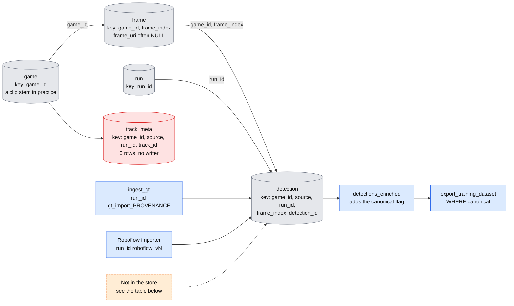

# Feature Store — Design

Status: **IMPLEMENTED (v1)** · Code: `src/footy_track/feature_store/` · Tests: `tests/feature_store/`

This document proposes a single, queryable **feature store** for footy-track:
the consolidated home for everything we know about a match's frames —
per-frame metadata, broadcast classification, pitch segmentation,
object detections from multiple sources, and (later) tracks and pitch
projections.

It **supersedes and consolidates** the scattered per-stage Parquet artifacts
sketched in [`../pipelines.md` §Data model](../pipelines.md#data-model-proposed)
(`frames.parquet`, `detections.parquet`, `geometry.parquet`,
`ocr_clock.parquet`, `embeddings.parquet`) and folds in the canonical track
store from [`player_tracking_format.md`](player_tracking_format.md). See
§9 for how the migration relates to those documents.

It honours the cross-stage invariants in
[`../system_design.md` §4](../system_design.md) — `ContinuousTime` as the only
canonical timestamp, normalised top-left xywh boxes, class labels from
`constants.py`, and monotone non-reused track IDs.

---

## 1. Goals and non-goals

**Goals**

- One **portable store per environment** that a human or a downstream
  consumer (footy-stats, FiftyOne, evaluation, overlays) can query with a
  single `SELECT` and no bespoke join glue.
- Hold, for every frame of every game: identity (path, resolution, frame
  index), time (`ContinuousTime` + `GameTime` + half), and the outputs of
  every analysis stage — broadcast classification, pitch segmentation,
  calibration, and object detections.
- Support **multiple independent detection sources** over the same frames
  (hand-labelled ground truth, SAM 3, YOLO runs, future trackers) coexisting
  without overwriting each other, each carrying its own confidence and model
  version.
- Be **idempotent**: re-ingesting the same run must not duplicate rows
  (footy-stats invariant).
- Allow **schema evolution** — adding a new stage's columns or a new source
  must not require rewriting existing data.

**Non-goals**

- A query *API* or serving layer — that is footy-stats' job. This store is
  the substrate footy-stats (and notebooks) read from.
- Re-identification, team assignment, jersey OCR, event extraction — these
  populate columns reserved here but are designed elsewhere.
- The tracker/detector algorithms themselves.
- Real-time/streaming ingestion — this design is batch-on-completion.
  §10 notes the streaming extension point.

---

## 2. The core decision: one *store*, not one *table*

The request is "a single Parquet/DuckDB table with lots of data in it." The
honest engineering answer is: **a single DuckDB database file (the store)
containing a small set of normalised tables at their natural grains, plus a
wide `frame_features` view that presents the per-frame world as one table.**

A literally-single physical table fails on **grain**:

| Fact | Natural grain | Rows for a 90-min game @ 25fps |
|---|---|---|
| frame metadata, clock, broadcast flag, pitch polygon, homography | **1 row per frame** | ~135 k |
| object detections (per source, per run) | **N rows per frame** (≈25 objects × M sources) | millions |
| game metadata (teams, venue, time mapping) | **1 row per game** | tens |
| processing provenance (model, params, run time) | **1 row per run** | hundreds |

Forcing detections into the frame row means array-of-struct columns that are
awkward to filter and explode; forcing frame metadata onto every detection row
means massive duplication and update anomalies (change one pitch polygon →
rewrite 25 M rows). So we **normalise by grain** and **denormalise on read**
via views. The user gets "one table" ergonomics (`SELECT * FROM
frame_features`); the storage stays sane.

### Why DuckDB as the store, Parquet as the substrate

- **DuckDB file = the single store.** One `feature_store.duckdb` is the
  portable, single-file artifact the request asks for. It gives real tables,
  constraints, `UPSERT` (idempotency), and SQL across grains.
- **Parquet = the on-disk table format and interchange.** Each table is also
  materialisable as a partitioned Parquet dataset
  (`store/<table>/game_id=<id>/part.parquet`) for DVC versioning, for
  consumers that don't want DuckDB, and so DuckDB can query it in place
  (`read_parquet`) without import.
- DuckDB reads/writes Parquet natively, so the two are the same data in two
  skins. We treat **Parquet as the source of truth on disk** and the DuckDB
  file as a fast, constraint-enforcing index over it (rebuildable from
  Parquet at any time). This keeps the store DVC-friendly and reproducible.

!!! note "Status check, 2026-11-08"
    The design above is not what runs. DuckDB is the only store anyone writes to. A Parquet export exists (`store.py:270-326`) but no workflow uses it, so DuckDB is the source of truth. And `game_id` is a clip stem for GT imports (for example `astonvilla_seg080`), not a match as section 3.1 suggests. See [section 7.1](#71-keys-as-implemented-and-what-is-not-in-the-store).

---

## 3. Schema overview

Seven tables plus five convenience views. All timestamps `ContinuousTime`
(seconds, `float64`) per [`../timings.md`](../timings.md). All boxes
normalised top-left xywh in `[0,1]`.

```
game ──1:N── frame ──1:N── detection
  │             │              │
  │             │              └── source/run carried per row (see §6)
  │             ├── pitch_segmentation: inlined on frame (§5.3)
  │             └── calibration ──1:N── pitch_keypoint (source/run per row, §3.7)
  └── run (provenance for every produced artifact, §7)

track / track_meta: derived from detection, see §8
```

### 3.1 `game` — one row per match

| Column | Type | Notes |
|---|---|---|
| `game_id` | `VARCHAR` PK | despite the name, usually a **clip** stem: `ingest_gt` uses the GT sidecar stem (`mancity_seg010`), `detect_objects` the frames folder name, Roboflow imports a match-level stem (`arsenal_mancity_20250925`). Not canonical; see §3.1a |
| `home_team` | `VARCHAR` | |
| `away_team` | `VARCHAR` | |
| `match_date` | `DATE` | nullable |
| `venue` | `VARCHAR` | nullable |
| `source_video_uri` | `VARCHAR` | original video path/URI |
| `fps` | `DOUBLE` | nominal sampling/extraction fps |
| `width` | `INTEGER` | native video resolution |
| `height` | `INTEGER` | |
| `half1_start_continuous_s` | `DOUBLE` | always `0.0` (kept explicit) |
| `half2_start_continuous_s` | `DOUBLE` | `GameTime→ContinuousTime` offset for 2nd half (`GameMetadata`, [`../timings.md`](../timings.md)) |
| `game_start_wallclock` | `TIMESTAMP` | nullable |
| `schema_version` | `VARCHAR` | store schema version this row was written under |

This subsumes the `GameMetadata` block previously living in
`tracks_meta.json`.

### 3.1a Clip identity (canonical clip id)

One physical clip has several names across the data plane, and `game_id`
inherits whichever one the importer saw. `footy_track.clip_id.canonical_clip_id`
maps them to one id, `<match>_<kind><NNN>` (date infix dropped, number
zero-padded to 3):

| Names on disk (same video, verified via the `ballcheck_clips/` and `eval_data/clips/` symlinks) | Canonical id |
|---|---|
| `arsenal_mancity_20250925_segNNN` (clips, machine labels, candidates), `arsenal_mancity_segNNN`, `mancity_segNNN` | `arsenal_mancity_segNNN` |
| `arsenal_mancity_20250925_partNNN` (`split_video_10s`, a different cut from `segNNN`), `mancity_partNNN` | `arsenal_mancity_partNNN` |
| `Arsenal - Aston Villa_segNNN`, `astonvilla_segNNN` | `arsenal_astonvilla_segNNN` |
| `Bournemouth vs Arsenal 1_segNNN`, `bournemouth_1st_segNNN`, `bournemouth_broadcast_segNNN`, `bournemouth_segNNN` | `arsenal_bournemouth_1st_segNNN` |
| `arsenal_mancity_example_video`, `arsenal_example` | `arsenal_example` |

Anything else passes through unchanged (minus extension). Where it is used:

- **Training export**: eval exclusion compares canonical ids, so an eval clip
  stored under another alias is excluded; the by-clip split assigns whole alias
  groups (keyed by their smallest `game_id`, so an alias-free store splits as
  before). The manifest lists the groups under `clip_aliases`.
- **`ball_check` `save_box`**: a correction on a raw-named candidate goes into
  the clip's existing GT sidecar (labeller README LAB-1013a).
- **`ball_eval`**: `EvalClip.clip_id`; `EvalDataset.from_dirs(...,
  resolve_aliases=True)` matches GT to a video under another alias (off by
  default, as it changes which GT files are scored).
- **`ingest_gt`**: deliberately *not* canonicalised. `game_id` stays the
  sidecar stem: that file is the unit ingest (re)imports and the
  `gt_import:<game_id>` run group, and two aliases' sidecars would otherwise
  collide on the detection PK.

Find aliases with `aliases_of(name, names)` / `group_by_clip(names)`, or the
read-only report `python -m footy_track.clip_id --db <store> [dirs...]`.

**Migration note.** Existing stores keep their alias `game_id`s and need no
change for the export to be leak-free. To canonicalise a store anyway, run the
report to list the `game_id`s that would collapse, merge those sidecars by hand
(they hold separately labelled frames), and re-ingest into a fresh store. Never
`UPDATE game_id` in place.

### 3.2 `frame` — one row per (game, frame)

The per-frame spine. One row whether or not the frame is a usable broadcast
view (non-broadcast frames are recorded, not dropped — invariant #5).

| Column | Type | Notes |
|---|---|---|
| `game_id` | `VARCHAR` | FK → `game` |
| `frame_index` | `INTEGER` | zero-based frame number within the game |
| `frame_uri` | `VARCHAR` | path to the extracted image (`full_video_frames/*.jpg`) |
| `width` | `INTEGER` | frame resolution (may differ from game native if downscaled) |
| `height` | `INTEGER` | |
| `continuous_time_s` | `DOUBLE` | **canonical** time, seconds from kickoff |
| `half` | `TINYINT` | 1 or 2; nullable until time-mapped |
| `game_time_s` | `DOUBLE` | referee/broadcast clock seconds in-half; nullable |
| **broadcast classification** | | |
| `is_broadcast` | `BOOLEAN` | from §2.2 classifier; nullable until run |
| `broadcast_confidence` | `FLOAT` | nullable |
| `broadcast_model_version` | `VARCHAR` | FK → `run.run_id` or a model tag |
| **pitch segmentation** (§5.3) | | |
| `pitch_polygon` | `LIST<STRUCT(x DOUBLE, y DOUBLE)>` | final pitch boundary, normalised; nullable |
| `pitch_seg_threshold` | `FLOAT` | the allowance/threshold used to derive the polygon |
| `pitch_seg_confidence` | `FLOAT` | nullable |
| `pitch_seg_model_version` | `VARCHAR` | FK → `run.run_id` |
| **calibration** (§5.4) | | |
| `homography` | `LIST<DOUBLE>` (len 9) | **DEPRECATED** — see §3.7; flattened 3×3 H; nullable |
| `calibration_quality` | `FLOAT` | **DEPRECATED** — see §3.7; nullable |
| `calibration_model_version` | `VARCHAR` | **DEPRECATED** — see §3.7 |

PK: `(game_id, frame_index)`. The clock fields come from the OCR stage
(`ocr_clock.parquet` is absorbed here); time-mapping fills `half` /
`continuous_time_s` via `game.half2_start_continuous_s`.

> **Design note — pitch segmentation is inlined on `frame`; calibration is
> not (any more).** Segmentation is strictly per-frame and read alongside the
> frame, so it stays inlined with **one** "final" polygon per frame; if we ever
> need to compare *multiple* segmentation runs it graduates to a source-tagged
> table (§11). Calibration already has that need (human GT, Claude proposals,
> classical runs over the same frames), so it graduated: see §3.7. The three
> inline `homography` / `calibration_quality` / `calibration_model_version`
> columns are **deprecated** (kept so old DBs and `FrameRow` stay valid; nothing
> writes or reads them, none of the views use them). Use `frame_calibration_best`.

### 3.3 `detection` — one row per (game, frame, source, object)

The high-volume table. Every detected object from every source/run is a row.

| Column | Type | Notes |
|---|---|---|
| `game_id` | `VARCHAR` | FK → `game` |
| `frame_index` | `INTEGER` | FK → `frame` |
| `continuous_time_s` | `DOUBLE` | denormalised from `frame` for time-range scans without a join |
| `detection_id` | `BIGINT` | **per-frame** object index (0..N-1) within `(game_id, source, run_id, frame_index)`; see §6 |
| `source` | `VARCHAR` (dict) | `hand_label` \| `yolo` \| `sam3` \| `bytetrack` \| … (§6) |
| `run_id` | `VARCHAR` | FK → `run`; pins model + params + version |
| `label` | `VARCHAR` (dict) | class from `constants.py` |
| `confidence` | `FLOAT` | `[0,1]`; `1.0` (or null) for hand labels |
| `bbox_x` | `FLOAT` | normalised top-left x |
| `bbox_y` | `FLOAT` | |
| `bbox_w` | `FLOAT` | |
| `bbox_h` | `FLOAT` | |
| `mask_ref` | `VARCHAR` | nullable; pointer to RLE/PNG mask sidecar for SAM3 (§5.5) |
| `track_id` | `INTEGER` | nullable; set by the tracking stage (§8) |
| `is_interpolated` | `BOOLEAN` | tracker fill vs raw detection (§8) |

PK: `(game_id, source, run_id, frame_index, detection_id)`. `detection_id` is
the **per-frame** object index, so detectors emit `0..N-1` per frame with no
need for a run-global counter; re-ingesting one frame's detections upserts
cleanly (GT-sidecar ingest additionally deletes the clip's `gt_import_*` rows
first, see §7). Partitioned on disk by `game_id` then `source` (§6) so a single
source's detections are a cheap column/partition scan and one source can be
rewritten without touching others.

### 3.4 `track_meta` — one row per track (§8)

Per-track summary (label, span, identity). Kept separate from `detection`
because it is updated post-hoc (re-ID, team, jersey) without rewriting the
row store. Replaces the `tracks` block of `tracks_meta.json`.

| Column | Type | Notes |
|---|---|---|
| `game_id` | `VARCHAR` | |
| `source` | `VARCHAR` | the tracker source (e.g. `bytetrack`) |
| `run_id` | `VARCHAR` | FK → `run` |
| `track_id` | `INTEGER` | monotone within `(game_id, source, run_id)`, never reused |
| `label` | `VARCHAR` | representative class |
| `start_frame` / `end_frame` | `INTEGER` | inclusive |
| `start_continuous_time_s` / `end_continuous_time_s` | `DOUBLE` | last *real* detection |
| `team_id` | `VARCHAR` | nullable — TODO, team assignment |
| `jersey_number` | `INTEGER` | nullable — TODO, OCR |
| `player_id` | `VARCHAR` | nullable — TODO, identity |
| `reid_parent_track_id` | `INTEGER` | nullable — re-ID link (invariant #6) |

### 3.5 `run` — one row per processing run (provenance)

Every produced value (a broadcast flag, a polygon, a detection set) names the
`run_id` that produced it. This is how we get reproducibility and how two
YOLO runs with different weights coexist (§6).

| Column | Type | Notes |
|---|---|---|
| `run_id` | `VARCHAR` PK | stable id, e.g. `yolo11n_v3__2026-06-10` or a content hash |
| `stage` | `VARCHAR` | `broadcast` \| `detection` \| `pitch_seg` \| `calibration` \| `tracking` |
| `source` | `VARCHAR` | the `source` value rows from this run carry |
| `model_name` | `VARCHAR` | e.g. `yolo11n.pt`, `sam3.pt`, `human` |
| `model_version` | `VARCHAR` | weights tag / git sha / roboflow dataset version |
| `params_json` | `VARCHAR` | JSON of thresholds/config (e.g. conf threshold, tracker yaml) |
| `created_at` | `TIMESTAMP` | when the run was produced |
| `code_version` | `VARCHAR` | footy-track git sha |
| `schema_version` | `VARCHAR` | store schema version |

### 3.6 Views (the "one table" ergonomics)

- `frame_features` — `frame` ⨝ `game`: every per-frame fact plus game
  metadata, one row per frame. The "single wide table" the request describes.
- `detections_enriched` — `detection` ⨝ `frame` ⨝ `run`: each detection with
  its frame's time/broadcast context and its run's model metadata.
- `tracks_enriched` — `detection` ⨝ `track_meta`: tracked detections with
  per-track identity.
- `frame_calibration_best` — one calibration per (game, frame) chosen from the
  `calibration` table by the precedence in §3.7.
- `detections_on_pitch` — `detection` ⨝ `frame_calibration_best`, projected to
  pitch metres in SQL (§3.7).

Views cost nothing on disk and can be `CREATE TABLE AS` materialised if a
consumer wants a frozen flat export.

### 3.7 `calibration`, `pitch_keypoint` and the calibration views

`calibration` — one row per **(game_id, source, run_id, frame_index)**
(source-tagged like `detection`, so human GT, Claude proposals and classical
runs coexist):

| Column | Type | Notes |
|---|---|---|
| `game_id`, `source`, `run_id`, `frame_index` | | PK. `source` ∈ `hand_label` \| `claude` \| `classical` \| (future) `model`; `run_id` FK → `run` (stage `calibration`, `params_json` = model / prompt_version / effort …) |
| `H` | `DOUBLE[9]` | row-major 3×3, **normalised image → pitch metres** (origin centre spot, +x long axis), exactly what `PitchProjector` applies. NULL only for `failed` rows |
| `h_convention` | `VARCHAR` | `normalised_image_to_pitch_m` (the only one the views understand; the importer rejects others) |
| `quality` | `DOUBLE` | [0,1] projector gate. Machine rows: the proposal `score`. Human rows: 1.0 |
| `mean_err_px`, `mean_err_m`, `n_points`, `n_inliers` | | fit diagnostics (`mean_err_px` = mean of per-point `err_px`) |
| `pitch_length`, `pitch_width`, `image_width`, `image_height` | | dims the H was solved for |
| `method` | `VARCHAR` | `dlt` \| `ransac` \| … |
| `review_status` | `VARCHAR` | `hand` \| `proposed` \| `accepted` \| `rejected` \| `failed` |
| `reviewed` | `BOOLEAN` | a human looked (true for GT, accepted, rejected) |
| `origin_source`, `origin_run_id`, `origin_status` | | for GT rows that began as an accepted/edited proposal: which proposal (`origin_status` ∈ accepted/edited) |
| `failure` | `VARCHAR` | reason when `failed` |
| `view_end`, `camera_side` | `VARCHAR` | machine view hints (L/R end, camera side) |
| `created_at` | `TIMESTAMP` | record time (UTC) |
| `dataset_tag` | `VARCHAR` | importer that wrote the row (`calibration_gt` \| `calibration_proposals`); scopes replace-on-reimport |

`pitch_keypoint` — one row per correspondence behind a calibration row, PK
`(game_id, source, run_id, frame_index, point_idx)`: `keypoint_id` (nullable —
free clicks have none), `u`, `v` (normalised image), `pitch_x`, `pitch_y`
(metres), `is_inlier`, `err_px`, `dataset_tag`.

Both are Parquet-partitioned by `game_id, source` like `detection`.

**`frame_calibration_best`** — one row per `(game_id, frame_index)`, carrying
the winner's `source`, `run_id` and `tier`. Precedence:

1. `hand_label` rows (this includes accepted/edited proposals that were
   copied into GT; their `origin_*` columns say where they came from),
2. machine rows with `review_status='accepted'`,
3. `proposed` machine rows, highest `quality` first,
4. `failed` / `rejected` rows (and any row without an `H`) are never chosen.

Ties break on newest `created_at`, then `run_id` DESC, so the view is
deterministic.

**`detections_on_pitch`** — every `detection` row left-joined to its frame's
best calibration and projected in SQL: `x_pitch`/`y_pitch` (metres) and
`x_pitch_norm`/`y_pitch_norm` ([0,1], using the calibration's pitch dims,
default 105×68), plus `projection_status`, `calibration_source/_run_id/_tier`.
Anchor: centroid for ball labels, bottom-centre of the box for everything
else. Gate: `quality IS NULL OR quality < 0.3` (`H_QUALITY_THRESHOLD` in the
projector) → `NaN` with status `low_quality`; no calibration at all → `NULL`
with status `no_calibration`. A test pins the SQL to `PitchProjector.project_frame`.
Note the view covers *all* detection rows; join `detections_enriched` on
`(game_id, frame_index, source, run_id, detection_id)` and filter `canonical`
for one batch per frame. `PitchProjector` itself only treats the exact label
`ball` as a ball; the view also treats the GT labels `in_play_ball` /
`out_of_play_ball` as balls (otherwise GT balls would be anchored at the
box bottom).

**Inline `frame.homography` columns — decision.** Deprecated, not removed:
nothing in the repo wrote or read them (grep: schema/store only), but dropping
columns would break `from_parquet` of existing exports. The views ignore them.
Do not fall back to them: an unattributed H with no run, score or review status
is exactly what the `calibration` table exists to avoid.

**Importer** (`feature_store/ingest_calibration.py`):
`python -m footy_track.feature_store.ingest_calibration --gt-dir <ball_gt_marks> --db <store> [--dry-run] [--clip X]`
reads `calibration_gt/*.json` (run `calibration_gt_import`, source
`hand_label`) and `calibration_proposals/*.json` (one run per `runs` key) per
the sidecar contract in [`calibration.md`](calibration.md).

- *Replace semantics* (as T-04): per game, the file is the truth. One
  transaction deletes the game's `calibration`/`pitch_keypoint` rows with that
  importer's `dataset_tag`, then inserts; other writers' rows are untouched. A
  file whose frames are *all* malformed keeps the earlier import.
- *game_id mapping*: `ingest_gt` keys ball GT by the **sidecar stem** (not
  canonicalised, §3.1a) while calibration files are keyed by
  `canonical_clip_id`. A file is written to **every** game_id whose canonical
  id matches — each `<stem>.jsonl` in `--gt-dir` plus existing `game` rows —
  falling back to the canonical id if none. E.g. `arsenal_mancity_seg010.json`
  lands on `arsenal_mancity_seg010`, `arsenal_mancity_20250925_seg010` and
  `mancity_seg010`, so `detections_on_pitch` projects the ball GT of each
  alias at the same `frame_index` (same video, same frame numbering). The cost
  is duplicate rows per alias; if the aliases are ever collapsed (§3.1a
  migration) the duplicates collapse with them.
- Malformed frames/points (bad key, non-3×3 or non-finite `H`, unknown
  convention or status) are skipped with a warning, never a crash.

---

## 4. Embeddings live outside the hot path

Frame/instance embedding vectors (`embeddings.parquet` in the old model) are
**not** stored in `frame` or `detection`. A 512–1024-dim float vector per
frame bloats every scan of the spine. Keep them in a dedicated
`frame_embedding(game_id, frame_index, embedding LIST<FLOAT>, model_version)`
table (or a vector store later), joined only when needed. Same rule for any
future per-instance appearance descriptors used for re-ID.

---

## 5. How each requested feature maps in

### 5.1 Per-frame info (path, resolution, clock, frame number)
→ `frame` columns `frame_uri`, `width`/`height`, `continuous_time_s` +
`half` + `game_time_s`, `frame_index`. (§3.2)

### 5.2 Broadcast features (binary yes/no, confidence, model version)
→ `frame.is_broadcast` (BOOLEAN), `broadcast_confidence`,
`broadcast_model_version`. The `model_version` resolves to a `run` row for
full provenance. (§3.2, §3.5)

### 5.3 Pitch segmentation (final polygon + thresholds/allowances)
→ `frame.pitch_polygon` (list of normalised points = the final segregation
line), `pitch_seg_threshold` (the allowance), `pitch_seg_confidence`,
`pitch_seg_model_version`. Polygon stored as `LIST<STRUCT(x,y)>` (DuckDB
native, explodes cleanly); a WKB/GEOMETRY column is an alternative if we
adopt DuckDB's `spatial` extension for point-in-polygon "is this player on
the pitch" queries — recommended once we need geometric predicates. (§3.2)

### 5.4 Calibration / homography
→ `calibration` + `pitch_keypoint` tables and the `frame_calibration_best` /
`detections_on_pitch` views (§3.7); the inline `frame.homography` columns are
deprecated. Absorbs `geometry.parquet`.

### 5.5 Object detections from multiple sources
→ `detection` table, one row per object, tagged by `source` + `run_id`.
Hand labels, SAM 3, and YOLO predictions over the same frame are distinct
rows distinguished by `source`/`run_id`; none overwrites another. SAM 3
instance **masks** are large — store the box in `detection` and the mask as
RLE/PNG in a sidecar referenced by `mask_ref` (don't inline mask blobs in the
hot table). (§3.3, §6)

### 5.6 Tracking (longer term)
→ `detection.track_id` + `detection.is_interpolated` for per-frame
membership, `track_meta` for per-track summary and identity. Schema and
lifecycle already specified in
[`player_tracking_format.md`](player_tracking_format.md); this store is where
those rows live. (§3.3, §3.4, §8)

---

## 6. Multiple sources over the same frames — the central pattern

The hardest requirement is "object detections likely from multiple
sources/runs — hand-labelled, SAM 3, YOLO — all with locations and
confidences." The pattern:

- **`source`** is the *kind* of producer (`hand_label`, `yolo`, `sam3`,
  `bytetrack`). **`run_id`** is a *specific* production of that source
  (weights + params + date). Two YOLO weights → two `run_id`s, same `source`.
- A detection's full key is `(game_id, source, run_id, frame_index, detection_id)`. The
  same physical player in the same frame appears as **separate rows** under
  each source — by design. No source is privileged in storage.
- **Idempotency**: re-running a run upserts on the PK and replaces that run's
  partition; it never touches other sources. Concretely, ingestion writes
  `detection/game_id=<id>/source=<src>/run_id=<rid>/part.parquet` atomically
  (write-temp-then-rename), so a re-run is a partition swap.
- **Comparison/eval becomes a self-join**: ground truth is just
  `source='hand_label'`; precision/recall vs YOLO is
  `detections_enriched WHERE source='hand_label'` joined to
  `source='yolo'` on IoU. No separate eval format needed — the MOT-CSV
  exporter from `player_tracking_format.md` §4 becomes an optional view, not a
  storage concern.

Partition layout on disk:

```
store/
  feature_store.duckdb            # the single store (index over parquet)
  game/part.parquet
  run/part.parquet
  frame/game_id=<id>/part.parquet
  detection/game_id=<id>/source=<src>/run_id=<rid>/part.parquet
  track_meta/game_id=<id>/source=<src>/run_id=<rid>/part.parquet
  detection_review/game_id=<id>/part.parquet   # Ball Check verdicts, see 6.2
  calibration/game_id=<id>/source=<src>/part.parquet     # §3.7
  pitch_keypoint/game_id=<id>/source=<src>/part.parquet  # §3.7
  frame_embedding/game_id=<id>/part.parquet
  masks/game_id=<id>/<frame>__<detection_id>.png   # mask_ref targets
```

### 6.1 Importing existing label sets

Implemented in `src/footy_track/feature_store/importers.py`. Two label sources
land as `detection` rows under different `source`s and stay comparable:

- **Roboflow YOLO datasets** (`import_roboflow`) → `source='hand_label'`,
  `run_id='roboflow_v<version>'`. Handles the three format gaps: YOLO **centre**
  xywh → store **top-left** xywh; class **indices** → names via `data.yaml`;
  Roboflow's mangled filename (`<stem>_<frame>_png.rf.<hash>.jpg`) → `(game_id,
  frame_index)`. Frame dims are read from the image. Validated on
  `roboflow_dataset_3`: 257 frames, 4 915 detections.
- **Web-labeller / SAM 3 JSON** (`import_labeller_json`) → `source='sam3'` by
  default (so it can be evaluated against the hand labels), or
  `source='hand_label'` to treat verified output as ground truth. Boxes are
  already top-left; `uri` (`<stem>_frame_<frame>`) → `(game_id, frame_index)`.

Frame identity is shared because both decode to `<video_stem>_<frame_index>`
(`extract_frames` names frames `<stem>_%06d`). Two label sets **align
frame-for-frame only if extracted from the same video at the same fps**;
`source_overlap(store)` reports, per `(game_id, frame_index)`, how many sources
are present so overlap (and thus comparability) is verified empirically rather
than assumed. `continuous_time_s` is derived `frame_index / fps + time_offset`
(default 1-fps extraction, offset 0) pending true kickoff alignment.

### 6.2 Ball Check verdicts (`detection_review`)

Ball Check (labeller §11) records human yes/no verdicts in a side log,
`<gt-dir>/ball_checks/<clip>.jsonl`, never in the sidecar. They reach the store
through `feature_store/ball_checks.py::import_ball_checks`, run by
`ingest_gt` after the sidecars (`--ball-checks-dir`, default
`<gt-dir>/ball_checks`; run it *after* sidecar ingest because the sidecar
upsert re-sets `reviewed`).

Per `(source, frame_index, box_index)` the latest line wins and a `verdict:
null` tombstone retracts. Every live verdict is written to
`detection_review(game_id, vsource, frame_index, box_index, verdict, ts, label,
bbox_*, matched_source, matched_run_id, matched_detection_id, match_iou)`
(additive table; replaced per clip on each run, so the import is idempotent).
`detection_id` is positional and `box_index` counts all boxes on a frame, so a
verdict is matched to a ball-class `detection` on the same frame by **IoU >= 0.5**
(`corrected_bbox` also tried), not by index. Unmatched verdicts (candidate boxes
never ingested, boxes since removed) are still stored with NULL `matched_*` and
counted in the import report.

| Verdict | Effect |
|---|---|
| `ball`, `corrected` | matched `detection.reviewed = TRUE` (source unchanged) |
| `not_ball` | rejected negative: `detection_review.verdict='not_ball'` with a match; a `cand` verdict never rejects a `hand_label` row (counted as a conflict) |
| `unsure`, `box_off` | recorded only, no change to `detection` |

`scripts/export_training_dataset.py` excludes matched `not_ball` boxes from
positives by default (the exporter has no negatives/background concept, so they
are just dropped); `--include-rejected` keeps them. Rows with no verdict are
unaffected.

**Known limitation.** The exclusion joins on the *stored* `detection_id`
(positional per frame/source). If a sidecar is edited so boxes shift position
and is re-ingested without re-running the verdict importer, a `not_ball`
verdict can point at the wrong box. Re-run `ingest_gt` (which re-imports
verdicts) to refresh. The follow-up TODO "match verdicts to detections at
export time (by overlap) instead of by stored detection_id" removes this;
`test_export_survives_reingest_after_boxes_shift` (strict xfail) encodes the
intended behaviour.

---

## 7. Idempotency, keys, and write protocol

- **Primary keys** (enforced in DuckDB; logically honoured in Parquet):
  - `game(game_id)`
  - `frame(game_id, frame_index)`
  - `detection(game_id, source, run_id, frame_index, detection_id)`
  - `track_meta(game_id, source, run_id, track_id)`
  - `detection_review(game_id, vsource, frame_index, box_index)` (§6.2)
  - `calibration(game_id, source, run_id, frame_index)`;
    `pitch_keypoint(game_id, source, run_id, frame_index, point_idx)` (§3.7)
  - `run(run_id)`
- **Upsert semantics**: ingestion is `INSERT … ON CONFLICT DO UPDATE`
  (DuckDB) / partition-replace (Parquet). Re-ingesting an identical run is a
  no-op on row count. This satisfies the footy-stats "re-upload must not
  duplicate" rule from the project CLAUDE.md.
- **GT-sidecar re-ingest is replace, not merge** (`ingest_gt`). A bare upsert
  never deletes, so a corrected or deleted box left a ghost row (e.g. an old
  `gt_import_vittrack` row still marked canonical after the box was rewritten
  as `labeller`), and positional `detection_id`s shift when a sidecar line is
  removed. So `ingest_gt_jsonl` / `ingest_gt_dir` (default `replace=True`, CLI
  `--replace/--no-replace`) treat the sidecar as the source of truth for its
  clip: in one transaction they delete every `detection` and `track_meta` row
  with `game_id = <clip>` and `run_id` starting `gt_import_`, then insert the
  freshly parsed rows. An emptied sidecar (or one with only skip markers)
  therefore clears the clip's GT rows. A malformed sidecar raises before the
  delete, and an error mid-way rolls back, so old rows survive. Left alone:
  all other runs for the game (`roboflow_v*`, `sam3`, hand-label imports),
  other games, and the shared `game` / `frame` / `run` rows. Re-ingesting an
  unchanged sidecar yields identical store contents. `detection_id` stays
  positional (per `(frame_index, source)` in sidecar order); delete-then-insert
  makes that safe. `--no-replace` restores the old merge-only upsert. A sidecar
  file removed from the GT dir is not detected; its rows persist until
  re-ingested with an empty file.
- **Frame spine first**: a run that produces detections requires the
  `(game_id, frame_index)` frame rows to exist (FK). Frame extraction is the
  first writer; analysis stages update/insert against existing frames.
- **Atomic partition writes**: write to a temp path, fsync, rename. A crashed
  run leaves no half-written partition visible.

### 7.1 Keys as implemented, and what is not in the store

_Added 2026-11-08 from a review of `main` @ 26d2506. Who this is for: anyone ingesting into the store, joining to it, or asking why a label is missing from an export._



Legend: grey is a table, blue is code in git, orange dashed is data that is not in the store, red is a table nothing writes. The diagram shows that a detection is found by `(game_id, frame_index)` plus a source and a run, that two importers feed it, and that only the `canonical` rows reach the export.

How the keys are built in practice:

| Key part | Built from | Consequence |
|---|---|---|
| `game_id` | The clip stem for GT imports (`ingest_gt.py:202`), the frame-file stem for Roboflow | Clips are linked to videos only by name. `game.source_video_uri` and `match_date` are NULL, and `frame_uri` is NULL in the samples looked at. |
| `run_id` | `gt_import_<provenance>` is hard-coded (`ingest_gt.py:197, 253`); Roboflow uses `roboflow_v<N>` | Two machines' sidecars for the same clip share a run and overwrite each other. |
| `detection_id` | Position within `(frame, source)` (`ingest_gt.py:199`, `importers.py:228`) | Deleting or reordering a box repoints old ids. The content-hash version in `identity/stable_id.py` is never called. |
| Upsert | `ON CONFLICT DO UPDATE` on the full key (`store.py:197-220`) | Re-ingest never deletes, so an old row stays next to a corrected one ([T-04](../todo.md)). |

What is and is not in the newest copy of the store (2026-08-04, measured 2026-11-08):

| In the store | Not in the store |
|---|---|
| Roboflow v3 (`hand_label`, run `roboflow_v3`) | Roboflow v11 |
| GT sidecars, top-level files only: runs `gt_import_labeller`, `gt_import_vittrack`, `gt_import_yolo` | The six GT files added later and the 2026-09-24 Ball Check corrections |
| 26,364 detections, 1,869 frames, 34 of 41 games | The 2.77M machine labels and the 357k ball candidates |
| | Ball Check verdicts (`ingest_gt` never reads `ball_checks/`) |
| | Tracklets, link proposals, identity labels (`track_meta` has 0 rows) |
| | Embeddings, pitch segmentation, calibration, broadcast flags: the columns exist, but no importer in the repo fills them (data not checked) |

The newest copy is stale and local only. Refreshing it is [T-07](../todo.md).


---

## 8. Tracking integration (forward-compatible)

Tracking reuses the `detection` table rather than a parallel `tracks.parquet`:

- A tracker run writes detection rows with `source` = tracker name (e.g.
  `bytetrack`), `track_id` set, `is_interpolated` flagged for Kalman fills.
- It may either (a) emit fresh detection rows, or (b) be modelled as a
  run that copies a detector run's boxes and adds `track_id`. **(a)** is
  cleaner for provenance and keeps tracker output independently
  rewritable.
- Per-track summary + identity lands in `track_meta`. Lifecycle, ID
  allocation, and re-ID semantics are unchanged from
  [`player_tracking_format.md` §5](player_tracking_format.md) — this doc only
  changes *where the rows live* (the store, not a per-match sidecar).

---

## 9. Relationship to existing docs (what this changes)

| Existing artifact | Fate under this design |
|---|---|
| `frames.parquet` (pipelines.md) | → `frame` table |
| `ocr_clock.parquet` | → `frame.game_time_s` / `half` columns |
| `detections.parquet` | → `detection` table (now multi-source) |
| `geometry.parquet` | → `calibration` table (§3.7) |
| `embeddings.parquet` | → `frame_embedding` table (§4) |
| `tracks.parquet` + `tracks_meta.json` (player_tracking_format.md) | → `detection` (track_id) + `track_meta` table |
| `GameMetadata` block in sidecar | → `game` table |
| `MatchExporter` (output.md) | reads the store instead of N parquet files; JSON/CSV/FiftyOne exporters become views/queries over the store |

`player_tracking_format.md` stays valid as the **track lifecycle &
semantics** spec; this doc is the **physical storage** spec it plugs into.
`pipelines.md` §Data model should be updated to point here (follow-up).

---

## 10. Why this over the alternatives

| Option | Verdict | Why |
|---|---|---|
| **DuckDB file + partitioned Parquet, normalised by grain** (this design) | **Chosen** | Single portable store, real keys/upsert, multi-source clean, DVC-friendly, schema-evolvable |
| One literal wide table | No | Grain mismatch → array columns or massive duplication; can't rewrite one source cheaply |
| Per-stage Parquet files joined ad-hoc (status quo) | No | The join glue is exactly what the request wants to eliminate; no enforced keys/idempotency |
| Postgres / a server DB | No | Adds an always-on service; loses single-file portability and DVC versioning; overkill for a single-writer batch warehouse |
| FiftyOne as canonical | No | FiftyOne is a *consumer*; we ingest the store **into** it, not vice-versa (matches existing stance) |
| SQLite | No | Row-oriented; poor at the columnar range/aggregate scans (time windows, per-source filters) that dominate here |

---

## 11. Open questions (file as beads before building)

- **Streaming producers.** This is batch-on-completion. A live feed wants
  append-friendly chunk Parquet compacted at end-of-game (same open question
  as `player_tracking_format.md` §6). Pick before building a live path.
- **Multiple segmentation runs per frame.** Segmentation is still "one final
  per frame" inlined on `frame`; promote it to a source-tagged table like
  `detection` when a second segmentation model appears. (Calibration already
  graduated: §3.7.)
- **Geometry predicates.** Adopt DuckDB `spatial` (WKB `GEOMETRY` for
  `pitch_polygon`) so "is this player inside the pitch" is a SQL
  `ST_Contains`? Recommended but pulls in the extension.
- ~~**`detection_id` allocation.**~~ **Resolved (v1):** `detection_id` is the
  **per-frame** object index (0..N-1) and `frame_index` is part of the PK. This
  matches how detectors emit, needs no run-global counter, and makes
  re-ingesting a single frame's detections a clean upsert. A content-hash
  variant remains an option for non-deterministic detectors but is not needed
  for the deterministic ingest path.
- **Schema-version enforcement on read.** `schema_version` is recorded but
  there's no read-side policy (reject / best-effort upgrade). Same gap as
  noted in `player_tracking_format.md` §6.
- **Store granularity: per-environment vs per-game.** One global
  `feature_store.duckdb` for all games, or one per game with a DuckDB
  `ATTACH`/`UNION` overlay? Per-game files are more DVC-friendly and
  parallel-write-safe; a global view attaches them. Leaning per-game files +
  global attach view.
- **Embeddings storage.** Plain `LIST<FLOAT>` Parquet vs a real vector index
  (lancedb / duckdb-vss) once re-ID/search needs ANN. Defer until there's a
  search workload.

---

## 12. Summary

- **One store** (`feature_store.duckdb` over partitioned Parquet),
  **normalised by grain**: `game` → `frame` → `detection`, plus `track_meta`
  and `run` provenance; embeddings off to the side.
- The request's "single table" is delivered as the **`frame_features` view**
  (frame ⨝ game) — one wide per-frame table to query — without paying the
  duplication cost in storage.
- **Multiple detection sources** (hand label / SAM 3 / YOLO / trackers)
  coexist as `source` + `run_id`-tagged rows; none overwrites another, eval
  is a self-join, re-runs are idempotent partition swaps.
- **Pitch segmentation** (final polygon + thresholds) and **broadcast** flags
  are inlined per-frame with their own model-version provenance;
  **calibration** is a source-tagged table (`calibration` + `pitch_keypoint`)
  resolved by the `frame_calibration_best` view; **tracking** plugs into `detection`/`track_meta` per the
  existing lifecycle spec.
- Folds together every previously-scattered Parquet artifact; honours the
  ContinuousTime / bbox / class-label / track-ID invariants; stays
  DVC-versioned and schema-evolvable.
