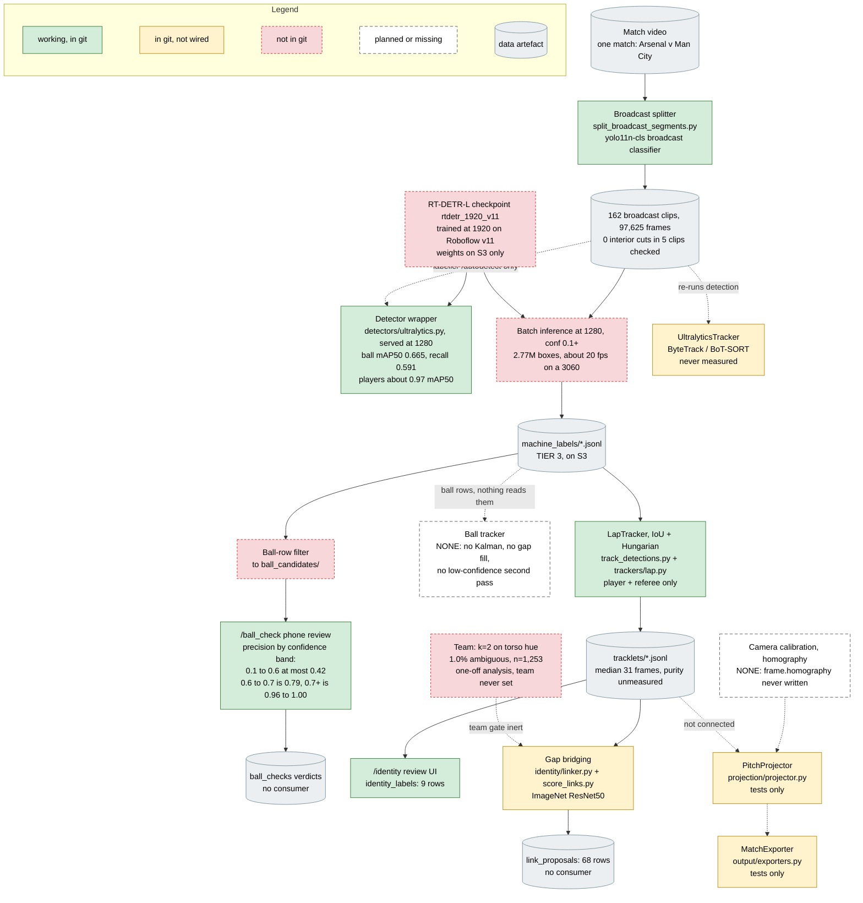
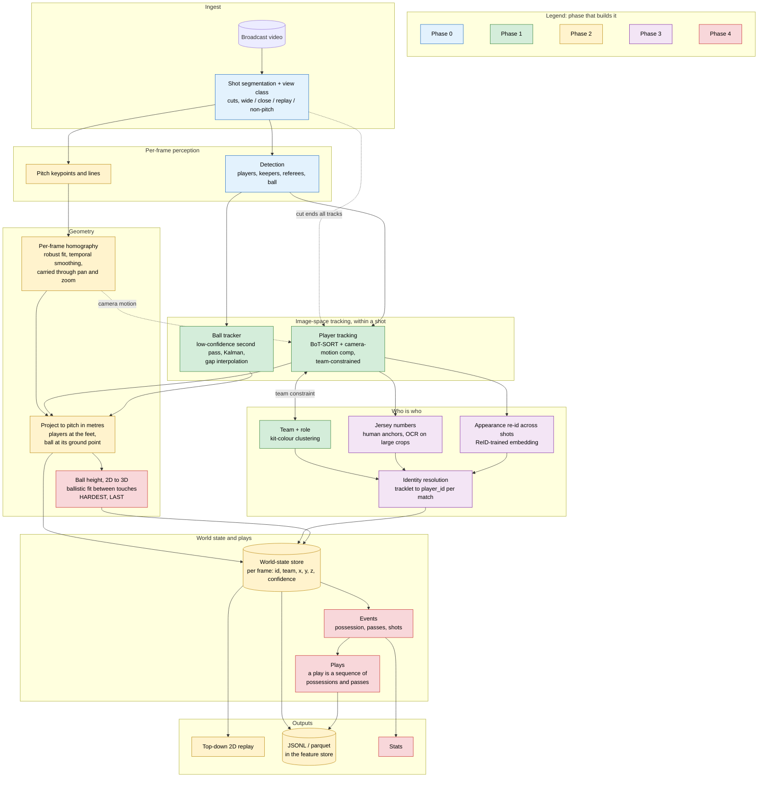
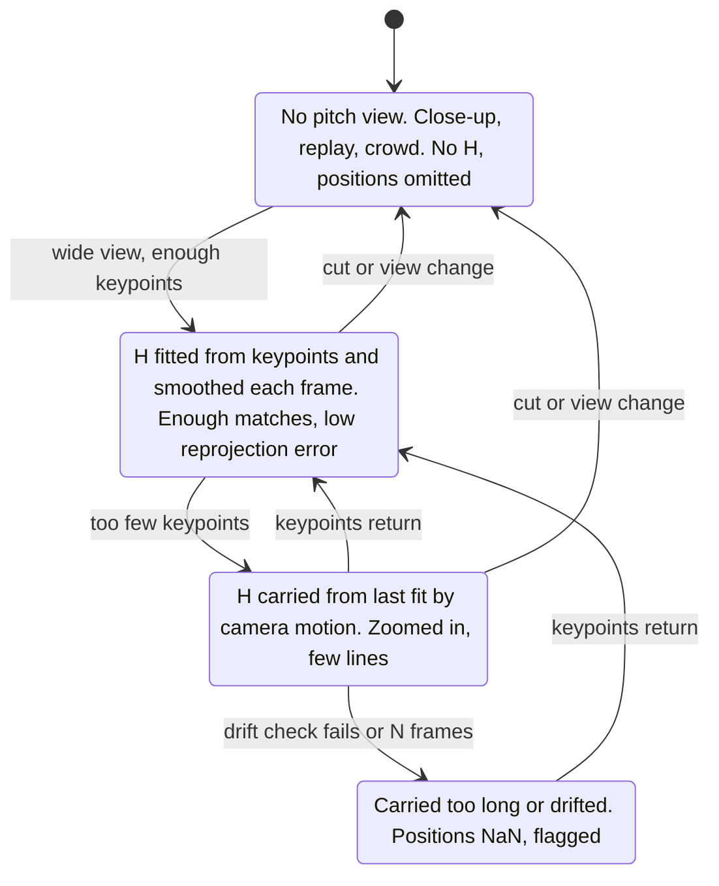

# Tracking pipeline: what we have, and where it should go

Status: **DRAFT for review** · Date: 2026-11-08 · Code reviewed: `main` @ `26d2506`

Two pictures. **Part 1** is the detection and tracking path as it really is in
code today, from a broadcast clip to whatever comes out the other end. **Part 2**
is the proposed end-to-end system: plays tracked on a top-down pitch in metres,
with team and player identity, instead of boxes in broadcast pixels. **Part 3**
is a phased plan with the labels, effort and success metric for each phase.

Every number is marked **measured** (with its denominator) or **assumed**. The
project has already been burnt by a ball mAP quoted off 44 instances
([pipeline overview](pipeline_overview.md)), so treat unmarked confidence with
suspicion.

This page builds on, and does not replace, the stage docs:
[pipeline overview](pipeline_overview.md), [player re-id](player_reid.md),
[tracking](tracking.md), [projection](projection.md), [output](output.md) and
[`system_design.md`](../system_design.md). Where it disagrees with them it says
so in [Relationship to existing design docs](#relationship-to-existing-design-docs).

---

## Part 1: what we have now

**What comes out today:** per-clip JSONL of boxes (`machine_labels/`), per-clip
tracklets (`tracklets/`), and human verdict logs. There is no ball trajectory, no
`team_id`, no `player_id`, and no pitch coordinate anywhere. The `footy-track`
console script prints "Hello from footy-track!".

### The gaps, in one list

1. **No ball tracker.** The ball is a set of independent per-frame boxes. The only
   ball tracker in a running path is VitTrack in the labeller, which holds the
   ball on 5% of frames (9/176, measured, KB `footy-labeller-gotchas`).
2. **The producers of the data we rely on are not in git:** the RT-DETR training
   command, the batch inference that made the 2.77M machine labels, and the
   filter from machine labels to `ball_candidates/`.
3. **Identity output is unused.** `link_proposals/` and `identity_labels/` are
   written and read by nothing.
4. **The team gate is inert.** `linker.candidate_links` skips cross-team pairs only
   when both tracklets have a `team` (`identity/linker.py:125`), and no code sets
   it.
5. **No calibration and no projection.** The store has a `homography` column
   (`feature_store/schema.py:158`) that nothing writes, and `PitchProjector` is
   called only from tests.
6. **The ball benchmark is narrow.** v11-val has 211 balls, but 156 of them (74%)
   come from one 10-second clip (`arsenal_example`). All machine labels are one
   match.

### Per-box detail

| Box | Module (file:line) | Status | Measured numbers and notes |
|---|---|---|---|
| Broadcast splitter | `scripts/split_broadcast_segments.py:86` (classifier load), `:213` (`main`); `classifier.py:27` (checkpoint path) | Working | Splits on broadcast/non-broadcast transitions; it is **not** a shot-cut detector. 0 interior cuts in 3,175 frames across 5 clips (measured, `player_reid.md` M1). Classifier hardcodes `device="mps"` (`classifier.py:128`). |
| RT-DETR-L checkpoint | `detectors/ultralytics.py:36-37` (`CURRENT_BEST_DETECTOR_CHECKPOINT`) | Weights not in git | Trained at `imgsz=1920, rect`, 50 epochs, v11. Ball (`in_play_ball`) mAP50 **0.665**, recall **0.591**, P 0.862 on v11-val, 211 balls (measured, training-run val log). The code comment at `:37` says .221/.209: that is the yolo11n figure and the comment is wrong. |
| Detector wrapper | `detectors/ultralytics.py:42` (`DEFAULT_IMGSZ=1280`), `:56` (`min_confidence=0.3`) | Working | Served at 1280, trained at 1920. Held-out recall at 1280 about **0.60** on 74 Man City balls (measured, small n). Player mAP50 0.974 is the yolo11n 1280 figure; RT-DETR per-class player mAP was never logged. |
| Batch inference | none | Not in git | 162 clips, 97,625 frames, 2,767,151 boxes, conf ≥ 0.1, imgsz 1280 (measured, `machine_labels/_manifest.json`). |
| Ball-row filter | none | Not in git | 356,812 candidate rows over 162 clips. |
| `/ball_check` | `labeller/ball_check.py:224` (queue), `:709` (`_append_gt`); `labeller/candidates.py` | Working | Precision by confidence band from 257 decided verdicts (measured; sampler oversamples the boundary, so these are per band, not global): 0.1-0.2: 0.04, 0.2-0.3: 0.29, 0.3-0.4: 0.23, 0.4-0.5: 0.36, 0.5-0.6: 0.42, 0.6-0.7: 0.79, 0.7-0.8: 0.96, 0.8-0.9: 1.00. About 3.3 s per card. Only `corrected` boxes reach the sidecar; `ball`/`not_ball` verdicts reach nothing. |
| Ball tracker | none (`ball_trackers/roi_yolo.py:171` has a Kalman ROI tracker used only by the bake-off, on the old 640 checkpoint) | Missing | On `arsenal_example`, misses are dominated by long blind spells: one 51-frame gap holds 70% of misses (stated in the August handoff, not re-checked). |
| LapTracker | `scripts/track_detections.py:154-156` (conf 0.5, IoU 0.15, max_age 90), `trackers/lap.py:42` | Working | seg000: 157 tracklets, median 31 frames, 9% singletons (measured, docstring). Purity, IDF1 and HOTA are **unmeasured**. |
| UltralyticsTracker | `trackers/ultralytics.py:28`, `scripts/track_objects.py:142` | Not wired | Re-runs detection. Never compared against ground truth. |
| `/identity` review | `labeller/identity_routes.py`, `identity/store.py` | Working | 9 rows. No downstream consumer. |
| Team | none | Not in git | k=2 on torso HSV, 1.0% ambiguous on 1,253 crops from one clip (measured, `player_reid.md` M6). |
| Gap bridging | `identity/linker.py:101` (`candidate_links`), `:125` (team gate); `scripts/score_links.py:69` (ResNet50) | Not wired | Within-clip AUC 0.912 at a 4-frame gap, 0.761 at 25 (measured, docstring). Cross-clip ImageNet AUC 0.43-0.49, chance (doc only). |
| Calibration | `feature_store/schema.py:158` (column only) | Missing | Nothing detects pitch lines or keypoints. |
| PitchProjector | `projection/projector.py:46`; ball anchor `:66-68`; uncertainty `:131` | Not wired | The ball-anchor check compares against `BALL_TAG = "ball"`, a dead class, so `in_play_ball` would get the player feet anchor. `uncertainty_m` is `1 - H_quality`, not metres. |
| MatchExporter | `output/exporters.py:32` | Not wired | Reads `tracks/tracks.parquet`, which nothing writes. |

---

## Part 2: proposed end-to-end tracking of plays

The target: a broadcast match in, and out of it, for every frame where the pitch
is visible, every player and the ball on a 105 x 68 m pitch with a team, a
player identity where we can get one, and a confidence. Possessions, passes and
plays are built on top of that world state, not on broadcast pixels.

Boxes are coloured by the phase that builds them (Part 3).

### Calibration per frame, as a state machine

Calibration is where broadcast footage fights back: wide shots show plenty of
lines, close-ups show grass and a player, and replays show a different camera.
The homography stage must say which case it is in rather than emit a confident
wrong matrix.

### Per-box detail

| Box | What it does | Builds on today | Depends on (research, labels) | Main risk |
|---|---|---|---|---|
| Shot segmentation + view class | Split at every camera cut, not just broadcast/non-broadcast; tag each shot wide, close-up, replay or non-pitch | `split_broadcast_segments.py`, yolo11n-cls checkpoint | M1 (0 interior cuts in 5 clips) holds for the current splitter; a cut detector needs a few hundred labelled cut frames (assumed) | Replays and close-ups currently vanish with the non-broadcast frames; a view class needs a new label set |
| Detection | Per-frame boxes for players, keepers, referees and the ball | `detectors/ultralytics.py`, `rtdetr_1920_v11` | Ball recall 0.591 on a one-clip-heavy val (measured); held-out multi-match eval set needed | The ball is ~11 px at 1280 (measured, KB); recall on other matches is unmeasured |
| Pitch keypoints and lines | Find pitch landmarks (line intersections, box corners, centre circle, arcs) in each frame | Nothing. `frame.homography` column only | **Pitch keypoint labels needed** on our own footage across views; a public calibration dataset may bootstrap it (licence to check) | Close-ups and zoomed shots have too few visible landmarks |
| Player tracking | Within-shot `track_id`, with camera-motion compensation and no cross-team association | `trackers/lap.py`, `trackers/ultralytics.py` (BoT-SORT config), `track_detections.py` | `player_reid.md` milestone 1: purity labels on 10 clips (~2 human hours, assumed); M4 says IoU association is easy (measured, one clip) | Purity is unmeasured; crowded 6.3% of instances (measured, one clip) is where switches happen |
| Ball tracker | One ball trajectory per shot: rescue low-confidence boxes by motion gating, interpolate gaps, reject static false positives | Existing `machine_labels/` (conf ≥ 0.1 already stored), precision bands from `/ball_check`, `scripts/analyse_ball_tracker.py`, `ball_eval/` | **Ball tracker over the existing machine labels**; dense held-out eval clips with explicit `no_ball` markers | Misses are long blind spells, not short dropouts (handoff, not re-checked), so the recall ceiling is low; gains are mostly precision |
| Team + role | Assign home, away, keeper, referee to each tracklet; use it as a hard association constraint | `identity/linker.py:125` gate (inert), `track_meta.team_id` column | M6: 1.0% ambiguous (measured, one clip, one kit pair) | Referees are weak detections (median conf 0.335, measured); a second kit pair is untested |
| Jersey numbers | Number per tracklet, as an identity anchor | `/identity` UI, `track_meta.jersey_number` column | **Jersey-number labels needed** (human, per tracklet); OCR only if a measured legibility rate supports it | Median player box 52 x 111 px gives ~10-18 px digits (measured, `player_reid.md` M3) |
| Appearance re-id | Link tracklets across shots and cuts | `scripts/score_links.py` (one-line backbone swap), `identity/linker.py` | ReID-trained weights untested; ImageNet features are at chance across clips (doc) | Teammates look alike; a single-match corpus means about 30 identities |
| Identity resolution | Combine team, numbers and re-id into `player_id` per match | `identity/clusters.py`, `identity/labels.py`, `track_meta.player_id` | Pairwise merge verdicts from `/identity/merge` | Persistent identity may not be needed at all (`player_reid.md` R7) |
| Per-frame homography | Robust fit from keypoints, smoothed over time, carried through pan and zoom by frame-to-frame motion, absent on non-pitch views | Nothing | Keypoint labels; a held-out set of hand-clicked correspondences for reprojection error | Drift while carrying H through a zoom; fails silently if unchecked |
| Project to pitch | Players at the bottom-centre of the box, ball at its ground point, in metres from the centre spot | `projection/projector.py` (fix the ball tag and the uncertainty units) | Calibration | An airborne ball projects to the wrong place (see risks) |
| Ball height | Fit ballistic arcs between touches and bounces to recover z; monocular cues (apparent size, shadow) as a check | Nothing | Touch and bounce events from the event layer; no ground truth for height exists | Hardest step: ill-posed from one camera, so it needs a trajectory prior and will be noisy |
| World-state store | Per frame, per object: `player_id` or `track_id`, team, x, y, optional z, confidence, provenance | `projection.md` `pitch_positions.parquet` schema; feature store tables | Everything above | Schema churn if built before projection works |
| Events and plays | Possession from ball-player proximity on the pitch; passes as possession changes within a team; a play as a sequence | Nothing | Hand-labelled events on a few matches (pass start, pass end, shot) | Possession is fragile where the ball track has gaps |
| Outputs | Top-down replay, JSONL/parquet in the feature store, stats | `output/exporters.py` (`MatchExporter`), `docs/design/output.md` JSON schema | World-state store | — |

---

## Part 3: phased plan

Effort is for one person: **S** is days, **M** is one to two weeks, **L** is
several weeks. These are estimates, not measurements.

| Phase | Goal | Builds | Labels and data it needs | Effort | Success metric |
|---|---|---|---|---|---|
| **0** | A simple inference pipeline in git (separate PR) | Video to broadcast clips to RT-DETR at 1280 to per-clip detections and LapTracker tracklets, as one command | None new; reproduce the existing `machine_labels/` on one clip | S | Matches the existing machine labels on a sample clip; runs end to end from a clean checkout |
| **1** | Trustworthy image-space tracking | A committed ball eval; the ball tracker over machine labels; a player tracking eval (`player_eval/`, mirroring `ball_eval/`); team clustering wired in as a constraint | Dense held-out ball clips with `no_ball` markers, at least 2 matches (~1.5-3k balls, assumed); the untouched v11 test split (243 balls); purity labels on 10 clips; detector run over a second match | M | Ball recall and precision at a fixed operating point on the held-out multi-match set, reported per match with instance counts; tracklet purity ≥ 0.95 and ID switches ≤ 1 per 1,000 player-frames (`player_reid.md` targets); team accuracy ≥ 0.98 |
| **2** | Players and ball on a 2D pitch | Pitch keypoint detector, per-frame homography with the state machine above, `PitchProjector` wired up, world-state store, a top-down replay | Pitch keypoint labels on a few hundred frames across views and at least 2 stadiums (assumed); ~50 held-out frames with hand-clicked correspondences | L | Reprojection error in pixels on held-out keypoints; position error in metres on known landmarks (penalty spots, box corners); share of broadcast frames with a usable H; player speeds stay physically plausible |
| **3** | Who is who across shots | ReID-trained embedding in `score_links.py`; team + number + appearance identity resolution; jersey numbers from humans, OCR only if measured legibility supports it | Jersey numbers per tracklet (human, seconds each); merge verdicts; a second match for any generalisation claim | L | Identity accuracy: share of player-frames with the correct `player_id` on labelled clips; re-id mAP within a match with the gallery size stated |
| **4** | Plays and the ball in 3D | Possession, passes and plays from world state; ball height from ballistic fits | Hand-labelled events (pass start and end, shots) on a few matches; no height ground truth exists | L | Pass detection precision and recall against labelled events; possession accuracy per second; for height, consistency checks (landing points against later ground contacts) |

**Order.** Phase 1 first: it reuses labels and machine output we already have,
and every later phase needs its evals. Phase 2 can start in parallel once Phase 0
lands, because calibration does not depend on tracking. Phase 3 waits on the
`player_reid.md` R7 question: is per-player identity needed at all, or are team
and pitch position enough? Phase 4 comes last.

**Where the label loop fits (proposal, not built).** Phase 1 needs more diverse ball labels and a held-out eval. The [Claude-assisted ball labelling loop](claude_autolabel_loop.md) is the proposed way to get the labels: Claude checks zoomed detector and tracker candidates on new matches, and a person confirms the doubtful ones in `/ball_check`. It sits beside Phase 1, not inside it: it consumes the Phase 1 ball tracker and the [ball tracking eval](../ball-tracking-eval.md) as its fill step and its score, and it feeds the labels a later retrain needs. Held-out eval clips stay human-only. It adds no box to the Part 1 diagram, which is already at the diagram size limit.

### Measured versus assumed

| Measured (with denominator) | Assumed or unmeasured |
|---|---|
| Ball mAP50 0.665 / recall 0.591, v11-val, 211 balls, 74% one clip | Ball recall on any match other than Man City |
| Held-out recall at 1280 about 0.60, 74 balls | That serving at 1280 costs nothing versus 1920 on a proper benchmark |
| Ball precision by confidence band, 257 verdicts | That a tracker can use those bands as its high/low thresholds |
| Player mAP50 0.974 (yolo11n at 1280) | RT-DETR per-class player mAP |
| 0 interior cuts, 5 clips, 3,175 frames | That this holds across all 162 clips and other broadcasters |
| Team separation 1.0% ambiguous, 1,253 crops, one clip | Team accuracy with a second kit pair, and for keepers and referees |
| LapTracker fragmentation on seg000 | Tracklet purity, IDF1, HOTA |
| ImageNet re-id AUC 0.912 at 4 frames within a clip | Any ReID-trained backbone on this footage |
| — | Everything about calibration accuracy on this footage |
| — | Every effort estimate on this page |

### Top risks

1. **Broadcast cuts break tracking.** Every cut ends every track, and replays show
   the same players from another angle. Within a clip the splitter gives cut-free
   shots (measured on 5 clips), so cuts turn into a cross-shot identity problem
   (Phase 3), not a tracker problem. A temporal ball detector must fall back to a
   single frame at cuts.
2. **Homography fails on zoomed shots.** Close-ups show too few landmarks for a
   fit. The plan is to carry H through pan and zoom by camera motion and to mark
   positions NaN once drift is too high, never to emit a confident wrong position
   (consistent with `projection.md` §5).
3. **The ball is ~11 px at 1280.** Recall is 0.59 on a narrow benchmark, and the
   misses cluster in long gaps. A tracker can raise precision a lot and recall a
   little. Recall needs more diverse labels (other matches, other camera angles).
4. **An airborne ball projects to the wrong place.** A homography maps the ground
   plane. A ball 3 m up, seen from a camera about 25 m high and 60 m away, lands
   roughly 5-10 m from its true ground point (geometry estimate). Until Phase 4,
   the ball's pitch position is only trustworthy when it is on or near the ground,
   and must carry a flag saying so.
5. **One match.** All machine labels, the team measurement and the identity
   gallery come from Arsenal v Man City. No claim generalises until a second match
   is processed.

### Open questions

1. Which phase first after Phase 0: the ball tracker and evals (Phase 1), or
   calibration and the top-down view (Phase 2)?
2. How ambitious on the ball in 3D: a 2D ground position with an "airborne" flag,
   or real height estimation?
3. Jersey numbers: human anchors only (as `player_reid.md` §3.7 recommends), or
   OCR on the best frame of large tracklets? `pipeline_overview.md` says about
   40% of tracklets have a frame at least 110 px tall and a human has read numbers
   at 102 px; that is the case for measuring OCR legibility before ruling it out.
4. Is persistent per-player identity needed downstream, or are team, role and
   pitch position enough (`player_reid.md` R7, `pipeline_overview.md` Q5)?
5. Calibration model: train our own keypoint detector on our labels, or start from
   a public pretrained pitch-calibration model and fine-tune (licence and fit to
   our footage to check)?
6. Where should the world state live: the DuckDB feature store, or the per-stage
   parquet files from `output.md` and `projection.md`?

---

## Relationship to existing design docs

| Doc | Kept | Superseded or changed |
|---|---|---|
| [`system_design.md`](../system_design.md) | Stage order; calibration in parallel with detection, feeding projection | Adds a ball tracker, identity resolution, ball height and an event layer, which the stage list does not have. The calibration design doc it asks for (`design/calibration.md`) should be written in Phase 2 |
| [`projection.md`](projection.md) | Pitch frame (centre-spot origin, metres), feet anchor for players, NaN on low-quality H, no clamping, smoothing downstream | "Z-axis not modelled, acceptable for v1" stays true for Phase 2, but the ball row needs an airborne flag, and Phase 4 adds z. The code's ball anchor must match `in_play_ball`, and `uncertainty_m` must be in metres. H must be defined on the same normalised image coordinates the projector uses |
| [`tracking.md`](tracking.md) | `ObjectTracker` protocol, track ID lifecycle | §4 says track state should survive a non-broadcast gap. In practice clips are separate files and a gap is a shot change, so continuity across it is identity resolution (Phase 3), as `player_reid.md` M1 already concluded |
| [`player_reid.md`](player_reid.md) | P0-first order, tracklet purity as the primary metric, team as a hard constraint, its targets, milestone 1 | §3.7 "do not build jersey OCR" becomes an open question for the reviewer (question 3), gated on a measured legibility rate |
| [`pipeline_overview.md`](pipeline_overview.md) | The three-problem split (ball, players, identity), the label tiers | Its ball mAP row is out of date: .665/.591 is the RT-DETR figure and .221/.209 is yolo11n |
| [`output.md`](output.md) | `MatchExporter`, parquet first, JSON per frame | Extend with world-state rows and plays once they exist |
