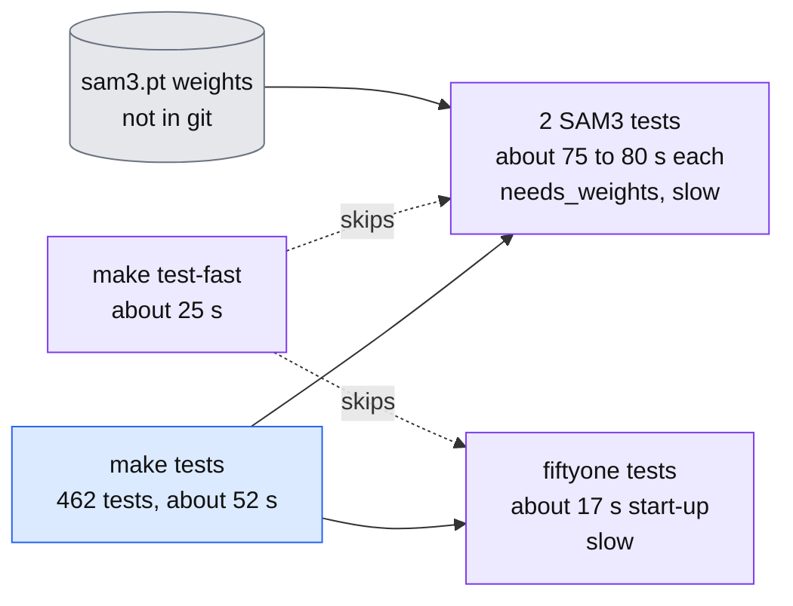
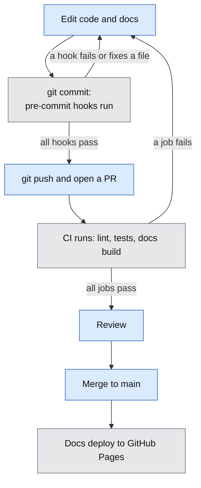

# Development Guide

This guide covers how to set up, develop, and work with the Footy Scan codebase.

## Setting Up Development Environment

1. Clone the repository:
```bash
git clone <repository-url>
cd football-scan
```

2. Python Environment:
We use `uv` for Python environment and dependency management. First, install `uv` if you haven't already:
```bash
curl -LsSf https://astral.sh/uv/install.sh | sh
```

3. Install the package in development mode:
```bash
uv pip install -e .
```

4. Install additional dependencies for ML and video processing (if needed):
```bash
uv pip install "torch" "opencv-python" "tqdm"
```

## Using the Makefile (recommended)

Common repo-wide tasks are captured in the Makefile to standardize workflows:

make setup
make deps-update

## Development Tools

### Documentation
We use MkDocs with the Material theme for documentation. To work with docs:

```bash
# Serve docs locally (with live reload)
uv run mkdocs serve

# Build the documentation site
uv run mkdocs build

# Deploy to GitHub Pages (if configured)
uv run mkdocs gh-deploy
```

The documentation will be available at http://127.0.0.1:8000 when serving locally.

### Running Tests
```bash
uv run pytest        # everything (also: make tests)
make test-fast       # skips tests marked slow or needs_weights
```

Tests marked `needs_weights` skip themselves when the model weights
(e.g. `model_saves/sam3/sam3.pt`) have not been pulled from DVC/LFS.

### Code Organization

```
football-scan/
├── docs/               # Documentation
├── src/
│   └── footy_track/   # Main package code
│       ├── __init__.py
│       └── main_entrypoint.py
├── tests/             # Test files
├── mkdocs.yml        # Documentation configuration
└── pyproject.toml    # Project configuration
```

## Project Conventions

### Time Handling
The project uses two main time formats:
- ContinuousTime: Continuous seconds from game start
- GameTime: Referee/broadcast clock time

See [Time Formats](timings.md) for detailed conversion rules and examples.

### Pipeline Architecture
The processing pipeline consists of three main components:
- InputConsumer: Video frame input
- Processor: Detection and tracking
- OutputProducer: Data serialization

See [Pipeline Architecture](pipeline_architecture.md) for detailed design information.

### Automated Tools
When using automated tools or agents with this codebase, follow the guidelines in [Agent Guidelines](agent_guidelines.md) to maintain consistency.

### Docs
To change the docs, read [How to contribute to the docs](contributing-docs.md).

## Environment notes

Who this is for: anyone setting up a new machine, especially an older or unusual one. These notes were measured on the review's build machine on 2026-11-08.

- **Old CPUs without AVX2 crash on import.** The build machine's CPU lacks AVX2. The newest `duckdb` and the stock `polars` die with an illegal instruction there. The workaround is `duckdb==1.3.2` and `polars-lts-cpu` in the virtual environment only. `pyproject.toml` asks for `duckdb>=1.5.3`, and `polars` arrives through `ultralytics`; do not edit `pyproject.toml` or `uv.lock` to work around a local CPU.
- **Open the feature store read-only when inspecting it:** `duckdb.connect(path, read_only=True)`. See [Feature store design, section 7.1](design/feature_store.md#71-keys-as-implemented-and-what-is-not-in-the-store).
- **Weights are not in git.** `model_saves/sam3/sam3.pt` and the detector checkpoints come from the object store or DVC/LFS. Tests that need them fail without the file (see below).
- **No GPU is needed for the tests.** No test uses CUDA (checked 2026-11-08). The slow ones are model tests that run on the CPU.
- **Where the data is** is covered in [Datasets and labels](data.md#where-things-live); the labeller finds it through `FOOTY_CLIPS_DIR`, `FOOTY_GT_MARKS_DIR` and `FOOTY_BALL_CANDIDATES_DIR`.

## Running the tests

The suite has 462 tests (collected 2026-11-08). The whole run took about 4 m 30 s before the speed-up and about 52 s after it (measured on the build machine, same date).

**Why it was slow.** The guess was a GPU problem. It was not: no test uses CUDA. Three things took almost all the time: two SAM3 tests (about 75 to 80 s each, and they fail anyway when the weights file is missing) and the first `fiftyone` test (about 17 s of start-up).

**What fixes it.** The `chore/faster-tests` changes are merged (with PR #24). You get:

| Command | What runs | Time (measured before the merge) |
|---|---|---|
| `uv run pytest` or `make tests` | Everything | about 52 s |
| `make test-fast` | Skips tests marked `slow` or `needs_weights` | about 25 s |

The `needs_weights` marker is for tests that need model weights that are not in the repo; they skip themselves when the file is missing. The change also makes the `extract_frames` test fixture create its output folder first, because `ffmpeg` does not.



Legend: blue is what existed before, purple is what the faster-tests change added, grey is data not in git. The diagram shows that the full run includes the two SAM3 tests and the `fiftyone` tests, and that `make test-fast` skips both groups.

CI runs `make test-fast` on every pull request (see [Checks before you commit](#checks-before-you-commit), [T-08](todo.md)).

## Checks before you commit

Two kinds of automatic check protect `main`: small, fast ones that run on your
machine each time you commit, and a fuller set that runs on GitHub for every
pull request (PR). The fast ones catch most mistakes before anyone else sees
them.

**One-time setup.** Run `make hooks`. This installs a git hook using
`uvx pre-commit`, so there is nothing new to add to the project.

**What runs when you commit.** Each commit runs these hooks on the files you
changed:

- `ruff` checks the Python for mistakes and fixes what it safely can.
- `ruff-format` lays the code out in the project style.
- `codespell` spell-checks code and docs. Project terms such as MOT are
  allowed.
- `nbstripout` strips outputs from notebooks so they do not bloat the repo.
- Small file checks: a newline at the end of each file, no trailing spaces,
  valid YAML and TOML, no leftover merge-conflict markers, and no file over
  500 KB.

If a hook changes a file, the commit stops. Look at the change, `git add` the
files again and commit again. If a hook reports a problem it cannot fix, fix it
by hand and commit again.

**Run everything yourself.**

```bash
make check    # lint + fast tests, the same things CI runs
make lint     # ruff check + ruff format --check only
make format   # let ruff fix formatting and simple lint problems
```

**What runs on GitHub.** Every PR, and every push to `main`, runs three jobs:

| Job | What it does |
| --- | --- |
| `lint` | Runs the pre-commit hooks on every file in the repo. |
| `tests` | Installs the project and runs `make test-fast` (skips slow tests and tests that need model weights or API keys). |
| `docs` | Builds the docs site, to catch broken pages. It is not strict yet, because `system_design.md` has two known broken links. |

A new push to the same branch cancels the run that is still going.



Legend: blue boxes are things you do; grey boxes happen by themselves. The
arrows going back to "Edit" show that a failed check sends you back to fix it.

Never skip the hooks with `git commit --no-verify`. If a check is wrong, fix
the check in its own PR.

Planned: add a hook that runs `scripts/check_docs_diagrams.py` on changed docs.
For now run `make docs-check` yourself when you change a diagram.
