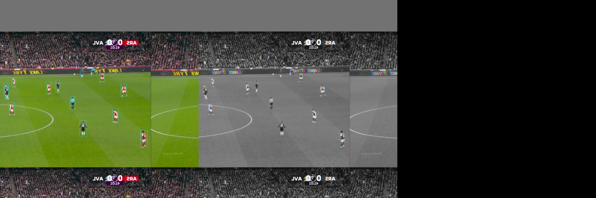
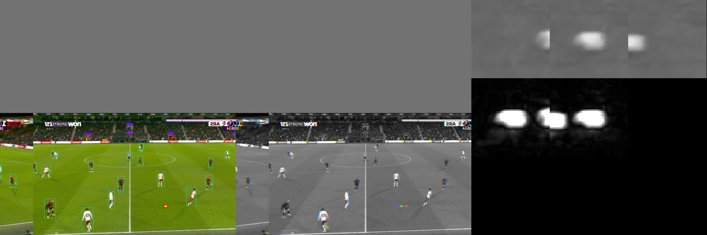
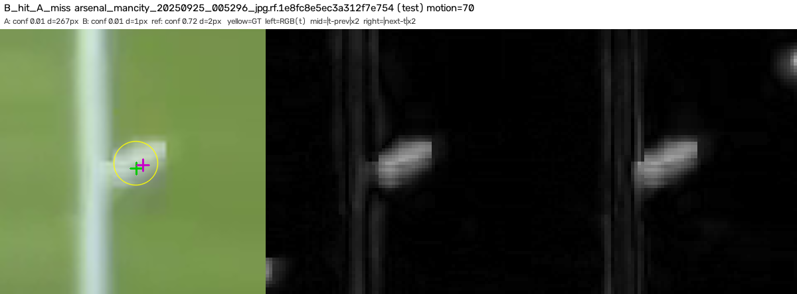
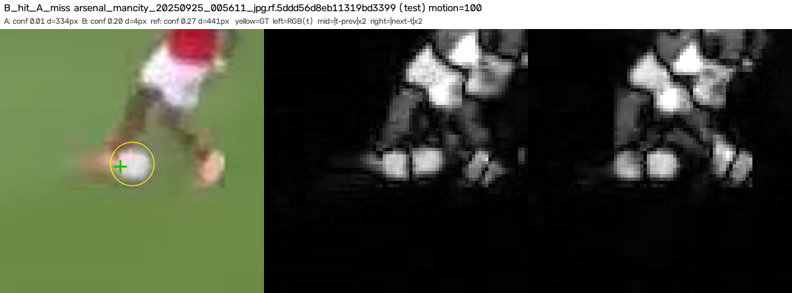
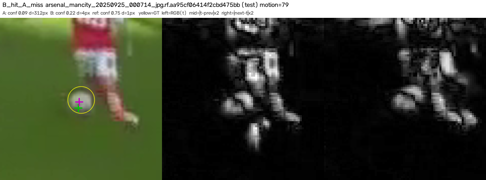
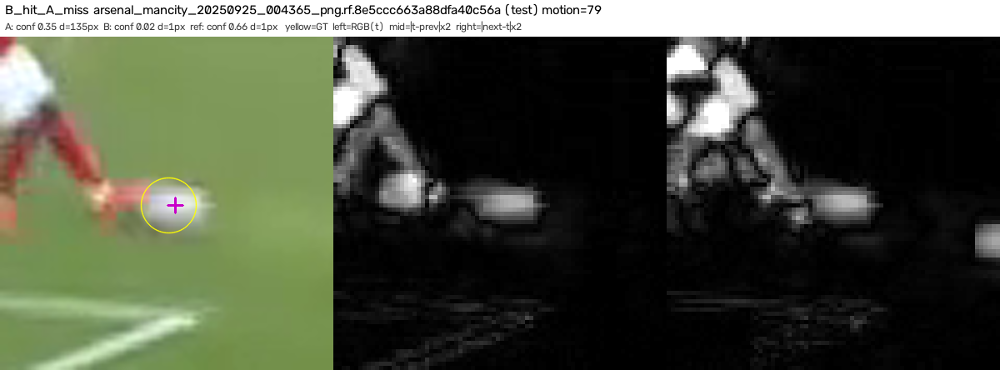
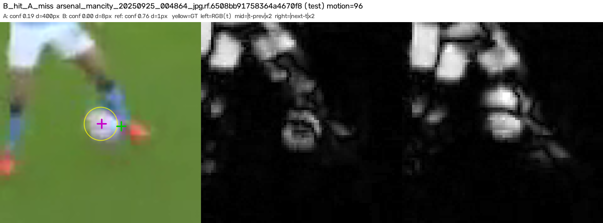
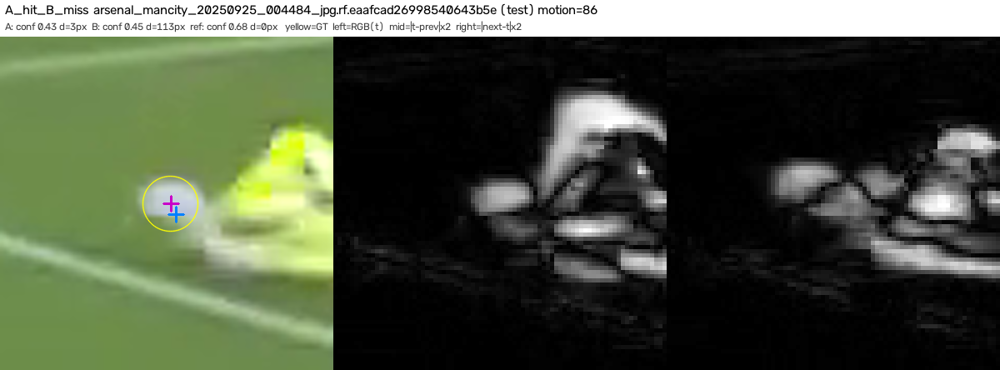
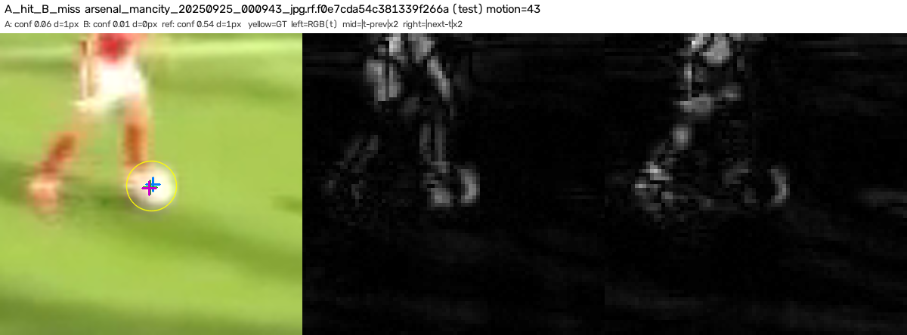
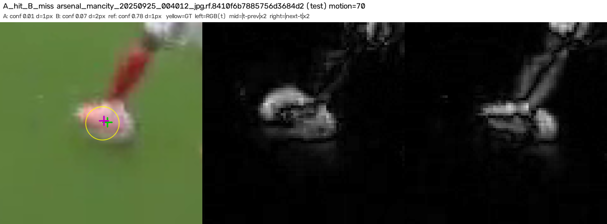

# Temporal detector ablation: single frame vs camera-aligned neighbours

Branch `exp/temporal-detector` (from `exp/multiframe-dataset`), 2026-11-14. Code: `experiments/temporal_detector/`, tests
`tests/temporal_detector/`, Prefect flow `~/code/jobs/footy_temporal.py`. Dataset: `docs/experiments/multiframe_dataset.md`.
Knowledge-base pages relied on: `footy-ball-detection-findings` (1280 px is the lever, the 44-instance benchmark trap, the
"go temporal" research), `prefect-job-system` / skill `prefect-jobs` (pools, deployments, desktop sync), `footy-data-s3`,
`wsl-gpu-training-box` ("Desktop as it is now": bare-metal Ubuntu, flaky Wi-Fi, `~/.local/bin/uv`).

## Question and verdict

Does giving the detector camera-motion-aligned neighbouring frames (t-2, t+2 as extra grey channels) improve tiny-ball
detection over the same detector on the single frame?

**Verdict: not shown. The input helps on one clip and does nothing measurable on the others.** Same YOLO11s, same recipe, same
frame-t pixels, COCO-pretrained, 100 epochs, 2 seeds per arm:

- Held-out clips (the cleanest arbiter, 117 balls in 11 clips; 84 balls in 6 clips that appear nowhere in train/val/test):
  top-1 recall@10 px A 0.462 vs B 0.479, **B-A = +0.017, 95% CI [-0.013, +0.047]** (images) / [-0.019, +0.061] (clips);
  strict subset +0.018 [-0.024, +0.060]. Per seed +0.043 and -0.009. The experiment can exclude a gain much larger than
  about +0.05 on these clips, not a small one.
- Test split (238 balls; optimistic because v11 splits by image, 33 clips shared with train): A 0.880, B 0.878,
  **B-A = -0.002 [-0.023, +0.019]** (saturated).
- Val split: B-A = +0.146 [+0.098, +0.191], but it is entirely one clip: `arsenal_example` (156 of 209 val balls, no train frames from
  it, so it is a genuinely unseen clip) gives +0.208 [+0.154, +0.266] (seeds +0.167 / +0.250), the other 32 val clips give
  -0.038 [-0.113, +0.028]. A clip-level bootstrap over val is [-0.082, +0.190]: one clip cannot establish a general effect.
- Where time does help: **candidate recall**. Fraction of balls with *some* detection within 10 px: test+heldout
  +0.023 [+0.003, +0.044], heldout +0.056 [+0.009, +0.107], and for the fastest third of balls (test+heldout) +0.066
  [+0.026, +0.114] while slow/medium balls show +0.000 / +0.009. So the temporal channels make the detector *propose* moving
  balls it otherwise missed, but they do not make the top-1 pick better (hit@10 for the fastest third +0.018 [-0.009, +0.044]).
  A re-ranking / tracking stage on top of the candidates is where this would pay, not the detector input alone.
- Neighbour fallback (cut / edge / alignment failure, 13 test+heldout balls): both arms 0.462, no difference (n too small).
- Against production: RT-DETR-L v11 at 1280, same frames, hit@10 val 0.718 / test 0.916 / heldout 0.487 vs B 0.639 / 0.878 /
  0.479 (A 0.493 / 0.880 / 0.462). YOLO11s B is on par with RT-DETR-L on held-out clips, lower on val and test. RT-DETR is
  trained at 1920 and is far less confident (top-1 FP rate on ball-free frames 31% at conf 0.5 vs 14-17% for YOLO), so
  compare recall at a conf level, not only the top-1 hit rate.
- Seed variance is large: val recall differs by 0.15 between the two A seeds, and the held-out B-A is +0.043 for seed 0 (CI
  just touching zero) but -0.009 for seed 1, so a single-seed comparison could have been read either way.

Caveats: one model size (YOLO11s, not m: m is ~2.5x slower per epoch), k=2 only, one recipe, 100 epochs (val ball AP50 is
still rising at epoch 100 for all runs; the curves are noisy, +-0.05 between neighbouring epochs, so `last.pt` is evaluated,
no checkpoint selection on val), 2 seeds. The seed-2 runs that were queued were cancelled to bound wall-clock
(`arm=A|B seed=2` reruns them).

## Recipe (identical in both arms; only the input differs)

- A: 3 channels = B,G,R of frame t, losslessly re-saved as PNG from the same TIFFs (pixels identical), stock YOLO11s stem.
- B: all 5 TIFF channels `[gray(t-2) aligned, B, G, R, gray(t+2) aligned]`; stem inflated by
  `multichannel.make_inflated_checkpoint` (pretrained R/G/B filters on input channels 3/2/1, channels 0 and 4 zero, so at step
  0 the 5-channel net computes exactly the 3-channel net; unit-tested, including that changing the neighbours leaves the
  output unchanged).
- YOLO11s, imgsz 1280, batch 4 (AMP), 100 epochs, seed 0 / 1, Ultralytics 8.3.241, optimiser `auto` (AdamW lr 0.00091, because
  iterations < 10k), mosaic 1.0 (close_mosaic 10), scale 0.5, translate 0.1, fliplr 0.5, HSV off in both arms (Ultralytics skips it
  for 5 channels), Albumentations off in both, plots off, val every epoch, no early stopping, `last.pt` evaluated. All 7 classes
  trained as in the export; the ball is class `in_play_ball`.
- Evaluation (`evaluate.py`, `report.py`): explicit fp16 inference at 1280 (letterbox, NMS conf 0.001 IoU 0.7 multi-label, ball
  class only), boxes in the 1920x1080 frame (7 of the 599 eval images are 1280x720 sources; they are scaled into the
  canonical frame). hit@10 = top-1 ball detection within 10 px of a GT ball centre; AP50 = 101-point at IoU 0.5. Cross-check
  against Ultralytics' own validator at the last epoch (ball AP50 on val, report vs Ultralytics): A0 0.506 vs 0.509,
  A1 0.376 vs 0.369, B0 0.620 vs 0.626, B1 0.542 vs 0.528.
- Reference row: production RT-DETR-L `rtdetr_1920_v11/best.pt` run through the same script on frame t at 1280 (Ultralytics
  predictor, conf 0.001). It was trained on the v11 train split, as were A and B.

## Augmentation check (5-channel input stays aligned)

`viz_aug.py` pulls samples from the very Ultralytics train pipeline (mosaic, affine, flip) and renders RGB(t), the temporal
composite R=gray(t-2) G=gray(t) B=gray(t+2) and a zoom at the ball. Static, aligned content stays grey; only moving players
and the on-screen graphics fringe; the neighbours are never displaced relative to t.




Quantitatively, over 40 augmented ball samples the mean |gray(t) - neighbour| is 2.16 (t-2) / 1.90 (t+2) vs 3.13 / 2.76 without
augmentation (lower because mosaic/affine padding has zero difference; a mis-warped neighbour would raise it), and a real batch
confirmed the tensor channel order is the stored B,G,R order (so RGB filters go to 3/2/1). A unit test pushes five identical
channels through `RandomPerspective` + `RandomFlip` and asserts they stay identical. Files: `aug_check_*`.

## What broke or needed a workaround

- **Pretrained stem silently dropped** for 5 channels (shape mismatch) -> manual inflation; "Transferred 643/649 items" confirms
  the stem is now loaded. A full `train()` epoch with val + AMP at 5 channels works (the open item from the dataset note).
- **Border value bug**: `RandomPerspective` calls `warpAffine(..., borderValue=(114,114,114))`, which OpenCV expands to
  `(114,114,114,0)`: for 5 channels the R channel is padded with 0 and the second neighbour with 114 (checked on a constant
  image: `[114 114 114 0 114]`). Patched in `multichannel.patch_ultralytics_multichannel` so every channel pads with 114.
- `cv2.resize(..., INTER_AREA)` does not accept 5 channels (Ultralytics' own loader uses INTER_LINEAR, so the evaluation does too);
  the Ultralytics predictor reverses all channels of a numpy input, which scrambles the 5-channel layout, hence the explicit
  inference path (checked equal to the dataset loader's letterbox content).
- `meta.jsonl` calls the val split `valid`, the directories `val`: the first evaluation runs lost neighbour status / clip ids for
  val; `report.py` re-fills them from `meta.jsonl` for every run.
- 7 images are 1280x720; the first evaluate crashed on them (empty motion window) until coordinates were converted to the
  1920x1080 frame.
- **Desktop / Prefect**: the desktop's Wi-Fi dropped several times (signal -72 to -77 dBm); the zombie automation then marked the running
  flow Crashed (no heartbeat) while its `train.py` kept running, and the next queued run started a second training on the same
  8 GB GPU (OOM). A retrying flow run also bypasses the pool's concurrency slot. Another session's SAM2 jobs share this GPU
  outside Prefect (epochs slowed from 52 s to ~105 s; one OOM at start-up). Mitigations: runs are resumable (`last.pt`,
  `train_done.json`), the flow now waits for any orphaned `train.py` before training (`_wait_for_orphan_training`), and A seed 1
  was resumed once at epoch 20 (kill + resume from `last.pt`).
- `ball_curve.jsonl` has a second row at the end of training (Ultralytics re-validates best.pt); `report.py` keeps the first
  row per epoch.
- Data transfer: 5.4 GB mini -> desktop took about 2.2 h over the Wi-Fi (rsync, resumable).

## Wall-clock

Per 100-epoch run: A seed 0 1.35 h, B seed 0 1.40 h, B seed 1 1.40 h, A seed 1 2.17 h (GPU shared with a SAM2 job, one resume);
evaluation of 599 images 52 s (YOLO) / 108 s (RT-DETR). About 6.3 GPU-hours for the four runs on one RTX 2070.

## Rerun

```
# code snapshot -> mini (the flow pulls it); then, from the mini with the Prefect auth loaded
rsync -a --delete --exclude __pycache__ experiments/temporal_detector /mnt/storage/exp/temporal/code/experiments/
PF=~/.claude/skills/prefect-jobs/scripts/pf.sh
$PF run temporal-ablation/temporal-ablation arm=A seed=0 epochs=100 model=yolo11s batch=4 exp_tag=v1   # also arm=B, seed=1, arm=ref
# aggregate (CPU, numpy + opencv only); --meta takes the narrative text of this page
uv run --no-project --python /usr/bin/python3 --with numpy --with opencv-python-headless python experiments/temporal_detector/report.py \
  --runs /mnt/storage/exp/temporal/runs/v1 --dataset /mnt/storage/footy_data/multiframe_v1/k2 \
  --out docs/experiments/temporal_detector_ablation
```
Deployment: `temporal-ablation/temporal-ablation` (pool `gpu`, `~/code/jobs/temporal.prefect.yaml`); per-run outputs
(`preds_*.json` per-image detections, `curve_*.jsonl`, `config_*.json`, `weights_*.pt`, `train_*.log`) in
`/mnt/storage/exp/temporal/runs/v1/` on the mini. The tables below are generated by `report.py`; the text above is hand-written
from them.

Counts: val: 215 images, test: 267 images, heldout: 117 images, heldout_strict: 84 images, test+heldout: 384 images, val+test+heldout: 599 images.

## Top-1 ball recall @10 px (hit@10)

| model | val (n=209) | test (n=238) | heldout (n=117) | heldout_strict (n=84) |
|---|---|---|---|---|
| RT-DETR-L v11 (production, frame t) | 0.718 | 0.916 | 0.487 | 0.524 |
| A  YOLO 3ch (frame t) seed 0 | 0.569 | 0.874 | 0.444 | 0.476 |
| A  YOLO 3ch (frame t) seed 1 | 0.416 | 0.887 | 0.479 | 0.512 |
| A  YOLO 3ch (frame t) mean of seeds | 0.493 | 0.880 | 0.462 | 0.494 |
| B  YOLO 5ch (t, t-2, t+2) seed 0 | 0.679 | 0.882 | 0.487 | 0.524 |
| B  YOLO 5ch (t, t-2, t+2) seed 1 | 0.598 | 0.874 | 0.470 | 0.500 |
| B  YOLO 5ch (t, t-2, t+2) mean of seeds | 0.639 | 0.878 | 0.479 | 0.512 |

## Candidate recall @10 px (any detection within 10 px)

| model | val (n=209) | test (n=238) | heldout (n=117) | heldout_strict (n=84) |
|---|---|---|---|---|
| RT-DETR-L v11 (production, frame t) | 0.833 | 0.962 | 0.675 | 0.750 |
| A  YOLO 3ch (frame t) seed 0 | 0.656 | 0.929 | 0.521 | 0.571 |
| A  YOLO 3ch (frame t) seed 1 | 0.536 | 0.912 | 0.504 | 0.548 |
| A  YOLO 3ch (frame t) mean of seeds | 0.596 | 0.920 | 0.513 | 0.560 |
| B  YOLO 5ch (t, t-2, t+2) seed 0 | 0.737 | 0.941 | 0.573 | 0.631 |
| B  YOLO 5ch (t, t-2, t+2) seed 1 | 0.722 | 0.912 | 0.564 | 0.619 |
| B  YOLO 5ch (t, t-2, t+2) mean of seeds | 0.730 | 0.926 | 0.568 | 0.625 |

## Ball AP50

| model | val (n=209) | test (n=238) | heldout (n=117) | heldout_strict (n=84) |
|---|---|---|---|---|
| RT-DETR-L v11 (production, frame t) | 0.658 | 0.881 | 0.464 | 0.514 |
| A  YOLO 3ch (frame t) seed 0 | 0.506 | 0.835 | 0.410 | 0.439 |
| A  YOLO 3ch (frame t) seed 1 | 0.376 | 0.827 | 0.460 | 0.501 |
| A  YOLO 3ch (frame t) mean of seeds | 0.441 | 0.831 | 0.435 | 0.470 |
| B  YOLO 5ch (t, t-2, t+2) seed 0 | 0.620 | 0.840 | 0.456 | 0.502 |
| B  YOLO 5ch (t, t-2, t+2) seed 1 | 0.542 | 0.834 | 0.435 | 0.476 |
| B  YOLO 5ch (t, t-2, t+2) mean of seeds | 0.581 | 0.837 | 0.446 | 0.489 |

## Paired difference B - A in hit@10 (bootstrap 95% CI)

| subset | n imgs | n clips | A | B | B-A | 95% CI (images) | 95% CI (clips) | B-only / A-only hits | per seed B-A |
|---|---|---|---|---|---|---|---|---|---|
| val | 209 | 33 | 0.493 | 0.639 | +0.146 | [+0.098, +0.191] | [-0.082, +0.190] | 41 / 5 | s0: +0.110, s1: +0.182 |
| test | 238 | 81 | 0.880 | 0.878 | -0.002 | [-0.023, +0.019] | [-0.024, +0.021] | 6 / 6 | s0: +0.008, s1: -0.013 |
| heldout | 117 | 11 | 0.462 | 0.479 | +0.017 | [-0.013, +0.047] | [-0.019, +0.061] | 4 / 2 | s0: +0.043, s1: -0.009 |
| val / clip arsenal_example (74% of val balls) | 156 | 1 | 0.375 | 0.583 | +0.208 | [+0.154, +0.266] | [+0.208, +0.208] | 41 / 2 | s0: +0.167, s1: +0.250 |
| val / all other clips | 53 | 32 | 0.840 | 0.802 | -0.038 | [-0.113, +0.028] | [-0.096, +0.029] | 0 / 3 | s0: -0.057, s1: -0.019 |
| heldout_strict | 84 | 6 | 0.494 | 0.512 | +0.018 | [-0.024, +0.060] | [-0.037, +0.083] | 3 / 2 | s0: +0.048, s1: -0.012 |
| test+heldout | 355 | 88 | 0.742 | 0.746 | +0.004 | [-0.014, +0.023] | [-0.015, +0.023] | 10 / 8 | s0: +0.020, s1: -0.011 |
| val+test+heldout | 564 | 102 | 0.650 | 0.707 | +0.057 | [+0.035, +0.079] | [-0.017, +0.114] | 51 / 13 | s0: +0.053, s1: +0.060 |
| test+heldout / neighbours both_ok | 342 | 87 | 0.753 | 0.757 | +0.004 | [-0.013, +0.022] | [-0.014, +0.022] | 10 / 7 | s0: +0.020, s1: -0.012 |
| test+heldout / neighbours fallback | 13 | 10 | 0.462 | 0.462 | +0.000 | [-0.115, +0.115] | [-0.100, +0.125] | 0 / 1 | s0: +0.000, s1: +0.000 |
| test+heldout / ball motion low | 113 | 53 | 0.743 | 0.735 | -0.009 | [-0.040, +0.027] | [-0.043, +0.026] | 4 / 5 | s0: +0.009, s1: -0.027 |
| test+heldout / ball motion mid | 115 | 58 | 0.822 | 0.826 | +0.004 | [-0.030, +0.039] | [-0.027, +0.035] | 4 / 1 | s0: +0.009, s1: +0.000 |
| test+heldout / ball motion high | 114 | 48 | 0.693 | 0.711 | +0.018 | [-0.009, +0.044] | [-0.006, +0.039] | 2 / 1 | s0: +0.044, s1: -0.009 |

## Paired difference B - A in candidate recall any@10 (does the detector at least propose the ball?)

| subset | n imgs | A | B | B-A | 95% CI (images) | 95% CI (clips) |
|---|---|---|---|---|---|---|
| val | 209 | 0.596 | 0.730 | +0.134 | [+0.096, +0.177] | [-0.031, +0.168] |
| test | 238 | 0.920 | 0.926 | +0.006 | [-0.011, +0.023] | [-0.011, +0.025] |
| heldout | 117 | 0.513 | 0.568 | +0.056 | [+0.009, +0.107] | [+0.000, +0.093] |
| val / clip arsenal_example (74% of val balls) | 156 | 0.503 | 0.683 | +0.179 | [+0.135, +0.231] | [+0.179, +0.179] |
| val / all other clips | 53 | 0.868 | 0.868 | +0.000 | [-0.047, +0.057] | [-0.038, +0.071] |
| heldout_strict | 84 | 0.560 | 0.625 | +0.065 | [+0.006, +0.131] | [-0.014, +0.102] |
| test+heldout | 355 | 0.786 | 0.808 | +0.023 | [+0.003, +0.044] | [-0.001, +0.045] |
| val+test+heldout | 564 | 0.715 | 0.779 | +0.064 | [+0.044, +0.084] | [+0.000, +0.108] |
| test+heldout / neighbours both_ok | 342 | 0.797 | 0.822 | +0.025 | [+0.006, +0.045] | [+0.001, +0.047] |
| test+heldout / neighbours fallback | 13 | 0.500 | 0.462 | -0.038 | [-0.115, +0.000] | [-0.107, +0.000] |
| test+heldout / ball motion low | 113 | 0.774 | 0.774 | +0.000 | [-0.031, +0.031] | [-0.026, +0.024] |
| test+heldout / ball motion mid | 115 | 0.883 | 0.891 | +0.009 | [-0.017, +0.039] | [-0.013, +0.036] |
| test+heldout / ball motion high | 114 | 0.732 | 0.798 | +0.066 | [+0.026, +0.114] | [+0.012, +0.110] |

## Top-1 precision and false positives by confidence threshold (val+test+heldout)

| model | prec@0.1 / recall@0.1 | prec@0.25 / recall@0.25 | prec@0.5 / recall@0.5 | FP(ball-free)@0.1 | FP(ball-free)@0.25 | FP(ball-free)@0.5 |
|---|---|---|---|---|---|---|
| RT-DETR-L v11 (production, frame t) | 0.711 / 0.754 | 0.772 / 0.743 | 0.921 / 0.706 | 1.000 | 0.771 | 0.314 |
| A  YOLO 3ch (frame t) seed 0 | 0.915 / 0.590 | 0.947 / 0.539 | 0.956 / 0.465 | 0.314 | 0.229 | 0.171 |
| A  YOLO 3ch (frame t) seed 1 | 0.901 / 0.546 | 0.950 / 0.507 | 0.966 / 0.459 | 0.400 | 0.200 | 0.171 |
| A  YOLO 3ch (frame t) mean of seeds | 0.908 / 0.568 | 0.949 / 0.523 | 0.961 / 0.462 | 0.357 | 0.214 | 0.171 |
| B  YOLO 5ch (t, t-2, t+2) seed 0 | 0.912 / 0.642 | 0.951 / 0.587 | 0.968 / 0.488 | 0.314 | 0.257 | 0.171 |
| B  YOLO 5ch (t, t-2, t+2) seed 1 | 0.891 / 0.626 | 0.945 / 0.574 | 0.972 / 0.496 | 0.371 | 0.229 | 0.143 |
| B  YOLO 5ch (t, t-2, t+2) mean of seeds | 0.902 / 0.634 | 0.948 / 0.581 | 0.970 / 0.492 | 0.343 | 0.243 | 0.157 |

Ball-free images in val+test+heldout: 35 (FP rate is noisy).

## By neighbour status and ball motion (hit@10, test+heldout)

| model | test+heldout / neighbours both_ok (n=342) | test+heldout / neighbours fallback (n=13) | test+heldout / ball motion low (n=113) | test+heldout / ball motion mid (n=115) | test+heldout / ball motion high (n=114) |
|---|---|---|---|---|---|
| RT-DETR-L v11 (production, frame t) | 0.784 | 0.538 | 0.779 | 0.852 | 0.719 |
| A  YOLO 3ch (frame t) seed 0 | 0.743 | 0.462 | 0.735 | 0.817 | 0.675 |
| A  YOLO 3ch (frame t) seed 1 | 0.763 | 0.462 | 0.752 | 0.826 | 0.711 |
| A  YOLO 3ch (frame t) mean of seeds | 0.753 | 0.462 | 0.743 | 0.822 | 0.693 |
| B  YOLO 5ch (t, t-2, t+2) seed 0 | 0.763 | 0.462 | 0.743 | 0.826 | 0.719 |
| B  YOLO 5ch (t, t-2, t+2) seed 1 | 0.751 | 0.462 | 0.726 | 0.826 | 0.702 |
| B  YOLO 5ch (t, t-2, t+2) mean of seeds | 0.757 | 0.462 | 0.735 | 0.826 | 0.711 |

Motion score = max over the two neighbours of the p90 of |gray(t) - aligned neighbour| in a 15x15 window at the GT ball; terciles over test+heldout balls with both neighbours ok: low < 81.6 <= mid < 101.1 <= high.

Paired B-A for these subsets:

| subset | n | B-A | 95% CI (images) | 95% CI (clips) |
|---|---|---|---|---|
| test+heldout / neighbours both_ok | 342 | +0.004 | [-0.013, +0.022] | [-0.014, +0.022] |
| test+heldout / neighbours fallback | 13 | +0.000 | [-0.115, +0.115] | [-0.100, +0.125] |
| test+heldout / ball motion low | 113 | -0.009 | [-0.040, +0.027] | [-0.043, +0.026] |
| test+heldout / ball motion mid | 115 | +0.004 | [-0.030, +0.039] | [-0.027, +0.035] |
| test+heldout / ball motion high | 114 | +0.018 | [-0.009, +0.044] | [-0.006, +0.039] |

## Training curves (ball AP50 on val, each epoch)

Ultralytics' own validator at the last epoch ('last') vs this report's explicit-inference AP50 on the same val split (cross-check of the evaluation code path; small differences come from letterbox padding and the AP matching).

| run | epochs | best ball AP50 (epoch) | last (Ultralytics val) | last (report.py val AP50) | mean last 10 | AP50 at epoch ... | training time |
|---|---|---|---|---|---|---|---|
| A_s0 | 100 | 0.540 (93) | 0.509 | 0.506 | 0.516 | 10: 0.276, 20: 0.351, 30: 0.371, 40: 0.357, 50: 0.417, 60: 0.380, 70: 0.410, 80: 0.444, 90: 0.484, 100: 0.509 | 1.35 h |
| A_s1 | 100 | 0.564 (48) | 0.369 | 0.376 | 0.373 | 10: 0.285, 20: 0.299, 30: 0.366, 40: 0.330, 50: 0.436, 60: 0.325, 70: 0.428, 80: 0.436, 90: 0.378, 100: 0.369 | 2.17 h |
| B_s0 | 100 | 0.642 (98) | 0.626 | 0.620 | 0.621 | 10: 0.289, 20: 0.304, 30: 0.393, 40: 0.399, 50: 0.412, 60: 0.422, 70: 0.461, 80: 0.584, 90: 0.596, 100: 0.626 | 1.40 h |
| B_s1 | 100 | 0.530 (98) | 0.528 | 0.542 | 0.509 | 10: 0.321, 20: 0.351, 30: 0.425, 40: 0.366, 50: 0.462, 60: 0.418, 70: 0.438, 80: 0.476, 90: 0.427, 100: 0.528 | 1.40 h |

## Examples where A and B disagree (test + heldout)

Images where the seed-averaged top-1 hit differs by >= 0.5: B better 17, A better 15; both miss 72 of 355. Shown: the clearest ones (all seeds agree first); the A / B markers are the seed-0 top-1 detections.

















