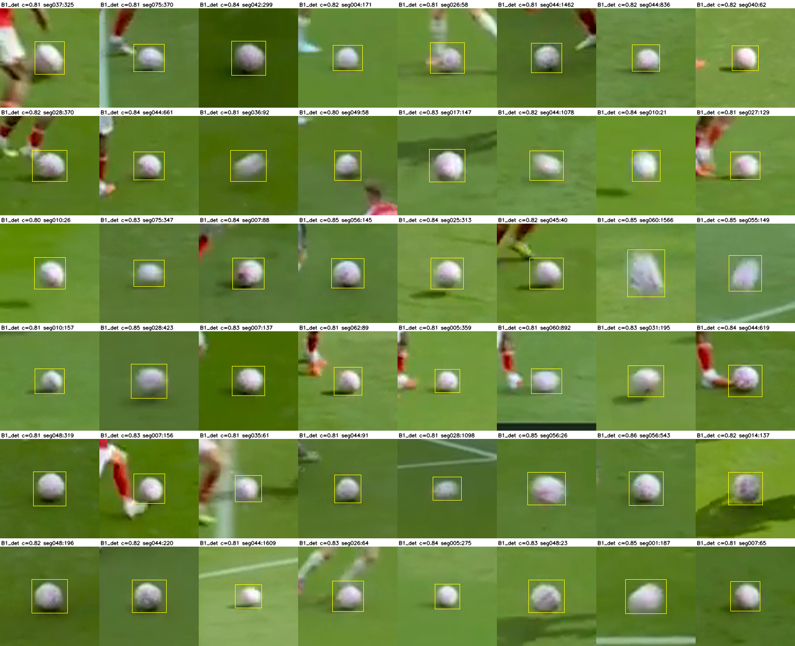
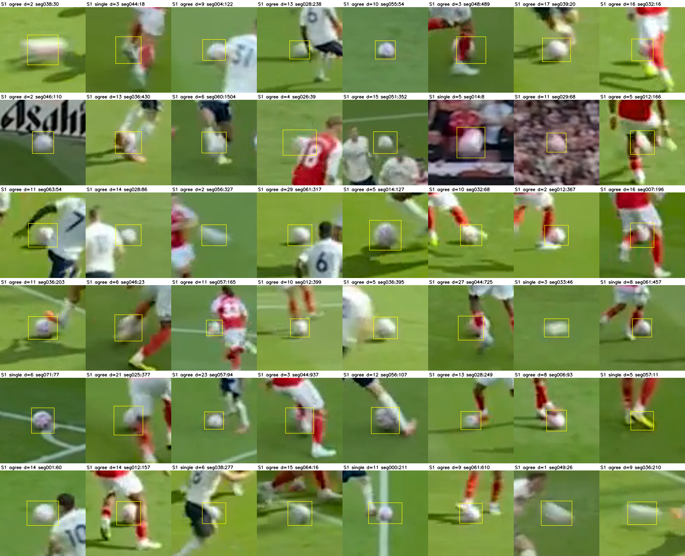
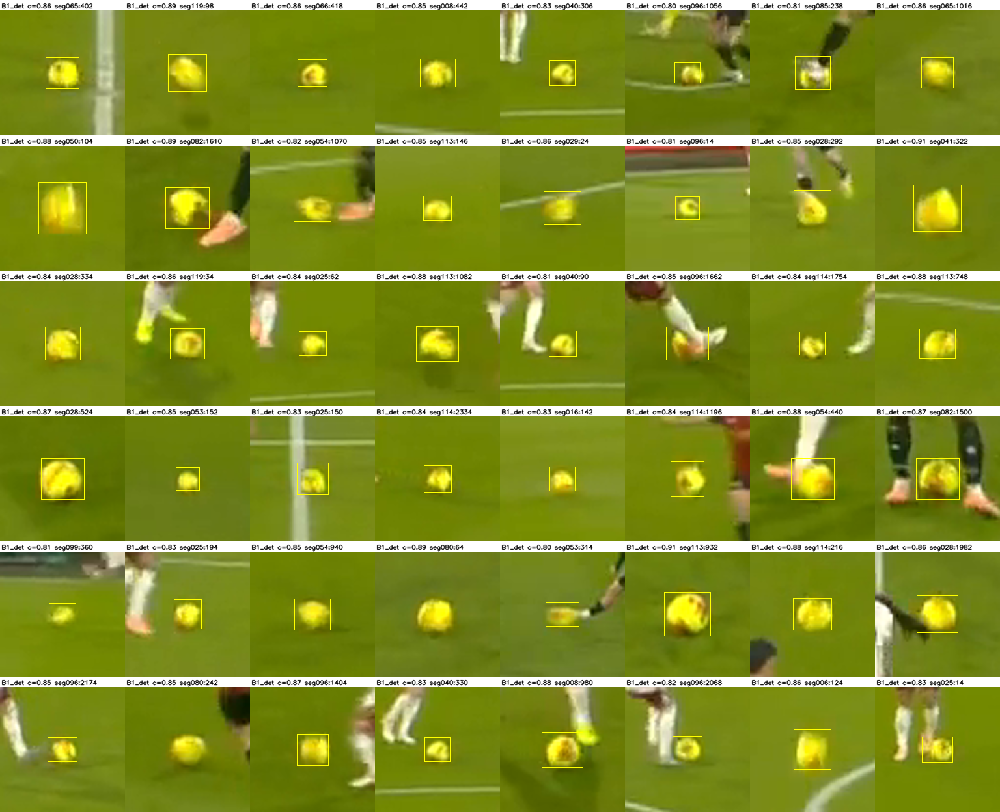
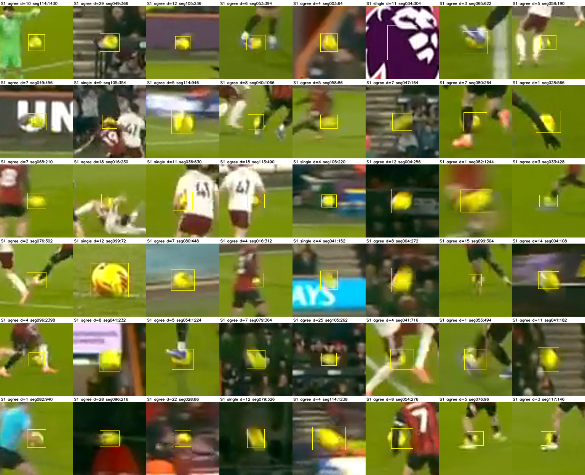

# Round 3: transductive per-match self-training (3ch, A++)

> Naming note: the held-out match used to be called "Norwich"; it is Arsenal v Nottingham Forest (scoreboard NFO), now `arsenal_nottinghamforest`. Old ids (`arsenal_norwich_segNNN`, `*_norwich` dirs) and experiment artifacts written under the old name (`r3_norwich`, `exp/temporal/round3/norwich*`, S3 `exp_temporal_r3/out/*_norwich`) keep it, so old numbers can still be traced.
Branch `exp/temporal-detector`. Code: `experiments/temporal_detector/{r3_detect,r3_prep,r3_fuse,r3_build,r3_audit_bm,heldout_by_match,round2_report}.py`,
flows `temporal-r3-{detect,sam2,build}` (`~/code/jobs/footy_temporal_r3.py`, S3 hop in `footy_s3hop.py`), training via `temporal-ablation ... extra_dirs=r3_bournemouth,r3_norwich`.
Builds on `temporal_detector_ablation.md` (v1), `temporal_pipeline_eval.md`, `temporal_detector_round2.md`. 3-channel only; the 5-channel arm is parked (not run).

## Question and answer

The tool is offline, so it may pseudo-label the match it is processing, using none of that match's human labels. Round 3 trains YOLO11s 3ch on v11 train + the Man City
round-2 pseudo set + pseudo labels of **Bournemouth** (the match 76 of the 117 held-out balls come from) and **Nottingham Forest** (a target match, no labels yet): arm **A++**, 60 epochs, 2 seeds,
same recipe as v1/round 2.

**Held-out recall moves off 0.48, and the whole gain is in the match whose video was pseudo-labelled.**
- Held-out (117 balls, 11 clips), top-1 recall@10 px: A+ (round 2) 0.479 -> **A++ 0.641** (seeds 0.658 / 0.624), paired **+0.162 [+0.103, +0.226]** over frames, clip-level [+0.040, +0.287];
  strict (84 balls) 0.512 -> 0.738, **+0.226 [+0.149, +0.315]**. Against production RT-DETR-L (0.487): **+0.154 [+0.094, +0.222]**.
- By source match (retrospective numbers for the earlier models included):

| held-out subset (n) | RT-DETR | A v1 | A+ r2 | B+ r2 | **A++ r3** (seeds) |
|---|---|---|---|---|---|
| Bournemouth (76) | 0.487 | 0.421 | 0.447 | 0.441 | **0.697** (0.724 / 0.671) |
| Bournemouth strict (66) | 0.424 | 0.356 | 0.379 | 0.379 | **0.667** (0.697 / 0.636) |
| Man City (41) | 0.488 | 0.537 | 0.537 | 0.549 | 0.537 |
| Man City minus arsenal_example (21) | 0.905 | 1.000 | 1.000 | 1.000 | 1.000 |
| arsenal_example held-out frames (20) | 0.050 | 0.050 | 0.050 | 0.075 | 0.050 |

  Bournemouth: A++ - A+ **+0.250 [+0.164, +0.342]** (clip CI [+0.141, +0.412]), strict +0.288 [+0.189, +0.394]; A++ - RT-DETR **+0.211 [+0.125, +0.303]** (clip [+0.083, +0.292]);
  candidate recall any@10 on Bournemouth 0.546 -> 0.849 (RT-DETR 0.724). A+ (Man City pseudo only) was -0.039 [-0.112, +0.026] below RT-DETR there.
- **Man City held-out was already "transductive" in A+ and stayed flat, and still is.** Minus arsenal_example the 21 balls are solved by every YOLO arm (1.000; RT-DETR 0.905), so the Man City held-out
  headroom is only arsenal_example's 20 held-out frames, where every model (RT-DETR included) is at 0.05: that is a hard / possibly mislabelled frame set, not a data-volume problem. The held-out gap was Bournemouth.
- The gain concentrates on fast balls: test+heldout, fastest third of balls A++ - A+ **+0.118 [+0.066, +0.175]**, slow and medium +/-0.01 (n.s.).

**Costs / side effects (be aware):**
- **arsenal_example (Man City example clip, val)**: hit@10 0.596 -> 0.510, **-0.087 [-0.131, -0.042]** (seed range 0.096); through the solver (all labelled frames) B1 recall A++ 0.210 raw / 0.301 iso vs A+ 0.264 / 0.457:
  **-0.054 [-0.091, -0.017] raw, -0.156 [-0.205, -0.108] iso**, ceiling -0.119 [-0.165, -0.074]; the two seeds disagree (+0.051 vs -0.159 raw). RT-DETR still leads there (0.540). Test (Man City, in-domain) is flat:
  -0.008 [-0.023, +0.004]; solver on the 9 test clips -0.003 [-0.030, +0.024] raw. A plausible reading is dilution (Man City pseudo is 34% of the pseudo-labelled data instead of all of it), not verified.
- **False positives on ball-free images** (35 images, val+test+heldout, small n): top-1 conf >= 0.5 A+ 0.157 -> A++ 0.243, conf >= 0.7 0.114 -> 0.171 (RT-DETR 0.314 / 0.171; A v1 0.171 / 0.071); confident wrong top-1 picks on ball frames 0.013 -> 0.010.
  So the new pseudo data buys recall with a visible rise in confident false positives on ball-free frames (about +3 images of 35 at conf >= 0.5): plausible leakage of the pseudo-label errors, not separable at this n.
- Through the solver on the 9 Man City test clips A++ stays at the A+ level (0.791 raw / 0.815 iso vs 0.794 / 0.826) and above production RT-DETR-L (+0.032 [+0.003, +0.064] raw, +0.056 [+0.026, +0.091] iso, precision unchanged).

## Inventory (which match, how much unlabelled video)

Held-out balls by source (k2 `meta.jsonl` `clip_id`): **Bournemouth 76** (seg009 10, 015 9, 021 5, 031 11, 035 40, 060 1; strict 66) and **Man City 41** (`part093` 18 strict, `arsenal_example` 20, segs 101/134/135 one each). No Aston Villa balls.

| match | unlabelled broadcast video | frames | notes |
|---|---|---|---|
| Bournemouth 1st half | 121 segment clips, **50 fps** 1920x1080 | 71,494 | 114 clips (67,897 frames) after removing the 7 clips that hold v11 val/test/held-out images; RT-DETR labels did not exist |
| Bournemouth 2nd half | raw `.ts` only (1.7 GB), never segmented | - | not used |
| Man City | 162 clips (25 fps) | 97,625 | r2 pool = 62 clips (21,340 frames); the other 100 contain v11 eval images or the trajectory test clips; unchanged here |
| Nottingham Forest | 76 clips (25 fps), RT-DETR labels existed | 25,694 | 24 label-queue windows (19 clips): windows +-25 frames = 6,850 frames excluded, pool 18,844 |
| Aston Villa | 189 clips | 81,280 | dropped (not a target match) |

## Pseudo-labelling pipeline (per target match)

RT-DETR-L v11 @1280 (Bournemouth: run here with the ffmpeg CLI `-fps_mode passthrough`, conf >= 0.1, all classes; Nottingham Forest: the existing machine labels) -> harness B1 (camera on, dev-tuned parameters, unchanged)
-> S1 (SAM2.1-small crop512 tracks from conf >= 0.8 anchors, forward/backward agreement gate) -> filter -> stride >= 5 -> 3ch PNG + YOLO labels (pseudo ball + machine player/other boxes conf >= 0.5).
- **Frame rate:** the Bournemouth clips are 50 fps. They are handled as 25 fps clips by taking every 2nd decoded frame, so B1's per-frame parameters (vmax 40 px/frame, max_gap 25), the +-25-frame filter window and stride 5 keep their meaning;
  subsampled index t is original frame 2t. RT-DETR runs on the original even frames, SAM2 on a 25 fps copy (crf 12), training images are the original frames 2t, so labels sit in the GT frame space (GT indices are 50 fps).
- **Random subset for Bournemouth:** 60 of the 114 pool clips (59 used: seg092 is unreadable on the mini, I/O error after ~5 MB of the mp4); 15,722 frames at 25 fps.
- **Exclusions:** every held-out clip and every v11 val/test clip in full (Bournemouth: seg009, 010, 015, 021, 031, 035, 060 never in the pool); Nottingham Forest queue windows +-25 frames (selected frames are >= 28 frames from any window, 0 inside, checked);
  `ball_gt_marks_nottinghamforest` is never read: the harness root used for B1 has an empty `ball_gt_marks`, and the blind-check verdicts in `ball_gt_marks_nottinghamforest/ball_checks` were not used for anything.
- **Selection:** easy B1 nodes (conf >= 0.8, random, cap 800) + all S1 fills, cap 1,500 per match: **Bournemouth 1,025 images (800 easy + 225 S1; 51 clips; 7 within 5 frames of a v11 train image, kept)**, **Nottingham Forest 1,138 (800 + 338; 66 clips)**.

**No low-confidence B1 detections for either match (a change to the round-2 filter, with evidence).** Audit off Man City: the harness B1 on RT-DETR labels of the six held-out Bournemouth clips (excluded from the pool, so no leak),
scored against their human GT on the 36 GT frames that fall on the 25 fps subsample: B1 node hit@10 by confidence band conf >= 0.8 **6/6**, 0.6-0.8 **5/9** (Man City: 98%), < 0.6 **1/8**, and the round-2 low-conf survivors **0/6**.
George's blind check of the Nottingham Forest set agrees (Ball Check, no source shown; verdicts in `ball_gt_marks_nottinghamforest/ball_checks`, not used for training; figures supplied by the coordinator): easy B1 anchors **58/60 real (97%, CI 89-99%)**,
S1 fills **53/60 (88%, CI 78-94%, plus 2 box_off)**, estimated set precision about **94%** (comparable to the Man City r2 set); B1 nodes with p < 0.5 outside the set 22/40 real (55%), and B1-rejected RT-DETR detections with conf >= 0.6 only 1/40 real,
so the solver's rejections are right and **RT-DETR confidence is badly calibrated on this match**.

**Contact sheets** (48 random crops each, 64 px at 3x, label box, source and confidence / fill rule and distance to the anchor):
- Nottingham Forest easy: 48/48 clear balls; Nottingham Forest S1 fills: mostly balls, about 4 of 48 are blurred streaks or a boot (consistent with the blind check).
- Bournemouth easy: 48/48 clear (yellow) balls; Bournemouth S1 fills: about 5 of 48 doubtful or wrong (one box on the Premier League logo, a few on ad boards / crowd): kept, flagged as the weakest part.

## Training and what was not done

- A++: v11 train (1,034) + Man City r2 pseudo (1,617) + Bournemouth (1,025) + Nottingham Forest (1,138) = 4,816 images, YOLO11s 3ch, imgsz 1280, batch 4, 60 epochs, seeds 0 and 1, `last.pt`, HSV / Albumentations off (identical to round 2).
  3.7-6 h per run (GPU-bound, 1,204 iterations per epoch).
- **Not run:** the arm without the Man City pseudo (cancelled: not cheap at ~5 h/run, so "Man City pseudo vs target pseudo" effects are not separated); the RT-DETR-L fine-tune (not started); the 5-channel arm (parked);
  the **Nottingham Forest preview**: at evaluation time `ball_gt_marks_nottinghamforest` held no window labels (only the blind-check verdicts), so nothing was scored on Nottingham Forest. Nottingham Forest pseudo labels are in the training data but untested.
- Caveat on interpretation: the held-out Bournemouth frames come from the same match (same kit, stadium, ball) as the pseudo-labelled clips, never from the same clips or frames (disjoint segments, held-out and v11 eval clips excluded in full).
  That is exactly the transductive setting the offline tool has, but it says nothing about a match whose video was not pseudo-labelled; and Man City held-out, the only other match, was flat before and after.
- Cost: Bournemouth RT-DETR labels for 17,282 processed frames about 17 min (18 fps); SAM2: Nottingham Forest 69 clips / 11.2k steps about 30 min, Bournemouth 42 clips / 5.7k steps about 20 min; most wall-clock went to the desktop Wi-Fi
  (the tailnet path fell back to a ~30 KB/s DERP relay for hours, so large transfers go through S3 with presigned URLs) and to the 3 x 4-6 h of training.

## Top-1 recall@10 px (hit@10), mean of 2 seeds [seed range]

| model | heldout / Bournemouth (n=76) | heldout / Bournemouth strict (n=66) | heldout / Man City (n=41) | heldout / Man City minus arsenal_example (n=21) | heldout / arsenal_example frames (n=20) | val (n=209) | val / clip arsenal_example (74% of val balls) (n=156) | val / all other clips (n=53) | test (n=238) | heldout (n=117) | heldout_strict (n=84) | test+heldout (n=355) | test+heldout / ball motion low (n=113) | test+heldout / ball motion mid (n=115) | test+heldout / ball motion high (n=114) |
|---|---|---|---|---|---|---|---|---|---|---|---|---|---|---|---|
| RT-DETR | 0.487 | 0.424 | 0.488 | 0.905 | 0.050 | 0.718 | 0.667 | 0.868 | 0.916 | 0.487 | 0.524 | 0.775 | 0.779 | 0.852 | 0.719 |
| A v1 | 0.421 [0.053] | 0.356 [0.045] | 0.537 | 1.000 | 0.050 | 0.493 [0.153] | 0.375 [0.186] | 0.840 [0.057] | 0.880 [0.013] | 0.462 [0.034] | 0.494 [0.036] | 0.742 [0.020] | 0.743 [0.018] | 0.822 [0.009] | 0.693 [0.035] |
| A+ r2 | 0.447 | 0.379 | 0.537 | 1.000 | 0.050 | 0.670 [0.038] | 0.596 [0.051] | 0.887 | 0.956 [0.004] | 0.479 | 0.512 | 0.799 [0.003] | 0.823 | 0.891 [0.009] | 0.715 [0.009] |
| B+ r2 | 0.441 [0.013] | 0.379 | 0.549 [0.024] | 1.000 | 0.075 [0.050] | 0.689 | 0.612 [0.006] | 0.915 [0.019] | 0.943 [0.004] | 0.479 | 0.512 | 0.790 [0.003] | 0.805 | 0.883 [0.009] | 0.711 |
| A++ r3 | 0.697 [0.053] | 0.667 [0.061] | 0.537 | 1.000 | 0.050 | 0.615 [0.072] | 0.510 [0.096] | 0.925 | 0.947 [0.004] | 0.641 [0.034] | 0.738 [0.048] | 0.846 [0.008] | 0.819 [0.009] | 0.904 | 0.833 [0.018] |

## Candidate recall any@10

| model | heldout / Bournemouth (n=76) | heldout / Bournemouth strict (n=66) | heldout / Man City (n=41) | heldout / Man City minus arsenal_example (n=21) | heldout / arsenal_example frames (n=20) | val (n=209) | val / clip arsenal_example (74% of val balls) (n=156) | val / all other clips (n=53) | test (n=238) | heldout (n=117) | heldout_strict (n=84) | test+heldout (n=355) | test+heldout / ball motion low (n=113) | test+heldout / ball motion mid (n=115) | test+heldout / ball motion high (n=114) |
|---|---|---|---|---|---|---|---|---|---|---|---|---|---|---|---|
| RT-DETR | 0.724 | 0.682 | 0.585 | 1.000 | 0.150 | 0.833 | 0.795 | 0.943 | 0.962 | 0.675 | 0.750 | 0.868 | 0.832 | 0.930 | 0.833 |
| A v1 | 0.500 [0.026] | 0.439 [0.030] | 0.537 | 1.000 | 0.050 | 0.596 [0.120] | 0.503 [0.147] | 0.868 [0.038] | 0.920 [0.017] | 0.513 [0.017] | 0.560 [0.024] | 0.786 [0.017] | 0.774 [0.009] | 0.883 [0.043] | 0.732 [0.009] |
| A+ r2 | 0.546 [0.039] | 0.492 [0.045] | 0.537 | 1.000 | 0.050 | 0.849 [0.005] | 0.811 [0.006] | 0.962 | 0.975 | 0.543 [0.026] | 0.601 [0.036] | 0.832 [0.008] | 0.845 [0.027] | 0.930 | 0.750 [0.009] |
| B+ r2 | 0.520 [0.013] | 0.462 [0.015] | 0.659 [0.049] | 1.000 | 0.300 [0.100] | 0.844 [0.005] | 0.811 [0.006] | 0.943 | 0.971 [0.025] | 0.568 [0.026] | 0.577 [0.012] | 0.838 [0.008] | 0.836 [0.027] | 0.926 [0.009] | 0.785 [0.009] |
| A++ r3 | 0.849 [0.013] | 0.841 [0.015] | 0.598 [0.073] | 1.000 | 0.175 [0.150] | 0.811 [0.024] | 0.760 [0.032] | 0.962 | 0.971 | 0.761 [0.034] | 0.875 [0.012] | 0.901 [0.011] | 0.876 [0.035] | 0.926 [0.009] | 0.921 [0.018] |

## Ball AP50

| model | heldout / Bournemouth (n=76) | heldout / Bournemouth strict (n=66) | heldout / Man City (n=41) | heldout / Man City minus arsenal_example (n=21) | heldout / arsenal_example frames (n=20) | val (n=209) | val / clip arsenal_example (74% of val balls) (n=156) | val / all other clips (n=53) | test (n=238) | heldout (n=117) | heldout_strict (n=84) | test+heldout (n=355) | test+heldout / ball motion low (n=113) | test+heldout / ball motion mid (n=115) | test+heldout / ball motion high (n=114) |
|---|---|---|---|---|---|---|---|---|---|---|---|---|---|---|---|
| RT-DETR | 0.470 | 0.412 | 0.461 | 0.880 | 0.047 | 0.658 | 0.636 | 0.734 | 0.881 | 0.464 | 0.514 | 0.750 | 0.749 | 0.823 | 0.717 |
| A v1 | 0.430 [0.066] | 0.366 [0.047] | 0.445 [0.024] | 0.782 [0.056] | 0.054 [0.004] | 0.441 [0.129] | 0.336 [0.190] | 0.702 [0.021] | 0.831 [0.009] | 0.435 [0.050] | 0.470 [0.061] | 0.703 [0.007] | 0.706 [0.003] | 0.789 [0.009] | 0.677 [0.017] |
| A+ r2 | 0.445 [0.003] | 0.384 [0.025] | 0.474 [0.001] | 0.881 [0.005] | 0.014 [0.004] | 0.623 [0.059] | 0.559 [0.095] | 0.792 [0.022] | 0.920 [0.005] | 0.445 [0.005] | 0.501 [0.028] | 0.771 [0.002] | 0.799 [0.016] | 0.861 [0.001] | 0.704 [0.013] |
| B+ r2 | 0.449 [0.045] | 0.385 [0.028] | 0.486 [0.012] | 0.884 [0.019] | 0.018 [0.003] | 0.643 [0.027] | 0.583 [0.025] | 0.792 [0.035] | 0.914 [0.014] | 0.456 [0.016] | 0.508 [0.006] | 0.771 [0.010] | 0.789 [0.017] | 0.858 [0.005] | 0.715 [0.003] |
| A++ r3 | 0.668 [0.052] | 0.643 [0.026] | 0.477 [0.024] | 0.877 [0.045] | 0.029 [0.034] | 0.573 [0.056] | 0.481 [0.097] | 0.796 [0.002] | 0.913 [0.023] | 0.598 [0.020] | 0.707 [0.009] | 0.815 [0.011] | 0.788 [0.000] | 0.884 [0.013] | 0.820 [0.017] |

## Paired differences in hit@10 (bootstrap over images; seed-mean outcomes; clip bootstrap in brackets)

| subset | n | A++ - A+ (r2) | A++ - A (v1) | A++ - RT-DETR | A++ - B+ (r2) | A+ - RT-DETR |
|---|---|---|---|---|---|---|
| heldout / Bournemouth | 76 | +0.250 [+0.164, +0.342] (+0.141, +0.412) | +0.276 [+0.191, +0.362] (+0.176, +0.460) | +0.211 [+0.125, +0.303] (+0.083, +0.292) | +0.257 [+0.171, +0.349] (+0.160, +0.423) | -0.039 [-0.112, +0.026] (-0.150, +0.004) |
| heldout / Bournemouth strict | 66 | +0.288 [+0.189, +0.394] (+0.225, +0.460) | +0.311 [+0.220, +0.409] (+0.236, +0.500) | +0.242 [+0.144, +0.341] (+0.160, +0.333) | +0.288 [+0.189, +0.387] (+0.217, +0.485) | -0.045 [-0.129, +0.030] (-0.172, +0.004) |
| heldout / Man City | 41 | +0.000 [+0.000, +0.000] (+0.000, +0.000) | +0.000 [+0.000, +0.000] (+0.000, +0.000) | +0.049 [+0.000, +0.122] (+0.000, +0.107) | -0.012 [-0.037, +0.000] (-0.024, +0.000) | +0.049 [+0.000, +0.122] (+0.000, +0.107) |
| heldout / Man City minus arsenal_example | 21 | +0.000 [+0.000, +0.000] (+0.000, +0.000) | +0.000 [+0.000, +0.000] (+0.000, +0.000) | +0.095 [+0.000, +0.238] (+0.000, +0.109) | +0.000 [+0.000, +0.000] (+0.000, +0.000) | +0.095 [+0.000, +0.238] (+0.000, +0.109) |
| heldout / arsenal_example frames | 20 | +0.000 [+0.000, +0.000] (+0.000, +0.000) | +0.000 [+0.000, +0.000] (+0.000, +0.000) | +0.000 [+0.000, +0.000] (+0.000, +0.000) | -0.025 [-0.075, +0.000] (-0.025, -0.025) | +0.000 [+0.000, +0.000] (+0.000, +0.000) |
| val | 209 | -0.055 [-0.093, -0.019] (-0.077, +0.056) | +0.122 [+0.079, +0.167] (+0.039, +0.145) | -0.103 [-0.160, -0.045] (-0.143, +0.140) | -0.074 [-0.117, -0.033] (-0.094, +0.037) | -0.048 [-0.100, +0.007] (-0.075, +0.100) |
| val / clip arsenal_example (74% of val balls) | 156 | -0.087 [-0.131, -0.042] (-0.087, -0.087) | +0.135 [+0.080, +0.189] (+0.135, +0.135) | -0.157 [-0.224, -0.090] (-0.157, -0.157) | -0.103 [-0.157, -0.051] (-0.103, -0.103) | -0.071 [-0.138, -0.003] (-0.071, -0.071) |
| val / all other clips | 53 | +0.038 [-0.009, +0.094] (+0.011, +0.065) | +0.085 [+0.028, +0.160] (+0.025, +0.167) | +0.057 [-0.019, +0.151] (-0.039, +0.169) | +0.009 [-0.047, +0.057] (-0.019, +0.048) | +0.019 [-0.066, +0.104] (-0.083, +0.133) |
| test | 238 | -0.008 [-0.023, +0.004] (-0.020, +0.004) | +0.067 [+0.040, +0.099] (+0.037, +0.100) | +0.032 [+0.008, +0.057] (+0.006, +0.060) | +0.004 [-0.013, +0.021] (-0.012, +0.022) | +0.040 [+0.015, +0.069] (+0.015, +0.067) |
| heldout | 117 | +0.162 [+0.103, +0.226] (+0.040, +0.287) | +0.179 [+0.120, +0.244] (+0.057, +0.313) | +0.154 [+0.094, +0.222] (+0.047, +0.234) | +0.162 [+0.103, +0.231] (+0.037, +0.289) | -0.009 [-0.060, +0.038] (-0.083, +0.038) |
| heldout_strict | 84 | +0.226 [+0.149, +0.315] (+0.093, +0.417) | +0.244 [+0.167, +0.327] (+0.113, +0.460) | +0.214 [+0.131, +0.298] (+0.133, +0.286) | +0.226 [+0.149, +0.310] (+0.093, +0.429) | -0.012 [-0.083, +0.054] (-0.150, +0.055) |
| test+heldout | 355 | +0.048 [+0.024, +0.073] (-0.002, +0.098) | +0.104 [+0.076, +0.134] (+0.056, +0.152) | +0.072 [+0.045, +0.100] (+0.027, +0.116) | +0.056 [+0.032, +0.082] (+0.009, +0.106) | +0.024 [+0.000, +0.049] (+0.000, +0.050) |
| test+heldout / ball motion low | 113 | -0.004 [-0.035, +0.027] (-0.034, +0.034) | +0.075 [+0.031, +0.124] (+0.025, +0.139) | +0.040 [+0.004, +0.080] (+0.004, +0.083) | +0.013 [-0.018, +0.049] (-0.019, +0.056) | +0.044 [+0.000, +0.093] (-0.004, +0.089) |
| test+heldout / ball motion mid | 115 | +0.013 [-0.009, +0.039] (-0.014, +0.043) | +0.083 [+0.043, +0.130] (+0.041, +0.124) | +0.052 [+0.013, +0.096] (+0.014, +0.096) | +0.022 [-0.004, +0.052] (-0.004, +0.049) | +0.039 [-0.004, +0.087] (+0.000, +0.085) |
| test+heldout / ball motion high | 114 | +0.118 [+0.066, +0.175] (+0.011, +0.216) | +0.140 [+0.088, +0.197] (+0.038, +0.227) | +0.114 [+0.061, +0.175] (+0.025, +0.201) | +0.123 [+0.070, +0.184] (+0.011, +0.222) | -0.004 [-0.044, +0.035] (-0.038, +0.035) |

## Paired differences in candidate recall any@10

| subset | A++ - A+ (r2) | A++ - A (v1) | A++ - RT-DETR | A++ - B+ (r2) | A+ - RT-DETR |
|---|---|---|---|---|---|
| heldout / Bournemouth | +0.303 [+0.211, +0.401] | +0.349 [+0.257, +0.441] | +0.125 [+0.033, +0.217] | +0.329 [+0.237, +0.421] | -0.178 [-0.263, -0.092] |
| heldout / Bournemouth strict | +0.348 [+0.242, +0.455] | +0.402 [+0.303, +0.500] | +0.159 [+0.061, +0.258] | +0.379 [+0.280, +0.485] | -0.189 [-0.288, -0.098] |
| heldout / Man City | +0.061 [+0.012, +0.134] | +0.061 [+0.012, +0.134] | +0.012 [-0.085, +0.110] | -0.061 [-0.122, -0.012] | -0.049 [-0.122, +0.000] |
| heldout / Man City minus arsenal_example | +0.000 [+0.000, +0.000] | +0.000 [+0.000, +0.000] | +0.000 [+0.000, +0.000] | +0.000 [+0.000, +0.000] | +0.000 [+0.000, +0.000] |
| heldout / arsenal_example frames | +0.125 [+0.025, +0.250] | +0.125 [+0.025, +0.250] | +0.025 [-0.175, +0.200] | -0.125 [-0.250, -0.025] | -0.100 [-0.250, +0.000] |
| val | -0.038 [-0.069, -0.010] | +0.215 [+0.170, +0.263] | -0.022 [-0.062, +0.022] | -0.033 [-0.060, -0.010] | +0.017 [-0.024, +0.057] |
| val / clip arsenal_example (74% of val balls) | -0.051 [-0.090, -0.016] | +0.256 [+0.202, +0.314] | -0.035 [-0.090, +0.016] | -0.051 [-0.083, -0.022] | +0.016 [-0.032, +0.067] |
| val / all other clips | +0.000 [-0.028, +0.028] | +0.094 [+0.028, +0.170] | +0.019 [-0.019, +0.066] | +0.019 [-0.019, +0.057] | +0.019 [-0.038, +0.075] |
| test | -0.004 [-0.017, +0.008] | +0.050 [+0.025, +0.078] | +0.008 [-0.015, +0.032] | +0.000 [-0.015, +0.015] | +0.013 [-0.008, +0.034] |
| heldout | +0.218 [+0.150, +0.286] | +0.248 [+0.184, +0.316] | +0.085 [+0.017, +0.154] | +0.192 [+0.120, +0.265] | -0.132 [-0.197, -0.073] |
| heldout_strict | +0.274 [+0.190, +0.363] | +0.315 [+0.232, +0.405] | +0.125 [+0.048, +0.208] | +0.298 [+0.214, +0.387] | -0.149 [-0.232, -0.077] |
| test+heldout | +0.069 [+0.044, +0.097] | +0.115 [+0.086, +0.146] | +0.034 [+0.006, +0.062] | +0.063 [+0.037, +0.092] | -0.035 [-0.062, -0.010] |
| test+heldout / ball motion low | +0.031 [+0.004, +0.062] | +0.102 [+0.053, +0.155] | +0.044 [+0.004, +0.088] | +0.040 [+0.009, +0.075] | +0.013 [-0.027, +0.058] |
| test+heldout / ball motion mid | -0.004 [-0.030, +0.017] | +0.043 [+0.013, +0.078] | -0.004 [-0.039, +0.026] | +0.000 [-0.030, +0.030] | +0.000 [-0.035, +0.035] |
| test+heldout / ball motion high | +0.171 [+0.105, +0.241] | +0.189 [+0.127, +0.259] | +0.088 [+0.031, +0.149] | +0.136 [+0.070, +0.206] | -0.083 [-0.132, -0.039] |

## False positives on ball-free images (n = 35, val+test+heldout)

| model | top-1 conf >= 0.1 | >= 0.25 | >= 0.5 | >= 0.7 | confident wrong top-1 on ball frames (conf >= 0.5, fraction of ball frames) |
|---|---|---|---|---|---|
| RT-DETR | 1.000 | 0.771 | 0.314 | 0.171 | 0.041 |
| A v1 | 0.357 | 0.214 | 0.171 | 0.071 | 0.008 |
| A+ r2 | 0.386 | 0.214 | 0.157 | 0.114 | 0.013 |
| B+ r2 | 0.371 | 0.257 | 0.186 | 0.143 | 0.009 |
| A++ r3 | 0.457 | 0.329 | 0.243 | 0.171 | 0.010 |

## Training curves (val ball AP50)

| run | epochs | last | mean last 10 | best |
|---|---|---|---|---|
| A_s0 | 100 | 0.509 | 0.516 | 0.540 |
| A_s1 | 100 | 0.369 | 0.373 | 0.564 |
| B_s0 | 100 | 0.626 | 0.621 | 0.642 |
| B_s1 | 100 | 0.528 | 0.509 | 0.530 |
| Ap_s0 | 60 | 0.606 | 0.583 | 0.641 |
| Ap_s1 | 60 | 0.657 | 0.668 | 0.680 |
| Bp_s0 | 60 | 0.624 | 0.658 | 0.695 |
| Bp_s1 | 60 | 0.669 | 0.644 | 0.671 |
| App_s0 | 60 | 0.608 | 0.576 | 0.608 |
| App_s1 | 60 | 0.555 | 0.523 | 0.582 |

# Appendix: round-3 models (A++ = 3ch with Bournemouth + Nottingham Forest pseudo) vs A+ through the harness trajectory solver (B0 / B1, camera on)
Comparison columns read 'A++ r3' minus 'A+ r2' (3ch both); the production RT-DETR-L rows are as in temporal_pipeline_eval.md. Test clips and arsenal_example are Man City: no new in-domain data. arsenal_example harness-clean n = 9 is uninformative; the all-labelled-frames table is the labelled deviation.

## test (9 clips, harness exclusions)

172 scored frames; n_gt = 170. recall@10 = emitted point within 10 px of GT (denominator: GT ball frames); precision = TP / (TP + FP) over scored frames (FP = emitted point > 10 px away, or emitted on a `no_ball` frame); ceiling = any candidate with conf >= 0.1 within 10 px (candidate-set recall, identical for B0 and B1).

| detector | calibration | B0 recall / prec | B1 recall / prec | ceiling |
|---|---|---|---|---|
| RT-DETR-L production (frame t) | raw | 0.741 / 0.947 | 0.759 / 0.985 | 0.829 |
| RT-DETR-L rerun by this pipeline | raw | 0.741 / 0.947 | 0.759 / 0.985 | 0.829 |
| A+ r2 Ap_s0 | raw | 0.788 / 0.993 | 0.788 / 0.985 | 0.812 |
| A+ r2 Ap_s0 | iso | 0.806 / 0.993 | 0.829 / 0.993 | 0.812 |
| A+ r2 Ap_s1 | raw | 0.794 / 0.993 | 0.800 / 0.993 | 0.829 |
| A+ r2 Ap_s1 | iso | 0.818 / 0.986 | 0.824 / 0.993 | 0.829 |
| A+ r2 mean of seeds | raw | 0.791 / 0.993 | 0.794 / 0.989 | 0.821 |
| A+ r2 mean of seeds | iso | 0.812 / 0.989 | 0.826 / 0.993 | 0.821 |
| A++ r3 App_s0 | raw | 0.782 / 0.993 | 0.782 / 0.985 | 0.812 |
| A++ r3 App_s0 | iso | 0.800 / 0.965 | 0.806 / 0.972 | 0.812 |
| A++ r3 App_s1 | raw | 0.788 / 0.985 | 0.800 / 0.986 | 0.818 |
| A++ r3 App_s1 | iso | 0.812 / 0.979 | 0.824 / 0.979 | 0.818 |
| A++ r3 mean of seeds | raw | 0.785 / 0.989 | 0.791 / 0.985 | 0.815 |
| A++ r3 mean of seeds | iso | 0.806 / 0.972 | 0.815 / 0.975 | 0.815 |

Paired bootstrap (10,000 resamples of scored frames; seed-mean per-frame outcomes for the arms), B1 camera on:

| comparison | calibration | recall@10 diff [95% CI] | precision diff [95% CI] | ceiling diff [95% CI] | per-seed recall diff |
|---|---|---|---|---|---|
| B1(A++ r3) - B1(A+ r2) | raw | -0.003 [-0.030, +0.024] | -0.004 [-0.012, +0.000] | -0.006 [-0.023, +0.009] | s0: -0.006, s1: +0.000 |
| B1(A++ r3) - B1(A+ r2) | iso | -0.012 [-0.029, +0.003] | -0.018 [-0.038, -0.003] | -0.006 [-0.024, +0.009] | s0: -0.024, s1: +0.000 |
| B1(A++ r3) - B1(RT-DETR) | raw | +0.032 [+0.003, +0.064] | +0.001 [-0.026, +0.029] | -0.015 [-0.051, +0.020] |  |
| B1(A++ r3) - B1(RT-DETR) | iso | +0.056 [+0.026, +0.091] | -0.009 [-0.040, +0.022] | -0.015 [-0.051, +0.018] |  |

## arsenal_example, harness-clean frames

9 scored frames; n_gt = 9. recall@10 = emitted point within 10 px of GT (denominator: GT ball frames); precision = TP / (TP + FP) over scored frames (FP = emitted point > 10 px away, or emitted on a `no_ball` frame); ceiling = any candidate with conf >= 0.1 within 10 px (candidate-set recall, identical for B0 and B1).

| detector | calibration | B0 recall / prec | B1 recall / prec | ceiling |
|---|---|---|---|---|
| RT-DETR-L production (frame t) | raw | 0.111 / 0.200 | 0.111 / 0.250 | 0.111 |
| RT-DETR-L rerun by this pipeline | raw | 0.111 / 0.200 | 0.111 / 0.250 | 0.111 |
| A+ r2 Ap_s0 | raw | 0.000 / n/a | 0.000 / n/a | 0.111 |
| A+ r2 Ap_s0 | iso | 0.111 / 0.333 | 0.111 / 0.500 | 0.111 |
| A+ r2 Ap_s1 | raw | 0.000 / n/a | 0.000 / n/a | 0.111 |
| A+ r2 Ap_s1 | iso | 0.000 / n/a | 0.000 / n/a | 0.111 |
| A+ r2 mean of seeds | raw | 0.000 / n/a | 0.000 / n/a | 0.111 |
| A+ r2 mean of seeds | iso | 0.056 / n/a | 0.056 / n/a | 0.111 |
| A++ r3 App_s0 | raw | 0.000 / n/a | 0.000 / n/a | 0.111 |
| A++ r3 App_s0 | iso | 0.111 / 1.000 | 0.111 / 1.000 | 0.111 |
| A++ r3 App_s1 | raw | 0.000 / n/a | 0.000 / n/a | 0.000 |
| A++ r3 App_s1 | iso | 0.000 / n/a | 0.000 / 0.000 | 0.000 |
| A++ r3 mean of seeds | raw | 0.000 / n/a | 0.000 / n/a | 0.056 |
| A++ r3 mean of seeds | iso | 0.056 / n/a | 0.056 / 0.500 | 0.056 |

Paired bootstrap (10,000 resamples of scored frames; seed-mean per-frame outcomes for the arms), B1 camera on:

| comparison | calibration | recall@10 diff [95% CI] | precision diff [95% CI] | ceiling diff [95% CI] | per-seed recall diff |
|---|---|---|---|---|---|
| B1(A++ r3) - B1(A+ r2) | raw | +0.000 [+0.000, +0.000] | +nan [+nan, +nan] | -0.056 [-0.167, +0.000] | s0: +0.000, s1: +0.000 |
| B1(A++ r3) - B1(A+ r2) | iso | +0.000 [+0.000, +0.000] | +0.000 [-0.667, +0.667] | -0.056 [-0.167, +0.000] | s0: +0.000, s1: +0.000 |
| B1(A++ r3) - B1(RT-DETR) | raw | -0.111 [-0.333, +0.000] | +nan [+nan, +nan] | -0.056 [-0.167, +0.000] |  |
| B1(A++ r3) - B1(RT-DETR) | iso | -0.056 [-0.167, +0.000] | +0.250 [-0.250, +0.833] | -0.056 [-0.167, +0.000] |  |

## arsenal_example, all labelled frames (NOT harness-clean)

176 scored frames; n_gt = 176. recall@10 = emitted point within 10 px of GT (denominator: GT ball frames); precision = TP / (TP + FP) over scored frames (FP = emitted point > 10 px away, or emitted on a `no_ball` frame); ceiling = any candidate with conf >= 0.1 within 10 px (candidate-set recall, identical for B0 and B1).

| detector | calibration | B0 recall / prec | B1 recall / prec | ceiling |
|---|---|---|---|---|
| RT-DETR-L production (frame t) | raw | 0.540 / 0.856 | 0.540 / 0.913 | 0.631 |
| RT-DETR-L rerun by this pipeline | raw | 0.540 / 0.856 | 0.540 / 0.913 | 0.631 |
| A+ r2 Ap_s0 | raw | 0.199 / 0.854 | 0.216 / 0.884 | 0.443 |
| A+ r2 Ap_s0 | iso | 0.415 / 0.716 | 0.398 / 0.805 | 0.443 |
| A+ r2 Ap_s1 | raw | 0.307 / 0.915 | 0.312 / 0.902 | 0.580 |
| A+ r2 Ap_s1 | iso | 0.489 / 0.835 | 0.517 / 0.843 | 0.580 |
| A+ r2 mean of seeds | raw | 0.253 / 0.884 | 0.264 / 0.893 | 0.511 |
| A+ r2 mean of seeds | iso | 0.452 / 0.775 | 0.457 / 0.824 | 0.511 |
| A++ r3 App_s0 | raw | 0.216 / 1.000 | 0.267 / 1.000 | 0.483 |
| A++ r3 App_s0 | iso | 0.386 / 0.819 | 0.392 / 0.958 | 0.483 |
| A++ r3 App_s1 | raw | 0.159 / 0.966 | 0.153 / 1.000 | 0.301 |
| A++ r3 App_s1 | iso | 0.210 / 0.822 | 0.210 / 0.822 | 0.301 |
| A++ r3 mean of seeds | raw | 0.188 / 0.983 | 0.210 / 1.000 | 0.392 |
| A++ r3 mean of seeds | iso | 0.298 / 0.821 | 0.301 / 0.890 | 0.392 |

Paired bootstrap (10,000 resamples of scored frames; seed-mean per-frame outcomes for the arms), B1 camera on:

| comparison | calibration | recall@10 diff [95% CI] | precision diff [95% CI] | ceiling diff [95% CI] | per-seed recall diff |
|---|---|---|---|---|---|
| B1(A++ r3) - B1(A+ r2) | raw | -0.054 [-0.091, -0.017] | +0.106 [+0.040, +0.186] | -0.119 [-0.165, -0.074] | s0: +0.051, s1: -0.159 |
| B1(A++ r3) - B1(A+ r2) | iso | -0.156 [-0.205, -0.108] | +0.080 [-0.001, +0.164] | -0.119 [-0.165, -0.077] | s0: -0.006, s1: -0.307 |
| B1(A++ r3) - B1(RT-DETR) | raw | -0.330 [-0.406, -0.250] | +0.087 [+0.038, +0.146] | -0.239 [-0.295, -0.185] |  |
| B1(A++ r3) - B1(RT-DETR) | iso | -0.239 [-0.307, -0.170] | -0.007 [-0.079, +0.063] | -0.239 [-0.295, -0.185] |  |

## Checks

- Harness reproduction on the 9 test clips (RT-DETR machine labels, camera-on B1): recall 0.759 (129 TP of 170), precision 0.985; B0 tau 0.4 recall 0.741, precision 0.947 (harness doc: 0.759 / 0.985 and 0.741 / 0.947).
- RT-DETR rerun by this pipeline vs the harness's machine labels (top-1 per frame with conf >= 0.3, same position within 3 px and conf within 0.05): seg010 549/549; seg011 609/610; seg031 311/312; seg094 2293/2294; seg101 212/212; seg115 2126/2132; seg134 426/426; seg135 680/680; seg140 347/348.
- Neighbour status per clip (frames, [prev, next] slots): seg010 ok:1182/edge:4/cut:4; seg011 ok:1510/edge:4/cut:4/align_fail:2; seg031 ok:742/edge:4/cut:4; seg094 ok:5032/edge:4/cut:4; seg101 ok:432/edge:4/cut:4; seg115 ok:4594/edge:4/align_fail:42; seg134 ok:866/edge:4; seg135 ok:1462/edge:4/cut:4; seg140 ok:702/edge:4/cut:4; arsenal_example ok:496/edge:4.
- Isotonic maps (fitted on v11 train candidates within 10 px of a labelled ball): Ap_s0: 1004/1088 correct, min_conf 0.10, B0 tau 0.10; Ap_s1: 1005/1108 correct, min_conf 0.13, B0 tau 0.13; App_s0: 1007/1136 correct, min_conf 0.14, B0 tau 0.19; App_s1: 1014/1159 correct, min_conf 0.13, B0 tau 0.22.

Solver parameters (harness `camera_on`): `{"min_conf": 0.3, "bias": 1.0, "emit_scale": 1.0, "kappa": 1.5, "lam_pos": 0.5, "lam_vel": 0.0, "vmax": 40.0, "r0": 12.0, "dmax": 2.0, "mu": 0.02, "static_px": 3.0, "max_gap": 25, "camera": true, "fill_gap": 10, "fill_min_p": 0.8, "fill_mode": "kalman"}`, B0 tau 0.4.
