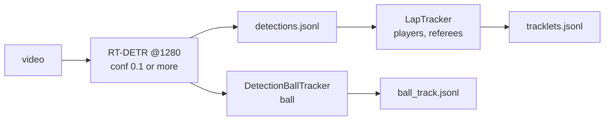

# Inference pipeline

One command takes a broadcast video (or clip) and produces detections, tracked
players and referees, and a tracked ball.

```bash
python -m footy_track.scripts.run_inference \
    --video data/arsenal_mancity_example_video.mp4 \
    --weights model_saves/detector/rtdetr_1920_v11/best.pt \
    --out runs/example --max-frames 300 --overlay
```

The checkpoint is not in git. `--weights` defaults to
`CURRENT_BEST_DETECTOR_CHECKPOINT`. Quick runs: `--start N`, `--max-frames N`,
`--stride N` (every Nth frame). The device is picked as cuda, then mps, then cpu;
override with `--device`. Expect CPU to be very slow: RT-DETR-L at 1280 px is a
GPU job.



## Outputs

All files are in `--out`. `frame_index` is the index in the source video.

| File | Format |
|---|---|
| `detections.jsonl` | Machine-label format (as `machine_labels/`): `{frame_index, bbox{x,y,w,h}, center{x,y}, tags:[label,"rtdetr"], confidence, model_id, run_id, reviewed}`. All detections at conf >= 0.1 are kept. |
| `tracklets.jsonl` | Same as `scripts/track_detections.py`: `{frame_index, track_id, tags:[label,"lap"], bbox, confidence, is_interpolated}`. Players and referees only. |
| `ball_track.jsonl` | New, one row per processed frame: `{frame_index, track_id, source, bbox, center, confidence}`. `source` is `detected`, `interpolated` (gap bridged between two detections, `confidence` null) or `none` (`bbox`, `center`, `track_id` null). |
| `summary.json` | Frames, fps, detection and track counts, ball coverage, timings, run config, checkpoint, git SHA. |
| `overlay.mp4` | With `--overlay`: boxes, track ids, ball with a short trail. |

Bounding boxes are normalised `x, y, w, h` with `(x, y)` the top-left corner.

## Thresholds and why

Players and referees reuse the measured defaults in `scripts/track_detections.py`
(conf 0.5, iou 0.15, max age 90). Purity of those tracklets is not measured.

The ball detector's precision depends heavily on confidence (Ball Check verdicts):

| conf | 0.1-0.2 | 0.2-0.3 | 0.3-0.4 | 0.4-0.5 | 0.5-0.6 | 0.6-0.7 | 0.7-0.8 | 0.8-0.9 |
|---|---|---|---|---|---|---|---|---|
| precision | 0.04 | 0.29 | 0.23 | 0.36 | 0.42 | 0.79 | 0.96 | 1.00 |

The sampler oversampled near the decision boundary, so read these as per-band, not
global, precision. The ball tracker uses that as follows
(`ball_trackers/detection_tracker.py`):

- `--ball-start-conf 0.6`: a track starts only on a candidate that is usually
  right. 0.5 would start on a coin flip.
- `--ball-jump-conf 0.8`: a candidate this strong is believed even outside the
  gate, so a false start cannot hold the track hostage.
- Gate `--ball-base-radius-px 40 + --ball-growth-px 25 * frames_since_last`, around
  a constant-velocity prediction. Weaker candidates get a proportionally smaller
  gate (confidence / start conf), so a 0.15 candidate must be close.
- `--ball-max-missed 12`: the track ends after 12 consecutive missed frames.
  Gaps bridged before that are interpolated and marked as such.

These numbers are starting points chosen from the bands above, not tuned against
ground truth.

## Known limits

- Broadcast cuts break tracks: players get new ids and the ball track restarts.
  Run per shot clip (see `split_broadcast_segments.py`) for best results.
- Ball recall is about 0.6 on held-out clips; the tracker recovers some of the
  rest, but nothing here has been scored against ball ground truth.
- A persistent false positive can capture the ball track. In the 60-frame demo the
  track sat on a player's head at confidence 0.7-0.8 for 50 frames while the
  camera panned; nothing here checks whether the "ball" moves with a player.
- No projection to pitch coordinates, no team assignment, no re-identification.
- Without a GPU the detector runs at well under 1 frame per second.

### Open decisions / revisit later

Each open item below has a `NOTE(revisit)` comment in the code where the decision lives (the last item is already fixed, so it has none).

- **Ball start threshold (0.6).** A track only starts on a detection of 0.6 or
  more, because the 0.5-0.6 band is only about 42% precise. This and the other
  tracker numbers are starting points, not tuned. Re-tune once the ball
  evaluation (T-10) gives real scores.
- **No guard against a ball stuck on a player.** If the detector keeps finding a
  "ball" on a player's head, the tracker follows it. We chose not to add a guard
  before there is ground truth to test it against. Revisit as T-34 once T-10
  exists.
- **The ball tracker is outside the `BallTracker` protocol.** That protocol hands
  over pixels, this tracker consumes detections. Revisit if a second
  detections-based tracker appears.
- **`ball_track.jsonl` has no shared schema.** It stays a documented minimal
  format until the projection step needs to read it.
- **Labeller detector ignored `predict_kwargs` (fixed).** `predict_from_path`
  in the labeller's detector used to skip the configured confidence and image
  size. That was fixed in a separate change (PR #29, merged), so the labeller
  detector now honours them.
