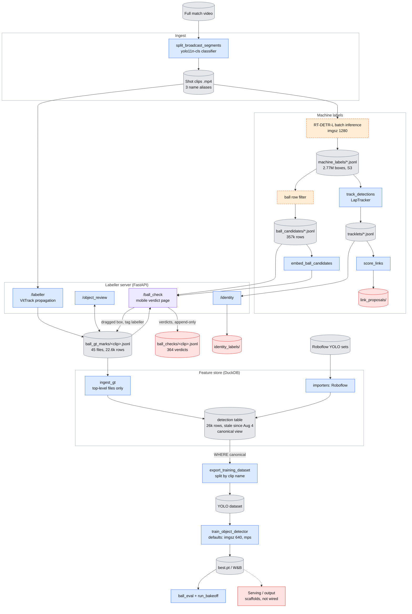
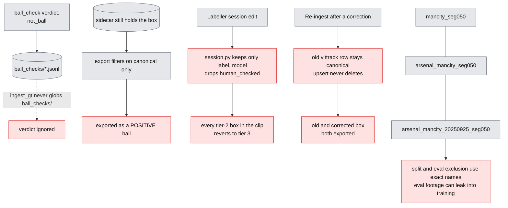

> Review of 2026-11-08, describing `main` @ 26d2506. Part of the [2026-11 review](index.md); prioritised actions are in the [TODO list](../../todo.md).

# footy-track architecture (origin/main)

Drawn from `architecture-review.md`. Legend: **grey** = data on disk or S3, **blue** = code in the repo, **orange, dashed** = step that is not in git, **red** = output that nothing reads, **purple** = the new `/ball_check` path.

## 1. End-to-end data flow

## 2. Where the pipeline silently goes wrong

## 3. Findings behind the diagram

| # | Seam | Where |
|---|---|---|
| 1 | Labeller session strips `human_checked` | `session.py:156-161`, `309-317` |
| 2 | `not_ball` verdicts never reach the store; the box exports as a positive | `ingest_gt.py:279`, `export_training_dataset.py:91-128` |
| 3 | Clip identity is not canonical (3 aliases) | `ball_check.py:709-728`, `export_training_dataset.py:78-80, 362-368` |
| 4 | Re-ingest leaves ghost rows | `store.py:197-220`, `schema.py:40-48` |
| 5 | Undoing a corrected card leaves its box; a session flush can overwrite `ball_check` writes | `ball_check.html:351-365`, `session.py:252-301` |
| 6 | Trainer defaults are traps (`--imgsz 640`, `--device mps`) | `train_object_detector.py` |
| 7 | Producers not in git: RT-DETR batch inference, ball row filter, RT-DETR training, clip-alias symlinks | see review §1 |

Full text: [architecture-review.md](architecture-review.md)
