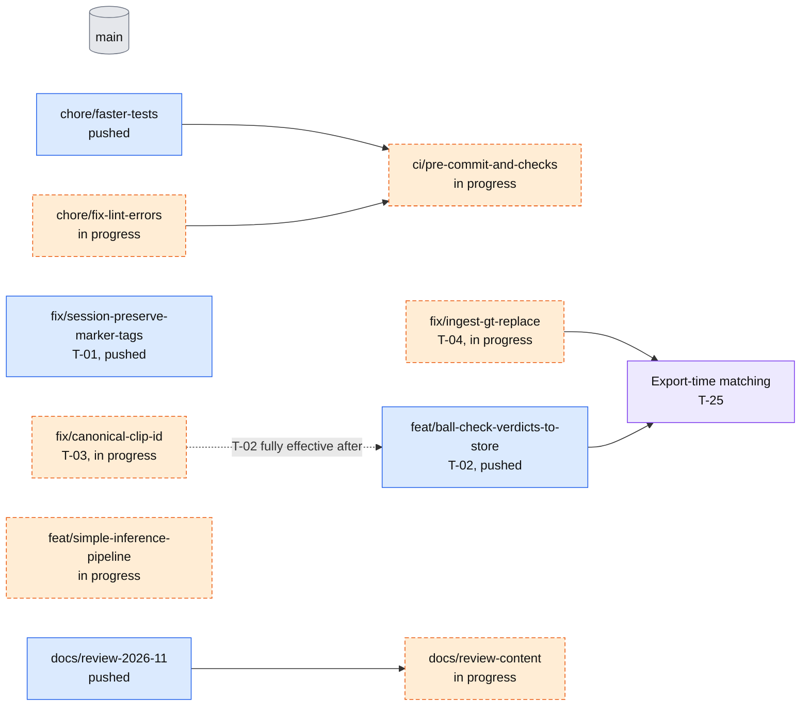

# TODO list

Prioritised from the 2026-11 review of `main` @ 26d2506 (2026-11-08); the findings are in [Architecture](architecture.md), [Datasets and labels](data.md) and [Best pipeline and label needs](pipeline-and-labels.md). This file is the only tracker: Gas Town is paused, so there are no beads. Tick the box and update the status when an item lands.

Priority: P0 silent data corruption, P1 blocks reliable training or eval, P2 docs and gaps, P3 cleanup. Effort: S under half a day, M a day or two, L longer.

## Merge order

Branches and PRs in flight on 2026-11-08. Nothing below except #21 is merged.

Legend: grey is merged (`main`, with PR #21, the tracking pipeline design, merged as a82ec07), blue is pushed and not merged, orange dashed is in progress and not on origin yet, purple is new work not started. The diagram shows that CI waits for the lint fix and the faster tests, that export-time matching waits for T-02 and T-04, and that T-02 only does its full job once T-03 fixes the clip names. T-01, `feat/simple-inference-pipeline` and the docs branches have no dependencies on the others; `docs/review-content` is stacked on `docs/review-2026-11`.

## P0: silent data corruption (fix before any more labelling or training)

- [ ] **T-01** (P0, S) Labeller session drops `human_checked` on load and flush, which downgrades tier 2 to tier 3 for every box in the clip. Add a regression test. Ref: `src/footy_track/labeller/session.py:156-161`, `309-317` (`_box_line` writes only `label` and `model`). Status: branch `fix/session-preserve-marker-tags`, commit eb54bbc, pushed, **not merged** (the labeller README section is already updated on that branch). Do not tick until merged.
- [ ] **T-02** (P0, M) Ball Check verdicts reach nothing. `ingest_gt` globs only top-level `*.jsonl` so `ball_checks/` is skipped, and the export keeps `not_ball` boxes as positive balls. Write a verdicts importer and make the export filter on review status. Ref: `feature_store/ingest_gt.py:279`, `scripts/export_training_dataset.py:91-128`, [Architecture, section 7](architecture.md#7-known-seams-and-risks). Status: branch `feat/ball-check-verdicts-to-store` pushed, **not merged**; a follow-up commit (lint, `schema.TABLES` and test fixes) is pending. The branch imports verdicts into a `detection_review` table and makes the export skip boxes a human rejected. Real-data effect so far: of 355 live verdicts across 110 clips, 87 matched a stored detection and only 2 `not_ball` boxes are rejected today; about 144 `not_ball` verdicts are on detector candidates that are in no label file (see T-26, T-27). T-02 only becomes fully effective after T-03, because most verdict files use the raw dated clip names. Do not tick until merged.
- [ ] **T-03** (P0, M) One canonical clip id shared by the labeller, `ingest_gt` and the eval exclusion and split. Each clip has three aliases today (for example `mancity_seg050`, `arsenal_mancity_seg050`, `arsenal_mancity_20250925_seg050`), so eval footage can leak into training. Ref: `labeller/ball_check.py:709-728`, `scripts/export_training_dataset.py:78-80`, `362-368`, [Datasets and labels](data.md). Status: in progress on branch `fix/canonical-clip-id` (work started, not finished; branch was not on origin when this page was written). Do not tick until merged.
- [ ] **T-04** (P0, M) `ingest_gt` must replace the clip's rows rather than upsert, otherwise an old vittrack row stays canonical next to the corrected one (ghost rows, both exported). Ref: `feature_store/store.py:197-220`, `feature_store/schema.py:40-48`. Status: in progress on branch `fix/ingest-gt-replace` (work started, not finished; branch was not on origin when this page was written). Do not tick until merged.

## P1

- [ ] **T-05** (P1, M) Undoing a corrected Ball Check card must revert its box, and the sidecar needs one locked atomic writer (a session flush can overwrite Ball Check writes). Ref: `labeller/session.py:252-301`, `labeller/web/ball_check.html:351-365`. Status: open.
- [ ] **T-06** (P1, S) Trainer defaults: `--imgsz 640` is ball-blind and `--device` defaults to `mps`. Also `--workers` defaults to 8 while merge commit 26d2506 says "default 0 under WSL": reconcile the message and the code, and document `--workers` and `--cache` in `docs/training.md`. Ref: `scripts/train_object_detector.py` (`imgsz: int = 640`, argparse `--device`, `--workers`, `--cache`). Status: open.
- [ ] **T-07** (P1, M) Refresh the feature store. The newest copy is stale (4 Aug) and local-only, and lacks the Sep corrections, new label files, machine labels and Roboflow v11. `game.source_video_uri` and `match_date` are NULL. Ref: [Datasets and labels](data.md). Status: open. Do after T-02 to T-04.
- [~] **T-08** (P1, M) Test speed and CI. Done on branch `chore/faster-tests` (commit 9acf147, pushed, **not merged**): weight- and key-dependent tests are skipped, slow ones are marked, `make test-fast` added. Remaining: merge it. The CI part (a workflow that runs the tests; none does today, `.github/workflows/docs.yml` only deploys docs) is now covered by T-28. Status: branch pushed, awaiting merge.
- [ ] **T-09** (P1, M) Commit the missing producers: RT-DETR batch inference, the machine_labels to ball_candidates filter, the RT-DETR training command, and the clip alias symlinks (`ballcheck_clips/`, 199 links). Ref: [Architecture, section 2](architecture.md#2-end-to-end-data-flow). Status: open.
- [ ] **T-10** (P1, M) One committed ball eval. The evidence dispute is settled: .221/.209 was yolo11n, and `rtdetr_1920_v11` scores mAP50 0.665 / recall 0.591 on v11-val at 1920 (211 balls, 74% from one clip). Remaining: commit one eval script that scores the checkpoint at **both 1280 and 1920** on the v11 test split (243 balls, never evaluated) plus held-out dense clips (`arsenal_example` after checking it is not a sub-span of a training clip, `mancity_seg031`), reporting instance counts and a per-match breakdown; record the results in [Best pipeline](pipeline-and-labels.md). Docs and the code comment at `detectors/ultralytics.py:37` are corrected on this branch. Ref: [Best pipeline](pipeline-and-labels.md). Status: docs fixed, eval open.
- [ ] **T-25** (P1, M, Data-correctness) Match Ball Check verdicts to detections at export time, by box overlap, not by the stored `detection_id`. Why: `detection_id` is positional, so after a re-ingest that shifts ids the stored `matched_detection_id` can point at the wrong box and the export can drop the wrong one. Ref: `feature_store/ball_checks.py` and the `_NOT_REJECTED` clause in `scripts/export_training_dataset.py`. Executable example: a strict-xfail test on branch `feat/ball-check-verdicts-to-store`, `tests/feature_store/test_ball_checks.py`. It puts three boxes A, B, C in one frame, records `not_ball` on B, then removes A and re-ingests without re-running the importer. The correct result is B excluded and C kept. Done when the xfail marker is removed and the test passes. Depends on T-02 and T-04 (replace on re-ingest). Status: open.
- [ ] **T-26** (P1, M, Training data) Use rejected candidates as hard negatives. 144 `not_ball` verdicts on detector candidates are stored in `detection_review`, and nothing consumes them. The research lists hard negatives as one of the label gaps that matters ([Best pipeline](pipeline-and-labels.md), section 3). Needs a design decision first: export them as background or negative boxes, or as crops; how they are weighted; and how to keep eval clips out. Ref: `feature_store/ball_checks.py`, `scripts/export_training_dataset.py`. Status: open, needs design.
- [ ] **T-20** (P1, M) Ball tracker: ByteTrack/Kalman association over the existing machine labels (conf 0.1 or more already stored), with high/low thresholds from the Ball Check precision bands (0.04 at conf 0.1-0.2, 0.42 at 0.5-0.6, 0.79 at 0.6-0.7, 0.96 at 0.7-0.8). Run `scripts/analyse_ball_tracker.py` first to split detector misses from tracker misses. Inference only; expect precision gains more than recall. Score it with the T-10 eval. Ref: [Best pipeline](pipeline-and-labels.md), section 5; the phased design is in [Tracking pipeline design](design/tracking-pipeline.md) (that page is now on `main`, #21 merged as a82ec07). Status: open.
- [ ] **T-21** (P1, L) Label new matches with `/ball_check` (Aston Villa, Bournemouth 2nd half, Norwich; run the detector on them first, since only Man City has machine labels), holding one full match out for eval. About 3.3 s per card. Do after T-01 to T-04. Ref: [Best pipeline](pipeline-and-labels.md), section 3. Status: open.
- [ ] **T-22** (P1, S) Make `export_training_dataset` export only tier 1/2 by default, with explicit opt-in for tier 3. Part of the T-02 fix; listed separately so it is not missed. Ref: `export_training_dataset.py:32-34, 91-128`. Status: open.

## P2

- [ ] **T-11** (P2, M) Docs refresh. README labeller sections 11-12 (verdicts, precision formula, crop window, focus 0.7 vs 0.98, handback 0.5 vs 0.30, test count 138 vs 177, undocumented step/save_box/crop_meta endpoints, and the claim that Ball Check writes nothing to the sidecars); `pipeline_architecture.md` and `system_overview.md` describe classes that do not exist; `docs/data_formats.md:35` and `scripts/README.md` name console scripts that do not exist (the only one is `footy-track`, `pyproject.toml:44`); the feature-store docs say `game_id` is a match when it is a clip stem. Ref: [Architecture, section 9](architecture.md#9-docs-that-still-disagree-with-the-code). Status: open.
- [ ] **T-12** (P2, S) Publish current docs in `mkdocs.yml`. Done on branch `docs/review-2026-11`: one merged [Architecture](architecture.md) page, [Datasets and labels](data.md) and [Best pipeline and label needs](pipeline-and-labels.md) are in the nav together with `pipeline_overview.md`, `player_reid.md` and `feature_store.md`; the Mermaid fence is enabled. Remaining: merge the branch. Status: in review.
- [ ] **T-23** (P2, M) Get the remaining code into git: the temporal package (`src/footy_track/temporal/*`, `train/eval_temporal_detector.py`, only in `<storage>/backups/temporal_work.tgz`) and the ft-1zq CenterTrack code (only on the desktop machine `~/footy/footy_track/scripts/prior_conditioning_ft1zq/`; recover before that box fails). Together with T-09 this makes training, inference and the temporal work reproducible. Status: open.
- [ ] **T-24** (P2, S, Tooling) Docs checks in CI: run `make docs-check` (diagram text check plus the site build) on pull requests. Part of the CI work in T-28, which should call it. The [contribution guide](contributing-docs.md) lists it as optional. Ref: `scripts/check_docs_diagrams.py`, `.github/workflows/docs.yml` (deploy only today). Status: open, folded into T-28.
- [ ] **T-27** (P2, S, Data) Find out why 268 of 355 verdicts did not match a stored detection. Split them into clips with no label file and clips whose label file has no box at that spot. Most is probably the clip-name problem (T-03). Ref: `feature_store/ball_checks.py`, [Datasets and labels](data.md). Status: open.
- [ ] **T-28** (P2, S, Tooling) Pre-commit and CI. Two PRs are being prepared: "fix ruff lint and format errors" (branch `chore/fix-lint-errors`) and "pre-commit and CI checks" (branch `ci/pre-commit-and-checks`, depends on `chore/faster-tests`). This consolidates the CI part of T-08 and the docs check in T-24. Status: in progress, no PR numbers yet.
- [ ] **T-29** (P2, S, Docs rule) Docs and checks in every change. Standing rule: every PR updates the docs in the same change (see [How to contribute to the docs](contributing-docs.md)) and passes `make check` once pre-commit lands. Status: standing rule, rule written; `make check` waits on T-28.
- [ ] **T-13** (P2, L) Label gaps. Norwich (4K, about 7k s) and Bournemouth 2nd half have footage but no ground truth; machine labels cover only the 162 Man City clips; GT covers 45 of about 1,700 broadcast segments. Ref: [Datasets and labels](data.md). Status: open.
- [ ] **T-14** (P2, S) One shared parser for the six label formats; `ingest_gt.py:210` crashes on a list-form bbox. Status: open.
- [ ] **T-15** (P2, S) Knowledge base fixes (outside this repo). See [kb-vs-reality](architecture.md). The user has to approve KB edits. A comparison of the KB against the repo and data exists outside this repo (not published here). Also update the KB findings page: the .221 figure was yolo11n, RT-DETR shows a data effect (v3 0.328 to v11 0.665), v11 train has 1,010 balls, v11-val is 74% one clip. Status: open.

## P3

- [ ] **T-16** (P3, S) Remove or archive dead code: Streamlit labeller (`labeller/app.py`, `labeller/_canvas_compat.py`, `scripts/run_labeller.py`, streamlit deps in `pyproject.toml`), `Sam3VideoLabeller` and the iCloud path in `labeller/video_utils.py:121`, `labeller/motion_tracker.py`, `footy_track/logging.py`, unused scaffolds. Status: open.
- [ ] **T-17** (P3, S) Serving and output scaffolds (`output/`, `projection/`, `input/streams.py`, the hello-world `footy_track:main`) are not wired. Decide to build or delete. Status: open.
- [ ] **T-18** (P3, S) `/ingest` returns 500 because `labeller/web/ingest.html` is missing (`labeller/server.py:160-162`). Status: open.
- [ ] **T-19** (P3, S) Hardcoded macOS paths: `scripts/run_bakeoff.py:26,28`, `classifier.py:128` `device="mps"`. Status: open.
- [ ] **T-30** (P3, S, Tooling) Put `detection_review` in `schema.TABLES` so the Parquet export carries it. Ref: `feature_store/schema.py`. Status: done on the `feat/ball-check-verdicts-to-store` branch, follow-up commit pending, not merged.

## Environment notes

- The Mac mini has no AVX2: duckdb needs `==1.3.2` and polars needs `polars-lts-cpu` (venv only, do not change `pyproject.toml` or `uv.lock`).
- Open the feature store with `duckdb.connect(path, read_only=True)` when inspecting.
- The SAM3 weights are not in git; tests that need them fail without them (see T-08).

## Done this session

- PR #21 merged (a82ec07): [Tracking pipeline design](design/tracking-pipeline.md) is now on `main`.
- Docs contribution guide written: [How to contribute to the docs](contributing-docs.md), with an agent docs section and a PR template.
- `feat/ball-check-mobile` merged (main 658d63d to 5d4fc90).
- `fix/train-workers-cache` merged (26d2506).
